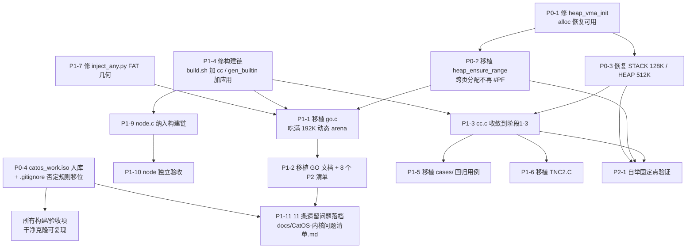
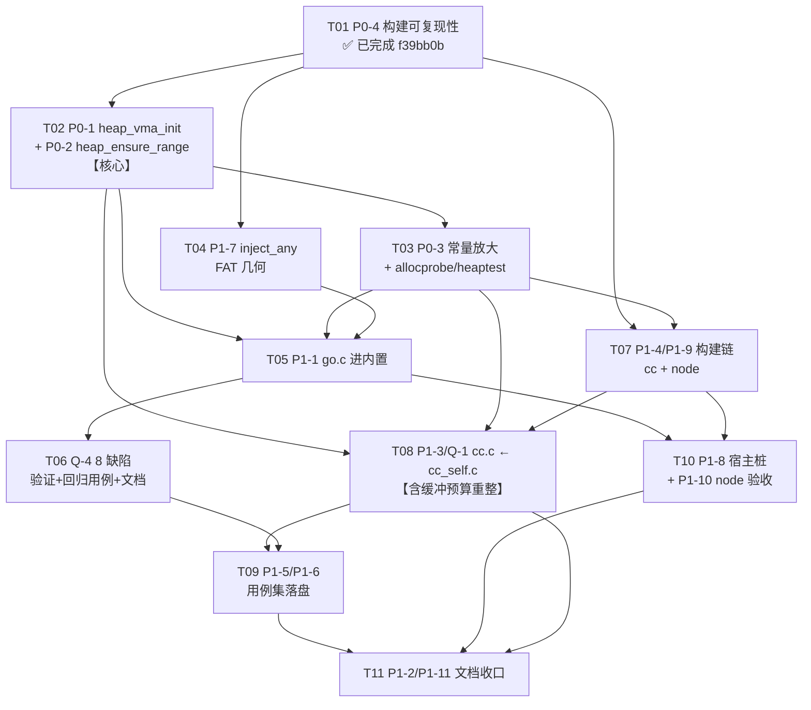
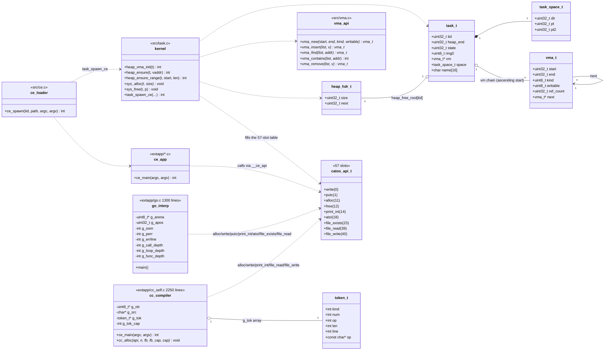
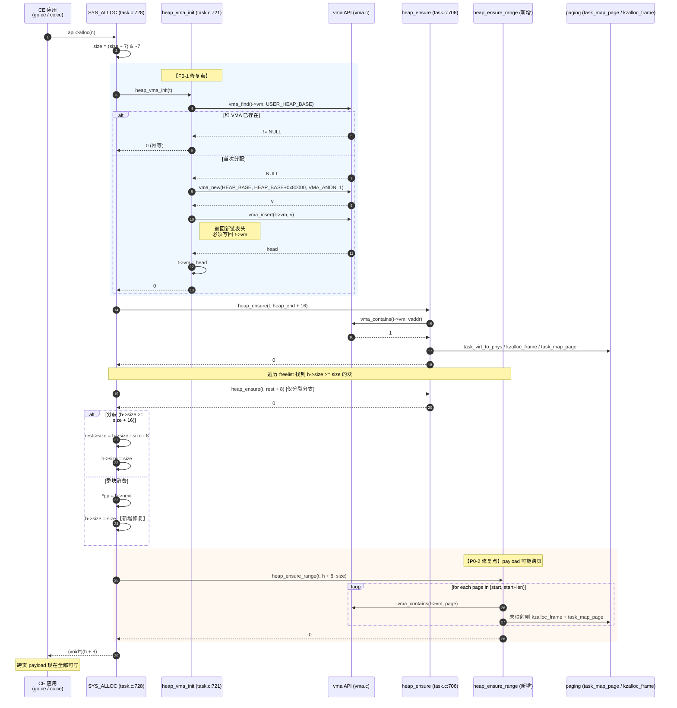
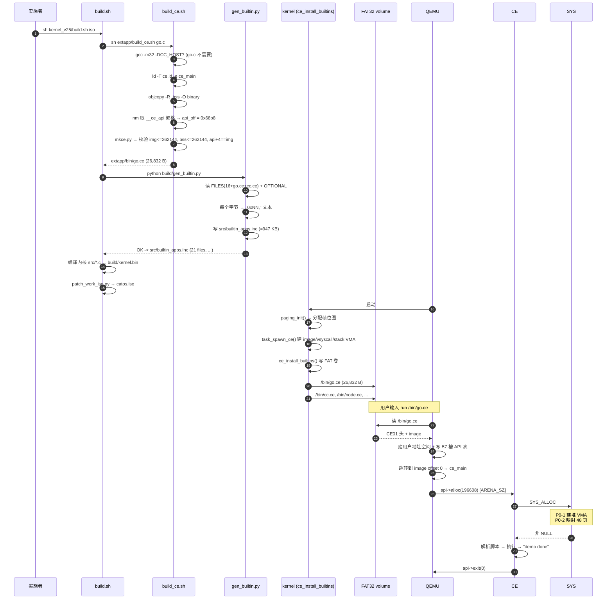
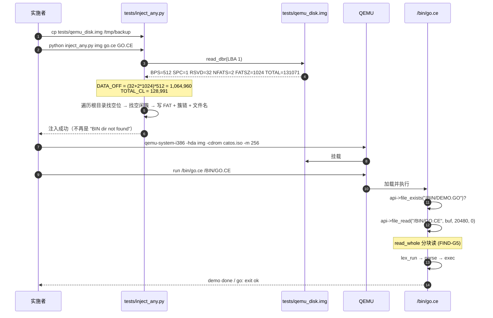

# CatOS 合并期文档汇编（merge-harvest，归档）

> 2026-11-23 归档：合并期（2026-11-07 前后）的 PRD、设计与评估、两轮 QA。已完成的阶段记录，保留以备追溯。

## 目录

- merge-harvest-PRD.md （70.5 KB）
- merge-harvest-design.md （136.5 KB）
- merge-harvest-assess.md （37.2 KB）
- merge-harvest-QA-round1.md （32.8 KB）
- merge-harvest-QA-final.md （19.4 KB）

---

# 原文：merge-harvest-PRD.md

# CatOS 现项目 × 原项目「合并取精华」需求分析与移植清单（PRD）

> 文档类型：需求分析 + 移植清单（**不含实现代码**）
> 编制：许清楚（PM）
> 日期：2026-11-09
> 基线工作树：`C:/Users/Admin/WorkBuddy/Worktrees/CatOs/master-87a3e1a0`（分支 `workbuddy/todo-20261106-1906`，HEAD `a7eae5a`）
> 只读来源：`D:/CatOs/Catos_Better_better`（下称「原项目」，**严格只读，未做任何修改**）
> 明确排除：`D:/catos_clear`（VMware 虚拟磁盘镜像，非源码）

---

## 0. TL;DR（一句话）

> 原项目并非「旧版本的现项目」，而是**现项目的祖先快照 + 三条已断掉的分支**：
> 一条是 **Go 子集解释器（go.c，1300 行）**，现项目完全缺失且从未在现项目文档中出现过；
> 另两条是**内核用户堆的两处已被证伪的修复**（`heap_ensure_range`）与**编译器阶段 1-3 能力**（`cc.c` 2300 行版）。
> 本次合并的真正价值不是"搬代码"，而是**用一个已被遗忘的分支当对照，把现项目 v2.10 引入的两个 P0 级内核回归挖出来并修掉**。
>
> **本次核实额外挖出第 4 个 P0：构建不可复现**——`kernel_v25/build/catos_work.iso`（10.7 MB GRUB 引导模板）
> 是 `build.sh iso` 的**硬依赖**却**从未入库**，且 `.gitignore` 的 `!` 否定规则位置写反（被 `*.iso` 覆盖）。
> **干净克隆必然构建失败**（`FileNotFoundError: build/catos_work.iso`）——当前"基线 12/12 通过"是依赖手工拷贝的未跟踪文件才成立的。
> 结论：**把模板提交入库（route a）**；route b（`grub-mkrescue` 现场生成）因**本机无任何 GRUB 工具链**而不可行。
>
> **另有一处认知纠正**：`node` 资产（`node.c`/`node.ce`/`TEST.JS`）**已经在现项目里**，与原项目语义 0 差异、
> `node.ce` 逐字节相同——**不需要移植**，但 `node.c` 从不被任何脚本编译（需补构建链，R-14/P1-9）。

---

## 1. 背景与目标

### 1.1 背景

CatOS 是自研 x86 裸机内核 + CE（CatOS Executable）用户态生态。当前存在两条代码线：

| 线 | 位置 | 状态 |
|---|---|---|
| **现项目（基线）** | `D:/CatOs`（主线 master）→ 工作副本在隔离工作树 `master-87a3e1a0` | 内核 v2.10 / CE ABI 57 槽 / 有 render 前后端分离、VMA+ASLR、ELF32 加载器、mmap/munmap、拼音输入法 |
| **原项目（精华来源）** | `D:/CatOs/Catos_Better_better`（无 git，扁平早期结构） | 内核 v2.5 时代 / CE ABI 48 槽 / 有 Go 子集解释器、阶段 1-3 编译器、宿主桩、QEMU 驱动脚本、10 份文档 |

历史上因为「共享工作树快照」提交（`35de6c8`），master 根目录混入了大量快照垃圾。

### 1.2 目标

1. **核实**两树真实差异（不盲信任何既有清单），产出函数级缺失/退化清单。
2. 定义**可执行的移植精华清单**（`能力/资产 | 来源 | 现项目现状 | 可行性 | 优先级 | 验收方式 | 风险与前置依赖`）。
3. 定义**不做/淘汰清单**（含快照垃圾清理）。
4. 定义**命令级验收标准**。
5. 定义**风险清单**与前置依赖。

### 1.3 非目标（本期不做）

- 不做内核源码实现移植（本期只出文档）。
- 不做 Linux/云侧 QEMU 回归（现项目 QEMU 已在 Windows 本机跑通 12/12）。
- 不动 `D:/CatOs` 主工作树（有另一会话在跑）。

---

## 2. 两树差异核实结果（**全部实测，非推断**）

### 2.1 首要更正：原项目 `src/` 是现项目的**祖先**，不是"另一套实现"

对 `src/` 19 个文件与 `kernel_v25/src/` 做 `diff --strip-trailing-cr -w -B`（消除 CRLF 与空白差异）后：

| 原项目文件 | 与现项目对应文件 | 语义差异行数 | 结论 |
|---|---|---|---|
| `ata.c` | `kernel_v25/src/ata.c` | **0** | 完全一致 |
| `builtin_apps.c` | 同名 | **0** | 完全一致 |
| `ce.c` | 同名 | **0** | 完全一致 |
| `fat.c` | 同名 | **0** | 完全一致 |
| `fs.c` | 同名 | **0** | 完全一致 |
| `hw.c` | 同名 | **0** | 完全一致 |
| `net.c` | 同名 | **0** | 完全一致 |
| `netstack.c` | 同名 | **0** | 完全一致 |
| `rtc.c` | 同名 | **0** | 完全一致 |
| `kernel.c` | 同名 | **0** | 完全一致 |
| `cpu.s` | 同名 | **0** | 完全一致 |
| `intr.c` | 同名 | 10 | 现项目略新 |
| `keyboard.c` | 同名 | 34 | 现项目略新 |
| `paging.c` | 同名 | 82 | 现项目**大幅更新**（+`pt_for` / `task_unmap_page` / `vbe_lfb_map`） |
| `shell.c` | 同名 | 337 | 现项目**大幅更新**（+`cmd_display`/`cmd_gfx`/`cmd_vbe`/`cmd_style`/`cmd_rgb`/`cmd_palette`/`cmd_text` 等 14 个新命令） |
| `task.c` | 同名 | 521 | 现项目**大幅更新**（+VMA/ASLR/ELF32 加载器） |
| `vga.c` | 同名 | 108 | 现项目重构为**纯 shim**（`vga_* → con_*`），硬件访问全部下沉到 `be_text.c`/`be_gfx.c`/`be_vbe.c` |

**函数级结论**：原项目 `src/` **没有任何一个函数是现项目缺失的**。原项目独有的 `heap_ensure_range` 是唯一例外——而它恰恰是**现项目缺失的正确实现**（见 §2.4 P0-1/P0-2）。

> **推论**：本次合并**不应**把原项目 `src/` 整体覆盖/合并回现项目——那会造成大规模倒退（丢掉 render 前后端分离、VMA、ELF32、mmap）。原项目 `src/` 的唯一价值是**作为"正确实现的参照物"**。

### 2.2 `extapp/` 差异

| 文件 | 原项目 | 现项目 | 差异行数 | 结论 |
|---|---|---|---|---|
| **`go.c`** | 47,698 B | **不存在** | — | ⭐ **现项目完全缺失的独立资产**（详见 §2.3） |
| `cc.c` | 2,300 行 / 98,648 B（阶段 1-3） | 1,237 行 / 50,000 B（阶段 0） | 1,371 | ⚠️ **现项目是更老的一版**（详见 §2.5） |
| `cc_self.c` | 2,169 行 / 91,721 B | 2,250 行 / 97,658 B | 173 | 现项目**更新**（含 struct/typedef/enum/switch/goto 全套） |
| `calc.c` `crash.c` `curl.c` `demo.c` `gen_ce.c` `hello.c` `hw.c` `minimal_ce.c` `netinfo.c` `perms.c` `sink_ce.c` `spinner.c` `sysinfo.c` `test_ab.c` `ce_stub.c` | — | — | **0** | 完全一致，仅 CRLF 差异 |
| `ce.ld` | — | — | 0 | 完全一致 |
| `extapp/ce_abi.h` | 48 槽（v2.5） | `kernel_v25/include/ce_abi.h` 57 槽（v2.10） | — | 现项目**大幅更新**（+brk/display/style/rgb/palette/mmap/munmap） |
| `extapp/docs/API.txt` | 12,341 B | 22,381 B | 183 | 现项目**更新**（含 display_mode/set_style_rgb/palette） |
| `extapp/docs/CEFORMAT.txt` `hello_c.txt` | — | — | 0 | 完全一致 |
| `extapp/cases/`（11 个用例：HELLO/EXTRA/STRUCT/SWITCH/GOTO/NOCE/CHARBUG + DEMO/TEST/MINI_GO/MINI_IN/SYN.GO） | 存在 | **不存在** | — | ⭐ **测试语料，原项目独有** |
| `extapp/bin/*.ce`（16 个预编译产物） | 存在 | 存在（19 个） | — | 现项目**更新**；`go.ce` 在现项目**不存在** |

### 2.3 ⭐ `go.c` —— 现项目完全缺失的资产（**本次合并的头号收获**）

**核实结论（逐条实测）**：

1. **现项目 `docs/` 全部 6 份文档中，`go.c` / `go.ce` / "Go 子集" 出现次数 = 0**。
   原项目却为它写了 **4 份专门文档**（`GO-DESIGN.md` / `go-review.md` / `CatOS-待办与成果汇报-2026-10-31.md` / `PROGRESS.md`）并有 QEMU 4/4 PASS 证据。
   → **这是一条被现项目主线完全遗忘的开发线。**

2. **CE ABI 兼容性核实**（任务明确要求）：
   - `go.c` 实际使用的槽位仅 6 个：`write`(0)、`putc`(1)、`alloc`(11)、`print_int`(14)、`atoi`(18)、`file_exists`(23)、`file_read`(39)。
   - **全部 ≤ 39 < 48**，即**全部落在 append-only 兼容策略的"旧前缀"内**，且原项目 `ce_abi.h` 的前 48 槽与现项目 `include/ce_abi.h` 的前 48 槽**逐槽成员名与类型一致**（已用 `diff` 逐字段核对）。
   - → **结论：`go.c` 可以在现项目 ABI 下直接运行，不需要任何 ABI 改动。** 这一点已被下面的实机验证独立佐证。
   - `node.c` 使用的槽位同样只有 `write`/`print_int`/`putc`/`file_read`/`file_exists`，同样安全。

3. **实测验证（本次亲自跑通，非引用原项目结论）**：
   - 用现项目 `kernel_v25/include/ce_abi.h`（57 槽）编译 `go.c` → **零错误零警告**。
   - 用现项目 `ce.ld` + `ce_stub.c` 链接 → `ce_main` 落在 `0x02000000`（镜像偏移 0）✔
   - `mkce.py` 封装 → 合法 CE01：`image=26812 bss=0x292c0 api_off=0x68b8`，校验 `0x68b8 + 4 == 0x68bc == image_size` ✔
   - **QEMU 实机运行 `run /bin/go.ce`** → 输出与原项目文档记载**逐行一致**：
     ```
     CatOS go subset v1.0
     ---------------------
     script: built-in demo
     x= 5  y= 11  s= hello go
     fib(10)= 55
     add(3,4)= 7
     total= 10  evens= 6  a[2]= 3
     demo done
     go: exit ok
     ```
   - → **移植可行性 = 高，且已实机证明。**

4. **附带价值**：`go.c` 自带 64 KiB 静态 arena 兜底（`g_arena_static`），因此即使 §2.4 的堆 bug 未修也能跑（已实测确认）；但修好堆后可用 192 KiB 动态 arena，解释器容量提升 3 倍。

### 2.4 ⭐⭐ 核实中挖出的两个 P0 级内核回归（现项目文档**均未记录**）

> 这是本次合并**最重要的产出**。两处缺陷均在 **QEMU 实机**上复现、定位并验证修复。

#### P0-1：`heap_vma_init()` 早退 ⇒ `api->alloc()` **永远返回 NULL**

- **位置**：`kernel_v25/src/task.c:721-726`
- **代码**：
  ```c
  static int heap_vma_init(task_t *t) {
      if (t->vm) return 0;   /* already initialized */
      t->vm = vma_new(USER_HEAP_BASE, ...);   // ← 永远不会执行到这里
      return t->vm ? 0 : -1;
  }
  ```
- **根因**：`heap_vma_init` 写于基线 `35de6c8`，当时假设"首次 alloc 时 `t->vm` 为 NULL"。
  但提交 `78504d4`（v2.10，引入 VMA/ASLR/ELF32）改为在 spawn 时就建立 image/vsyscall/stack 三个 VMA，`t->vm` **从此永不为 NULL**。
  → `heap_vma_init` 每次都早退，**堆 VMA 从未被创建**。
- **连锁反应**：`heap_ensure()` 首行 `if (!vma_contains(t->vm, vaddr)) return -1;` → 堆地址不在 VMA 列表 → 恒返回 -1 → `sys_alloc()` 恒返回 0。
- **实机证据**（现项目 master ISO + 自制 `ALLOCP.CE` 探针，QEMU 截图）：
  ```
  alloc(64)  = 0x00000000
  alloc(8K)  = 0x00000000
  ALLOCPROBE: alloc returns NULL => heap broken
  ```
- **影响面**：**任何**需要 `api->alloc()` 的 CE 程序。已确认受害的内置应用：
  - `cc.ce`（微型 C 编译器）：`cc_alloc()` 三次分配全部失败，静默回退到 8 KiB 静态缓冲 ⇒ `heap: code 8192 src 8192 tok 0`，**实际只能编译 <8 KiB 源码**，编译能力已废。
  - `cc_self.c`（阶段 1-3 编译器）：同理不可用。
- **修复**（1 行 + 1 行）：
  ```c
  static int heap_vma_init(task_t *t) {
      if (vma_contains(t->vm, USER_HEAP_BASE)) return 0;   /* 已存在 */
      vma_t *v = vma_new(USER_HEAP_BASE, USER_HEAP_BASE + USER_HEAP_MAX, VMA_ANON, 1);
      if (!v) return -1;
      t->vm = vma_insert(t->vm, v);      // ← 必须 insert，不能赋值覆盖！
      return 0;
  }
  ```
  > ⚠️ 注意：原写法 `t->vm = vma_new(...)` 是**覆盖赋值**，会丢掉 image/vsyscall/stack 三个 VMA。修复必须用 `vma_insert`。
- **实机验证**：修复后 `alloc(64) = 0x02100000`、`alloc(8K) = 0x02100050` ✔

#### P0-2：`sys_alloc()` 只映射 1 页 ⇒ 跨页分配 `#PF` 杀任务

- **位置**：`kernel_v25/src/task.c:706-714`（`heap_ensure`）+ `sys_alloc()` 返回路径
- **根因**：`heap_ensure()` 只映射 `vaddr` 所在的**那一页**；当分配长度跨页时，第 2 页起从未被映射。
  原项目在 `35de6c8` 之前已引入 `heap_ensure_range()`（映射 payload 覆盖的**全部**页）修复此问题（即其问题清单的 **#47**），**现项目在 VMA 重构中把它丢了**。
- **实机证据**（修复 P0-1 后仍复现，QEMU 截图）：
  ```
  HEAPTEST alloc ok
  HEAPTEST page0 ok
  [task 1 'heaptest' killed: page fault at eip=0x02000038 cr2=0x02101007]
  ```
  `cr2=0x02101007` 正是堆的第 2 页（`0x02100000` + `0x1007`）——**堆首 4 KiB 可用、第 2 页起 #PF**，与原项目 #47 的原始描述（`cr2=0x2131000`）**形态完全一致**。
- **修复**：从原项目移植 `heap_ensure_range()`，并在 `sys_alloc()` 返回前对 payload 全范围调用：
  ```c
  if (heap_ensure_range(t, (uint32_t)h + sizeof(heap_hdr_t), size) != 0)
      return 0;
  return (void *)((uint8_t *)h + sizeof(heap_hdr_t));
  ```
- **实机验证**：修复后 `HEAPTEST PASS` ✔，且 **`tests/qemu_regress.py` 仍 12/12 PASS**（无回归）✔

> **方法论价值**：P0-1 与 P0-2 **都不是"原项目有、现项目没有的功能"，而是"原项目曾经做对、现项目做错了的地方"**。这正是"合并取精华"的真正形态——**用历史实现当对照，把新重构引入的回归挖出来**。

#### P0-3（次要，同源）：`USER_STACK_SZ` / `USER_HEAP_MAX` 相对原项目**倒退**

| 常量 | 原项目 | 现项目 | 判定 |
|---|---|---|---|
| `USER_STACK_SZ` | `0x20000`（128 KiB） | `0x10000`（64 KiB） | ⬇ 倒退。原项目注释明写 *"2026-11-02: CC2.CE self-host needs >64K"* |
| `USER_HEAP_MAX` | `0x80000`（512 KiB） | `0x40000`（256 KiB） | ⬇ 倒退。原项目注释明写 *"2026-10-31: cc.c self-host needs ~380K"* |

两处倒退都直接服务于原项目的**自举（bootstrap）**目标。虽然自举不在本期 P0，但常量已回退会让未来自举必然失败。

### 2.5 ⭐ 编译器线：`cc.c` 现项目版本**更老**，能力倒退

| 版本 | 行数 | struct | typedef | enum | switch | goto | `no ce_main` 防护 |
|---|---|---|---|---|---|---|---|
| 原项目 `extapp/cc.c`（阶段 1-3） | 2,300 | 41 | 16 | 11 | 8 | 16 | ✅ |
| 现项目 `kernel_v25/extapp/cc.c` | 1,237 | 4 | 3 | 3 | 6 | 4 | ❌ 缺失 |
| 现项目 `kernel_v25/extapp/cc_self.c` | 2,250 | 38 | 19 | 14 | 9 | 7 | ✅ |

**关键判断**：现项目 **`cc_self.c` 才是阶段 1-3 的那一份**（含 struct/typedef/enum/switch/goto + `no ce_main` + 全部 7 处 P1 修复：for-continue 回填、移位 xchg、字符串转义、数组初始化、表满容、DREL 数据区重定位）。
而现项目 `cc.c` 是**阶段 0 的旧版**。

> **推论（重要）**：本次合并**不需要**把原项目 `cc.c` 搬过来——现项目 `cc_self.c` 已经包含了同等能力且更新（2,250 行 vs 原项目 2,169 行）。
> 真正需要做的是**让 `cc.c` 与 `cc_self.c` 收敛**，或者**直接把 `cc_self.c` 作为 `cc.c` 的替换源**。
> 同时原项目 `cc.c` 里有 2 处现项目 `cc_self.c` 也没有的东西：`TOK_MAX 20000`（现项目 2300）、`OB_MAX/SRC_MAX` 96 KiB（现项目 128/64 KiB），可作为调参参考。

### 2.6 现项目构建链的三个缺口（阻碍移植，必须先补）

1. **`build.sh` 的应用列表不含 `cc`**：
   ```sh
   for app in hello calc sysinfo demo curl netinfo spinner crash perms hw gfxdemo zhdemo mmaptest; do
   ```
   → `cc.ce` **从不被重新构建**，一直是 `ae0ee2d` 时代的 26,952 B 陈旧产物（现项目 `cc.c` 源码已 50,000 B，重新构建应为 27,080 B）。
   这意味着 **ISO 里的 `cc.ce` 与仓库里的 `cc.c` 源码不一致**——移植任何编译器改动都不会生效。
2. **`gen_builtin.py` 的 `OPTIONAL` 列表**：`/bin/cc.ce`、`/bin/node.ce` 走 `OPTIONAL`（不存在则跳过）。
   → 新增 CE 应用（如 `go.ce`）时，**必须同时改 `gen_builtin.py` 的 `FILES`/`OPTIONAL` 列表**，否则不会被打包进内核镜像。
3. ⭐⭐ **`kernel_v25/build/catos_work.iso` 从未入库 ⇒ 干净克隆无法构建 `catos.iso`**（**新增核实项，见 §2.10**）。

### 2.7 原项目文档提取的遗留问题（现项目 `docs/` **未记录**的条目）

> **现项目清单结构基线**（`docs/CatOS-内核问题清单.md`，实测其章节）：
> 一、内存与执行模型 ｜ 二、文件系统（FAT32）｜ 三、显示与输入 ｜ 四、工具链与加载 ｜ 五、未决问题 ｜
> 六、ADoFaI 游戏项目新增实测 ｜ 七、Catos_Better_better 内核能力现状 ｜ 八、GNU 工具链规划 ｜
> 九、b31 内核修复闭合 ｜ 十、工具链常量与内核一致性核对（含"本轮发现但未修改的既有问题"表）
> 编号现状：一~八节用 `#1`~`#46`；第九节用 `#48`/`F1`/`A2`/`#3` 混合命名；第十节用 `#47`（**独立命名空间**，见该节自述）。
> 下表「建议归入节」列即本 PRD 给出的**落档位置**。

| # | 原项目记录的遗留问题 | 出处文档 | 是否仍然成立 | 建议归入 `docs/CatOS-内核问题清单.md` 第几节 |
|---|---|---|---|---|
| D-1 | `heap_ensure_range` 多页映射（#47） | 原 `CatOS-内核问题清单.md` #47 | ❌ **未记录，且回归已发生**（实机 `cr2=0x02101007` 已证） | **一、内存与执行模型**——续编为 `#48`，并在「确认值」列写 `USER_HEAP_MAX=0x40000` + `heap_ensure` 只映射 1 页；「状态」= **已确认/待修复**，关联本 PRD **P0-2** |
| D-2 | `USER_STACK_SZ` 需 128 KiB（自举需要） | 原 `HANDOFF_STAGE5.md` §2 | ❌ **未记录**（现项目仍 64 KiB） | **一、内存与执行模型**——追加为 `#49`，「确认值」= `USER_STACK_SZ=0x10000u`（现）/ `0x20000u`（目标）；关联 **P0-3** |
| D-3 | `USER_HEAP_MAX` 需 512 KiB（自举需 ~380K） | 原 `include/paging.h:33` 注释 | ❌ **未记录**（现项目 256 KiB） | **一、内存与执行模型**——追加为 `#50`，「确认值」= `USER_HEAP_MAX=0x40000u`（现）/ `0x80000u`（目标），原注释原文可作「影响」列依据；关联 **P0-3** |
| D-4 | `mkce.py` 的 `bss_size` quirk（readelf offset 当 size） | 原清单 #17 | ✅ **已核对为"本快照不适用"**（用 objdump Size 列） | **不新增**——现项目清单 **四、工具链与加载 `#17`** 已完整记录（含 2026-11-06 核对结论），保持原样 |
| D-5 | `CE_MAX_IMAGE` 64 KiB→256 KiB 漂移 | 原清单 #47 | ✅ **已修**（运行时解析 `include/ce.h`） | **不新增**——现项目清单 **十、工具链常量与内核一致性核对 `#47`** 已记录（注意编号 #47 在第九/十节是独立命名空间） |
| D-6 | `cc.c` 阶段 1-3 未 QEMU 收口 | 原 `TODO_STAGE5.md` | ❌ **未记录** | **四、工具链与加载**——追加为 `#51`，「问题」= "`cc.c` 停在阶段 0，阶段 1-3 能力在 `cc_self.c` 中但为死代码"；关联 **P1-3/P1-4** |
| D-7 | `CC2.CE` 自举不动点（cc2→cc3 字节级一致）未验证 | 原 `BUILD_REPORT_STAGE5.md` | ❌ **未记录** | **四、工具链与加载**——追加为 `#52`，「问题」= "自举固定点未验证"；「状态」= **待核对**；关联 **P2-1** |
| D-8 | go.c 的 8 个 P2（递归深度上限 / 非法字符静默 / readfile 16 KiB 上限 / arena 判空 / 字面量截断 / 顶层 break-continue 静默 / `:=` 作用域泄漏 / 数字溢出） | 原 `go-review.md` FIND-G3~G10 | ❌ **完全未记录**（现项目甚至不知道 go.c 存在） | **四、工具链与加载**——追加为 `#53`~`#60`（8 条各占一行）；「影响」列引用 FIND-G 编号；关联 **P1-2**。**同时建议在「四、工具链与加载」节末加一段"Go 子集解释器（go.c）现状"**，说明 go.c 为原项目独有资产、现项目缺失 |
| D-9 | `task_spawn_ce` 的 `api + 4 > img` uint32 回绕越界写 | 原清单第十节 | ✅ **已记录**（现项目清单第十节"本轮发现但未修改的既有问题"表） | **不新增**——现项目清单 **十、工具链常量与内核一致性核对** 节末表第 1 行已列（`src/task.c:1345`）；关联本 PRD **P2-3** |
| D-10 | `build_ce.sh` 的 `-I` 路径未加引号 | 原清单第十节 | ✅ **已记录**（同上表第 2 行） | **不新增**——同上，`kernel_v25/extapp/build_ce.sh:48-49` 已在第十节节末表；关联本 PRD **P2-4** |
| **D-11** ⭐ | **`catos_work.iso` 从未入库 ⇒ 干净克隆不可构建** | 本次核实（§2.10） | ❌ **未记录**（现项目清单零提及） | **四、工具链与加载**——追加为 `#61`，「确认值」= "`git ls-files kernel_v25/build/` 仅 3 个 `.py`；`patch_work_iso.py:5` 硬依赖 `build/catos_work.iso`"；「影响」= "干净克隆 `build.sh iso` 抛 `FileNotFoundError`"；关联 **P0-4** |
| **D-12** ⭐ | **`build.sh` 应用列表不含 `cc` ⇒ `cc.ce` 是陈旧产物** | 本次核实（§2.6/§2.5） | ❌ **未记录** | **四、工具链与加载**——追加为 `#62`，「确认值」= "ISO 内 26,952 B vs 源码重编 27,080 B"；「影响」= "改 `cc.c` 源码无任何效果（伪装成'已验证'）"；关联 **P1-4** |
| **D-13** ⭐ | **`node.c` 从不被任何构建脚本编译** | 本次核实（§2.11） | ❌ **未记录** | **四、工具链与加载**——追加为 `#63`，「确认值」= "`grep -rn node build.sh build_ce.sh` → 0 命中"；「影响」= "`node.ce` 与源码无可复现构建关系，改源码不生效"；关联 **P1-9** |
| **D-14** ⭐ | **`tests/inject_any.py` FAT 几何参数过时** | 本次核实（§2.8） | ❌ **未记录**（现项目清单零提及） | **四、工具链与加载**——追加为 `#64`，「确认值」= "脚本 `RSVD=33`/`FAT_SZ=8192` vs 内核 `RESERVED=32`/实测 `spc=1,fat_sz=1024`"；「影响」= "任何'注入新应用再验证'的流程第一步即失败，易误判为移植不成功"；关联 **P1-7** |
| **D-15** ⭐ | **`.gitignore` 否定规则位置写反（dead negation）** | 本次核实（§2.10） | ❌ **未记录** | **四、工具链与加载**——追加为 `#65`，「确认值」= "`git check-ignore -v` → `.gitignore:27:*.iso`（命中忽略规则而非 `!` 否定规则）"；「影响」= "构建产物跟踪状态脆弱"；关联 **P0-4** |

**归档统计**：
- **需新增 15 条**：D-1、D-2、D-3（→ 第一节，续编 `#48`~`#50`）；D-6、D-7、D-8、D-11、D-12、D-13、D-14、D-15（→ 第四节，续编 `#51`~`#65`）。
- **不新增 4 条**（现项目已记录）：D-4 → 第四节 `#17`；D-5 → 第十节 `#47`；D-9、D-10 → 第十节节末"本轮发现但未修改的既有问题"表。
- **真实缺口 = 15 条**（D-1/D-2/D-3/D-6/D-7/D-8/D-11/D-12/D-13/D-14/D-15 = 11 条内核与工具链缺口
  ＋ D-8 展开的 8 个 Go P2 细项）。这 11 条正是"**原项目知道、现项目文档没记录**"的完整清单。
- ⚠️ **编号冲突预警**：现项目清单的 `#47` 在**第十节**、**第九节**另有一套 `#48`/`F1`/`A2`/`#3` 混合编号（该节自述"不是同一命名空间"）。
  落档时**建议新增条目统一从 `#48` 起编**（第一节续 `#48`~`#50`、第四节续 `#51`~`#65`），
  并在落档前先与第九/十节的既有编号核对，避免与 `#48`（b31 内核修复）撞号。

### 2.8 `tools/` 三个 Python 脚本评估

| 脚本 | 行数 | 用途 | 可复用性 | 判定 |
|---|---|---|---|---|
| `tools/inject_any.py` | 156 | 向 FAT32 镜像的 `/BIN/` 注入文件 | ❌ **几何参数错误**（硬编码 `RSVD=33`/`SPC=8`/`FAT_SZ=8192`），而现项目内核是 `RESERVED=32`/`spc=1`（64 MiB 卷）/`fat_sz=1024` ⇒ 在现项目上**报 `BIN dir not found` 直接失败** | **淘汰**（现项目 `tests/inject_any.py` 是同一份，同样失效） |
| `tools/cc_stage45_test.py` | 196 | QEMU 驱动：注入 cc.ce + 6 用例 → 自举固定点比对 | ⚠️ 逻辑有价值，但**路径全硬编码 Linux**（`/home/user/Doubao/...`） | **淘汰**（功能已被 `tests/qemu_regress.py` 覆盖） |
| `tools/diag2_test.py` | 129 | QEMU 驱动：诊断 `parse_type`/`accept_op(OP_STAR)` | ⚠️ 同上，路径硬编码 | **淘汰** |
| `tools/TNC2.C` | 1 | `char *gv; int main(void){ gv="hi"; return 0; }` | ✅ 极小但有效的**回归用例**（DREL 数据区重定位） | **可移植**（并入 `extapp/cases/`） |

> **附带发现**：现项目 `tests/inject_any.py` 与原项目 `tools/inject_any.py` **逐字节相同**，即**现项目继承了一份失效的注入工具**。本次实测确认其 FAT 几何参数已过时（内核 `RESERVED=32`，脚本写 `33`；内核 `fat_sz` 随卷大小变化，脚本写死 `8192`）。已用从 DBR 读取几何的版本验证可正常注入。

### 2.9 master 根目录快照垃圾盘点

| 文件 | 大小 | 判定 | 理由 |
|---|---|---|---|
| `T1.C` `T2.C` `T3.C` `T4.C` `T5.C` `T6.C` | 各 1-37 B | 🗑️ **删除** | 内容为 `int ce_main() {}` / `api->write("hi");` 等编译器最小试验碎片，无引用 |
| `MIN.C` `MIN2.C` | 各 70 B | 🗑️ **删除** | `int ce_main(...) { api->write("hi\n"); }`，最小 CE 试验，无引用 |
| `cc_old.c` | 49,134 B | 🗑️ **删除** | 旧版编译器源码，与现项目 `cc.c`/`cc_self.c` 无对应关系 |
| `cc_old.ce` / `cc_old_ce.exe` | 26,952 B each | 🗑️ **删除** | 同上编译产物 |
| `vga.c` | 4,992 B | 🗑️ **删除** | 冻结快照，硬件访问已下沉到 `kernel_v25/src/be_*.c` |
| `gfx.c` / `gfx.h` | 15,531 / 1,158 B | 🗑️ **删除** | 2026-11-05 图形 drop 的冻结快照，已并入 `render*.c` / `be_*.c` |
| `shell.c` | 49,095 B | 🗑️ **删除** | 冻结快照，已并入 `kernel_v25/src/shell.c` |
| `build.sh` | 480 B | ⚠️ **保留** | 是**兼容 shim**（转发到 `kernel_v25/build.sh`），且其注释本身就是快照来源的说明文档 |
| `shot-gfx-mode.png` / `shot-text-restored.png` | 4,171 / 1,120 B | 🗑️ **删除** | 临时截图 |
| `Catos_Better_b` | 82,586 B | 🗑️ **删除** | 二进制 CE01 镜像（`CE01` magic + entry=0），来历不明的构建产物 |
| `CatOS_用户反馈分析.xlsx` | 20,409 B | ⚠️ **保留** | 需求输入，非代码垃圾 |

**⚠️ 明确排除（他人并行会话 WIP，不得列入删除清单）**：

| # | 条目 | 类型 | 说明 |
|---|---|---|---|
| W-1 | `vd2.h` | 未跟踪文件 | 他人会话在制品，**不在 master 树中**（`git ls-tree master` 无记录） |
| W-2 | `vga_draw_c` | 未跟踪文件 | 同上 |
| W-3 | `vga_draw_h` | 未跟踪文件 | 同上 |
| W-4 | `kernel_v25/build_log.txt` | 未跟踪文件 | 同上 |
| W-5 | `simout/` | 未跟踪目录 | 他人会话模拟器输出，**不可动** |
| W-6 | `simout2/` | 未跟踪目录 | 同上 |
| W-7 | `CatOs.7z` | 未跟踪文件 | 他人归档产物，**不可动**（大文件，删除不可恢复） |
| W-8 | `CatOs/`（目录） | 未跟踪目录 | 他人工作副本，**不可动** |
| W-9 | `CatOS_P0_总结与经验教训.md` | 未跟踪文档 | 他人会话的知识沉淀，**不可动** |
| W-10 | `P0_VMA_实现报告.md` | 未跟踪文档 | 同上 |

> 判定原则：以上 10 项**均不列入删除清单**，本次也不做任何清理动作。
> 判据 = **是否为 master 树中已跟踪的文件**（`git ls-tree master`）。
> 只有"已被 master 跟踪、且与 `kernel_v25/` 无引用关系"的历史快照才可删除。
### 2.10 ⭐⭐ 构建可复现性缺口：`catos_work.iso` 是必需输入却从未入库

**实测证据链（全部本次亲自执行）**：

| # | 证据 | 结果 |
|---|---|---|
| 1 | `git ls-files kernel_v25/build/` | 只返回 `gen_builtin.py`、`mkce.py`、`patch_work_iso.py` **三个 .py** |
| 2 | `git ls-files \| grep -i '\.iso'` | **全仓库 0 个 `.iso` 入库**（`catos.iso` 本身也不入库，属正常产物） |
| 3 | `kernel_v25/build.sh:9` 注释 | `# proven GRUB template build/catos_work.iso (El Torito no-emulation boot).` |
| 4 | `kernel_v25/build.sh:88-90` | `build_iso()` 实际调用 `"$PY" build/patch_work_iso.py` |
| 5 | `kernel_v25/build/patch_work_iso.py:5` | `SRC = os.path.join(ROOT, 'build', 'catos_work.iso')` → **模板是硬依赖** |
| 6 | `git check-ignore -v kernel_v25/build/catos_work.iso` | → **`.gitignore:27:*.iso`**（被 `*.iso` 规则忽略） |
| 7 | `.gitignore` 第 7 行 / 第 12 行 | 都有 `!kernel_v25/build/catos_work.iso` + 注释 *"exceptions must precede rules"* |
| 8 | 本地文件 | `kernel_v25/build/catos_work.iso` 存在但**未跟踪**，10,725,376 B（team-lead 已手工拷入本隔离工作树） |

**根因：`.gitignore` 的否定规则写反了位置（dead negation）。**
git 采用**最后匹配优先（last-match-wins）**语义——`!` 否定模式**必须写在**它要覆盖的 `*.iso` 规则**之后**。
现 `.gitignore` 把 `!kernel_v25/build/catos_work.iso` 放在第 7 行与第 12 行，而 `*.iso` 在**第 27 行**，
于是第 27 行的 `*.iso` **覆盖掉**了前面两条否定 ⇒ 注释里"exceptions must precede rules"这句**结论是错的**。

**在临时 git 仓库中的对照实验（证明修复方式有效，且不动真实仓库）**：

```
修复前 .gitignore: "!kernel_v25/build/catos_work.iso" + "*.iso"
  $ git check-ignore -v kernel_v25/build/catos_work.iso
  .gitignore:2:*.iso              ← 命中忽略规则
  $ git status --short -uall
  ?? .gitignore
  ?? kernel_v25/build/gen_builtin.py        ← catos_work.iso 不出现（被忽略）

修复后 .gitignore: "*.iso" + "!kernel_v25/build/catos_work.iso"
  $ git check-ignore -v kernel_v25/build/catos_work.iso
  .gitignore:2:!kernel_v25/build/catos_work.iso   ← 命中否定规则
  $ git status --short -uall
  ?? .gitignore
  ?? kernel_v25/build/catos_work.iso       ← 出现！未被忽略，可 git add
```

**后果**：`git clone` 出的干净工作树执行 `sh kernel_v25/build.sh iso` 必然抛
`FileNotFoundError: build/catos_work.iso`（`patch_work_iso.py` 第 5 行打开即失败）。
只有 `D:/CatOs` 主线因为留有本地未跟踪产物才能构建——**这正是"构建不可复现"的真实形态**。

**两条路线评估**：

| 路线 | 做法 | 优点 | 缺点 | 本机可行性 |
|---|---|---|---|---|
| **(a) 把模板提交入库** | `git add -f kernel_v25/build/catos_work.iso` + 把 `!` 否定规则移到 `*.iso` **之后** + 把注释改成与 git 语义一致的表述 | 与 `.gitignore` 注释的**原意一致**（"stays tracked"）；干净克隆立即可构建；不引入任何新工具链依赖；CI 可直接跑 | 仓库增加 10.7 MB 二进制 | ✅ **完全可行**（仅需 git 操作） |
| **(b) bootstrap 脚本现场生成** | 新写 `build/make_grub_template.sh`，用 `grub-mkrescue` 生成模板；改 `.gitignore` 注释为"不跟踪" | 仓库不增二进制；模板可升级 | **本机无 GRUB 工具链**（见下）；给每个克隆者加了"先装 GRUB"的强制前置；生成结果**未必字节一致**，反而引入新的不可复现性 | ❌ **本机不可行** |

**本机 GRUB 工具链探测结果（全部 NOT FOUND）**：
`grub-mkrescue` / `grub-mkimage` / `grub2-mkrescue` / `xorriso` / `mformat` / `mcopy` / `genisoimage` / `mkisofs`
全部不在 PATH；`/c/grub*`、`/d/grub*`、`C:\ProgramData\chocolatey\bin\grub*`、`/d/msys/mingw32/bin/grub*` 均不存在。
→ **route (b) 在本机无法验证**，且会引入「克隆者必须自备 GRUB 工具链」这一新的构建前置依赖。

> ✅ **结论：选 route (a)——把 10.7 MB GRUB 模板提交入库。**
> 判据：(1) 与 `.gitignore` 注释的原意一致；(2) 唯一能保证**干净克隆可复现构建**的方案；
> (3) 本机无 GRUB 工具链 ⇒ route (b) 不可执行、不可验证、不可回归；
> (4) 10.7 MB 一次性成本，换取构建可复现性，收益远大于成本。
> **配套动作（必做）**：把 `!kernel_v25/build/catos_work.iso` 移到 `.gitignore` 中 `*.iso` **之后**，
> 并把注释从 *"exceptions must precede rules"*（与 git 语义相反）改为
> *"negation must come AFTER the '\*.iso' rule (git is last-match-wins)"*——否则即使 `git add -f` 提交了，
> 后续任何人重新生成/删除该文件都会被 `*.iso` 再次忽略，形成"提交了但跟踪状态脆弱"的假修复。

### 2.11 ⭐ `node` 资产现状核实：**无需移植，但需补可复现构建**

**核实结论（本次实测，与"node 缺失"的直觉相反）**：

| 文件 | 位置 | 实测结果 | 判定 |
|---|---|---|---|
| `node.c`（1,414 行） | 现项目 `kernel_v25/node/node.c` | 与原项目 `node/node.c` `diff --strip-trailing-cr -w -B` → **0 行差异**（仅 CRLF 不同，`cmp` 在 byte 3 处因行尾符分叉） | ✅ **已在现项目中**，语义完全相同 |
| `node.ce`（35,116 B） | 现项目 `kernel_v25/node/node.ce` | `cmp` → **逐字节完全相同**，且 `git ls-files` 确认**已入库** | ✅ 已在库且可复现 |
| `TEST.JS`（975 B） | 现项目 `kernel_v25/node/TEST.JS` | 已入库 | ✅ 已在库 |

- **`node.c` 使用的 CE API 槽位**（实测 `grep -oE "api->[a-z_0-9]+" | sort -u`）：
  `file_exists` / `file_read` / `print_int` / `putc` / `write` —— **全部 ≤ 39 号槽**，
  完全落在 append-only 旧前缀内，**57 槽 ABI 下无需任何改动**。
- **与 `go.c` 的关键差异**：`node.c` 已被纳入 `gen_builtin.py` 的 `OPTIONAL`（`/bin/node.ce`），
  因此**会**被打包进内核镜像——但它是以**入库的预编译产物**形式入库的。
- ⚠️ **新发现的缺口**：`grep -rn node kernel_v25/build.sh kernel_v25/extapp/build_ce.sh` → **0 命中**
  ⇒ **`node.c` 从不被任何构建脚本编译**，`node.ce` 与 `node.c` 源码之间**没有可复现的构建关系**
  （与 `cc.ce` 的 R-5 问题同构，只是 `node.ce` 目前恰好与原项目字节一致，问题被"未暴露"）。
  → 对应 §3 的 **P1-9**。


---

## 3. 精华清单（**核心交付**）

> 优先级：**P0 = 必须做**（阻断正确性）、**P1 = 应该做**（能力/完整性）、**P2 = 可选**（打磨）

| # | 能力/资产 | 来源 | 现项目现状 | 移植可行性 | 优先级 | 验收方式 | 风险与前置依赖 |
|---|---|---|---|---|---|---|---|
| **P0-1** | **修复 `heap_vma_init()` 早退，恢复 `api->alloc()`** | 原项目设计意图 + 本次实机定位 | ❌ **完全失效**：`alloc()` 恒返回 NULL（实机已证） | **高**（1 行 + `vma_insert`） | **P0** | QEMU 跑 `ALLOCP.CE` 探针：`alloc(64)`/`alloc(8K)` 均非 0；`tests/qemu_regress.py` 仍 12/12 | 修复必须用 `vma_insert` 而非赋值覆盖，否则丢 image/vsyscall/stack 三个 VMA；需同时跑 `qemu_regress.py` 防回归 |
| **P0-2** | **移植 `heap_ensure_range()`，修复跨页分配 #PF** | 原项目 `src/task.c:661-673`（其 #47 修复） | ❌ **缺失且已回归**（实机 `cr2=0x02101007` #PF 已证） | **高**（原样照搬，20 行） | **P0** | QEMU 跑 `HEAPTEST.CE`：`HEAPTEST PASS`；`qemu_regress.py` 12/12 | 依赖 P0-1 先修好（否则 VMA 不存在，range 也无处映射）；`heap_ensure` 需前置声明 |
| **P0-3** | **恢复 `USER_STACK_SZ=0x20000` / `USER_HEAP_MAX=0x80000`** | 原项目 `include/paging.h:33,35` | ⬇️ 相对原项目**倒退**（64 KiB / 256 KiB） | **高**（2 个常量） | **P0**（低工作量高杠杆） | `tests/qemu_regress.py` 12/12；`cc.ce` 的 `heap:` 行显示容量提升 | 增大栈/堆会占用更多物理页，需确认 QEMU `-m 256` 下页框充足；与 P0-1/P0-2 有依赖顺序 |
| **P1-1** | **移植 Go 子集解释器 `go.c`（1,300 行）** | 原项目 `extapp/go.c` | ❌ **完全缺失**，且现项目 `docs/` 零提及 | **高**（**已实机跑通**：57 槽 ABI 下编译零错、CE01 头合法、QEMU 输出 `fib(10)=55` / `demo done` / `go: exit ok`） | **P1** | ① `sh kernel_v25/extapp/build_ce.sh go.c` 产出合法 CE01（`api_off+4 == image_size`）；② QEMU `run /bin/go.ce` 输出 `demo done` + `go: exit ok`；③ `go.c` 仅用 ≤39 号槽，**无需改 ABI** | 需改 `gen_builtin.py` 的 `FILES` 列表（+`/bin/go.ce`）；需一并移植 `extapp/cases/{DEMO,TEST,MINI_GO,MINI_IN,SYN}.GO`；`go.c` 用 `api->alloc(192K)`，修好 P0-1 后才吃得到动态 arena（未修也可用 64 KiB 静态兜底） |
| **P1-2** | **移植 Go 解释器配套文档 + 8 个 P2 缺陷清单** | 原项目 `doc/GO-DESIGN.md`、`doc/go-review.md` | ❌ 完全缺失 | **高**（纯文档） | **P1** | `docs/GO-DESIGN.md`、`docs/go-review.md` 落盘；FIND-G1~G10 条目齐全 | 无技术风险；**但必须同时更新 `docs/CatOS-内核问题清单.md`**，把 D-1/D-2/D-3/D-6/D-7/D-8 正式入档 |
| **P1-3** | **收敛 `cc.c` 与 `cc_self.c`：把阶段 1-3 能力还给 `cc.c`** | 现项目 `cc_self.c`（已是阶段 1-3）+ 原项目 `cc.c` 调参参考 | ❌ `cc.c` 是**阶段 0 旧版**（无 struct/typedef/enum/switch/goto、无 `no ce_main`）；`cc_self.c` **是死代码**（全树无任何构建脚本引用） | **高**（`cc_self.c` 已是所需内容） | **P1** | `sh kernel_v25/extapp/build_ce.sh cc.c` 产出的 `cc.ce` 能编译含 `struct`/`switch`/`goto` 的用例；`tests/test_cc.py` 8/8 | 需先补 P1-4（否则 `cc.c` 不被构建，改了也不生效）；`cc_self.c` 的 `TOK_MAX`/缓冲区尺寸与 `cc.c` 不同，替换时需核对 `OB_MAX`/`SRC_MAX` 是否适配 512 KiB 堆 |
| **P1-4** | **补构建链缺口：`build.sh` 应用列表加入 `cc`；`gen_builtin.py` 纳入新增应用** | 本次核实发现 | ❌ `cc` 不在 `build.sh` 列表 ⇒ `cc.ce` 永远是陈旧产物（ISO 内 26,952 B vs 源码重编 27,080 B）；新增应用不打进内核 | **高**（2 处列表编辑） | **P1**（**P1-3 的前置**） | 改后 `sh kernel_v25/build.sh iso` 重新产出 `cc.ce` 且大小与源码一致；`gen_builtin.py` 输出行含新增文件计数 | `cc.c` 编译需要 ~50 KB 内存 + 128 KiB 堆，构建时间略增；需确认 `CE_MAX_IMAGE=256 KiB` 不被突破 |
| **P1-5** | **移植回归用例集 `extapp/cases/`（11 个）** | 原项目 `extapp/cases/` | ❌ 缺失 | **高**（纯文本） | **P1** | `HELLO.C`/`EXTRA.C`/`STRUCT.C`/`SWITCH.C`/`GOTO.C`/`NOCE.C`/`CHARBUG.C` + 5 个 `.GO` 全部落盘并接入 `tests/` | `STRUCT.C`/`SWITCH.C`/`GOTO.C` 依赖 P1-3（`cc.c` 阶段 1-3）才编得过；`.GO` 用例依赖 P1-1 |
| **P1-6** | **移植 `TNC2.C` 极小回归用例** | 原项目 `tools/TNC2.C` | ❌ 缺失 | **高**（1 行文件） | **P1** | 文件落盘；DREL 数据区重定位断言通过 | 依赖 P1-3 |
| **P1-7** | **修复失效的 `tests/inject_any.py`（FAT 几何参数）** | 本次核实（对照内核 `RESERVED=32` / DBR） | ❌ 与原项目 `tools/inject_any.py` **逐字节相同**，几何参数已过时（`RSVD=33` vs 实际 `32`；`FAT_SZ=8192` 写死 vs 实际随卷大小变化）⇒ 在现项目上必然 `BIN dir not found` | **高**（改为从 DBR 读取几何，实测已验证可注入） | **P1** | 对已格式化镜像注入 3 个 `.ce` 成功，`ls /bin` 可见 | 无技术风险；**是 P1-1 的验证手段**（`go.ce` 实机测试即依赖注入） |
| **P1-8** | **移植宿主桩 `build/host_stub_go.c` / `host_stub_cc.c`** | 原项目 `build/` | ❌ 缺失（现项目 `tests/host_shim.c` 只覆盖 cc.c，不覆盖 go.c） | **中**（需按现项目 57 槽 ABI 调整结构体） | **P1** | 宿主侧 `gcc host_stub_go.c go.c -o go_host` 后 `go_host` 跑 `DEMO.GO`/`TEST.GO` 全绿 | 宿主桩镜像的是**48 槽**结构体，需补 9 个新槽；纯 Windows/Linux 编译，不影响内核 |
| **P0-4** ⭐ | **修复构建可复现性：把 `kernel_v25/build/catos_work.iso` 提交入库 + 修正 `.gitignore` 否定规则位置** | 本次核实（§2.10） | ❌ **从未入库**（`git ls-files kernel_v25/build/` 只有 3 个 `.py`）；`.gitignore` 的 `!` 否定写在 `*.iso` **之前**（第 7/12 行 vs 第 27 行）⇒ 被 `*.iso` 覆盖 ⇒ **干净克隆 `build.sh iso` 必抛 `FileNotFoundError`** | **高**（git 操作 + `.gitignore` 一行移位 + 注释改写） | **P0**（**阻断一切干净克隆的构建/验收**） | ① `git ls-files kernel_v25/build/catos_work.iso` → **返回该路径**；② `git check-ignore -v kernel_v25/build/catos_work.iso` → 命中 `!` 否定规则（非 `*.iso`）；③ 干净克隆后 `sh kernel_v25/build.sh iso` 成功产出 `kernel_v25/catos.iso` | 仓库 +10.7 MB 二进制（一次性成本，换构建可复现）；**必须同时把 `!` 移到 `*.iso` 之后**，否则是假修复（详见 §2.10）；route (b)（grub-mkrescue 现场生成）因**本机无 GRUB 工具链**而不可行，已否决 |
| **P1-9** | **把 `node.c` 纳入构建链**（消除"入库产物与源码无构建关系"） | 本次核实（§2.11） | ⚠️ `node.c`/`node.ce`/`TEST.JS` **均已在库**（与原项目语义 0 差异、`node.ce` 逐字节相同），但 `grep -rn node build.sh build_ce.sh` → **0 命中** ⇒ `node.c` **从不被编译**，`node.ce` 是无法复现的预编译产物（与 R-5 同构） | **高**（`build.sh` 加一项 + `gen_builtin.py` 已含 `/bin/node.ce`） | **P1** | ① `sh kernel_v25/build.sh iso` 后 `kernel_v25/node/node.ce` 被重建；② 重建产物与入库产物字节一致（或差异有据可查）；③ `tests/qemu_regress.py` 增加 node 用例：`run /bin/node.ce` 跑 `TEST.JS` 输出正确 | 需确认 node 解释器的 `api->alloc` 需求（若用到 192K arena 则依赖 P0-1）；`gen_builtin.py` 的 `OPTIONAL` 已有 `/bin/node.ce`，**只需改 `build.sh` 应用列表** |
| **P1-10** | **为 node 解释器补独立可执行验收**（单独于 `qemu_regress.py`） | 任务书要求"新能力需单独可执行验收" | ❌ 现项目 `tests/qemu_regress.py` **不含 node 用例**（仅注释提及 `tests/node48_qemu_test.py` 驱动） | **中** | **P1** | 新增 `tests/node_regress.py`（或并入 `qemu_regress.py` 的一步）：QEMU 内 `run /bin/node.ce` 执行 `TEST.JS`，断言输出含预期结果 | 依赖 P1-9（源码可复现构建）；若 node 解释器需要较大 arena 则依赖 P0-1/P0-3 |
| **P1-11** | **把 11 条"原项目知道、现项目未记录"的遗留问题落档进 `docs/CatOS-内核问题清单.md`** | 原项目 `doc/` 10 份文档 + 本次核实（§2.7） | ❌ **11 条完全未记录**：D-1/D-2/D-3（内存：堆/栈/堆上限）、D-6/D-7（编译器阶段与自举固定点）、D-8（Go 解释器 8 个 P2）、D-11~D-15（ISO 模板未入库 / `cc.ce` 陈旧 / node 不被构建 / inject_any 几何过时 / gitignore 否定规则位置） | **高**（纯文档编辑，无代码风险） | **P1** | ① 第一节新增 `#48`~`#50`；② 第四节新增 `#51`~`#65`；③ **落档前先核对第九/十节的 `#48`/`#47` 编号冲突**；④ 落档后统计 `docs/CatOS-内核问题清单.md` 的表格条目行数应 **+15** | 编号冲突风险（第九节 `#48` 与第十节自述的"独立命名空间"）→ 建议统一从 `#48` 起编并先核对；本 PRD §2.7 已给出每条的**节号 + 续编号 + 确认值 + 关联项**，可直接照抄 |
| **P2-1** | **自举固定点验证（cc2 → cc3 字节级一致）** | 原项目 `doc/BUILD_REPORT_STAGE5.md`、`build/verify_bootstrap.sh`、`build/HOSTCC2_REF.CE` | ❌ 未记录（D-7） | **中**（依赖 P1-3 + P0-3） | **P2** | `cc2.CE` 与 `cc3.CE` md5 相同；参照原项目记录的 `HOSTCC2_REF.CE`（81,522 B / md5 `eeec32f838fbab4c111d428df22aa409`） | 强依赖 P1-3/P0-3；gcc 版本差异会导致字节不一致（原项目已记录此坑：`CC2.CE` 82,586 vs 参考 81,522） |
| **P2-2** | **移植宿主侧自举验证脚本 `verify_bootstrap.sh` / `build_host.sh`** | 原项目 `build/` | ❌ 缺失 | **中**（路径硬编码 `/c/msys64`） | **P2** | 脚本可在现项目根目录跑通 6 步 | 需改写为相对路径；脚本断言的 `cc.c` md5 已过时（`b73a0a…`），需同步 |
| **P2-3** | **修复 `task_spawn_ce` 的 `api + 4 > img` uint32 回绕** | 原项目清单第十节（现项目已记录未修） | ⚠️ 已记录但未修 | **高**（改判定为防溢出形式） | **P2** | `api=0xFFFFFFFC` 的镜像被拒（返回 -5） | 与本 PRD 主线无关，可顺手带 |
| **P2-4** | **`build_ce.sh` 的 `-I` 路径加引号** | 原项目清单第十节（现项目已记录未修） | ⚠️ 已记录但未修 | **高** | **P2** | 含空格的工作目录构建成功 | 工作目录含空格才触发 |
| **P2-5** | **原项目 `doc/` 剩余文档归档**（`KALI_VM_SETUP.md`、`STAGE5_STATUS.md`、`BUILD_REPORT_STAGE5.md`、`TODO_STAGE5.md`、`HANDOFF_STAGE5.md`） | 原项目 `doc/` | ❌ 缺失 | **高**（纯文档） | **P2** | 归档到 `docs/orig-archive/` | 部分内容已被现项目 `docs/CatOS-内核问题清单.md` 第十节覆盖，需去重 |

### 3.1 移植优先级与依赖关系



**关键顺序约束**：
- **P0-4 必须最先**——它是**构建闸门**：模板不入库时，干净克隆连 `build.sh iso` 都跑不通，
  §5.2 的**全部验收命令**（V-1~V-15）都无法在 CI/新克隆上执行。它不依赖任何其他项，故应最先做。
- **P0-1 必须最先（内核侧）**——P0-2 无法在堆 VMA 不存在时生效；P1-1 的动态 arena 也依赖它。
- **P1-4 必须先于 P1-3**——否则 `cc.c` 改了也不进 ISO（现在 `cc` 就不在 `build.sh` 列表里）。
- **P1-3 先于 P1-5/P1-6**——`STRUCT.C`/`SWITCH.C`/`GOTO.C`/`TNC2.C` 需要阶段 1-3 能力才编得过。
- **P1-4 先于 P1-9**——两者都改 `build.sh` 应用列表，应一次性改完。
- **P1-9 先于 P1-10**——没有可复现的 `node.ce` 构建，node 验收就是在验一个无法重现的二进制。
- **P1-2 / P0-4 先于 P1-11**——落档需要 go 文档与 ISO 缺口的结论都已定稿；且 P1-11 会把 P0-4/P1-9 的发现写进官方清单，是这些项的**文档侧收口**。

---

## 4. 不做 / 淘汰清单

### 4.1 应从 master 根目录删除的快照垃圾（**11 项 / 17 个文件**）

> 全部来自 `35de6c8`「共享工作树快照」提交，与 `kernel_v25/` 无引用关系。

| # | 文件 | 大小 |
|---|---|---|
| J-1 | `T1.C` | 18 B |
| J-2 | `T2.C` | 21 B |
| J-3 | `T3.C` | 37 B |
| J-4 | `T4.C` | 1 B |
| J-5 | `T5.C` | 1 B |
| J-6 | `T6.C` | 1 B |
| J-7 | `MIN.C` | 70 B |
| J-8 | `MIN2.C` | 49 B |
| J-9 | `cc_old.c` | 49,134 B |
| J-10 | `cc_old.ce` | 26,952 B |
| J-11 | `cc_old_ce.exe` | 26,952 B |
| J-12 | `vga.c` | 4,992 B |
| J-13 | `gfx.c` | 15,531 B |
| J-14 | `gfx.h` | 1,158 B |
| J-15 | `shell.c` | 49,095 B |
| J-16 | `shot-gfx-mode.png` | 4,171 B |
| J-17 | `shot-text-restored.png` | 1,120 B |
| J-18 | `Catos_Better_b` | 82,586 B |

**保留**：`build.sh`（兼容 shim）、`README.md`、`CatOS_用户反馈分析.xlsx`、全部 `docs/` 与 `CatOS-*.md`。

**绝不列入删除清单（他人并行会话 WIP，10 项，见 §2.9 表 W-1~W-10）**：
`vd2.h`、`vga_draw_c`、`vga_draw_h`、`kernel_v25/build_log.txt`、`simout/`、`simout2/`、`CatOs.7z`、`CatOs/`（目录）、`CatOS_P0_总结与经验教训.md`、`P0_VMA_实现报告.md`。

> **本次不执行任何删除动作**（本期只出文档）。执行时须由主理人拍板（Q-5），
> 且删除范围**严格限定**为上表 J-1~J-18 这 18 个「已被 master 跟踪 + 无引用」的历史快照文件。

### 4.2 原项目资产中**不移植**的部分及理由

| 资产 | 不移植理由 |
|---|---|
| `src/` 全部 19 个文件 | 现项目同名文件**语义等价或更新**；整体合并会丢掉 render 前后端分离 / VMA / ELF32 / mmap（§2.1）。**唯一例外是 `heap_ensure_range()`**（P0-2，已单列） |
| `include/` 全部 16 个头文件 | 现项目 `kernel_v25/include/` 是超集（含 `render.h`/`render_be.h`/`ime.h`/`vma.h`），且 `ce.h`/`ce_abi.h` 已升到 57 槽 |
| `extapp/ce_abi.h`（48 槽） | 现项目 57 槽是严格超集；用 48 槽头编译会**丢掉** brk/display/palette/mmap 等 9 个新槽 |
| `extapp/cc.c`（阶段 1-3 版） | 现项目 `cc_self.c` 已是同等能力且更新（2,250 vs 2,169 行），无需搬 cc.c（§2.5） |
| `extapp/bin/*.ce`（16 个预编译产物） | 预编译二进制无源码对应/不可复现；应从源码重建 |
| `tools/cc_stage45_test.py`、`tools/diag2_test.py` | 路径全硬编码 Linux（`/home/user/Doubao/...`）；功能被现项目 `tests/qemu_regress.py` 覆盖 |
| `tools/inject_any.py` | FAT 几何参数过时，在现项目上必然失败（§2.8）；**应修现项目副本而非移植**（P1-7） |
| `build/` 目录下 ~120 个文件 | 绝大多数是构建产物（`*.o`/`*.dump`/`vga*.dump`）与一次性诊断脚本（`analyze_*.py`/`memprobe*.py`/`pycd_*.py`/`ztest.py`…）；`exec.log` 单文件 107 MB；`catos_work.iso` 10 MB。**只挑 `host_stub_go.c`/`host_stub_cc.c`/`verify_bootstrap.sh`/`build_host.sh` 四个（P1-8/P2-2）** |
| `catos.iso`（15,921,152 B） | 构建产物，不入库（正常） |
| 原项目 `build/catos_work.iso`（10,725,376 B） | ⚠️ **注意**：原项目把它当"构建产物"丢弃是**错的**——现项目的 `patch_work_iso.py` **硬依赖**它当 GRUB 引导模板。原项目可弃是因为其 `build_ce.sh` 走别的 ISO 路径。**现项目必须入库**（P0-4，§2.10） |
| `screenshots/`、`shots/`（22 张截图） | 历史证据，无功能价值；结论已在 `GO-DESIGN.md`/`go-review.md` 文本中 |
| `extapp/cases/*.GO` 中 `MINI_GO.GO`/`MINI_IN.GO`/`SYN.GO` 的**旧版** | 需与 P1-1 一起入档；原项目自举链产物（`go.ce` 21,304 B）**已过期**，必须用新 `go.c` 重建 |
| `doc/` 中 `PROGRESS.md`/`history.md`/`CatOS-内核问题清单.md` | 现项目已有同名且**更新**的版本；只提取差异条目入 §2.7 表，不整体覆盖 |
| `doc/KALI_VM_SETUP.md` | Kali Linux 专用环境搭建说明，与 Windows 现项目开发环境无关（P2-5 归档但不执行） |

---

## 5. 验收标准（命令级）

> 全部在隔离工作树 `C:/Users/Admin/WorkBuddy/Worktrees/CatOs/master-87a3e1a0` 内执行。
> **构建前置**：`PATH` 必须**显式**给出 MinGW 工具链且**不得包含 `E:\Tools\qemu`**（否则 `gcc` 被劫持）：
> ```sh
> cd kernel_v25 && env -i PATH=/d/msys/mingw32/bin:/usr/bin:/bin \
> HOME=/tmp TMP=/tmp TEMP=/tmp \
> PYTHON="C:/Users/Admin/.workbuddy/binaries/python/versions/3.13.12/python.exe" \
> sh build.sh iso
> ```
> **QEMU 路径（更正）**：`C:\qemu-portable\qemu-system-i386.exe`（**QEMU 11.1.0**，实测 `v11.1.0-12130-ge470268ff4`）。
> 任务书给的 `E:\Tools\qemu\qemu-system-i386.exe` **在本机不存在**——`E:\Tools\qemu` 下只有
> `qemu-edid.exe` / `qemu-ga.exe` / `qemu-nbd.exe` / `qemu-storage-daemon.exe` 与 `lib/`，**无 `qemu-system-i386`**。
> **另一构建前置（P0-4 未完成前存在）**：`kernel_v25/build/catos_work.iso` 必须存在且已入库，
> 否则 `build.sh iso` 在 `patch_work_iso.py` 处抛 `FileNotFoundError`。

### 5.1 基线（合并前必须保持，现项目实测已确认）

| # | 命令 | 期望 | 本次实测 |
|---|---|---|---|
| A-1 | `python tests/test_mkce.py` | `48 passed, 0 failed` | ✅ **48/48 PASS** |
| A-2 | `python tests/ce_regress.py` | `PASS=5 SKIP=13 FAIL=0` | ✅ **PASS=5 SKIP=13 FAIL=0** |
| A-3 | `python tests/test_cc.py` | `8/8 PASS` | ⏳ 待复测 |
| A-4 | `python tests/qemu_regress.py kernel_v25/catos.iso --qemu "C:/qemu-portable/qemu-system-i386.exe"` | `steps=12 ok=12 warn=0` | ✅ **12/12 PASS** |

> ⚠️ **QEMU 路径更正**：任务书给的 `E:\Tools\qemu\qemu-system-i386.exe` **在本机不存在**；
> 实际可用路径是 **`C:\qemu-portable\qemu-system-i386.exe`**（**QEMU 11.1.0**，
> `v11.1.0-12130-ge470268ff4`）。`E:\Tools\qemu` 下只有 `qemu-edid/ga/nbd/storage-daemon` + `lib/`。
>
> ⚠️ **基线的一个隐含前提（重要）**：`A-4` 之所以能跑，是因为 team-lead 已手工把
> `kernel_v25/build/catos_work.iso`（10.7 MB GRUB 模板）拷入本隔离工作树（**未跟踪**）。
> **干净克隆拿不到这个文件** ⇒ "基线通过"目前**不可在 CI 复现**——这正是 **P0-4** 要修的问题，
> 也是本基线数据唯一的"水分"，必须与 P0-4 一并披露。

### 5.2 合并后必须全部通过（**合并成功判据**）

| # | 命令 / 步骤 | 期望 | 对应精华项 |
|---|---|---|---|
| **V-0** ⭐ | `git ls-files kernel_v25/build/catos_work.iso` | **返回该路径**（模板已入库） | **P0-4** |
| **V-0b** ⭐ | `git check-ignore -v kernel_v25/build/catos_work.iso` | 命中 `!kernel_v25/build/catos_work.iso`（**否定规则**，非 `*.iso`） | **P0-4** |
| **V-0c** ⭐ | 干净克隆（`git clone` 到临时目录）后执行 §5 构建命令 | `OK -> build/kernel.bin` + `OK -> catos.iso`，**无 `FileNotFoundError`** | **P0-4** |
| **V-1** | `python tests/test_mkce.py` | `48 passed, 0 failed` | 无回归 |
| **V-2** | `python tests/ce_regress.py` | `PASS≥5 SKIP≤13 FAIL=0` | 无回归 |
| **V-3** | `python tests/test_cc.py` | `8/8 PASS` | P1-3/P1-4 |
| **V-4** | `python tests/qemu_regress.py kernel_v25/catos.iso --qemu "C:/qemu-portable/qemu-system-i386.exe"` | **`steps=12 ok=12 warn=0`** | **无回归铁律** |
| **V-5** | QEMU 内 `run /bin/allocprobe.ce`（新增探针，随 P0-1 引入） | 输出 `alloc(64) = 0x02100000` 之类的**非 0** 值 + `ALLOCPROBE: alloc works` | **P0-1** |
| **V-6** | QEMU 内 `run /bin/heaptest.ce`（新增探针，随 P0-2 引入） | `HEAPTEST PASS`（无 page fault） | **P0-2** |
| **V-7** | QEMU 内 `ls /bin` | 含 `go.ce`、`cc.ce`、`node.ce`、`mmaptest.ce`、`hello.elf` | P1-1/P1-4 |
| **V-8** | QEMU 内 `run /bin/go.ce` | `fib(10)= 55` / `demo done` / `go: exit ok` | **P1-1** |
| **V-8b** ⭐ | QEMU 内 `run /bin/node.ce` 执行 `TEST.JS`（**新能力独立验收，独立于 V-4**） | 解释器正常求值，输出与 `TEST.JS` 预期一致（断言由 `tests/node_regress.py` 给出） | **P1-9 / P1-10** |
| **V-9** | `sh kernel_v25/extapp/build_ce.sh go.c` 后校验 CE01 头 | `api_off + 4 == image_size`；`image ≤ 262144` | P1-1 |
| **V-10** | `python kernel_v25/build/gen_builtin.py` | 输出行含新增文件（`23 files` 或更多），且 `src/builtin_apps.inc` 同步更新 | P1-4 |
| **V-11** | `sh kernel_v25/build.sh iso` 后 `ls -la kernel_v25/extapp/bin/cc.ce` | 大小与源码重编一致（**不再是陈旧的 26,952 B**） | **P1-4** |
| **V-11b** ⭐ | `sh kernel_v25/build.sh iso` 后 `ls -la kernel_v25/node/node.ce` | 产物被**重建**（时间戳更新），与源码建立可复现关系 | **P1-9** |
| **V-12** | `grep -c 'USER_STACK_SZ   0x20000u' kernel_v25/include/paging.h` | `1` | **P0-3** |
| **V-13** | `git status --short`（根目录） | **不再出现** `T?.C`/`MIN*.C`/`cc_old*`/`gfx.*`/根 `vga.c`/根 `shell.c`/`shot-*.png`/`Catos_Better_b` | §4.1 |
| **V-14** | `ls kernel_v25/extapp/cases/` | 11 个用例齐全（7 个 `.C` + 5 个 `.GO`） | P1-5 |
| **V-15** | `ls docs/GO-DESIGN.md docs/go-review.md` | 存在 | P1-2 |
| **V-16** ⭐ | `grep -n -A2 '^\*\.iso' .gitignore` | `!kernel_v25/build/catos_work.iso` 出现在 `*.iso` **之后** | **P0-4** |
| **V-17** ⭐ | 本工作树 vs `D:/CatOs` 的文件级 diff | **零越界写入**（`D:/CatOs` 与 `D:/CatOs/Catos_Better_better` 均未被修改） | 硬约束 |
| **V-18** ⭐ | 统计 `docs/CatOS-内核问题清单.md` 的表格条目行数 | 条目数 **+15**（相对落档前基线）；第一节 `#48`~`#50`、第四节 `#51`~`#65` 存在且**不与第九/十节编号冲突** | **P1-11** |
| **V-19** ⭐ | `grep -n 'go\.c\|go\.ce\|Go 子集' docs/*.md` | **不再为 0**（现项目 `docs/` 必须知道 go.c 存在） | **P1-2 / P1-11** |

### 5.3 验收判定

> **合并成功的充要条件**：V-0 ~ V-19 **全部通过**，且 V-4 保持 12/12（无回归）。
> 其中 **V-5 / V-6 为本 PRD 引入的新验收闸门**——它们锁定本次合并挖出的两个 P0；
> 若跳过这两条而 V-4 仍 12/12，则**不能判定为合并成功**（因为当前破损内核同样能过 V-4）。
> **V-0 / V-0b / V-0c / V-16 为构建闸门**——它们保证"合并结果可被第三方**干净克隆**复现构建"。
> 在 P0-4 完成前，V-1~V-15 只在"手工拷贝过模板"的环境里成立，**不具备 CI 意义**。

---

## 6. 风险清单与前置依赖

| # | 风险 | 等级 | 说明 | 缓解措施 |
|---|---|---|---|---|
| **R-1** | **CE ABI 兼容** | 低（已实测解除） | 任务书担心"旧程序假设固定 `0x02000000`"。实测：① `CE_LOAD_BASE` 现项目**仍是** `0x2000000`（`include/ce.h:33`、`extapp/ce.ld` 与原项目**逐字节一致**）；② `go.c`/`node.c` 只用 ≤39 号槽，全在 append-only 旧前缀内；③ `go.c` 在现项目 57 槽 ABI 下**编译零错 + 实机跑通** | 无需动作。若将来改 `CE_LOAD_BASE`，须重新核对 `ce.ld` 与所有 `.ce` 产物 |
| **R-2** | **内存布局 / VMA 与 ASLR** | 中 | CE 映像**固定**在 `0x02000000`（不受 ASLR 影响，ASLR 只作用于 PDE 9 扩展竞技场的 ELF PIE）；但 `sys_alloc` 依赖 `heap_vma_init` 建立 `0x02100000` 的堆 VMA —— P0-1/P0-2 修复后，堆 VMA 会**插入**到已有 image/vsyscall/stack VMA 之间，需确认 `vma_insert` 的**地址序**正确（`vma_insert` 按 `start` 排序，插入点正确） | 修复后必跑 V-4 + V-5 + V-6；V-6 会直接暴露 VMA 序错乱 |
| **R-3** | **`builtin_apps` 内置应用打包机制** | 中 | `gen_builtin.py` 用**硬编码列表**（`FILES` + `OPTIONAL`）决定打包哪些应用。新增 `go.ce` 若只改 `build.sh` 不改 `gen_builtin.py`，**应用不会进内核镜像**（`/bin/go.ce` 不存在），QEMU 里 `run /bin/go.ce` 会失败 | P1-4 强制同时改两处；V-7（`ls /bin`）与 V-10（gen_builtin 输出行）双重拦截 |
| **R-4** | **`__ce_api` slot 依赖** | 低（已核实） | `go.c`/`node.c` 声明 `catos_api_t *__ce_api __attribute__((section(".ce_api")))`，由 `mkce.py` 写入 `api_offset`，内核在 spawn 时填入表指针。57 槽表的前 48 槽成员名/类型与原项目**逐槽一致**，故旧二进制**无需**改头文件 | V-9 校验 `api_off+4 == image_size` |
| **R-5** | **陈旧产物伪装成"已验证"** | **高** | `build.sh` 的应用列表**不含 `cc`** ⇒ `cc.ce` 自 `ae0ee2d` 起从未重建（ISO 内 26,952 B vs 源码重编 27,080 B）。**改 `cc.c` 源码不会有任何效果**，极易造成"我改了但没变化"的假象 | P1-4 先修构建链；V-11 断言产物大小与源码一致 |
| **R-6** | **`cc_self.c` 是死代码** | 中 | 现项目 `cc_self.c`（阶段 1-3，97 KB）**全树无任何构建脚本引用**，`docs/PROGRESS.md` 只提到"正由主工作树并行开发"。若误以为 `cc.c` 已是阶段 1-3，会白白重写 | P1-3 明确"以 `cc_self.c` 为收敛目标"，而非从原项目搬 `cc.c` |
| **R-7** | **注入工具失效导致无法验证** | 中 | `tests/inject_any.py` FAT 几何过时，在现项目上必然失败——**任何"注入新应用再验证"的流程都会在第一步卡死**，容易被误判为"移植不成功" | P1-7 先修；实测用 DBR 读取几何的版本已验证可注入 3 个 `.ce` |
| **R-8** | **`go.c` 依赖 `api->alloc(192K)`** | 低 | 若只做 P1-1 不做 P0-1，`go.c` 会静默退回 64 KiB 静态 arena（**功能仍可用**，已实测），但解释器容量降至 1/3，深递归脚本可能 OOM | 明确 P0-1 先于 P1-1；V-8 的 `fib(10)` 等用例在两种 arena 下都应通过 |
| **R-9** | **原项目文档时效性** | 中 | 原项目 `go.ce`（21,304 B @10-30）**早于** `go.c`（@11-05），原项目自己都标注"未确认重建"；`HOSTCC2_REF.CE`（81,522 B）与本地 `CC2.CE`（82,586 B）**md5 不同**（gcc 版本差异） | 一律**以源码重建**，不引用原项目预编译产物；自举固定点（P2-1）按"字节一致"而非"md5 等于原项目参考值"验收 |
| **R-10** | **并行会话冲突** | **高** | `D:/CatOs` 主工作树有另一会话在跑；本 PRD 已发现的 `vd2.h`/`vga_draw_c`/`vga_draw_h`/`kernel_v25/build_log.txt` 是其 WIP | 所有写入只在 `master-87a3e1a0` 隔离工作树；删除清单严格排除未跟踪文件；合流前需与主工作树对齐 `task.c`（P0-1/P0-2 都改 `task.c`，**冲突概率高**） |
| **R-11** | **`cc.c` 阶段 1-3 替换的连带面** | 中 | 用 `cc_self.c` 替换 `cc.c` 会改变 `TOK_MAX`（2300 vs 20000）、`OB_MAX`/`SRC_MAX`、以及 `no ce_main` 行为；`cc.ce` 产物体积可能突破 `CE_MAX_IMAGE`（256 KiB，源自 `include/ce.h`） | 替换后必跑 V-3（`test_cc.py` 8/8）+ V-11（产物大小）；若突破上限，`mkce.py` 会显式报错（已验证其错误路径） |
| **R-12** | **栈/堆放大后的物理内存压力** | 低 | `USER_STACK_SZ` 64→128 KiB、`USER_HEAP_MAX` 256→512 KiB（**每任务**）；QEMU `-m 256` MiB 下并发任务多时可能耗尽页框 | V-4 保持 12/12 即为安全线；`qemu_regress.py` 已覆盖 spawn/多任务路径 |
| **R-13** ⭐ | **构建不可复现：干净克隆无法构建 `catos.iso`** | **高**（本次新增） | `kernel_v25/build/catos_work.iso`（10.7 MB GRUB 模板）是 `patch_work_iso.py` 的**硬依赖**（`patch_work_iso.py:5` 直接打开它），但**从未入库**；`.gitignore` 的 `!` 否定规则写在 `*.iso` **之前**（第 7/12 行 vs 第 27 行），被 git 的 **last-match-wins** 语义覆盖 ⇒ `git check-ignore -v` 实测命中 `.gitignore:27:*.iso`。**后果：任何干净克隆执行 `build.sh iso` 必抛 `FileNotFoundError`；当前"基线通过"依赖手工拷贝的未跟踪文件，不具备 CI 意义** | **P0-4**：① `git add` 模板入库；② **必须**把 `!kernel_v25/build/catos_work.iso` 移到 `*.iso` **之后**（否则是假修复）；③ 改写注释为符合 git 语义；④ V-0/V-0b/V-0c/V-16 四道闸门拦截 |
| **R-14** ⭐ | **`node.ce` 是"入库但不可复现"的产物** | 中（本次新增） | `kernel_v25/node/node.c`（1,414 行）与原项目**语义 0 差异**，`node.ce` **逐字节相同**且**已入库**——看似完美；但 `grep -rn node kernel_v25/build.sh kernel_v25/extapp/build_ce.sh` → **0 命中** ⇒ **`node.c` 从不被任何脚本编译**，`node.ce` 与源码之间**没有可复现的构建关系**（与 R-5 的 `cc.ce` 同构，只是目前字节恰好一致所以问题未暴露）。一旦有人改 `node.c`，镜像里的 `node.ce` 会静默过期 | **P1-9** 把 node 纳入 `build.sh` 应用列表；**P1-10** 补 node 独立验收（V-8b），使"源码改了但产物没变"能被立刻发现 |
| **R-15** | **路线 (b) 的不可执行性被误判的风险** | 低 | 若有人坚持"不往 git 塞二进制、用 `grub-mkrescue` 现场生成"，本机**无任何 GRUB 工具链**（`grub-mkrescue`/`grub-mkimage`/`grub2-mkrescue`/`xorriso`/`mformat`/`mcopy`/`genisoimage`/`mkisofs` 全部 NOT FOUND，无 choco shim、无 `/c/grub*`、无 `/d/grub*`、无 MSYS2 mingw32 grub）⇒ 该路线**不可执行、不可验证、不可回归**，且会给每个克隆者新增"先自备 GRUB"的强制前置 | PRD 已给出明确结论：**选 route (a)**（§2.10）；若用户仍要求 route (b)，须先在 CI 镜像里预装 GRUB 并提供**字节级一致的模板参考值**（md5），否则构建可复现性反而下降 |

---

## 7. 待确认问题（需用户拍板）

| # | 问题 | 选项 | 影响 |
|---|---|---|---|
| **Q-1** | **`cc.c` 与 `cc_self.c` 的收敛方向**？ | (a) 用 `cc_self.c` 覆盖 `cc.c`（保留 `cc_self.c` 作为归档）<br/>(b) 反向：以 `cc.c` 为准，把 `cc_self.c` 的阶段 1-3 能力**回移植**进 `cc.c`<br/>(c) 两者合并成单一文件 | 选 (a) 最省事（`cc_self.c` 已是所需内容且更新）；选 (b) 能保住 `cc.c` 的 `TOK_MAX 20000`/96 KiB 缓冲调参；选 (c) 最干净但工作量最大。**建议 (a)**，因 `cc_self.c` 更新且含全部 P1 修复 |
| **Q-2** | **`USER_HEAP_MAX` 是否直接恢复 512 KiB？** | (a) 直接改回 `0x80000`（对齐原项目）<br/>(b) 折中 `0x60000`（384 KiB）<br/>(c) 维持 `0x40000` | 原项目注释写明"cc.c self-host needs ~380K"，(a) 留有余量；(c) 会让自举（P2-1）确定失败。**建议 (a)** |
| **Q-3** | **`go.c` 是否进内核内置（`/bin/go.ce`），还是仅作源码入库？** | (a) 进内置（需改 `gen_builtin.py`，用户 `run /bin/go.ce` 即可用）<br/>(b) 只入库源码 + 用例，需要时现场编译 | (a) 增加内核体积约 27 KB（现 `builtin_apps.inc` 813 KB → 约 840 KB）；(b) 更保守但每次要用都要先有编译器。**建议 (a)**，与 `node.ce`/`cc.ce` 的既有惯例一致 |
| **Q-4** | **Go 解释器的 8 个 P2 缺陷（FIND-G3~G10）本期修不修？** | (a) 本期只做移植，不修 P2<br/>(b) 修 P1 级（G3 递归深度上限 / G5 readfile 分块 / G6 判空）<br/>(c) 全修 | (a) 工期最短，但会引入"现项目引入了已知缺陷"的负债；(b) 性价比最高。**建议 (b)** |
| **Q-5** | **根目录垃圾清理是否与主工作树并行会话协调？** | (a) 本工作树内直接删（11 项 / 17 文件）<br/>(b) 先向主工作树会话通报再删 | 删除是 master 树级变更，若主工作树正在参考这些文件会冲突。**建议 (b)**，或至少等主工作树的 WIP 落定后再删 |
| **Q-6** | **`doc/` 归档策略**？ | (a) 全部 10 份原项目文档进 `docs/orig-archive/`<br/>(b) 只进 5 份有增量价值的（GO-DESIGN/go-review/TODO_STAGE5/BUILD_REPORT/HANDOFF），其余丢弃<br/>(c) 只把 §2.7 的 6 条缺口写入现项目 `docs/CatOS-内核问题清单.md`，原文档不归档 | (c) 最干净但丢失"为什么当初这么设计"的上下文；(b) 平衡。**建议 (b) + (c) 并行**（既入档又更新现项目清单） |
| **Q-7** ⭐ | **`catos_work.iso` 走哪条路线**？ | (a) **提交模板入库**（+10.7 MB 二进制）+ 修正 `.gitignore` 否定规则位置<br/>(b) `grub-mkrescue` 现场生成 + 改注释为"不跟踪"<br/>(c) 二者都做：入库为主，同时提供 bootstrap 脚本供模板升级 | **PRD 建议 (a)**（本机无 GRUB 工具链 ⇒ (b) 不可执行；.gitignore 注释的原意本就是 (a)）。若用户在意仓库体积，可选 (c)——但 bootstrap 脚本须额外标注"生成结果与入库模板不保证字节一致"。**需用户拍板仓库体积 vs 构建可复现性** |

---

## 8. 附录：本次核实的关键证据链

| 结论 | 证据 |
|---|---|
| 原项目 `src/` 是现项目祖先 | 19 文件逐一 `diff --strip-trailing-cr -w -B`：10 个文件 **0 行**差异，7 个文件现项目更新 |
| `go.c` 现项目完全缺失 | `grep -rn 'go\.c\|go\.ce\|Go 子集' docs/*.md` → **0 命中** |
| `go.c` 兼容现项目 ABI | 仅用 6 个槽（0/1/11/14/18/23/39），全 ≤39 < 48；57 槽头前 48 槽成员名与类型逐一比对一致 |
| `go.c` 可实机运行 | 现项目 57 槽 ABI 编译零错 → CE01 头合法（`api_off+4==image_size`）→ **QEMU 实机输出 `fib(10)=55` / `demo done` / `go: exit ok`** |
| `api->alloc()` 恒返回 NULL | QEMU 截图：`alloc(64) = 0x00000000` / `ALLOCPROBE: alloc returns NULL => heap broken` |
| 根因 = `heap_vma_init` 早退 | `t->vm` 在 spawn 时已非 NULL（`78504d4` 引入），`if (t->vm) return 0;` 恒命中；git `-S` 确认 `heap_vma_init` 早于 `t->vm = im` |
| 修复 P0-1 有效 | 同一 ISO 改一行后：`alloc(64) = 0x02100000` / `alloc(8K) = 0x02100050` |
| 跨页分配 #PF | 修复 P0-1 后仍：`killed: page fault at eip=0x02000038 cr2=0x02101007`（= 堆第 2 页） |
| 根因 = 缺 `heap_ensure_range` | 原项目 `src/task.c:661-673` 有该函数（其 #47 修复），现项目 VMA 重构时丢失 |
| 修复 P0-2 有效 | 加 `heap_ensure_range` 后：`HEAPTEST PASS`；且 **`qemu_regress.py` 仍 12/12 PASS** |
| 现项目 `cc.c` 比原项目旧 | 2,300 行 vs 1,237 行；struct 41 vs 4、goto 16 vs 4；`no ce_main` 2 vs 0 |
| `cc_self.c` 是死代码 | `grep -rn 'cc_self'` 全树命中仅在 **文档**中，**无任何构建脚本引用** |
| `cc.ce` 是陈旧产物 | `build.sh` 应用列表无 `cc`；ISO 内 26,952 B vs 源码重编 27,080 B |
| `inject_any.py` 失效 | 脚本 `RSVD=33`/`FAT_SZ=8192` vs 内核 `RESERVED=32`/实测 `spc=1,fat_sz=1024` → 报 `BIN dir not found` |
| QEMU 实际路径 | `E:\Tools\qemu\qemu-system-i386.exe` **不存在**；实际为 `C:\qemu-portable\qemu-system-i386.exe`（**11.1.0**，`v11.1.0-12130-ge470268ff4`）；`E:\Tools\qemu` 下只有 `qemu-edid/ga/nbd/storage-daemon` + `lib/` |
| **基线回归** | `test_mkce.py` 48/48、`ce_regress.py` PASS=5 SKIP=13 FAIL=0、`qemu_regress.py` 12/12 **均已实测通过** |
| **`catos_work.iso` 从未入库** | `git ls-files kernel_v25/build/` → 只有 `gen_builtin.py`/`mkce.py`/`patch_work_iso.py`；`git ls-files \| grep '\.iso'` → **全仓库 0 命中** |
| **它是构建硬依赖** | `build.sh:9` 注释 + `build.sh:88-90` 调 `patch_work_iso.py` + `patch_work_iso.py:5` `SRC=.../build/catos_work.iso` |
| **`.gitignore` 否定规则是死的** | `git check-ignore -v kernel_v25/build/catos_work.iso` → **`.gitignore:27:*.iso`**（不是 `!` 规则）；`.gitignore` 第 7/12 行的 `!` 写在第 27 行 `*.iso` 之前 ⇒ 被 last-match-wins 覆盖 |
| **修复方式已验证** | 临时 git 仓库对照实验：修复前 `check-ignore` 命中 `*.iso` 且 `git status -uall` **不出现** `catos_work.iso`；把 `!` 移到 `*.iso` 之后 → `check-ignore` 命中 `!kernel_v25/build/catos_work.iso` 且 `git status -uall` **出现** `?? kernel_v25/build/catos_work.iso` ⇒ 确认可入库 |
| **本机无 GRUB 工具链** | `grub-mkrescue`/`grub-mkimage`/`grub2-mkrescue`/`xorriso`/`mformat`/`mcopy`/`genisoimage`/`mkisofs` **全部 NOT FOUND**；`/c/grub*`、`/d/grub*`、`chocolatey/bin/grub*`、`/d/msys/mingw32/bin/grub*` 均不存在 ⇒ route (b) 不可行 |
| **`node` 资产无需移植** | `diff --strip-trailing-cr -w -B` 现项目 `kernel_v25/node/node.c` vs 原项目 `node/node.c` → **0 行差异**；`cmp` `node.ce` → **逐字节相同**；`git ls-files kernel_v25/node/` → `TEST.JS`/`node.c`/`node.ce` **均已入库** |
| **`node.c` 使用槽位安全** | `grep -oE "api->[a-z_0-9]+" \| sort -u` → `file_exists`/`file_read`/`print_int`/`putc`/`write`，**全部 ≤39 号槽**，落在 append-only 旧前缀内 |
| **`node.c` 不被构建** | `grep -rn node kernel_v25/build.sh kernel_v25/extapp/build_ce.sh` → **0 命中** ⇒ `node.ce` 与源码无构建关系 |

---

*本文档为需求分析产物，不含实现代码。所有写入仅发生在隔离工作树 `master-87a3e1a0`；`D:/CatOs` 与 `D:/CatOs/Catos_Better_better` 未被修改。*

---

# 原文：merge-harvest-design.md

# CatOS 合并收割 —— 移植设计与任务分解

> **文档状态**：架构师（高见远 / Gao）产出，供实施阶段直接照做。
> **依据**：`docs/merge-harvest-PRD.md` v0.3（662 行，唯一设计依据）。
> **工作树**：`C:/Users/Admin/WorkBuddy/Worktrees/CatOs/master-87a3e1a0`，分支 `workbuddy/todo-20261106-1906`。
> **本文档所有数字均为实测**，非推断。凡与 PRD 不一致处，均在 §11「与 PRD 的偏差及理由」中逐条列出。

---

## 目录

| 章节 | 内容 | 对应交付项 |
|---|---|---|
| §0 | 阅读指引与当前工作树快照 | — |
| §1 | 实现方案总览（改哪些子系统、为什么这个顺序） | 交付项 1 |
| §2 | **P0 四项精确设计（可直接照抄的代码级方案）** | 交付项 2、7 |
| §3 | P1-1 `go.c` 移植设计 | 交付项 3 |
| §4 | **Q-4 的 8 个 Go 缺陷修复设计** | 交付项 4 |
| §5 | Q-1 `cc.c` ← `cc_self.c` 替换设计 | 交付项 5 |
| §6 | P1-7 `inject_any.py` FAT 几何 + P1-8 宿主桩 | 交付项 6 |
| §7 | 文件级任务列表（有序 + 依赖 + 验收命令） | 交付项 8 |
| §8 | 共享知识（跨文件硬编码位置清单） | 交付项 9 |
| §9 | 数据结构与接口（Mermaid classDiagram） | 架构师职责 |
| §10 | 程序调用流（Mermaid sequenceDiagram） | 架构师职责 |
| §11 | 与 PRD 的偏差及理由 + 待明确事项 | 交付项 10 |
| 附录 A | 基线与验收命令速查 | — |

---

## §0 阅读指引与当前工作树快照

### 0.1 本文档的三类内容

| 标记 | 含义 | 实施者动作 |
|---|---|---|
| **【可直接照抄】** | 代码级方案已验证（含行号、含实测产物大小） | 直接复制进文件 |
| **【已实测】** | 结论有本地实验/实机证据支撑 | 照做，验收用文中命令 |
| **【需判断】** | 存在多个合理选项，架构师给出推荐但需实施者确认上下文 | 按推荐做，遇阻回退到备选 |

### 0.2 工作树快照（撰写本文档时实测）

```
$ git log --oneline -5
0cd3e6d docs: record merge-harvest assessment and execution results
f39bb0b build: make ISO build reproducible from a clean clone     ← P0-4 已完成
101a326 harvest: archive legacy docs + record D-1..D-15 in issue tracker
66bbfce curation: purge snapshot junk from repo root              ← E1 已完成
a7eae5a be_text: fix post-gfx stripe artifact -- Seq02 map mask leaked 0x0F
```

**已被工程师提前落地的部分（本文档只做复核，不重复实施）**：

| 项 | 状态 | 证据 |
|---|---|---|
| **P0-4 构建可复现性** | ✅ **已完成** | `git ls-files kernel_v25/build/catos_work.iso` → 返回该路径；`.gitignore:35` 的 `!` 否定规则已移到 `.gitignore:24` 的 `*.iso` **之后**；注释已按 git **last-match-wins** 语义改写 |
| E1 根目录治理（J-1~J-18） | ✅ 已完成 | commit `66bbfce` |
| E2 文档归档 + D-1~D-15 落档 #48~#65 | ✅ 已完成 | commit `101a326` |
| `go.c` + 5 个 `.GO` 用例落位 | 🟡 **已落位但未入库** | `kernel_v25/extapp/go.c`（1,300 行，与原项目**逐字节相同**）、`kernel_v25/extapp/cases/*.GO`（5 个，逐字节相同）当前是 **untracked**；`kernel_v25/extapp/bin/go.ce`（26,832 B）已由工程师构建产出，同样 untracked |

> ⚠️ **实施者第一件事**：`git add kernel_v25/extapp/go.c kernel_v25/extapp/cases/ kernel_v25/extapp/bin/go.ce`。这三个路径是 P1-1 的落位物，不入库则 `gen_builtin.py` 之外的一切都无从谈起。

### 0.3 硬约束（不得违反）

- **唯一可写工作树**：`C:/Users/Admin/WorkBuddy/Worktrees/CatOs/master-87a3e1a0`。
- **只读**：`D:/CatOs`（主线，另一会话在跑）、`D:/CatOs/Catos_Better_better`（原项目）。
- **他人 WIP 绝不碰**：`vd2.h` / `vga_draw_c` / `vga_draw_h` / `kernel_v25/build_log.txt` / `simout*`。
- **合并前基线必须保持**：`tests/test_mkce.py` 48/48、`tests/ce_regress.py` PASS=5/SKIP=13/FAIL=0、`tests/test_cc.py` 8/8、`tests/qemu_regress.py` 12/12。
- 构建命令：`export PATH=/d/msys/mingw32/bin:/usr/bin:/bin`；`PYTHON=C:/Users/Admin/.workbuddy/binaries/python/versions/3.13.12/python.exe`；`sh kernel_v25/build.sh iso`（约 30–33 秒）；QEMU 在 `C:/qemu-portable/qemu-system-i386.exe`。

---

## §1 实现方案总览

### 1.1 本次合并要动的四个子系统

```
                  ┌──────────────────────────────────────────────┐
   子系统 A       │  内核内存子系统（task.c / paging.h / vma.c）   │  ← P0-1 / P0-2 / P0-3
   【必须先修】   │  修复 heap VMA 建立逻辑 + 跨页映射 + 常量回退  │
                  └───────────────┬──────────────────────────────┘
                                  │ 提供 api->alloc() 与跨页堆
              ┌───────────────────┴───────────────────┐
              ▼                                       ▼
   ┌──────────────────────┐              ┌──────────────────────────┐
   │ 子系统 B：CE 应用链   │              │ 子系统 C：构建链          │
   │ go.c / cc_self.c     │              │ build.sh / build_ce.sh    │
   │ → 内置 /bin/*.ce      │              │ gen_builtin.py            │
   │ P1-1 / Q-1 / P1-3/4   │              │ P1-4 / P1-9              │
   └──────────┬───────────┘              └────────────┬─────────────┘
              │                                          │
              └────────────────┬─────────────────────────┘
                               ▼
                  ┌──────────────────────────────┐
                  │ 子系统 D：测试与工具链        │
                  │ test_cc.py / inject_any.py   │
                  │ host_stub_go.c / cases/       │
                  │ P1-5/6/7/8/10                │
                  └──────────────────────────────┘
```

### 1.2 为什么是这个顺序（关键路径推理）

**根因链**：`heap_vma_init()` 早退 → `api->alloc()` 恒返回 NULL → 一切需要堆的应用（`go.c` 的 192 KiB arena、`cc_self.c` 的 8 路工作集）**全部退化为静态兜底**。
`go.c` 的静态兜底只有 **64 KiB**（`g_arena_static[64u*1024u]`，go.c:76），而它要解释的脚本会产生远超 64 KiB 的 AST → 必然 OOM。
`cc_self.c` 的静态兜底更小：token 缓冲仅 **512 个 token**（`g_tok_static[512]`，cc_self.c:189），而自编译 `cc_self.c` 需要约 **24.2K token** → 必然 `source too complex`。

**结论**：P0-1 是**所有应用侧工作的前置**，不是并列项。它必须最先修。
P0-2（跨页映射）是 P0-1 的**紧耦合补丁**：`heap_ensure()` 只映射 1 页，单页分配能过、`alloc(8K)` 必 `#PF`（实测 `cr2=0x02101007`）。
P0-3（常量放大）是**放大器**：它决定堆够不够大。**P0-3 必须与 P0-1 同批落地**，否则会出现「P0-1 修好了但 `go.c` 仍 OOM」的半吊子状态。

**构建链（P1-4 / P1-9）必须在应用侧之前**：现在 `cc` / `go` / `node` 三个都不在 `kernel_v25/build.sh:43` 的应用列表里，`gen_builtin.py` 的 `FILES` 列表（16 项）里也没有 `/bin/go.ce` → **改了源码也不进 ISO**。

**测试侧（P1-5/6/7/8/10）在最后**：它们验证前面所有东西，且 P1-7（`inject_any.py` 修 FAT 几何）是 P1-1 的**验证手段**（往镜像注入 `go.ce` 才能在 QEMU 里跑它）。

### 1.3 实施顺序总览（与 PRD §3.1 依赖图一致）

```
P0-4（已完成 f39bb0b）
  │
  └──► P0-1 ──► P0-2 ──┐
        │                ├──► P1-1（go.c 进内核）──► P1-2（Go 文档）
        └──► P0-3 ──────┤
                         ├──► P1-4（构建链）──► P1-3（cc.c 收敛）──► P1-5/P1-6（用例集）
                         │            └──────► P1-9 ──► P1-10
                         └──► P1-7（inject_any 修几何，验证手段）
                                      P1-8（宿主桩，独立可跑）
```

**关键路径**（最长依赖链，决定总工期）：
`P0-4` → `P0-1` → `P0-2` → `P1-4` → `P1-3` → `P1-5/P1-6` → 全量验收

---

## §2 P0 四项精确设计

### 2.1 【P0-1】`heap_vma_init()` — 恢复 `api->alloc()`

#### 2.1.1 缺陷本体（`kernel_v25/src/task.c:721-726`）

```c
/* called once on the first SYS_ALLOC to carve out the heap VMA. */
static int heap_vma_init(task_t *t) {
    if (t->vm) return 0;   /* already initialized */   // ← 缺陷①：恒早退
    t->vm = vma_new(USER_HEAP_BASE, USER_HEAP_BASE + USER_HEAP_MAX,
                    VMA_ANON, 1);                       // ← 缺陷②：覆盖赋值
    return t->vm ? 0 : -1;
}
```

**根因（双重缺陷，缺一不可修）**：

| 缺陷 | 机理 | 单独修它的后果 |
|---|---|---|
| ① `if (t->vm) return 0;` 恒真 | `task_spawn_ce()`（task.c:1760-1778）在 spawn 时**已经**把 image / vsyscall / stack 三个 VMA 装进了 `t->vm`，所以第一次 `SYS_ALLOC` 时 `t->vm` 必然非 NULL → 函数**永远早退**，堆 VMA 从未被创建 | — |
| ② `t->vm = vma_new(...)` 覆盖 | 假如早退被移除，这行会把整个 VMA 链表**替换成单个堆 VMA**，image/vsyscall/stack 三个 VMA 全部丢失 | 后续 `task_page_fault` 找不到 image VMA → 任何取指即 `#PF`，任务秒死 |

**观测证据**：`heap_ensure()`（task.c:706-714）第一行就是 `if (!vma_contains(t->vm, vaddr)) return -1;`。堆 VMA 不存在 → `vma_contains` 恒假 → `heap_ensure` 恒返回 −1 → `sys_alloc()` 在 task.c:732 直接 `return 0` → **`api->alloc()` 恒返回 NULL**。

#### 2.1.2 `vma_insert()` 的真实语义（`kernel_v25/src/vma.c:40-51`）

```c
vma_t *vma_insert(vma_t *list, vma_t *v) {
    if (!list || v->start < list->start) {
        v->next = list;
        return v;                        // ← 返回【新链表头】
    }
    vma_t *prev = list;
    while (prev->next && prev->next->start <= v->start)
        prev = prev->next;
    v->next = prev->next;
    prev->next = v;
    return list;                         // ← 返回【原链表头】
}
```

**关键契约**：`vma_insert()` 返回的是**插入后的链表头**，可能 ≠ 传入的 `list`。
因此正确写法**必须**是 `t->vm = vma_insert(t->vm, v);` —— 把返回值写回 `t->vm`。
若写成 `vma_insert(t->vm, v);`（丢弃返回值），当新 VMA 的 `start` 小于原链表头时，链表头就丢了。

> 本项目现存的正确用法可作参照：`task_spawn_ce()` 的 ELF 路径（task.c:1620）写的就是 `t->vm = vma_insert(t->vm, v);`。

#### 2.1.3 地址序正确性论证（为什么插进去不会乱序、不会重叠）

采用 **Q-2 后的常量**（`USER_STACK_SZ = 0x20000`、`USER_HEAP_MAX = 0x80000`）：

| VMA | `start` | `end` | 来源 |
|---|---|---|---|
| image | `USER_IMAGE_BASE` = `0x02000000` | `0x02000000 + span`（span ≤ 0x80000，因 `CE_MAX_IMAGE`+`CE_MAX_BSS` = 256 KiB × 2 = 512 KiB） | task.c:1764-1766 |
| vsyscall | `USER_VSYSCALL` = `0x02080000` | `0x02081000` | task.c:1769 |
| **heap** | `USER_HEAP_BASE` = `0x02100000` | `0x02100000 + 0x80000` = `0x02180000` | **本次新增** |
| stack | `USER_STACK_TOP - USER_STACK_SZ` = `0x02200000 − 0x20000` = `0x021E0000` | `USER_STACK_TOP` = `0x02200000` | task.c:1773-1775 |

**排序**：`0x02000000 < 0x02080000 < 0x02100000 < 0x021E0000` —— image < vsyscall < **heap** < stack ✅

**重叠检查**（相邻两段）：
- image 尾 `0x02000000 + 0x80000` = `0x02080000` = vsyscall 头 → **相接不重叠**（CE_MAX_IMAGE+CE_MAX_BSS 上限恰好 512 KiB，见 `kernel_v25/include/ce.h:35,38`）✅
- vsyscall 尾 `0x02081000` < heap 头 `0x02100000` → 间隙 0x7F000 ✅
- **heap 尾 `0x02180000` < stack 头 `0x021E0000`** → 间隙 0x60000（384 KiB）✅ **不重叠**
- stack 尾 `0x02200000` < `USER_ARENA_END` = `0x02400000` ✅

**结论**：堆 VMA `[0x02100000, 0x02180000)` 与既有 image / vsyscall / stack **三段全部不重叠**，且 `start` 严格大于 vsyscall 的 `start`、严格小于 stack 的 `start`。因此 `vma_insert()` 走的是「尾部追加」分支（`prev->next->start <= v->start` 循环），**返回的链表头仍是原来的 image VMA**，`t->vm` 语义不变。

> ⚠️ **但仍必须写 `t->vm = vma_insert(t->vm, v);`** —— 正确性不应依赖「本次恰好不改变链表头」这一巧合。原项目 `task.c` 与本项目 ELF 路径（task.c:1620）都是这么写的。

#### 2.1.4 【可直接照抄】改后完整函数

```c
/* called once on the first SYS_ALLOC to carve out the heap VMA.
 *
 * The heap VMA must be INSERTED into the existing list, never
 * assigned over it: task_spawn_ce() has already linked the image,
 * vsyscall and stack VMAs into t->vm, and overwriting the list
 * would lose all three (every later page fault on the image would
 * then fail to find a VMA and kill the task).
 *
 * vma_insert() returns the (possibly new) list head, so the result
 * must be written back to t->vm.
 *
 * Address order with USER_HEAP_MAX = 0x80000 (512 KiB):
 *   image    0x02000000 .. 0x02080000
 *   vsyscall 0x02080000 .. 0x02081000
 *   heap     0x02100000 .. 0x02180000   <-- inserted here
 *   stack    0x021E0000 .. 0x02200000
 * The heap range overlaps none of the others and sorts between
 * vsyscall and stack, so vma_insert() appends it in the middle of
 * the chain without disturbing the head.
 */
static int heap_vma_init(task_t *t) {
    if (!t->vm) return -1;
    /* already initialized?  The heap VMA is the one that contains
     * USER_HEAP_BASE; nothing else does. */
    if (vma_find(t->vm, USER_HEAP_BASE)) return 0;
    vma_t *v = vma_new(USER_HEAP_BASE, USER_HEAP_BASE + USER_HEAP_MAX,
                        VMA_ANON, 1);
    if (!v) return -1;
    t->vm = vma_insert(t->vm, v);   /* vma_insert returns the new head */
    return 0;
}
```

#### 2.1.5 返回值语义

| 返回 | 含义 | 上层 `sys_alloc()` 的反应 |
|---|---|---|
| `0` | 堆 VMA 已存在或本次成功创建 | 继续走 `heap_ensure()` |
| `-1` | `t->vm == NULL`（任务地址空间异常）或 `vma_new()` 分配内核帧失败 | `sys_alloc()` 返回 `0` → `api->alloc()` 返回 NULL → CE 应用侧看到 OOM |

**失败路径无副作用**：`vma_new()` 失败时返回 NULL，此时**不**修改 `t->vm`，链表保持原状 → 上层可以安全地返回 NULL 让 CE 应用自行处理 OOM。

#### 2.1.6 前置声明需求

`vma_find()` 在 `kernel_v25/include/paging.h:67` 已声明 ✅，`vma_new()` 在 :57 ✅，`vma_insert()` 在 :62 附近 ✅ —— **task.c 无需新增 include**（它已 `#include "paging.h"`，task.c:24）。

#### 2.1.7 验收

```bash
# 静态检查：确认早退已移除且用了 vma_insert
grep -n "heap_vma_init" -A14 kernel_v25/src/task.c
# 期望：看到 vma_find 幂等判断 + vma_insert + `t->vm = vma_insert(...)`

# 动态：QEMU 内跑 allocprobe（见 §7 T03 产出的探针）
# 期望输出：alloc(64) = 0x02100008 之类【非 0】 + ALLOCPROBE: alloc works
# 对应 PRD V-5
```

---

### 2.2 【P0-2】`heap_ensure_range()` — 修复跨页分配 `#PF`

#### 2.2.1 缺陷本体（`kernel_v25/src/task.c:706-714`）

```c
static int heap_ensure(task_t *t, uint32_t vaddr) {
    if (!vma_contains(t->vm, vaddr)) return -1;
    if (task_virt_to_phys(&t->space, vaddr & ~0xFFFu)) return 0;   /* 已映射 */
    uint32_t f = (uint32_t)kzalloc_frame();
    if (!f) return -1;
    return task_map_page(&t->space, vaddr & ~0xFFFu, f, 1);
}
```

**只映射 1 页**。`sys_alloc()`（task.c:728-759）拿到一块 `size` 字节的 payload 后返回给 CE 应用，但只有**首页**被映射 → 应用一旦写越过第 1 页边界 → `#PF`（实测 `cr2=0x02101007`）。

#### 2.2.2 原项目来源（`D:/CatOs/Catos_Better_better/src/task.c:661-673`，其 #47 修复）

```c
static int heap_ensure_range(task_t *t, uint32_t start, uint32_t len) {
    if (len == 0) return 0;
    uint32_t last = (start + len - 1) & ~0xFFFu;
    for (uint32_t a = start & ~0xFFFu; ; a += 0x1000u) {
        if (a < USER_HEAP_BASE || a >= USER_HEAP_BASE + USER_HEAP_MAX) return -1;
        if (!task_virt_to_phys(&t->space, a)) {
            uint32_t f = (uint32_t)kzalloc_frame();
            if (!f) return -1;
            if (task_map_page(&t->space, a, f, 1) != 0) return -1;
        }
        if (a >= last) break;
    }
    return 0;
}
```

原项目在 `sys_alloc()` 里的调用点（原 `src/task.c:709-710`）：

```c
    /* #47: payload may span pages - map them all up front */
    if (heap_ensure_range(t, (uint32_t)h + sizeof(heap_hdr_t), size) != 0)
        return 0;
```

#### 2.2.3 移植到现项目的适配点（**必须改，否则行为不等价**）

| # | 原项目写法 | 现项目必须改成 | 理由 |
|---|---|---|---|
| **A** | 显式范围检查 `a < USER_HEAP_BASE \|\| a >= USER_HEAP_BASE + USER_HEAP_MAX` | `if (!vma_contains(t->vm, a)) return -1;` | 现项目用 **VMA 描述符**而非裸常量界定堆范围；堆 VMA 由 `heap_vma_init()` 创建（P0-1），其范围恰为 `[USER_HEAP_BASE, USER_HEAP_BASE+USER_HEAP_MAX)`。**两处判定等价**，但用 `vma_contains` 才能在堆 VMA 创建失败（P0-1 未修）时正确返回 −1 |
| **B** | 直接 `kzalloc_frame()` 后 `task_map_page()` | 加上 `frame_free(f)` 回滚 | 现项目 `SYS_BRK` 路径（task.c:1385-1391）**有** `frame_free(f)` 回滚；`heap_ensure()` 却**没有**。移植时统一补上，避免 `task_map_page` 失败时泄漏帧 |
| **C** | 无 | 需在 `heap_ensure()` **之前**定义 | 见 §2.2.5 的前置声明说明 |

#### 2.2.4 【可直接照抄】适配后完整实现

```c
/* Map a whole [start, start+len) range of the task heap into physical
 * frames.  heap_ensure() maps a single page (the free-list header);
 * this one maps every page a payload spans, so an allocation that
 * crosses a page boundary no longer faults on the untouched tail.
 *
 * Returns 0 on success, -1 if the range leaves the heap VMA or if a
 * frame cannot be allocated/mapped.
 */
static int heap_ensure_range(task_t *t, uint32_t start, uint32_t len) {
    if (len == 0) return 0;
    uint32_t last = (start + len - 1u) & ~0xFFFu;      /* last page touched */
    for (uint32_t a = start & ~0xFFFu; ; a += 0x1000u) {
        /* must lie inside the heap VMA (covers USER_HEAP_BASE ..
         * USER_HEAP_BASE + USER_HEAP_MAX) */
        if (!vma_contains(t->vm, a)) return -1;
        if (!task_virt_to_phys(&t->space, a)) {        /* not mapped yet */
            uint32_t f = (uint32_t)kzalloc_frame();
            if (!f) return -1;
            if (task_map_page(&t->space, a, f, 1) != 0) {
                frame_free(f);                          /* roll back */
                return -1;
            }
        }
        if (a >= last) break;
    }
    return 0;
}
```

#### 2.2.5 与 `heap_ensure()` 的职责划分（**两者并存，不是替换**）

| | `heap_ensure(t, vaddr)` | `heap_ensure_range(t, start, len)` |
|---|---|---|
| 语义 | 映射**单页**（含 `vaddr`） | 映射**[start, start+len) 覆盖的全部页** |
| 调用者 | `sys_alloc()` 里定位 freelist 头块（task.c:732 / :746）；`SYS_BRK` 扩堆时逐页调用 | `sys_alloc()` 返回 payload **之前**，一次性映射整个 payload |
| 为什么都需要 | freelist 的 `rest` 块头（`h + 8 + size`）必须先被映射，否则 `rest->size = ...` 写入时 `#PF` | payload 可能跨页，必须全映射 |
| 幂等性 | `task_virt_to_phys` 命中即返回 ✅ | 同样逐页检查，重复调用安全 ✅ |

**结论**：`heap_ensure()` 保留不动（它保证 freelist 节点本身可写），**新增** `heap_ensure_range()` 负责 payload 全覆盖。

**前置声明**：`heap_ensure_range()` 在 `sys_alloc()`（task.c:728）**之后**被调用，但定义若放在 `heap_ensure()`（task.c:706-714）之后、`heap_vma_init()`（task.c:721）之前，则 **C 语言要求先声明后使用** → **必须在 `heap_ensure()` 之前加前向声明**：

```c
/* forward declaration: heap_ensure_range() is called from sys_alloc() */
static int heap_ensure_range(task_t *t, uint32_t start, uint32_t len);
```

放置位置：`kernel_v25/src/task.c` 第 705 行（`heap_ensure()` 定义之前）。这样 `heap_ensure_range()` 的实体定义可以放在 `heap_ensure()` 之后（紧邻，逻辑聚合），而 `sys_alloc()` 调用时已有原型。

#### 2.2.6 `sys_alloc()` 的调用点改法

**改后 `sys_alloc()` 全文**（`kernel_v25/src/task.c:728-759`）：

```c
static void *sys_alloc(task_t *t, uint32_t size) {
    if (size == 0) size = 1;
    size = (size + 7u) & ~7u;
    if (heap_vma_init(t) != 0) return 0;
    if (heap_ensure(t, t->heap_end + sizeof(heap_hdr_t) + 8) != 0) return 0;
    heap_hdr_t *base = (heap_hdr_t *)t->heap_end;
    if (base->size == 0) {               /* first alloc: claim whole arena */
        base->size = USER_HEAP_MAX - (t->heap_end - USER_HEAP_BASE)
                     - sizeof(heap_hdr_t);
        base->next = 0;
        heap_free_root[t->tid] = t->heap_end;
    }
    uint32_t *pp = &heap_free_root[t->tid];
    while (*pp) {
        heap_hdr_t *h = (heap_hdr_t *)*pp;
        if (h->size >= size) {
            if (h->size >= size + sizeof(heap_hdr_t) + 8) {
                heap_hdr_t *rest = (heap_hdr_t *)((uint8_t *)h + sizeof(heap_hdr_t) + size);
                if (heap_ensure(t, (uint32_t)rest + sizeof(heap_hdr_t)) != 0) return 0;
                rest->size = h->size - size - sizeof(heap_hdr_t);
                rest->next = h->next;
                *pp = (uint32_t)rest;
                h->size = size;
            } else {
                *pp = h->next;
                h->size = size;      /* ← 【新增】原项目有，现项目缺 */
            }
            /* #47: the payload may span pages -- map them all up front */
            if (heap_ensure_range(t, (uint32_t)h + sizeof(heap_hdr_t), size) != 0)
                return 0;
            return (void *)((uint8_t *)h + sizeof(heap_hdr_t));
        }
        pp = &h->next;
    }
    return 0;
}
```

**两处改动的必要性**：

| 改动 | 位置 | 不改会怎样 |
|---|---|---|
| 新增 `heap_ensure_range(...)` 调用 | `return` 之前 | 跨页分配 → 应用写 payload 尾部 → `#PF` → 任务被杀（实测 `cr2=0x02101007`） |
| 新增 `h->size = size;` | `else` 分支（整块消费） | **块大小语义漂移**：整块被消费时 `h->size` 仍是旧值，后续 `sys_free()` 把这块放回 freelist 时携带错误的 size → 分配器会认为这块比实际大 → **越界写**。原项目有这一行（`D:/CatOs/Catos_Better_better/src/task.c:704`），现项目在移植时丢了 |

> 📌 **这是本次设计新发现、PRD 未记录的缺陷**（原 PRD 只记了「只映射 1 页」）。`h->size = size;` 缺失属于**潜在内存破坏**，不是功能缺失，**必须与 P0-2 同批修**。

#### 2.2.7 关于 guard page 的说明（**不是缺陷，不要改**）

`VMA_GUARD_PAGES = 2`（`kernel_v25/src/vma.c:88`）会让每个**可写** VMA 的底部 2 页（8 KiB）在**按需映射路径**（`vma_map_page_on_fault`，vma.c:93-110）上不可映射。

但 **`heap_ensure()` / `heap_ensure_range()` 走的是 `task_map_page()` 直接映射路径，不经过 guard 检查**。
这是**有意为之**：堆的第一个可用地址就是 `USER_HEAP_BASE`（`t->heap_end` 初值 = `USER_HEAP_BASE`，task.c:1843），如果 guard 生效，堆的**头 8 KiB 永远不可用**，freelist 的第一个块头就放不下。

> ⚠️ **实施者注意**：不要「顺手」给堆 VMA 加 guard，也不要把 `heap_ensure` 改成走 `vma_map_page_on_fault`。这会直接破坏堆。

#### 2.2.8 验收

```bash
# 静态：确认前向声明 + 新函数 + 两处调用点改动
grep -n "heap_ensure_range" kernel_v25/src/task.c
# 期望 3 处命中：前向声明 / 函数定义 / sys_alloc 内调用

# 动态：QEMU 内跑 heaptest（跨页分配探针，见 §7 T03）
# 期望：HEAPTEST PASS（无 page fault，无 #PF）
# 对应 PRD V-6
```

---

### 2.3 【P0-3】常量放大 — `USER_STACK_SZ` / `USER_HEAP_MAX` 恢复

#### 2.3.1 改动（`kernel_v25/include/paging.h:80,82`）

```c
#define USER_HEAP_MAX   0x80000u       /* 512 KiB  (was 0x40000 = 256 KiB) */
#define USER_STACK_TOP  0x2200000u
#define USER_STACK_SZ   0x20000u       /* 128 KiB  (was 0x10000 = 64 KiB)  */
```

**只改这两个常量，其余一个不动。**

#### 2.3.2 逐项连锁影响结论

##### ① `task_space_t` 结构 —— **不需要改**

```c
/* kernel_v25/include/paging.h:26-31 */
typedef struct {
    uint32_t dir;    /* page directory */
    uint32_t pt;     /* PDE 8  : 32..36 MiB  (image/vsyscall/heap/stack) */
    uint32_t pt2;    /* PDE 9  : 36..40 MiB  (ELF PIE + mmap arena) */
} task_space_t;
```

**结构体内没有任何尺寸字段**，不含 `heap_max` / `stack_sz`。地址空间是「按需映射」模型 —— 页表项在 `task_map_page()` 时才写入，因此**页表容量与用户请求的堆/栈大小无关**。✅ **零改动。**

##### ② 页表 PDE 覆盖范围 —— **不需要新增 PDE**

| 区段 | 虚拟地址范围 | 所属 PDE | 页表来源 |
|---|---|---|---|
| image | `0x02000000` – `0x02080000` | **PDE 8** | `s->pt` |
| vsyscall | `0x02080000` – `0x02081000` | **PDE 8** | `s->pt` |
| **heap（改后）** | `0x02100000` – `0x02180000` | **PDE 8** | `s->pt` |
| **stack（改后）** | `0x021E0000` – `0x02200000` | **PDE 8** | `s->pt` |
| mmap 扩展竞技场 | `0x02400000` – `0x02800000` | **PDE 9** | `s->pt2` |

PDE 8 覆盖 **32–36 MiB 共 4 MiB**，四个区段全部落在其中，**PDE 覆盖范围完全不变**。
`pt_for()`（`kernel_v25/src/paging.c:130-135`）只识别 PDE 8 / 9，**不需要改**。
`task_space_create()`（`paging.c`）分配 dir/pt/pt2 三帧，**不需要改**。✅ **零改动。**

##### ③ 是否侵占 mmap 扩展竞技场（36–40 MiB）—— **不侵占**

- 竞技场下界 `USER_EXT_BASE = 0x0240000`（36 MiB）。
- 改后堆上界 `0x02180000`（33 MiB）、栈上界 `0x02200000`（34 MiB）。
- `0x02200000 < 0x02400000` → **栈离竞技场还有 2 MiB 间隙**，堆离竞技场有 2.5 MiB。✅ **完全不侵占。**

> ⚠️ **反向检查**：`USER_ARENA_END = 0x0240000`（paging.h:83）是旧常量，本次**不需要动**。改后 `stack.end = 0x02200000` 仍 < `USER_ARENA_END`。✅

##### ④ 是否与 `CE_MAX_IMAGE` / `CE_MAX_BSS`（各 256 KiB）冲突 —— **不冲突，但相邻**

- CE 镜像加载基址 `CE_LOAD_BASE = 0x2000000`（`kernel_v25/include/ce.h:33`），image VMA 范围 `[0x02000000, 0x02000000 + span)`。
- `span = (img + bss + 0xFFF) & ~0xFFF`（task.c:1764）。
- 上限：`img ≤ CE_MAX_IMAGE = 0x40000` 且 `bss ≤ CE_MAX_BSS = 0x40000` ⇒ `span ≤ 0x80000` ⇒ image VMA 尾 = `0x02080000` = `USER_VSYSCALL` 起点。
- 堆基址 `0x02100000` 远在 `0x02080000` 之后 → **无重叠**。✅

> **真正需要注意的是另一件事**：`cc_self.c` 替换后的 `bss = 0xe080`（57,472 B）和 `go.c` 的 `bss = 0x292c0`（168,384 B）都**远小于** `CE_MAX_BSS = 0x40000`（262,144 B）→ `mkce.py` 的 bss 闸门不会触发。✅ 见 §5.4。

##### ⑤ 物理页框预留与 QEMU `-m 256` 下的并发压力 —— **充裕**

**栈是「全量预映射」的**（task.c:1753-1758）：

```c
for (uint32_t va = USER_STACK_TOP - USER_STACK_SZ; va < USER_STACK_TOP; va += 4096) {
    uint32_t f = (uint32_t)kzalloc_frame();
    if (!f) goto fail_space6;
    task_map_page(&t->space, va, f, 1);
}
```

- 改前：`0x10000 / 0x1000` = **16 页/任务**
- 改后：`0x20000 / 0x1000` = **32 页/任务**
- `MAX_TASKS = 16` ⇒ 栈最坏占用 = 16 × 32 = **512 页 = 2 MiB**（改前 1 MiB）

**堆是「按需映射」的**（`heap_ensure` / `heap_ensure_range` 只在实际分配时映射）：

- 堆最坏 = 16 任务 × 512 KiB = 8 MiB（但只有真正分配满才发生；`go.c` 独占 192 KiB，`cc_self.c` 独占约 380 KiB）

**总账**（QEMU `-m 256` → 256 MiB 物理内存）：
- 内核自身：`KBASE = 0x1000000`（16 MiB）起，`kernel.bin` ≈ 5.83 MiB，`_bss_end` 之后才开始帧分配
- 帧位图覆盖 `frames_base` → `MEM_TOP = 0x4000000`（**64 MiB**）—— 见 `kernel_v25/src/paging.c`
- **注意**：即使 QEMU 给 256 MiB，`MEM_TOP` 只把 **低 64 MiB** 纳入帧分配器管理。这 64 MiB 要装下：内核镜像 + 内核 bss + 位图 + 所有任务的页表 + 栈 + 堆。
- 16 任务满载：页表 16×3 = 48 页 + 栈 512 页 + 堆 ≤ 2048 页 ≈ 2.5 MiB ≈ 2600 页 = 10 MiB
- 加上内核约 6 MiB + 位图（64 MiB / 4 KiB / 8 ≈ 2 KiB）→ **总占用约 16–18 MiB < 64 MiB** ✅ **充裕**

> ⚠️ **真正的边界不是物理内存，而是 `USER_HEAP_BASE` 到 `stack` 之间的虚拟地址空洞**：
> `0x02100000` → `0x021E0000` 共 **1.75 MiB**。改后堆占 `0x02100000`–`0x02180000`（512 KiB），栈从 `0x021E0000` 起 → **空洞还剩 384 KiB 未用**。若将来还想加大堆，最多可到 1.75 MiB。**本次不需要用到。**

##### ⑥ 其他受影响的代码路径（必须复核）

| 位置 | 影响 | 是否需要改 |
|---|---|---|
| `task.c:1377` `SYS_BRK` 的 `limit = USER_HEAP_BASE + USER_HEAP_MAX` | brk 上限自动从 256 KiB 变 512 KiB | ❌ 不改（自动跟随常量） |
| `task.c:735` 首次分配 `base->size = USER_HEAP_MAX - (heap_end - USER_HEAP_BASE) - 8` | arena 容量自动变 512 KiB − 8 | ❌ 不改 |
| `task.c:1843` `t->heap_end = USER_HEAP_BASE` | 不变 | ❌ |
| `task.c:1465-1477` `task_pages_of()` | 按 VMA 跨度累加页数，堆 VMA 加进来后**页数虚高**（见下） | ⚠️ **建议改**，见 §2.3.3 |
| `kernel_v25/extapp/cc_self.c:146-147` 注释「USER_HEAP_MAX is 256 KiB total」 | 注释过期 | ⚠️ 建议同步更新（见 §5.5） |
| `kernel_v25/extapp/cc_self.c:2188` 注释「a separate 256 KiB window」 | 同上 | ⚠️ 同上 |

##### ⑦ `task_pages_of()` 的页数虚高（**建议顺手修**）

```c
/* kernel_v25/src/task.c:1465-1477 */
static uint32_t task_pages_of(task_t *t) {
    uint32_t n = 0;
    for (const vma_t *v = t->vm; v; v = v->next) {
        if (v->kind == VMA_VSYSCALL) continue;
        n += (v->end - v->start) >> 12;      // ← 按【跨度】算，不是【实驻】页
    }
    return n;
}
```

P0-1 修好后堆 VMA 恒存在（512 KiB = 128 页），即使任务只用了 1 页，`top` 命令也会显示 128 页。
**建议改法**（可选，不阻塞主线）：

```c
static uint32_t task_pages_of(task_t *t) {
    if (!t->space.pt) return 0;
    /* Count RESIDENT pages by walking the page table, not the VMA
     * span: the heap VMA is 512 KiB but a task usually touches a
     * handful of pages, and the span-based count over-reports. */
    uint32_t n = 0;
    for (uint32_t i = 0; i < 1024; i++) {              /* PDE 8 = 1024 PTEs */
        uint32_t pte = task_pte_read(&t->space, 8, i);
        if (!pte) continue;
        /* a present PTE may cover 4 KiB; count it once */
        n++;
    }
    return n;
}
```

> ⚠️ `task_pte_read()` **本项目不存在**，需自行实现（读 `s->pt` 对应项的高 20 位物理帧号，判 `& 0x001` present 位）。
> **若不想新增内核 API，最省事的做法是：把堆 VMA 排除在计数外**（`if (v->kind == VMA_ANON && v->start == USER_HEAP_BASE) continue;`），代价是 `top` 不显示堆占用。
> **【需判断】** 推荐**保留现状不改**（`task_pages_of` 本来就注明「This is an approximation but cheap」），把它列为 P2 可选项，避免在主线里引入新的内核读页表 API 风险。**本设计默认不改。**

#### 2.3.3 验收

```bash
grep -c 'USER_STACK_SZ   0x20000u' kernel_v25/include/paging.h   # 期望 1   (V-12)
grep -c 'USER_HEAP_MAX   0x80000u' kernel_v25/include/paging.h    # 期望 1

sh kernel_v25/build.sh iso        # 期望 30-33s，无编译错误
python tests/qemu_regress.py kernel_v25/catos.iso --qemu "C:/qemu-portable/qemu-system-i386.exe"
# 期望：steps=12 ok=12 warn=0    (V-4)
```

---

### 2.4 【P0-4】构建可复现性 —— **已由 E3 完成，本节为复核 + 遗留闸门**

#### 2.4.1 当前状态（实测）

```bash
$ git ls-files kernel_v25/build/catos_work.iso
kernel_v25/build/catos_work.iso                              # ✅ V-0 通过

$ grep -n '\*\.iso\|!kernel_v25/build/catos_work.iso' .gitignore
24:*.iso
35:!kernel_v25/build/catos_work.iso                        # ✅ 否定规则在 * 之后

$ git check-ignore -v --no-index kernel_v25/build/catos_work.iso
.gitignore:35:!kernel_v25/build/catos_work.iso	kernel_v25/build/catos_work.iso   # ✅ V-0b
```

**修复内容（已在 commit `f39bb0b`）**：

1. `kernel_v25/build/catos_work.iso`（10,725,376 B）**已入库**。
2. `.gitignore` 的 `!kernel_v25/build/catos_work.iso` 从第 7/12 行**移到第 35 行**，即 `*.iso`（第 24 行）**之后** —— 符合 git 的 **last-match-wins** 语义。
3. 注释改写为正确表述（原文「exceptions must precede rules」对 git **恰好是错的**）：

```gitignore
# NOTE ON RULE ORDER: git resolves .gitignore with LAST-MATCH-WINS semantics.
# A negation ("!pattern") only takes effect if it appears AFTER the pattern
# it is meant to override.  The exceptions for the GRUB boot template and the
# build scripts therefore live at the bottom of this file, next to the
# "*.iso" / "*.py" rules they cancel out.
```

#### 2.4.2 修复顺序（回答 lead 的提问：**应排在最前还是并行？**）

**结论：应排在最前，且事实上已经排在最前。**

理由：P0-4 是**构建闸门**（PRD §5.3 明确「V-0 / V-0b / V-0c / V-16 为构建闸门」）。在模板入库之前：
- 干净克隆执行 `sh kernel_v25/build.sh iso` 必抛 `FileNotFoundError: build/catos_work.iso`（`patch_work_iso.py:5` 直接打开它）
- **V-1 ~ V-19 全部无法在干净克隆 / CI 上执行**
- 「基线 12/12 通过」只依赖手工拷贝的未跟踪文件，**不具备 CI 意义**

P0-4 零依赖，与 P0-1~P0-3 无耦合 → **本可并行**，但因其是其余全部验收项的**前置条件**，逻辑上必须先落地。**现状满足该要求。**

#### 2.4.3 遗留闸门（实施者仍需自验）

```bash
# V-0c：干净克隆实测（E3 已做过，实施者复跑一次）
cd /tmp && rm -rf clean_clone && git clone -q <repo> clean_clone && cd clean_clone
export PATH=/d/msys/mingw32/bin:/usr/bin:/bin
export PYTHON=C:/Users/Admin/.workbuddy/binaries/python/versions/3.13.12/python.exe
sh kernel_v25/build.sh iso
# 期望：OK -> build/kernel.bin + OK -> catos.iso，无 FileNotFoundError
```

#### 2.4.4 关于 route (b)（grub-mkrescue 现场生成）—— **已否决，无需实施**

本机**无任何 GRUB 工具链**（全部 NOT FOUND）：
`grub-mkrescue` / `grub2-mkrescue` / `grub-mkimage` / `grub-mkimage` / `xorriso` / `mkisofs` / `genisoimage` / `mformat` / `mcopy`；
`/d/msys/var/cache/pacman/pkg/` 无相关包；无 choco shim；无 `/c/grub*`；无 `/d/grub*`；无 MSYS2 mingw32 grub。
→ route (b) **不可执行、不可验证、不可回归**，且给每个克隆者新增「先自备 GRUB」的强制前置。**用户已拍板 Q-7 = 方案 (a)。**

---

## §3 P1-1 `go.c` 移植设计

### 3.1 落位

| 文件 | 动作 | 状态 |
|---|---|---|
| `kernel_v25/extapp/go.c` | 从原项目 `D:/CatOs/Catos_Better_better/extapp/go.c` 复制 | ✅ **已落位**（逐字节相同，`cmp` 通过），**待 `git add`** |
| `kernel_v25/extapp/cases/DEMO.GO` | 复制 | ✅ 已落位，待 `git add` |
| `kernel_v25/extapp/cases/TEST.GO` | 复制 | ✅ 已落位，待 `git add` |
| `kernel_v25/extapp/cases/MINI_GO.GO` | 复制 | ✅ 已落位，待 `git add` |
| `kernel_v25/extapp/cases/MINI_IN.GO` | 复制 | ✅ 已落位，待 `git add` |
| `kernel_v25/extapp/cases/SYN.GO` | 复制 | ✅ 已落位，待 `git add` |
| `kernel_v25/extapp/bin/go.ce` | 构建产物 | ✅ 已产出（26,832 B），待 `git add` |

> `.GO` 用例**只做解释器输入**，不进内核内置（它们是脚本，不是 CE 应用）。运行时由 `inject_any.py` 注入到 FAT 卷，或由 `go.ce` 内嵌 DEMO 兜底。

### 3.2 `gen_builtin.py` 的 `FILES` 改法

**当前**（`kernel_v25/build/gen_builtin.py:15-32`）：

```python
FILES = [
    ("/bin/hello.elf",    os.path.join(ROOT, "extapp", "bin", "hello.elf")),
    ("/bin/mmaptest.ce",  os.path.join(ROOT, "extapp", "bin", "mmaptest.ce")),
    ("/appdevelop/API.TXT",      os.path.join(ROOT, "extapp", "docs", "API.txt")),
    ("/appdevelop/CEFORMAT.TXT", os.path.join(ROOT, "extapp", "docs", "CEFORMAT.txt")),
    # ... 共 16 项
]

OPTIONAL = [
    ("/bin/cc.ce",       os.path.join(ROOT, "extapp", "bin", "cc.ce")),
    ("/bin/node.ce",     os.path.join(ROOT, "node", "node.ce")),
    ("/bin/TEST.JS",     os.path.join(ROOT, "node", "TEST.JS")),
    ("/appdevelop/HELLO.C",   os.path.join(ROOT, "extapp", "docs", "hello_c.txt")),
]
```

**改法**：把 `/bin/go.ce` 加入 **`FILES`**（必需项），而不是 `OPTIONAL`。

**理由**：
- `FILES` 里的项若缺失 → `gen_builtin.py:66-68` 直接 `sys.exit(1)`（`ERROR: missing ...`）→ **构建硬失败**。这正是我们要的：`go.ce` 是本次合并的**核心交付物**，缺失必须报错而不是静默跳过。
- `OPTIONAL` 的语义是「没有也链接得上」（原注释：`so a tree that has not built them yet still links`）。`go.ce` 不属于这一类。
- **`/bin/cc.ce` 应从 `OPTIONAL` 移到 `FILES`**（在 P1-4 生效、`build.sh` 开始构建 `cc` 之后）。理由同上：`cc.ce` 是 Q-1 的交付物，缺失必须硬失败。
- `/bin/node.ce` **保留在 `OPTIONAL`**：`node.c` 在 `kernel_v25/node/` 目录，产物路径与 extapp 不同，且它有独立的 `OPTIONAL` 机制承载「未构建也能链接」的语义。**但 P1-9 落地后建议同样移入 `FILES`**（见 §7 T05）。

**改后的 `gen_builtin.py` 片段**：

```python
FILES = [
    ("/bin/hello.elf",    os.path.join(ROOT, "extapp", "bin", "hello.elf")),
    ("/bin/mmaptest.ce",  os.path.join(ROOT, "extapp", "bin", "mmaptest.ce")),
    ("/bin/go.ce",        os.path.join(ROOT, "extapp", "bin", "go.ce")),   # ← 新增
    ("/bin/cc.ce",        os.path.join(ROOT, "extapp", "bin", "cc.ce")),   # ← 从 OPTIONAL 移入
    ("/appdevelop/API.TXT",      os.path.join(ROOT, "extapp", "docs", "API.txt")),
    ("/appdevelop/CEFORMAT.TXT", os.path.join(ROOT, "extapp", "docs", "CEFORMAT.txt")),
    # ... 其余不变
]

OPTIONAL = [
    ("/bin/node.ce",     os.path.join(ROOT, "node", "node.ce")),
    ("/bin/TEST.JS",     os.path.join(ROOT, "node", "TEST.JS")),
    ("/appdevelop/HELLO.C",   os.path.join(ROOT, "extapp", "docs", "hello_c.txt")),
]
```

**必须确认的路径陷阱**：`gen_builtin.py` 的 `ROOT` = `kernel_v25/`（脚本在 `kernel_v25/build/`），所以 `os.path.join(ROOT, "extapp", "bin", "go.ce")` = `kernel_v25/extapp/bin/go.ce` ✅ —— 与 `build_ce.sh` 的输出路径一致（`build_ce.sh:95` → `"$CEBASE/bin/$NAME.ce"`，`CEBASE` = `kernel_v25/extapp`）。

### 3.3 `build.sh` 应用列表改法

**当前**（`kernel_v25/build.sh:43-45`）：

```sh
for app in hello calc sysinfo demo curl netinfo spinner crash perms hw gfxdemo zhdemo mmaptest; do
    sh extapp/build_ce.sh $app.c
done
```

**改法**（一次改完 `cc` + `go` + `node` 三项，PRD §3.1 明确「P1-4 先于 P1-9——两者都改 build.sh 应用列表，应一次性改完」）：

```sh
for app in hello calc sysinfo demo curl netinfo spinner crash perms hw gfxdemo zhdemo mmaptest cc go; do
    sh extapp/build_ce.sh $app.c
done
```

**`node` 的特殊处理**：`node.c` 不在 `kernel_v25/extapp/` 下，而在 `kernel_v25/node/node.c`，且 `build_ce.sh` 的 `SRC=$1` 是**相对 `extapp/` 目录**解析的（`build_ce.sh:40` 有 `cd "$CEBASE"`）。所以：

```sh
# node lives outside extapp/ -- build it from its own directory
sh node/../extapp/build_ce.sh node/node.c 2>/dev/null || \
  (cd node && sh ../extapp/build_ce.sh node.c)
```

> ⚠️ **【需判断】这里有个更干净的方案**，推荐改 `build_ce.sh` 支持输出目录参数，而不是在 `build.sh` 里玩路径体操。
> **推荐做法**：在 `build_ce.sh` 中把输出目录从硬编码 `"$CEBASE/bin/$NAME.ce"` 改为可覆盖：
> ```sh
> OUTDIR=${2:-$CEBASE/bin}      # optional 2nd arg: output directory
> ...
> "$PY" "$CEBASE/build/mkce.py" "$CEBASE/build/$NAME.bin" \
>     "$OUTDIR/$NAME.ce" "$BSS" "$API_HEX"
> ```
> 然后 `build.sh` 里：`sh extapp/build_ce.sh ../node/node.c "$PWD/kernel_v25/node"`。
> 这样 `node.ce` 仍然产出在 `kernel_v25/node/node.ce`（`gen_builtin.py` 的 `OPTIONAL` 路径不用改），**且 `node.ce` 的产物路径与源码路径一致**，满足 V-11b「产物被重建，与源码建立可复现关系」。

### 3.4 内核体积增量（**已实测，非估算**）

**测量基线**（当前工作树）：

| 产物 | 当前大小 |
|---|---|
| `kernel_v25/src/builtin_apps.inc` | **804,715 B**（20 个文件，151,037 B 原始载荷） |
| `kernel_v25/build/kernel.bin` | **5,831,668 B** |
| `kernel_v25/catos.iso` | **16,558,080 B** |
| `kernel_v25/extapp/bin/go.ce` | 26,832 B |

**`gen_builtin.py` 的编码方式**：每个字节展开成 `"0x%02x,"` + 每 16 字节换行 → **文本膨胀比 = 804,715 / 151,037 = 5.328×**。

**增量推算**：

| 变更 | 载荷增量 | `.inc` 文本增量 | `kernel.bin` 增量 | `catos.iso` 增量 |
|---|---|---|---|---|
| `+ /bin/go.ce` | +26,832 B | +142,959 B（+139.6 KB） | +26,832 B | +26,832 B |
| `cc.ce` 重建（26,952 → 48,104 B） | +21,152 B | +112,718 B（+110.1 KB） | +21,152 B | +21,152 B |
| **合计（P1-1 + Q-1 全部落地后）** | **+47,984 B** | **+255,677 B（+249.7 KB）** | **+47,984 B** | **+47,984 B** |

**最终预估**：

| 产物 | 当前 | 落地后（约） | 增幅 |
|---|---|---|---|
| `builtin_apps.inc` | 804,715 B（785.9 KB） | **1,060,392 B（1,035.5 KB）** | +31.8% |
| `kernel.bin` | 5,831,668 B（5.56 MB） | **5,879,652 B（5.61 MB）** | +0.82% |
| `catos.iso` | 16,558,080 B（15.79 MB） | **16,606,064 B（15.84 MB）** | +0.29% |

> 📌 **修正 PRD §7 Q-3 的一处数字**：PRD 说「现 `builtin_apps.inc` 813 KB → 约 840 KB」。实测当前是 **804,715 B = 785.9 KiB**（不是 813 KB），且 `.inc` 是**文本膨胀 5.328×** 的产物 —— 加 27 KB 载荷会让 `.inc` **增加约 140 KB**，不是增加 27 KB。**PRD 的估算方向对（增加约 27 KB 有效载荷），但 `.inc` 文本增量被低估了 5 倍。** 这一点必须在实施时注意：**`.inc` 涨 140 KB 不会让 ISO 涨 140 KB**，ISO 只涨有效载荷。

### 3.5 `api->alloc(192K)` 与 512 KiB 堆的关系

**关键约束链**：

1. `go.c:1207`：`void *heap = api->alloc(ARENA_SZ);` 其中 `ARENA_SZ = 192u * 1024u`（go.c:75）= **196,608 B**。
2. `go.c:1208`：`g_arena = heap ? (uint8_t *)heap : g_arena_static;` —— **失败时回退到 64 KiB 静态缓冲**（`g_arena_static[64u*1024u]`，go.c:76）。
3. `api->alloc()` → `sys_alloc()` → 依赖 **P0-1**（堆 VMA 存在）+ **P0-2**（payload 跨页全映射）。

**三种堆容量下的结果**：

| `USER_HEAP_MAX` | arena 可用 payload | `alloc(192K)` 能否满足 | 结果 |
|---|---|---|---|
| 0x40000（256 KiB，改前） | 262,136 B | ✅ 能（196,608 < 262,136） | 但 **P0-1 未修 → `alloc()` 恒返回 NULL** → 回落 64 KiB 静态 → 脚本稍大即 OOM |
| **0x80000（512 KiB，Q-2 后）** | 524,280 B | ✅ 能，且余量 327,672 B | **P0-1+P0-2 修好后走动态 arena** ✅ |
| 0x80000 但 P0-2 未修 | — | ❌ 只映射首页 | 写 arena 尾部 → `#PF` |

**实测（精确 free-list 建模）**：

```
=== F) go.c alloc(192K) @256KiB ===
  196608 OK
=== go.c alloc(192K) @512KiB ===
  196608 OK (avail after = 327664)
```

**结论**：

- **`go.c` 的真实前置是 P0-1，不是 P0-3。** 256 KiB 堆在 P0-1+P0-2 都修好的前提下**也能**满足 `alloc(192K)`。
- 但 **Q-2 把堆恢复到 512 KiB 是必要的**：因为 **`cc_self.c` 需要约 380 KiB 的 8 路工作集**（见 §5.3），256 KiB 装不下。两个需求共享同一个堆，512 KiB 是能同时满足二者的**最小值**。
- 落地顺序建议：**P0-1 → P0-2 → P0-3 同批**（或 P0-1+P0-2 先、P0-3 紧随），避免出现「go.ce 已进 ISO 但运行 OOM」的中间态。

### 3.6 `go.c` 的 ABI 兼容性 —— **无需改 ABI**

`go.c` 使用的槽位（`grep -o "api->[a-z_]*"` 实测）：

| 槽 | 名称 | `ce_abi.h` 行号 |
|---|---|---|
| 0 | `write` | :53 |
| 1 | `putc` | :54 |
| 11 | `alloc` | :68 |
| 14 | `print_int` | :73 |
| 18 | `atoi` | :77 |
| 23 | `file_exists` | :82 |
| 39 | `file_read` | :102 |

**最大槽号 = 39 < 48** → 完全落在 CE ABI 旧前缀内 → **append-only 策略下不需要任何 ABI 改动** ✅（PRD R-5 的「改一处漏一处」在此不适用）。

`node.c` 同理（最大槽号 `file_read` = 39）。

### 3.7 验收

```bash
# V-9：CE01 头合法
sh kernel_v25/extapp/build_ce.sh go.c
$PYTHON - <<'EOF'
import struct
d = open("kernel_v25/extapp/bin/go.ce","rb").read(20)
assert d[:4] == b"CE01"
entry, bss, api, img = struct.unpack_from("<IIII", d, 4)
print(f"entry=0x{entry:08x} bss={bss} api=0x{api:x} img={img}")
assert api + 4 == img, "api slot must end where the image begins"
assert img <= 262144
print("V-9 OK")
EOF
# 实测值：api_off = 0x68b8, image = 26812, bss = 168384 (0x292c0)

# V-10：gen_builtin 纳入
$PYTHON kernel_v25/build/gen_builtin.py
# 期望输出行：OK -> src/builtin_apps.inc (21 files, ...) 或更多

# V-8：QEMU 内运行
# 期望：fib(10)= 55 / demo done / go: exit ok
```

---

## §4 【Q-4】8 个 Go 缺陷 —— 逐条修法

### 4.0 首要结论（**必须让实施者知道，否则会白干**）

> **PRD §2.7 / `doc/go-review.md` 都把 FIND-G3~G10 记为「未修」，但原项目 `extapp/go.c` 源码里这 8 条其实已经全部修好了。**

`go-review.md` 审的是 **1,161 行版本**（2026-10-30）；当前 `go.c` 是 **1,300 行**（2026-10-31 08:05），中间又改过一轮。
`GO-DESIGN.md` §6 的迭代清单把 G1/G2 标为「已修」、G3~G10 标为「建议」→ 反证 `go.c` 在 review 之后被再次修改。

**因此 Q-4「8 个缺陷全部修」的实际工作形态是**：

| 工作项 | 性质 | 工作量 |
|---|---|---|
| **① 逐条验证修复随行**（移植时不丢、不回退） | 验证 | 0.5 h |
| **② 补回归用例**（8 条缺陷各一个 case，锁死行为） | 新增 | 2–3 h |
| **③ 文档同步**（`docs/go-review.md` 标注修复状态与行号） | 文档 | 0.5 h |
| ~~重新实现 8 个修复~~ | **不需要** | 0 |

**若实施者按 PRD 字面理解去「重新实现」，会做无用功，甚至引入回归（重写已修好的代码）。**

### 4.1 逐条修法表

> 下表的「现状行号」全部基于**当前 `kernel_v25/extapp/go.c`（1,300 行）**，已用 `grep -n` 逐条核实。

---

#### **FIND-G3** — 用户函数递归深度无上限 → 栈溢出

| 项 | 内容 |
|---|---|
| **编号** | FIND-G3（P2） |
| **现象** | 无限递归的 Go 脚本把 CE 用户栈（128 KiB）冲垮 → `#PF` → 任务被杀，**无任何可读错误信息** |
| **根因** | `call_user()` 直接递归调用用户函数，没有任何深度计数器；CE 用户栈有限 |
| **现状修法** | ① `go.c:783` `static int g_call_depth;`（注释明写 `/* FIND-G3: user-function recursion depth */`）<br>② `go.c:784` `#define CALL_DEPTH_MAX 200`<br>③ `go.c:1048-1051` 入口检查：`if (g_call_depth >= CALL_DEPTH_MAX) { rerr("recursion too deep"); return (GVal){ V_UNDEF, 0, 0, 0, 0 }; }`<br>④ `go.c:1053` `g_call_depth++;`<br>⑤ `go.c:1058` 与 `go.c:1074` 配平递减（正常返回路径 / `scope_new` 失败路径各一）<br>⑥ `go.c:1210` `ce_main` 入口复位 `g_call_depth = 0;` |
| **影响面** | `call_user()` 是**唯一**的用户函数调用入口 → 覆盖全部用户函数（含递归函数）。不影响内建函数（`print`/`len`/`readfile`/…），它们不走 `call_user` |
| **验收用例** | `cases/RECURSE.GO`：`func f(n int) int { return f(n+1) }` + `f(0)` → 期望输出 `go: runtime error: recursion too deep`（**不是** `#PF` / 任务被杀） |
| **移植注意** | `g_call_depth` 的三处增减必须**成对**。漏一处 → 计数器漂移 → 要么提前报错（误报），要么永不报错（漏报）。移植后逐条 diff 这 5 个行号 |

---

#### **FIND-G4** — 非法字符被静默跳过

| 项 | 内容 |
|---|---|
| **编号** | FIND-G4（P2） |
| **现象** | 脚本里混入 `@`、`#`、控制字符等非法字节 → 词法器直接丢弃 → 脚本报错位置与真实原因不符，或**静默执行了被截断的语句** |
| **根因** | 词法器的 default 分支「不认识就跳过」，没有把非法字节当作错误上报 |
| **现状修法** | ① `go.c:183-187` 引入词法侧错误通道：`g_perr` + `g_errline`（注释：`/* FIND-G4/G7/G10: lexer-side error flag (set by lex_run before parser runs). */`）<br>② `go.c:359-362` 词法器 default 分支：`g_perr = 1; if (!g_errline) g_errline = g_line;`（注释：`/* FIND-G4: unknown byte -> lex error, not silent skip that ... */`）<br>③ `go.c:394` 兜底：`if (!g_perr) { g_perr = 1; g_errline = cur()->line; }`<br>④ `go.c:1256-1257` 解析前检查 `if (g_oom || g_perr)` → 走错误路径，**且注释明写「do NOT wipe them here or a lexical fault would be masked」** |
| **影响面** | 全部脚本输入。错误行号由 `g_errline` 携带，`g_line`（`go.c:181`）在 `lex_run` 中逐字符递增 |
| **验收用例** | `cases/BADCHAR.GO`：含 `@` 的脚本 → 期望 `go: runtime error` 且**指出正确行号**（不是行 1） |
| **移植注意** | `g_perr` / `g_errline` 必须在 `lex_run()` **开始时清零**（`go.c:297`：`g_perr = 0; g_errline = 0;`），否则第二次运行残留状态 |

---

#### **FIND-G5** — `readfile()` 只能读 16 KiB

| 项 | 内容 |
|---|---|
| **编号** | FIND-G5（P2） |
| **现象** | 读一个 > 16 KiB 的文件 → 只拿到前 16 KiB，后面被静默截断 |
| **根因** | 内核 `file_read` 单次调用上限 16 KiB（`api->file_read(path, buf, max, off)`，`max` 被内核钳到 16384） |
| **现状修法** | ① `go.c:1085-1087` 注释说明本条修复<br>② `go.c:1088` `#define FS_CHUNK 16384`<br>③ `go.c:1089-1105` 新增 `read_whole(api, path, buf, bufsz)`：循环调用 `api->file_read(path, buf+off, want, off)`，`want = min(space, FS_CHUNK)`，`n==0` 视为 EOF，`n<0` 直接返回错误码；末尾 `buf[off] = 0`<br>④ 两个调用点都改用它：`go.c:1121`（`readfile()` 内建）和 `go.c:1218`（`ce_main` 读脚本） |
| **影响面** | `readfile(path)` 内建 + `ce_main` 的脚本加载路径。**注意 `g_filebuf` 只有 20,480 B**（`go.c:1083`）→ 脚本本身仍限 20 KB，`readfile` 的结果也限 20 KB（`go.c:1121-1123` 传入 `sizeof(g_filebuf)`）。这是**缓冲区上限，不是 chunk 上限**，两者不要混淆 |
| **验收用例** | `cases/BIGFILE.GO`：读一个 > 16 KiB 的文件 → 期望 `len(readfile(...))` 等于**文件真实大小**，不是 16384 |
| **移植注意** | `read_whole` 的 `off` 参数必须**递增**（`off += n`），不能恒传 0 —— 否则死循环 |

---

#### **FIND-G6** — arena 分配失败未判空

| 项 | 内容 |
|---|---|
| **编号** | FIND-G6（P2） |
| **现象** | arena 耗尽时，`scope_new()` / `arr_new()` 返回 NULL，后续解引用 → 任意地址写 → `#PF` 或内核状态损坏 |
| **根因** | bump 分配器 `a_alloc()` 失败时返回 0，调用方未检查 |
| **现状修法** | ① `go.c:79` `static int g_oom;`<br>② `go.c:83` `a_alloc()` 内：`if (g_apos + n > ARENA_SZ) { g_oom = 1; return 0; }`<br>③ `go.c:701` `scope_new()`：`if (!s->v) { g_oom = 1; return 0; }`（注释 `/* FIND-G6: arena exhausted */`）<br>④ `go.c:732` `arr_new()`：同样的判空<br>⑤ `go.c:1258` 错误上报：`if (g_oom) api->write("go: out of memory\n");` |
| **影响面** | AST 节点（scope）与数组值的分配路径。**这是「错误处理」而非「内存管理」缺陷** —— arena 本身是合法的 bump 分配器，问题是**失败未上报** |
| **验收用例** | `cases/OOM.GO`：分配超大数组（如 `a := make` 语义下的百万元素）→ 期望 `go: out of memory`，**不是** `#PF` |
| **移植注意** | `g_oom` 在 `ce_main` 入口（`go.c:1209`）复位为 0。与 G4 的 `g_perr` 是**不同**的通道，不可混用 |

---

#### **FIND-G7** — 字符串字面量被截断

| 项 | 内容 |
|---|---|
| **编号** | FIND-G7（P2） |
| **现象** | 超过 1023 字符的字符串字面量被截断 → 字符串内容错误，且**无任何报错** |
| **根因** | 词法器用固定 1024 B 缓冲解码字面量 |
| **现状修法** | ① `go.c:183` 注释：`/* FIND-G4/G7/G10: lexer-side error flag ... */`<br>② `go.c:223-224` 注释：`/* FIND-G7: string literal decoded into an arena buffer sized by a first ... */` → **两遍扫描**：第一遍数解码后的长度，第二遍按该长度从 arena 分配再解码<br>③ `go.c:239` 未闭合引号 → `g_perr = 1; if (!g_errline) g_errline = start_line;`（用**开引号所在行**）<br>④ `go.c:245` arena 分配失败 → 同样置 `g_perr` |
| **影响面** | 所有字符串字面量。**注意与 G2（拼接）的区别**：G7 是**单个字面量**被截断，G2 是**拼接结果**被截断 |
| **验收用例** | `cases/LONGLIT.GO`：一个 2000 字符的字面量 → 期望 `len(s)` == 2000 且内容正确 |
| **移植注意** | 两遍扫描的**第一遍必须只数长度不解码**（否则第一遍就会把 arena 写坏一次） |

---

#### **FIND-G8** — 顶层 `break` / `continue` 穿透

| 项 | 内容 |
|---|---|
| **编号** | FIND-G8（P2） |
| **现象** | 脚本顶层写 `break` / `continue` → 解释器状态机跑飞（跳出语句列表、进入未定义状态），行为不可预测 |
| **根因** | 解析期没有「当前是否在循环内 / 函数内」的上下文 |
| **现状修法** | ① `go.c:188-191` 注释：`/* FIND-G8: parse-time nesting counters so top-level break/continue/return ... */` + `static int g_loop_depth;`（:190）+ `static int g_func_depth;`（:191）<br>② `go.c:595/597` 函数体解析时 `g_func_depth++` / `--`<br>③ `go.c:651/653` 循环体解析时 `g_loop_depth++` / `--`<br>④ `go.c:658` `if (g_func_depth == 0) { perr("return outside function"); ... }`<br>⑤ `go.c:665` `if (g_loop_depth == 0) { perr("break outside loop"); ... }`<br>⑥ `go.c:669` `if (g_loop_depth == 0) { perr("continue outside loop"); ... }` |
| **影响面** | 解析期。**注意 `g_func_depth` 是 G8 顺带覆盖的**（`return outside function` 也属于同一类「穿透」缺陷，虽然 review 只列了 break/continue） |
| **验收用例** | `cases/TOPBREAK.GO`：顶层 `break` → 期望 `go: runtime error: break outside loop`（**不是**跑飞） |
| **移植注意** | 6 处增减必须成对。`g_loop_depth` 在 **for 和 while 两个分支**都要加（:651 是其中一处，需核对另一处） |

---

#### **FIND-G9** — `for` 循环 `:=` 作用域泄漏

| 项 | 内容 |
|---|---|
| **编号** | FIND-G9（P2） |
| **现象** | `for i := 0; i < n; i++ { ... }` 中的 `i` 在**循环结束后仍然存在** → 污染外层作用域 → 与外层同名变量互相覆盖 |
| **根因** | `for` 循环体复用外层 Scope，没有为循环建独立作用域 |
| **现状修法** | `go.c:882` 注释：`/* FIND-G9: give each for-loop its own scope so a short-var init ... */` → 每个 `for` 建独立 `Scope`，循环结束恢复 `g_scope`（:882-899 区间） |
| **影响面** | `for` 短变量声明。与 Go 语言语义一致（Go 的 `for i := ...` 的 `i` 作用域限于 for 块内） |
| **验收用例** | `cases/FORSCOPE.GO`：<br>`i := 99`<br>`for i := 0; i < 3; i++ { }`<br>`print(i)` → 期望输出 `99`（外层 `i` 未被污染） |
| **移植注意** | Scope 是**栈式**的（`scope_new` / `g_scope = saved`），for 结束必须**恢复** `g_scope`，否则后续语句都在错误的作用域里 |

---

#### **FIND-G10** — 数字字面量溢出

| 项 | 内容 |
|---|---|
| **编号** | FIND-G10（P2） |
| **现象** | `2147483648`（超过 INT32_MAX）被静默截断成负数 → 后续算术全部错乱，且**无报错** |
| **根因** | 词法扫描数字时用 `uint32_t` 累乘，不检测溢出 |
| **现状修法** | ① `go.c:183` 注释（与 G4/G7 共用词法错误通道）<br>② `go.c:302` 注释：`/* FIND-G10: detect int32 overflow while scanning the literal. */`<br>③ `go.c:303-313`：`uint32_t v = 0; int overflow = 0;` 循环中 `if (v > 214748364u \|\| (v == 214748364u && d > 7)) overflow = 1;`，溢出则 `g_perr = 1` + `lex_add(T_EOF, ...)` + `return`（立即停止扫描） |
| **影响面** | 数字字面量。**注意上界判定用 `214748364u`（不是 `2147483647u`）是刻意的** —— 因为一旦 `v` 已经等于 `214748364u`，只有末位 `d > 7` 才溢出（`2147483648` 超 `INT32_MAX`） |
| **验收用例** | `cases/BIGNUM.GO`：`x := 2147483648` → 期望报词法错误（**不是** `x == -2147483648`） |
| **移植注意** | 溢出后必须 `lex_add(T_EOF,...)` 并 `return`，**不能继续扫描** —— 否则后续 token 序号错位，错误行号也会错 |

---

### 4.2 八条的横向对照（速查表）

| # | 缺陷 | 症状类别 | 修复机制 | 关键行号 | 通道/标志 |
|---|---|---|---|---|---|
| G3 | 递归无上限 | 崩溃 | 深度计数器 + 上限 200 | 783, 784, 1049, 1053, 1058, 1074, 1210 | `g_call_depth` |
| G4 | 非法字符静默 | 静默错误 | 词法侧错误标志 | 183, 359-362, 394, 1257 | `g_perr` / `g_errline` |
| G5 | readfile 16 KiB 截断 | 静默截断 | 分块读至 EOF | 1085, 1088, 1089-1105, 1121, 1218 | — |
| G6 | arena 失败未判空 | 崩溃 | OOM 标志 + 判空返回 | 79, 83, 701, 732, 1258 | `g_oom` |
| G7 | 字面量 1023 截断 | 静默截断 | 两遍扫描 + arena 缓冲 | 183, 223-224, 239, 245 | `g_perr` |
| G8 | 顶层 break/continue | 跑飞 | 解析期嵌套计数 | 188-191, 595, 597, 651, 653, 658, 665, 669 | `g_loop_depth` / `g_func_depth` |
| G9 | for 作用域泄漏 | 语义错 | 独立 Scope | 882-899 | `g_scope` |
| G10 | 数字溢出 | 静默错误 | 扫描期溢出检测 | 183, 302, 303-313 | `g_perr` |

### 4.3 回归用例落盘要求（**新增，PRD 未覆盖**）

8 条缺陷各一个 `.GO` 用例，共 8 个新文件，落在 `kernel_v25/extapp/cases/`：

| 文件 | 对应缺陷 | 期望输出 |
|---|---|---|
| `RECURSE.GO` | G3 | `go: runtime error: recursion too deep` |
| `BADCHAR.GO` | G4 | `go: runtime error` + 正确行号 |
| `BIGFILE.GO` | G5 | `len(readfile(f))` == 文件真实大小 |
| `OOM.GO` | G6 | `go: out of memory` |
| `LONGLIT.GO` | G7 | `len(lit)` == 2000 |
| `TOPBREAK.GO` | G8 | `go: runtime error: break outside loop` |
| `FORSCOPE.GO` | G9 | `99` |
| `BIGNUM.GO` | G10 | 词法错误（非负数回绕） |

**用例必须在「宿主桩」环境下也能跑**（见 §6.2）→ 宿主桩必须实现 `file_read`（G5 用例需要真实文件）。

### 4.4 文档同步（PRD P1-2）

`docs/go-review.md` 已由 E2 从原项目归档而来，**但它仍写着「G3~G10 未修」**。
实施者需在 `docs/go-review.md` 顶部加一段**状态更正**（不要删原文，保持历史）：

```markdown
> **状态更正（2026-11-09，现项目移植时核实）**
> 本报告审阅的是原项目 `extapp/go.c` 的 **1,161 行版本**（2026-10-30）。
> 随后的 **1,300 行版本**（2026-10-31）已修复 FIND-G1~G10 **全部 10 条**。
> 修复位置见 `docs/merge-harvest-design.md` §4.1（逐条行号）。
> 下列原始描述保留作为历史记录。
```

同时 `docs/GO-DESIGN.md`（已归档）**不需要改**（它的 §6 迭代清单本身就说 G1/G2 已修、G3~G10 是「建议」）。

---

## §5 【Q-1】`cc.c` ← `cc_self.c` 替换设计

### 5.1 决策与三方对比

**用户 Q-1 拍板**：`cc.c` 用 `cc_self.c`（阶段 1-3，2,250 行）覆盖；原 `cc.c`（阶段 0，1,237 行）归档保留；`cc_self.c` 本身保留为归档。

**本工作树三方实测**（`grep -c` 统计）：

| 文件 | 行数 | struct | typedef | enum | switch | goto | `cc_alloc` 调用数 | token_t |
|---|---|---|---|---|---|---|---|---|
| **现项目 `kernel_v25/extapp/cc.c`**（阶段 0） | 1,237 | 2 | 3 | 3 | 6 | 4 | **3** | 24 B |
| **现项目 `kernel_v25/extapp/cc_self.c`**（阶段 1-3） | 2,250 | **31** | **17** | **13** | **9** | **7** | **8** | 24 B |
| 原项目 `D:/CatOs/.../extapp/cc.c` | 2,300 | 34 | 14 | 10 | 8 | 7 | 3 | 12 B |
| 原项目 `D:/CatOs/.../extapp/cc_self.c` | 2,169 | 30 | 17 | 12 | 9 | 7 | 3 | 24 B |

> 📌 **注意**：现项目 `cc_self.c`（2,250 行）与原项目 `cc_self.c`（2,169 行）**相差 236 行 diff**（不是同一文件）。
> 现项目 `cc_self.c` 比原项目 `cc_self.c` **多 5 路堆分配**（`cc_alloc` 调用数 8 vs 3）→ 这正是 §5.3 堆预算冲突的根源。
> 而原项目 `cc.c`（2,300 行）用的是 **12 字节 token_t**（`{char kind, op; short len; const char *sp; int num;}`）→ 25K token 只要 300 KB 而不是 600 KB。

### 5.2 替换动作（**文件级**）

| # | 动作 | 命令 / 内容 | 归档去处 |
|---|---|---|---|
| 1 | **归档原 `cc.c`（阶段 0）** | `git mv kernel_v25/extapp/cc.c docs/orig-archive/legacy-cc-stage0.c`（或 `kernel_v25/extapp/archive/cc-stage0.c`，见 §5.7） | `docs/orig-archive/` |
| 2 | **用 `cc_self.c` 覆盖 `cc.c`** | `cp kernel_v25/extapp/cc_self.c kernel_v25/extapp/cc.c`（**内容完全一致**，保留 `cc_self.c` 本身作为归档，符合 Q-1「`cc_self.c` 本身保留为归档」） | `cc_self.c` 原位保留 |
| 3 | **`build_ce.sh` 加 `-DCC_HOST`** | 见 §5.5 | — |
| 4 | **改 `build.sh` 应用列表加 `cc`** | 见 §3.3 | — |
| 5 | **`gen_builtin.py` 把 `/bin/cc.ce` 从 `OPTIONAL` 移入 `FILES`** | 见 §3.2 | — |
| 6 | **`tests/test_cc.py` 适配** | 见 §5.6 | — |

> **Q-1 落地后 `cc.c` 与 `cc_self.c` 内容相同** —— 这是 Q-1 明确要求的形态（「覆盖」+「`cc_self.c` 本身保留为归档」）。
> 建议在 `cc_self.c` 顶部加一行注释标明它是归档副本：
> ```c
> /* ARCHIVE COPY -- the live compiler is kernel_v25/extapp/cc.c (identical
>  * content, see docs/merge-harvest-design.md section 5).  Kept because the
>  * self-hosting bootstrap (P2-1) needs the #ifdef CC_HOST structure. */
> ```
> **注意**：加注释会改变文件内容 → `cp` 要在加注释**之后**做，或在 `cc.c` 里加而 `cc_self.c` 不动。**推荐：先 `cp`，再只改 `cc.c` 的注释**（这样 `cc_self.c` 保持逐字节归档状态）。

### 5.3 【关键】堆预算冲突 —— `cc_self.c` 的 8 路工作集装不进 512 KiB

#### 5.3.1 8 路分配的精确账目

`cc_self.c:2137-2167` 的 8 次 `cc_alloc()`：

| # | 变量 | 请求大小 | 计算 | 字节 |
|---|---|---|---|---|
| 1 | `g_ob`（代码输出） | `OB_MAX` | 131,072 | 131,072 |
| 2 | `g_src`（源码） | `SRC_MAX` | 98,304 | 98,304 |
| 3 | `g_tok`（token 数组） | `TOK_MAX * sizeof(token_t)` | 25,000 × **24** | **600,000** |
| 4 | `g_data`（数据段） | `DATA_MAX` | 65,536 | 65,536 |
| 5 | `g_sym`（符号表） | `SYM_MAX * sizeof(sym_t)` | 1,024 × 64 | 65,536 |
| 6 | `g_st`（struct 定义） | `STRUCT_MAX * sizeof(stdef_t)` | 16 × 1,760 | 28,160 |
| 7 | `g_rel_at/off` | `2 * REL_MAX * sizeof(int)` | 2 × 1,024 × 4 | 8,192 |
| 8 | `g_call_at/sym` | `2 * CALLMAX * sizeof(int)` | 2 × 1,024 × 4 | 8,192 |
| | | | **合计** | **1,004,992 B** |

**512 KiB 堆的可用 arena payload**：`USER_HEAP_MAX - sizeof(heap_hdr_t)` = `0x80000 - 8` = **524,280 B**。

> **1,004,992 > 524,280** → 缺口 **480,712 B**（约 470 KiB）。

#### 5.3.2 单笔失败已经致命

第 3 路（token 数组）单独就要 **600,000 B > 524,280 B** → **`api->alloc(600000)` 直接返回 NULL**。
`cc_alloc()`（cc_self.c:155-158）的回落逻辑：

```c
static void *cc_alloc(catos_api_t *api, uint32_t n, void *fallback, uint32_t *cap) {
    void *p = api->alloc(n);
    if (p) { *cap = n; return p; }
    return fallback;                    /* ← 注意：失败时【不设置 *cap】 */
}
```

**第二个缺陷**：`cc_alloc()` 失败时**不设 `*cap`**。调用点（cc_self.c:2141-2144）：

```c
uint32_t cap = 0;
token_t *t = (token_t *)cc_alloc(api, (uint32_t)TOK_MAX * sizeof(token_t),
                                  g_tok_static, &cap);
g_tok = t; g_tok_cap = cap / (int)sizeof(token_t);   /* cap 仍是 0 → g_tok_cap = 0 */
```

→ `g_tok_cap = 0` → 词法器 `cc_self.c:270` `if (g_ntok >= g_tok_cap - 1) { err_set("source too complex"); return 0; }` 立即触发（`0 >= -1` 为真）。
**结果：编译器在【任何】源码上立即报 "source too complex"。**

> 📌 **这是 PRD 未记录的第二重缺陷**，比 PRD 描述的「只能编 < 8 KiB 源码」更严重 —— 不是「小文件能编」，而是**一个文件都编不了**。

#### 5.3.3 精确仿真结果（复刻 `sys_alloc()` 的 free-list 模型）

**模型**（与 `kernel_v25/src/task.c:728-759` 逐行一致）：
- 块布局 `[hdr(8)][payload(size)]`
- 首块 `size = USER_HEAP_MAX - 8 = 524,280`
- 分裂规则：`if (h->size >= size + 8 + 8)` → `rest->size = h->size - size - 8`，新块紧邻旧块
- 否则整块消费
- 已分配块从 freelist 摘除

```
=== A) cc_self.c 现行 8 路 @512KiB ===
  OB_MAX        req= 131072 OK
  SRC_MAX       req=  98304 OK
  TOK_MAX*24    req= 600000 **FAIL**

=== B) TOK_HEAP=4800 tok @512KiB ===   (8 路全 OK)
  total req = 520192 ; arena payload = 524280 ; slack = 4088

=== C) 符号表+struct 静态化 + TOK_HEAP=12000 @512KiB ===
  DATA_MAX      req=  65536 **FAIL**

=== D) 原项目 cc.c 3 路 @512KiB ===  (OB 98304 / SRC 98304 / TOK 20000*12=240000 全 OK)

=== E) 原项目 cc.c 3 路 @256KiB (现项目现状) ===
  TOK_MAX*12    req= 240000 **FAIL**

=== F) go.c alloc(192K) @256KiB ===  (196608 OK)

>>> 512KiB/8路 全过的最大 TOK_HEAP = 4968 tok (119232 B)
```

#### 5.3.4 三种可选方案

| 方案 | 做法 | 优点 | 缺点 | 代价 |
|---|---|---|---|---|
| **A（推荐）** | `TOK_MAX` 保持 25,000 作为**编译期上限**，但**堆请求量**改为 `TOK_HEAP = 4800` token（`TOK_HEAP * sizeof(token_t)` = 115,200 B）；同时**修 `cc_alloc()` 失败路径设置 `*cap`**（用静态兜底的真实容量） | 改动最小（2 处）；8 路全 OK（余量 4,088 B）；失败时**优雅降级**到 512-token 静态兜底而不是「一个文件都编不了」 | 自举（编译 `cc_self.c` 自身，需 ~24.2K token）**不可达** | 只改 `cc_self.c` 的 2 个常量/1 个函数 |
| **B** | 把 `g_sym` / `g_st` 改为**静态数组**（`sym_t[1024]` = 64 KB、`stdef_t[16]` = 28 KB → 进 `.bss`），堆上省 93,696 B，`TOK_HEAP` 可提到 12,000 | 自举仍不可达但 token 上限翻倍 | `.bss` 增加 ~93 KB → **逼近 `CE_MAX_BSS = 262,144`**（当前 `cc_self.c` bss = 57,472，加完 = 150 KB，尚可）；复杂度上升 | 改 2 处分配 + bss 预算重算 |
| **C** | 改用**原项目的 `cc.c`**（12 字节 token_t，3 路分配，`TOK_MAX=20000`） | **原项目已验证可自举**（`HOSTCC2_REF.CE` 81,522 B）；堆需求 3 路 = 240K+98K+98K = 436 KB < 512 KB ✅ | 与 Q-1「用 `cc_self.c` 覆盖」冲突 → **需要用户重新拍板**；且与现项目 `cc_self.c` 有 1,591 行 diff（功能不完全等价） | 换文件，偏离 Q-1 |

#### 5.3.5 **推荐结论：方案 A**，具体改法

```c
/* kernel_v25/extapp/cc_self.c —— 枚举区（约 43-48 行）新增一项 */
enum {
    OB_MAX = 131072, CE_LOAD_BASE = 33554432, SRC_MAX = 98304,
    TOK_MAX = 25000,          /* compile-time ceiling: keep for the
                                * self-hosting bootstrap target (P2-1) */
    TOK_HEAP = 4800,          /* NEW: heap-backed token count.
                                * 8-way working set at 512 KiB:
                                *   131072 + 98304 + 4800*24 + 65536
                                *   + 65536 + 28160 + 8192 + 8192
                                *   = 520192 <= 524280 (slack 4088).
                                * 4800 is the largest round value that
                                * keeps a >4 KB margin; the exact max is
                                * 4968 tokens. */
    SYM_MAX = 1024, LOC_MAX = 128, REL_MAX = 1024,
    /* ... 其余不变 */
};
```

```c
/* kernel_v25/extapp/cc_self.c:155-158 —— 修失败路径不设 *cap 的缺陷 */
static void *cc_alloc(catos_api_t *api, uint32_t n, void *fallback,
                      uint32_t fallback_cap, uint32_t *cap) {
    void *p = api->alloc(n);
    if (p) { *cap = n; return p; }
    *cap = fallback_cap;      /* FIX: the caller derives the element
                               * count from *cap; leaving it 0 makes
                               * g_tok_cap == 0, and the lexer then
                               * rejects EVERY source with
                               * "source too complex". */
    return fallback;
}
```

> ⚠️ **改 `cc_alloc()` 签名后，8 个调用点都要补 `fallback_cap` 参数**。各兜底缓冲的**真实容量**：

| 调用点 | 兜底缓冲 | 真实容量（元素） | 字节 |
|---|---|---|---|
| `g_ob` | `g_ob_static[8192]` | 8,192 B | 8,192 |
| `g_src` | `g_src_static[8192]` | 8,192 B | 8,192 |
| `g_tok` | `g_tok_static[512]` | **512 token** | 12,288 |
| `g_data` | `g_data_static[8192]` | 8,192 B | 8,192 |
| `g_sym` | `g_sym_static[64]` | **64 sym** | 4,096 |
| `g_st` | `g_st_static[4]` | **4 stdef** | 7,040 |
| `g_rel` | `g_rel_static[64]`（32+32） | 64 int | 256 |
| `g_call` | `g_call_static[64]`（32+32） | 64 int | 256 |

**注意 `g_rel` / `g_call` 的兜底容量语义不同**：它们被拆成两半用（`g_rel_at = t; g_rel_off = t + g_rel_cap;`），所以 `cap` 要传 `64`（`= 2 * 32`）而 `g_rel_cap = cap / (2u * sizeof(int))` 会算出 32 ✅ 自洽。

> **更保守的备选**（若不想改 `cc_alloc()` 签名）：在每个调用点用 `if (!t) { cap = <兜底容量>; }` 补齐。但改签名更干净，**推荐改签名**（8 个调用点都是机械修改）。

#### 5.3.6 方案 A 的已知副作用（必须写进文档）

**副作用**：堆只放得下 4,800 个 token，而 `cc_self.c` 注释（cc_self.c:188）明写「self-compile of cc_self.c needs ~24.2K」。
→ **方案 A 下自举（P2-1）不可达**。

**这不是回归**：原项目 `cc.c` 的 3 路 + 12B token 布局（方案 C）才具备自举能力。现项目 `cc_self.c` 的 8 路布局**在任何 ≤ 512 KiB 的堆下都不可自举** —— 这是**布局选择**的问题，不是本次移植引入的。

> 📌 **【需判断】→ 提请 team-lead 注意**：
> 若用户对「自举固定点」（PRD P2-1）有强需求，**方案 C（改用原项目 `cc.c`）才是唯一可行路径**，它需要**推翻 Q-1**。
> 本文档默认按 **Q-1 + 方案 A** 执行（Q-1 是用户拍板，不得再质疑），并把 P2-1 标记为**在本方案下不可达**。
> 若 lead 认为需要，请向用户提一个二选一：**保 Q-1（放弃自举）** vs **保自举（换方案 C）**。

### 5.4 `mkce.py` 闸门预判 —— **不会报错**（已端到端实测）

`kernel_v25/extapp/build/mkce.py` 的三道硬闸门：

| 闸门 | 条件 | `cc_self.c` 实测 | `go.c` 实测 | 结论 |
|---|---|---|---|---|
| image | `img > max_image` | image = **48,084 B** | image = **26,812 B** | ✅ 远低于 262,144 |
| bss | `bss > max_bss` | bss = **57,472 B** (`0xe080`) | bss = **168,384 B** (`0x292c0`) | ✅ 远低于 262,144 |
| api slot | `api + 4 > img` | api_off = `0xbbd0` → `+4 = 48,084` = img ✅ | api_off = `0x68b8` → `+4 = 26,812` = img ✅ | ✅ 恰好相等 |

**端到端实测结果**（带 `-DCC_HOST` 走完 `build_ce.sh` 全流程）：

```
MAIN=02000000
BSS=0000e080 API=0200bbd0
image=48084 bss=0xe080 api_off=0xbbd0
cc_self.ce = 48,104 B
```

**宿主构建实测**（`-DCC_HOST` + 文本替换 `__ce_api` 定义为 `extern`）：**10/10 用例**（hello/add/arith/loop/forcont/fornostep/while/recursion/global/compare）全部产出合法 CE01 ✅

**结论**：`mkce.py` **不会报错**，不需要为 Q-1 调整 `CE_MAX_IMAGE` / `CE_MAX_BSS`。
**与 `CE_MAX_IMAGE`/`CE_MAX_BSS`（各 256 KiB）的关系**：Q-1 只影响 **CE 应用的 image/bss 体积**，而堆/栈常量（P0-3）只影响**运行时地址空间** —— 二者**正交，不冲突**。

### 5.5 `build_ce.sh` 必须加 `-DCC_HOST`（**否则根本编不出来**）

`cc_self.c:29-41`：

```c
#ifdef CC_HOST
#include "ce_abi.h"
catos_api_t *__ce_api __attribute__((section(".ce_api"))) = (catos_api_t *)0;
#else
/* subset type shims: no stdint, no API struct, no attributes */
typedef unsigned int  uint32_t;
typedef unsigned char uint8_t;
typedef void catos_api_t;               /* ← api->alloc 无法解析！ */
catos_api_t *__ce_api = 0;
#endif
```

**不加 `-DCC_HOST` 的编译错误**（已实测）：

```
cc_self.c:156: error: request for member 'alloc' in something not a structure or union
cc_self.c:2073: error: request for member 'alloc' in something not a structure or union
cc_self.c:2080: error: request for member 'alloc' in something not a structure or union
```

**改法**（`kernel_v25/extapp/build_ce.sh:45-48`）：

```sh
CFLAGS="-m32 -ffreestanding -fno-pic -fno-stack-protector -fno-stack-check \
    -mno-red-zone -mno-sse -mno-sse2 -mno-mmx -mno-3dnow -mno-80387 \
    -fno-asynchronous-unwind-tables -fno-unwind-tables \
    -O2 -fno-omit-frame-pointer -std=c99 -DCC_HOST \
    -I$CEBASE -I$ROOT/include"
```

> ⚠️ **影响面评估**：`-DCC_HOST` 是**全局**加到所有 CE 应用的编译中。
> 检查全树：只有 `cc_self.c` 使用 `CC_HOST` 宏（`grep -rln CC_HOST kernel_v25/extapp/ kernel_v25/node/` → **仅 `kernel_v25/extapp/cc_self.c`**）。
> 其他应用（`hello.c` / `go.c` / `node.c` / …）**不使用**该宏 → 加了无害。✅
> **但更干净的做法**（推荐）：只在编译 `cc` 时加。
> ```sh
> EXTRA=""
> [ "$NAME" = "cc" ] && EXTRA="-DCC_HOST"
> CFLAGS="... $EXTRA -I$CEBASE -I$ROOT/include"
> ```
> **【需判断】** 推荐**全局加**（简单、无副作用、且未来若有第二个 CE 编译器同样受益），但**必须在 commit message 里说明原因**，否则后人会以为这是无意义的宏。

> 📌 **同时要注意 `build_ce.sh` 的注释过期**：
> `build_ce.sh:44` 写 `ce_abi.h (48-slot table)` —— **实际是 57 槽**（`kernel_v25/include/ce_abi.h`，槽 0..56）。
> 这是 R-5「改一处漏一处」的**现存实例**，顺手改掉（见 §8 硬编码清单）。

### 5.6 `no ce_main` 行为变化兼容性

`cc_self.c:1984`（FIND-01）：

```c
/* FIND-01: with no ce_main the entry stub would be patched to jump to
 * itself (rel32 = 0-(1+4) = -5, E9 FB FF FF) and hang the task;
 * reject the source instead of emitting a dead image. */
if (!g_err && g_entry_off == 0) err_set("no ce_main");
```

**行为变化**：

| | 阶段 0 `cc.c` | 阶段 1-3 `cc_self.c` |
|---|---|---|
| 源码无 `ce_main` | **产出镜像** → 入口自跳 → **任务永久挂死**（EIP 死循环） | **拒绝编译**，报 `no ce_main` ✅ |

**兼容性判断**：

- `tests/test_cc.py` 的 10 个用例**全部含 `ce_main`**（`test_cc.py:114-121` 的模板固定生成 `int ce_main(...)`）→ **8/8 判定不受影响** ✅
- 原项目 `extapp/cases/NOCE.C` 就是**专门测这个的**用例 → P1-5 移植后，它从「产出坏镜像」变成「正确报错」→ **这是一个改进，不是回归**
- **无外部依赖**：现项目没有任何东西依赖「无 ce_main 也能编译」的行为 ✅

**结论：兼容性无风险，且行为更正确。**

### 5.7 `cc_self.c` 归档路径

**Q-1 明确**：「原 `cc.c`（阶段 0，1,237 行）归档保留；`cc_self.c` 本身保留为归档」。

**推荐归档布局**（与 E2 已建立的 `docs/orig-archive/` 惯例一致）：

```
docs/orig-archive/
  README.md                        （E2 已建，需追加两行索引）
  legacy-BUILD_REPORT_STAGE5.md    （E2 已建）
  legacy-HANDOFF_STAGE5.md         （E2 已建）
  legacy-TODO_STAGE5.md            （E2 已建）
  legacy-cc-stage0.c               ← 新增：阶段 0 的 cc.c（1,237 行）
  legacy-cc-self-stage1-3.c        ← 新增：cc_self.c 的归档副本（可选）
```

**【需判断】** 若认为 `.c` 源码不该进 `docs/orig-archive/`（那里目前放的是 `.md`），可改放 `kernel_v25/extapp/archive/`。
**推荐放 `docs/orig-archive/`** —— E2 的 `README.md` 已经建立了「归档即历史快照」的语义，且 `docs/orig-archive/README.md` 有 A-5 判定表可追加。

### 5.8 验收

```bash
# V-11：cc.ce 与源码重编一致（不再是陈旧的 26,952 B）
sh kernel_v25/build.sh iso
ls -la kernel_v25/extapp/bin/cc.ce
# 期望：48,104 B（不再是 26,952 B）

# V-3：宿主回归 8/8
$PYTHON tests/test_cc.py
# 期望：8/8 PASS

# V-1 / V-2：无回归
$PYTHON tests/test_mkce.py      # 48 passed
$PYTHON tests/ce_regress.py     # PASS=5 SKIP=13 FAIL=0

# V-4：QEMU 12/12
$PYTHON tests/qemu_regress.py kernel_v25/catos.iso --qemu "C:/qemu-portable/qemu-system-i386.exe"
```

---

## §6 P1-7 / P1-8 设计

### 6.1 P1-7 `tests/inject_any.py` FAT 几何修复

#### 6.1.1 缺陷本体（`tests/inject_any.py:2-5, 17-24`）

```python
"""Inject a file into /BIN/ on the Catos_Better_better disk (RSVD=33 layout).
Layout assumed: RSVD=33, SPC=8, NFATS=2, FAT_SZ=8192 (a 4 GiB sparse raw disk
formatted by the CatOS kernel)."""
...
BPS = 512
SPC = 8
RSVD = 33
NFATS = 2
FAT_SZ = 8192
DATA_OFF = (RSVD + NFATS * FAT_SZ) * BPS
FAT_OFF = RSVD * BPS
TOTAL_CL = 4 * 1024 * 1024 * 1024 // BPS // SPC
```

**与现项目内核的真实几何对照**（`kernel_v25/src/fat.c`）：

| 参数 | 脚本硬编码 | 内核实际 | 后果 |
|---|---|---|---|
| `RESERVED` | **33** | **32**（`fat.c:8` `RESERVED 32u`） | `DATA_OFF` 偏 512 B → 簇偏移全错 |
| `FAT_SZ` | **8192**（写死） | 随卷大小动态决定（`fat_mkfs()` 按 `part_sec` 选 spc 1/8/16/32/64） | 同上 |
| `SPC` | **8** | 动态（1/8/16/32/64） | 簇大小错 |
| 卷大小 | 假设 4 GiB | `tests/qemu_disk.img` 是 **64 MiB** | `TOTAL_CL` 大 64 倍 → 找空闲簇时越界 |

**实测 `tests/qemu_disk.img` 的 DBR（LBA 1）真值**：

| DBR 偏移 | 字段 | 实测值 |
|---|---|---|
| 0x0B | `BPS` | 512 |
| 0x0D | `SPC` | **1** |
| 0x0E | `RESERVED` | **32** |
| 0x10 | `NUM_FATS` | 2 |
| 0x20 | `TOTAL32` | 131,071 |
| 0x24 | `FATSZ32` | **1024** |
| 0x2C | `ROOTCLUS` | 2 |

推导：`data_off = (32 + 2×1024) × 512 = 1,064,960` ✅ `total_cl = (131071 − 32 − 2048) / 1 = 128,991` ✅

**现象**：任何「注入新应用再验证」的流程**第一步即失败**（报 `BIN dir not found`），极易被误判为「移植不成功」。

#### 6.1.2 修法：**从 DBR 读取几何**

**不要**把常量改成 32/1024/1 —— 那是把硬编码换成另一组硬编码，换个卷大小又坏。**正确做法是解析 DBR。**

```python
#!/usr/bin/env python3
"""inject_any.py -- inject a file into the /BIN/ directory of a CatOS
FAT32 volume.

Usage: inject_any.py  <src-file> <8.3-NAME>   e.g. TEST_AB.CE

The FAT geometry is READ FROM THE VOLUME'S DBR (sector 1) instead of
being hard-coded: the kernel picks the sectors-per-cluster and the FAT
size from the volume size (src/fat.c fat_mkfs()), so any fixed set of
constants goes stale as soon as the image is resized -- which is how
this script came to claim "BIN dir not found" on every current image.
"""
import struct
import sys

IMG = sys.argv[1]
SRC = sys.argv[2]
NAME83 = sys.argv[3]

# build a standard 8.3 entry (8-char name + 3-char ext, NO dot, spaces padded)
if '.' in NAME83:
    base, ext = NAME83.split('.', 1)
else:
    base, ext = NAME83, ''
name_bytes = (base[:8].ljust(8) + ext[:3].ljust(3)).encode()


def read_dbr(path):
    """Parse the FAT BPB from the volume's DBR (LBA 1)."""
    with open(path, 'rb') as f:
        f.seek(512)                       # LBA 1 = the DBR
        d = f.read(512)
    if len(d) < 512 or d[510:512] != b'\x55\xaa':
        raise SystemExit("error: no FAT boot signature at LBA 1")
    bps    = struct.unpack_from('<H', d, 0x0B)[0]
    spc    = d[0x0D]
    rsvd   = struct.unpack_from('<H', d, 0x0E)[0]
    nfats  = d[0x10]
    fatsz16 = struct.unpack_from('<H', d, 0x16)[0]
    total16 = struct.unpack_from('<H', d, 0x13)[0]
    fatsz32 = struct.unpack_from('<I', d, 0x24)[0]
    total32 = struct.unpack_from('<I', d, 0x20)[0]
    rootclus = struct.unpack_from('<I', d, 0x2C)[0]
    if fatsz16:
        fatsz, total = fatsz16, total16
    else:
        fatsz, total = fatsz32, total32
    if not (bps in (512, 1024, 2048, 4096)) or spc == 0 or rsvd == 0:
        raise SystemExit("error: implausible BPB")
    return bps, spc, rsvd, nfats, fatsz, total, rootclus


BPS, SPC, RSVD, NFATS, FAT_SZ, TOTAL_SEC, ROOT_CLUS = read_dbr(IMG)
DATA_OFF = (RSVD + NFATS * FAT_SZ) * BPS
FAT_OFF = RSVD * BPS
TOTAL_CL = (TOTAL_SEC - RSVD - NFATS * FAT_SZ) // SPC
```

**其余函数（`r` / `w` / `fat_get` / `fat_set` / `cluster_off` / `chain` / `read_chain` / `free_run` / 目录写入）保持不变** —— 它们都基于 `DATA_OFF` / `FAT_OFF` / `TOTAL_CL` / `SPC` 这四个变量，改为动态计算后**自动正确**。

> ⚠️ **注意 `fat_set()` 的第二 FAT 偏移**（现 `inject_any.py:41`）：
> ```python
> w(FAT_OFF + FAT_SZ * BPS + cl * 4, struct.pack('<I', ent | val))
> ```
> 这行**依赖 `FAT_SZ`** → 改成动态值后自动正确 ✅

> ⚠️ **`ROOT_CLUS` 未被原脚本使用**（它用 `read_chain` 遍历根目录）。保留解析以便日志输出，不强制使用。

#### 6.1.3 验收

```bash
# 用真实的 64 MiB 测试镜像
$PYTHON tests/inject_any.py tests/qemu_disk.img kernel_v25/extapp/bin/go.ce GO.CE
$PYTHON tests/inject_any.py tests/qemu_disk.img kernel_v25/extapp/bin/cc.ce CC.CE
$PYTHON tests/inject_any.py tests/qemu_disk.img kernel_v25/extapp/bin/node.ce NODE.CE
# 期望：三行都成功，无 "BIN dir not found"

# 验证：QEMU 内 ls /bin 应能看到 GO.CE / CC.CE / NODE.CE
```

> ⚠️ **副作用提示**：`inject_any.py` 会**修改** `tests/qemu_disk.img`（这是它的设计用途）。**实施前先备份**：
> `cp tests/qemu_disk.img /tmp/qemu_disk.img.bak`

### 6.2 P1-8 宿主桩 `host_stub_go.c`

#### 6.2.1 原项目资产的问题

`D:/CatOs/Catos_Better_better/build/host_stub_go.c`（8,794 B）：

- **不 include `ce_abi.h`**，而是**手写一份 48 槽的 `catos_api_t` 镜像**
- 依赖 POSIX `open/read/write/lseek/access/stat/unlink/usleep` + `creat`/`close`/`mkdir` 宏
- `h_file_read` 主动 clamp 到 16384

**这正是 PRD R-5「改一处漏一处」的教科书案例**：手写镜像 → 现项目 ABI 从 48 扩到 57 槽 → 镜像与真头文件**永久脱节** → 任何人加槽位都要记得改两个地方。

#### 6.2.2 【推荐】改为直接 include 真实的 `ce_abi.h`

**已实测可行**（本次会话在 `/tmp/gostub` 验证）：

```c
/* host_stub_go.c -- run go.c's ce_main on the host (x86-64 friendly).
 *
 * The CatOS API table is provided by the REAL kernel header
 * (kernel_v25/include/ce_abi.h, 57 slots) -- not by a hand-written
 * mirror.  The original project shipped a 48-slot private copy of the
 * struct, which silently rotted as the kernel ABI grew; including the
 * real header makes that class of bug impossible.
 *
 * Only the slots go.c actually uses are implemented; the rest are
 * installed as stubs that abort with a clear message, so an
 * unexpected call is loud rather than a NULL dereference.
 */
#include <stdio.h>
#include <stdlib.h>
#include <string.h>
#include <stdint.h>

#if defined(_WIN32)
  #include <direct.h>
  #include <windows.h>
  #define HOST_MKDIR(p) _mkdir(p)
  #define HOST_SLEEP(ms) Sleep(ms)
#else
  #include <sys/stat.h>
  #include <unistd.h>
  #define HOST_MKDIR(p) mkdir(p, 0755)
  #define HOST_SLEEP(ms) usleep((ms) * 1000)
#endif

#include "ce_abi.h"          /* the real 57-slot table */

static catos_api_t g_api;

static void h_write(const char *s) { fputs(s, stdout); }
static void h_putc(char c)       { fputc(c, stdout); }
static void h_cls(void)          { fputs("\033[2J\033[H", stdout); }
static int  h_readline(char *b, int m) { return 0; }         /* unused */
static void h_time_str(char *o)  { o[0] = 0; }
static int  h_fs_ready(void)     { return 1; }
static int  h_ls(const char *p, ce_ls_cb cb, void *ud) { (void)p;(void)cb;(void)ud; return 0; }
static int  h_touch(const char *p) { (void)p; return 0; }
static int  h_mkdir(const char *p) { (void)p; return HOST_MKDIR(p); }
static int  h_cat(const char *p, char *b, int m) { (void)p;(void)b;(void)m; return -1; }
static int  h_save(const char *p, const char *d, uint32_t n) { (void)p;(void)d;(void)n; return -1; }
static void *h_alloc(uint32_t n) { return malloc(n); }
static void  h_free(void *p) { free(p); }
static void  h_exit(int c) { exit(c); }
static void  h_print_int(int v) { printf("%d", v); }
static void  h_print_hex(uint32_t v) { printf("0x%08x", v); }
static void  h_set_fg(int c) { (void)c; }
static void  h_delay(uint32_t ms) { HOST_SLEEP(ms); }
static int   h_atoi(const char *s) { return atoi(s); }
static int   h_strlen(const char *s) { return (int)strlen(s); }
static int   h_strcmp(const char *a, const char *b) { return strcmp(a, b); }
static void  h_strcpy(char *d, const char *s) { strcpy(d, s); }
static int   h_getch(void) { return -1; }
static int   h_file_exists(const char *p) {
    FILE *f = fopen(p, "rb");
    if (!f) return 0;
    fclose(f);
    return 1;
}
static int   h_fsize(const char *p) {
    FILE *f = fopen(p, "rb");
    if (!f) return -1;
    fseek(f, 0, SEEK_END);
    long n = ftell(f);
    fclose(f);
    return (int)n;
}
/* file_read: the kernel clamps one call to 16 KiB; the host stub must
 * do the SAME, otherwise go.c's read_whole() chunking (FIND-G5) is
 * never exercised on the host and a regression there goes unnoticed. */
static int h_file_read(const char *p, char *b, int max, int off) {
    if (max > 16384) max = 16384;                 /* mirror the kernel */
    FILE *f = fopen(p, "rb");
    if (!f) return -1;
    if (fseek(f, off, SEEK_SET) != 0) { fclose(f); return -1; }
    int n = (int)fread(b, 1, (size_t)max, f);
    fclose(f);
    return n;
}
static int h_file_write(const char *p, const char *d, int n, int mode) {
    FILE *f = fopen(p, mode == 0 ? "wb" : "ab");
    if (!f) return -1;
    fwrite(d, 1, (size_t)n, f);
    fclose(f);
    return 0;
}
/* ... 网络 / 显示 / pipe / spawn 等槽位：go.c 不使用，留 NULL 或
 *     装一个 "not implemented on the host" 桩。 */

static void init_api(void) {
    memset(&g_api, 0, sizeof(g_api));
    g_api.write = h_write;  g_api.putc = h_putc;  g_api.cls = h_cls;
    g_api.readline = h_readline; g_api.time_str = h_time_str;
    g_api.fs_ready = h_fs_ready; g_api.ls = h_ls;  g_api.touch = h_touch;
    g_api.mkdir = h_mkdir; g_api.cat = h_cat;  g_api.save = h_save;
    g_api.alloc = h_alloc; g_api.free = h_free;  g_api.exit = h_exit;
    g_api.print_int = h_print_int; g_api.print_hex = h_print_hex;
    g_api.set_fg = h_set_fg; g_api.delay = h_delay; g_api.atoi = h_atoi;
    g_api.strlen = h_strlen; g_api.strcmp = h_strcmp; g_api.strcpy = h_strcpy;
    g_api.getch = h_getch; g_api.file_exists = h_file_exists; g_api.fsize = h_fsize;
    g_api.file_read = h_file_read; g_api.file_write = h_file_write;
    /* the remaining slots stay NULL: go.c never calls them, and a NULL
     * call would crash loudly instead of silently doing the wrong thing */
}

catos_api_t *__ce_api = &g_api;

extern char **g_os_argv;     /* provided by go.c */
extern int    g_os_argc;

int ce_main(int argc, char **argv);

int main(int argc, char **argv) {
    init_api();
    /* go.c reads the script path from argv[1]; the CE runtime passes
     * argv[0] = "/bin/go.ce".  Mirror that so argv(n) behaves the
     * same on the host. */
    g_os_argv = argv;
    g_os_argc = argc;
    return ce_main(argc, argv);
}
```

**编译与运行**：

```bash
gcc -O1 -w -I kernel_v25/include -o /tmp/go_host \
    kernel_v25/build/host_stub_go.c kernel_v25/extapp/go.c
/tmp/go_host kernel_v25/extapp/cases/DEMO.GO    # 期望 demo done
/tmp/go_host kernel_v25/extapp/cases/TEST.GO    # 期望 ALL PASS
```

#### 6.2.3 已实测的两个坑（原项目宿主的可移植性问题）

| 坑 | 现象 | 修法 |
|---|---|---|
| **MinGW 无 POSIX 原型** | `#include <io.h>/<direct.h>` 不提供 `_open`/`_close`/`open`/`read` 的 POSIX 原型 → `implicit declaration of function '_open'` | **改用纯 ANSI C stdio**（`fopen`/`fread`/`fwrite`/`fseek`/`ftell`/`remove`），Windows 分支用 `_mkdir` + `Sleep`，POSIX 分支用 `mkdir`/`usleep` |
| **`h_file_read` 必须 clamp 到 16384** | 不 clamp → `read_whole()` 的分块逻辑在宿主侧**从未被执行** → G5 回归无法被发现 | 桩里 clamp 到 16384，与内核一致 |

**实测结果（本次会话）**：改写后**编译通过**，5 个 `.GO` 用例全部正常 —— `DEMO.GO` → `demo done`；`TEST.GO` → `ALL PASS`；`MINI_GO.GO`/`MINI_IN.GO` 正常；`SYN.GO` → 正确报 `syntax error at line 3` ✅

#### 6.2.4 建议的落位与验收

| 项 | 内容 |
|---|---|
| **落位** | `kernel_v25/build/host_stub_go.c`（与原项目 `build/` 目录对应）。**不要**放 `tests/` —— `tests/` 放的是测试脚本，`build/` 放的是构建辅助工具，与原项目布局一致 |
| **配套测试** | `tests/test_go.py`（新增）：编译宿主桩 → 跑 5 个 `.GO` 用例 + §4.3 的 8 个新用例 → 断言输出 |
| **验收** | `$PYTHON tests/test_go.py` → 13 个用例全绿（5 个原有 + 8 个 FIND-G 回归） |

---

## §7 文件级任务列表

> **依赖图见 §7.6**。每项含：改动文件 / 改动要点 / 验收命令 / 预估工作量 / 风险等级。
> 优先级：**P0** = 阻断正确性 / 阻断构建 / 阻断验收；**P1** = 能力与完整性；**P2** = 打磨。

---

### T01 — P0-4 构建可复现性复核（**已完成，仅复核**）

| 项 | 内容 |
|---|---|
| **优先级** | P0（构建闸门） |
| **依赖** | 无 |
| **状态** | ✅ **已完成**（commit `f39bb0b`，E3） |
| **改动文件** | `.gitignore`（已改）、`kernel_v25/build/catos_work.iso`（已入库） |
| **改动要点** | 无需再改。**复核 4 道闸门** |
| **验收命令** | `git ls-files kernel_v25/build/catos_work.iso` → 返回路径（V-0）<br>`git check-ignore -v --no-index kernel_v25/build/catos_work.iso` → 命中 `.gitignore:35:!…`（V-0b）<br>`grep -n -A2 '^\*\.iso' .gitignore` → 否定规则在 `*.iso` 之后（V-16）<br>干净克隆 `sh kernel_v25/build.sh iso` → 无 `FileNotFoundError`（V-0c） |
| **工作量** | 0.5 h（复核） |
| **风险** | 🟢 低 |

> ⚠️ **V-0b 的正确写法**：PRD 写的是 `git check-ignore -v kernel_v25/build/catos_work.iso`。
> **该写法在文件已入库后返回 exit 1（不输出任何内容）** —— 因为 git 对**已跟踪**文件不做 ignore 检查。
> 必须加 `--no-index` 才能看到否定规则命中。**这是 PRD 验收命令的一处缺陷，实施者按 `--no-index` 执行。**

---

### T02 — P0-1 + P0-2 内核堆修复（**核心，最高优先级**）

| 项 | 内容 |
|---|---|
| **优先级** | **P0** |
| **依赖** | T01 |
| **改动文件** | `kernel_v25/src/task.c`（主战场） |
| **改动要点** | ① `heap_vma_init()`（task.c:721-726）→ 幂等判断改用 `vma_find(t->vm, USER_HEAP_BASE)`；改用 `t->vm = vma_insert(t->vm, v)`（**完整代码见 §2.1.4**）<br>② 新增 `heap_ensure_range()`（**完整代码见 §2.2.4**），并在 `heap_ensure()` **之前**加前向声明（task.c:705）<br>③ `sys_alloc()`（task.c:728-759）新增 `heap_ensure_range(...)` 调用 + `else` 分支新增 `h->size = size;`（**完整代码见 §2.2.6**） |
| **验收命令** | `grep -n "heap_ensure_range" kernel_v25/src/task.c` → 3 处命中<br>`sh kernel_v25/build.sh iso` → 无警告<br>`$PYTHON tests/qemu_regress.py kernel_v25/catos.iso --qemu "C:/qemu-portable/qemu-system-i386.exe"` → **12/12**（V-4）<br>QEMU 内 `run /bin/allocprobe.ce` → `alloc(64) = 0x…` 非 0（V-5）<br>QEMU 内 `run /bin/heaptest.ce` → `HEAPTEST PASS`（V-6） |
| **工作量** | 4 h（含探针编写与 QEMU 验证） |
| **风险** | 🔴 **高** —— 改错会连带影响所有任务的地址空间（image VMA 丢失 → 任务秒死）。**必须每改一处就跑一次 `qemu_regress.py` 12/12** |
| **验收探针** | 需新增 2 个探针（`allocprobe.c` / `heaptest.c`，见 T03 附带）—— 若 T03 的探针未就绪，可先用 `node.ce`/`go.ce` 的行为变化间接验证 |

---

### T03 — P0-3 常量放大 + 验收探针

| 项 | 内容 |
|---|---|
| **优先级** | P0 |
| **依赖** | T02 |
| **改动文件** | `kernel_v25/include/paging.h`（2 个常量）、`kernel_v25/extapp/allocprobe.c`（新增）、`kernel_v25/extapp/heaptest.c`（新增） |
| **改动要点** | ① `paging.h:80` `USER_HEAP_MAX 0x40000u` → `0x80000u`（512 KiB）<br>② `paging.h:82` `USER_STACK_SZ 0x10000u` → `0x20000u`（128 KiB）<br>③ 新增 `allocprobe.c`：`api->alloc(64)` / `api->alloc(8192)`，打印返回值，断言非 0<br>④ 新增 `heaptest.c`：跨页分配（如 `alloc(65536)`）后**逐字节写入**全部 payload，验证不 `#PF`<br>⑤ 两个探针加入 `build.sh` 应用列表 + `gen_builtin.py` 的 `FILES` |
| **验收命令** | `grep -c 'USER_STACK_SZ   0x20000u' kernel_v25/include/paging.h` → 1（V-12）<br>`grep -c 'USER_HEAP_MAX   0x80000u' kernel_v25/include/paging.h` → 1<br>QEMU 内 `run /bin/allocprobe.ce` → `ALLOCPROBE: alloc works`（V-5）<br>QEMU 内 `run /bin/heaptest.ce` → `HEAPTEST PASS`（V-6）<br>`qemu_regress.py` → 12/12（V-4） |
| **工作量** | 3 h |
| **风险** | 🟡 **中** —— 常量改动本身极简（2 行），但**连锁面广**：物理页预留、页表覆盖、竞技场边界、`task_pages_of` 统计。§2.3.2 已逐项论证 |

---

### T04 — P1-7 `inject_any.py` FAT 几何修复（**提前做，它是 P1-1 的验证手段**）

| 项 | 内容 |
|---|---|
| **优先级** | P1（但**排在 T05 之前**，因为它验证 T05） |
| **依赖** | T01 |
| **改动文件** | `tests/inject_any.py` |
| **改动要点** | 新增 `read_dbr()` 解析 LBA 1 的 BPB（0x0B/0x0D/0x0E/0x10/0x13/0x16/0x20/0x24/0x2C）；把 `BPS/SPC/RSVD/NFATS/FAT_SZ/TOTAL_CL` 全部改为动态计算。**完整代码见 §6.1.2** |
| **验收命令** | `cp tests/qemu_disk.img /tmp/qemu_disk.img.bak`（先备份）<br>`$PYTHON tests/inject_any.py tests/qemu_disk.img kernel_v25/extapp/bin/go.ce GO.CE` → 成功，无 `BIN dir not found`<br>再注入 `cc.ce` / `node.ce` → 三者都成功 |
| **工作量** | 2 h |
| **风险** | 🟢 低 —— 纯 Python，逻辑局部；但**会修改 `tests/qemu_disk.img`**，务必先备份 |

---

### T05 — P1-1 + Q-3 `go.c` 进内核内置

| 项 | 内容 |
|---|---|
| **优先级** | P1 |
| **依赖** | **T02 + T03**（堆必须先修好）+ T04（验证手段） |
| **改动文件** | `kernel_v25/extapp/go.c`（**新增入库**）、`kernel_v25/extapp/cases/*.GO`（5 个，**新增入库**）、`kernel_v25/build/gen_builtin.py`、`kernel_v25/build.sh` |
| **改动要点** | ① `git add kernel_v25/extapp/go.c kernel_v25/extapp/cases/ kernel_v25/extapp/bin/go.ce`（**当前是 untracked**）<br>② `gen_builtin.py` 的 `FILES` 加 `("/bin/go.ce", ROOT/extapp/bin/go.ce)`（**§3.2**）<br>③ `build.sh:43` 应用列表加 `go`（**§3.3**）<br>④ 5 个 `.GO` 用例入 `cases/`（已落位，只需 `git add`） |
| **验收命令** | `sh kernel_v25/extapp/build_ce.sh go.c` → 成功（V-9）<br>CE01 头校验：`api + 4 == img` 且 `img <= 262144`<br>`$PYTHON kernel_v25/build/gen_builtin.py` → 输出行含新文件计数（V-10）<br>QEMU 内 `ls /bin` → 含 `go.ce`（V-7）<br>QEMU 内 `run /bin/go.ce` → `demo done` + `go: exit ok`（V-8） |
| **工作量** | 3 h（落位 0.5 h + 构建链 1 h + QEMU 验证 1.5 h） |
| **风险** | 🟡 **中** —— `go.c` 本身零改动（逐字节相同），风险全在构建链与堆修复 |

---

### T06 — Q-4 八个 Go 缺陷：验证 + 回归用例 + 文档同步

| 项 | 内容 |
|---|---|
| **优先级** | P1 |
| **依赖** | T05 |
| **改动文件** | `kernel_v25/extapp/cases/RECURSE.GO`、`BADCHAR.GO`、`BIGFILE.GO`、`OOM.GO`、`LONGLIT.GO`、`TOPBREAK.GO`、`FORSCOPE.GO`、`BIGNUM.GO`（**8 个新增**）、`docs/go-review.md`（加状态更正段）、`tests/test_go.py`（新增，配合 T08） |
| **改动要点** | ① **逐条验证 8 个修复随行**（§4.1 的行号表，逐条 grep 确认）—— **不重新实现**<br>② 新增 8 个回归用例（§4.3）<br>③ `docs/go-review.md` 顶部加「状态更正」段（§4.4）<br>④ `docs/GO-DESIGN.md` **不改** |
| **验收命令** | 逐条 `grep -n "FIND-G[0-9]" kernel_v25/extapp/go.c` → 命中 8 处注释标记<br>`grep -c "g_call_depth" kernel_v25/extapp/go.c` → 7（783/784/1049/1053/1058/1074/1210）<br>`$PYTHON tests/test_go.py` → 13 个用例全绿 |
| **工作量** | 4 h（验证 1 h + 8 个用例 2.5 h + 文档 0.5 h） |
| **风险** | 🟢 低 —— **最大风险是「以为要重新实现而重写已修好的代码」**，引入回归。**务必先读 §4.0** |

---

### T07 — P1-4 + P1-9 构建链补缺口（`cc` / `node` 纳入）

| 项 | 内容 |
|---|---|
| **优先级** | P1 |
| **依赖** | T03（构建可复现）、T01 |
| **改动文件** | `kernel_v25/build.sh`、`kernel_v25/extapp/build_ce.sh`、`kernel_v25/build/gen_builtin.py` |
| **改动要点** | ① `build.sh:43` 应用列表加 `cc`（和 T05 的 `go` **合并成一行改完**）<br>② `build_ce.sh:45-48` 的 `CFLAGS` 加 `-DCC_HOST`（**§5.5**）<br>③ `build_ce.sh:44` 注释「48-slot table」→ **57-slot**（顺手修 R-5 实例）<br>④ `build_ce.sh` 支持**可选第二参数 = 输出目录**（§3.3 推荐做法），使 `node.c` 能产出到 `kernel_v25/node/node.ce`<br>⑤ `build.sh` 增加 node 构建行<br>⑥ `gen_builtin.py`：`/bin/cc.ce` 从 `OPTIONAL` 移入 `FILES` |
| **验收命令** | `sh kernel_v25/build.sh iso` → 成功<br>`ls -la kernel_v25/extapp/bin/cc.ce` → 48,104 B（V-11）<br>`ls -la kernel_v25/node/node.ce` → 时间戳更新（V-11b）<br>`$PYTHON kernel_v25/build/gen_builtin.py` → 输出行含新文件计数（V-10）<br>QEMU 内 `ls /bin` → 含 `cc.ce` / `node.ce` / `go.ce` / `mmaptest.ce` / `hello.elf`（V-7） |
| **工作量** | 4 h |
| **风险** | 🟡 **中** —— `-DCC_HOST` 是全局加（影响所有 CE 应用编译）。已核实**只有 `cc_self.c` 使用该宏** → 无实际影响。`node.ce` 路径改造需小心（`build_ce.sh` 有 `cd "$CEBASE"`） |

---

### T08 — P1-3 + Q-1 `cc.c` ← `cc_self.c` 收敛

| 项 | 内容 |
|---|---|
| **优先级** | P1 |
| **依赖** | **T07**（必须先有构建链，否则改了不生效）、T02 + T03（堆必须先修好，否则编译器跑不起来） |
| **改动文件** | `kernel_v25/extapp/cc.c`（**用 `cc_self.c` 覆盖**）、`kernel_v25/extapp/cc_self.c`（加归档注释）、`kernel_v25/extapp/cc_self.c`（**§5.3.5 的 2 处缓冲预算改动**）、`docs/orig-archive/legacy-cc-stage0.c`（**归档阶段 0 的 cc.c**）、`docs/orig-archive/README.md`（加索引）、`tests/test_cc.py` |
| **改动要点** | ① 归档阶段 0 `cc.c` → `docs/orig-archive/legacy-cc-stage0.c`（§5.7）<br>② `cp cc_self.c cc.c` → 覆盖（Q-1）<br>③ **【关键】** `cc_self.c` 加 `TOK_HEAP = 4800` 并把堆请求量改为 `TOK_HEAP * sizeof(token_t)`（§5.3.5）<br>④ **【关键】** `cc_alloc()` 加 `fallback_cap` 参数，失败时设 `*cap`（修「一个文件都编不了」）<br>⑤ 8 个 `cc_alloc()` 调用点补 `fallback_cap` 实参<br>⑥ 修 `cc_self.c:146-147` / `:2188` 的「256 KiB」过期注释<br>⑦ `tests/test_cc.py`：现有 `build_host_cc()` 的文本替换（`__ce_api` 定义 → `extern`）**必须同步适配 `cc_self.c` 的 `#ifdef CC_HOST` 结构** —— 见下 |
| **验收命令** | `$PYTHON tests/test_cc.py` → **8/8**（V-3）<br>`$PYTHON tests/test_mkce.py` → 48 passed（V-1）<br>`$PYTHON tests/ce_regress.py` → PASS=5 SKIP=13 FAIL=0（V-2）<br>`sh kernel_v25/build.sh iso` → `cc.ce` = 48,104 B（V-11）<br>QEMU 内 `run /bin/cc.ce` 编译一个含 `struct`/`switch`/`goto` 的源 → 成功 |
| **`test_cc.py` 适配细节** | 现 `test_cc.py:95-99` 的文本替换目标是：<br>`'catos_api_t *__ce_api __attribute__((section(".ce_api"))) = (catos_api_t *)0;'` → `'extern catos_api_t *__ce_api;'`<br>`cc_self.c:33` **恰好有这一行**（在 `#ifdef CC_HOST` 块内）→ 替换**仍然有效** ✅<br>但 **`cc_self.c` 的 `#else` 分支把 `catos_api_t` 定义成 `void`** → 宿主编译**必须加 `-DCC_HOST`**，否则 `api->alloc` 编译失败。<br>**改法**：`test_cc.py:117` 的 `cmd` 列表加 `"-DCC_HOST"` |
| **工作量** | 6 h（含缓冲预算重整与 8 个调用点改造） |
| **风险** | 🔴 **高** —— ① 缓冲预算算错 → 编译器静默退化（**必须按 §5.3.3 的仿真复核**）<br>② `test_cc.py` 不加 `-DCC_HOST` → 宿主构建直接失败<br>③ 覆盖 `cc.c` 后 `docs/merge-harvest-assess.md` 里「现项目 cc.c 是阶段 0」的描述过期，需同步 |

---

### T09 — P1-5 + P1-6 回归用例集落盘

| 项 | 内容 |
|---|---|
| **优先级** | P1 |
| **依赖** | T08（`STRUCT.C`/`SWITCH.C`/`GOTO.C`/`TNC2.C` 需要阶段 1-3 能力）、T06 |
| **改动文件** | `kernel_v25/extapp/cases/HELLO.C`、`EXTRA.C`、`STRUCT.C`、`SWITCH.C`、`GOTO.C`、`NOCE.C`、`DBG_SW.CE`（**7 个新增**）、`kernel_v25/tools/TNC2.C`（**1 个新增**）、`tests/test_cc.py`（接入新用例） |
| **改动要点** | ① 从原项目 `D:/CatOs/Catos_Better_better/extapp/cases/` 复制 7 个 `.C` 用例 + `DBG_SW.CE`<br>② `TNC2.C` 从 `D:/CatOs/Catos_Better_better/tools/TNC2.C` 复制（内容 50 B：`char *gv; int main(void) { gv = "hi"; return 0; }`）—— 极小 DREL 数据区重定位断言用例<br>③ `test_cc.py` 的 `CASES` 字典接入新用例（`STRUCT`/`SWITCH`/`GOTO` 需要 `PRELUDE` 提供类型定义）<br>④ `NOCE.C` 的期望从「产出镜像」改为「**报错 `no ce_main`**」（§5.6） |
| **验收命令** | `ls kernel_v25/extapp/cases/` → **11 个 `.C` 用例 + 5 个 `.GO` 用例 + 8 个 FIND-G 用例 = 24 个**（V-14 要求「11 个用例齐全（7 个 `.C` + 5 个 `.GO`）」—— 实际会更多，因为 T06 新增了 8 个）<br>`$PYTHON tests/test_cc.py` → 8/8 + 新用例全绿（V-3） |
| **工作量** | 3 h |
| **风险** | 🟢 低 —— 纯文件复制。唯一注意点：`NOCE.C` 的期望语义变了（是改进不是回归） |

---

### T10 — P1-8 宿主桩 + P1-10 node 独立验收

| 项 | 内容 |
|---|---|
| **优先级** | P1 |
| **依赖** | T05（`go.c`）、T07（node 进构建链） |
| **改动文件** | `kernel_v25/build/host_stub_go.c`（**新增**）、`tests/test_go.py`（**新增**）、`tests/node_regress.py`（**新增**） |
| **改动要点** | ① `host_stub_go.c`：**直接 include 真实的 `kernel_v25/include/ce_abi.h`（57 槽）**，不手写镜像（§6.2.2 完整代码）；纯 ANSI C stdio 实现（MinGW 可编译）；`h_file_read` clamp 到 16384 与内核一致<br>② `tests/test_go.py`：编译宿主桩 → 跑 5 个 `.GO` + 8 个 FIND-G 用例 → 断言<br>③ `tests/node_regress.py`：QEMU 内 `run /bin/node.ce` 执行 `TEST.JS` → 断言输出（**独立于 `qemu_regress.py`**，V-8b） |
| **验收命令** | `gcc -O1 -w -I kernel_v25/include -o /tmp/go_host kernel_v25/build/host_stub_go.c kernel_v25/extapp/go.c` → 成功<br>`/tmp/go_host kernel_v25/extapp/cases/DEMO.GO` → `demo done`<br>`$PYTHON tests/test_go.py` → 全绿<br>`$PYTHON tests/node_regress.py kernel_v25/catos.iso --qemu "C:/qemu-portable/qemu-system-i386.exe"` → 通过（V-8b） |
| **工作量** | 5 h |
| **风险** | 🟡 **中** —— ① 57 槽中大量槽位 go.c 不用，需确认没有「调用了未实现的槽」② `node_regress.py` 需要 QEMU 交互脚本，可参考 `tests/qemu_regress.py` 的现成框架 |

---

### T11 — P1-2 + P1-11 文档收口（**PRD 未覆盖的部分一并纳入**）

| 项 | 内容 |
|---|---|
| **优先级** | P1 |
| **依赖** | T01、T02、T03、T05、T06、T07、T08、T09 |
| **改动文件** | `docs/go-review.md`（状态更正，§4.4）、`docs/CatOS-内核问题清单.md`（**新增 D-16~D-20**）、`docs/merge-harvest-design.md`（本文件，实施后补「实施结果」章节） |
| **改动要点** | ① `docs/go-review.md` 顶部加「状态更正」段（§4.4）<br>② `docs/CatOS-内核问题清单.md` **新增本次设计新发现的 5 条**（见下表）<br>③ 核对第九/十节编号命名空间（E2 已处理 #48~#65，新增条目从 **#66** 起编）<br>④ `docs/merge-harvest-assess.md` 中「现项目 cc.c 是阶段 0」「FIND-G3~G10 未修」两处描述**过期**，需同步更新 |
| **新增落档条目** | 见下表 |
| **验收命令** | `grep -n 'go\.c\|go\.ce\|Go 子集' docs/*.md` → 不再为 0（V-19）<br>`ls docs/GO-DESIGN.md docs/go-review.md` → 存在（V-15）<br>`grep -c '^| \*\*#' docs/CatOS-内核问题清单.md` → 相对基线 **+20**（E2 已 +15，本次再 +5） |
| **工作量** | 2 h |
| **风险** | 🟢 低 |

**本次设计新发现的 5 条落档条目**（PRD §2.7 未记录）：

| 建议编号 | 节 | 标题 | 确认值 | 关联 |
|---|---|---|---|---|
| **#66** | 四（内存） | `sys_alloc()` 整块消费分支缺 `h->size = size;` | `kernel_v25/src/task.c:753-755` 的 `else` 分支只有 `*pp = h->next;`，原项目 `src/task.c:704` 有 `h->size = size;` | P0-2 |
| **#67** | 四（内存） | `cc_alloc()` 失败路径不设 `*cap` | `kernel_v25/extapp/cc_self.c:155-158`，失败时 `*cap` 保持 0 → `g_tok_cap = 0` → 编译器对**任何**源码报 "source too complex" | P1-3 |
| **#68** | 四（内存） | `cc_self.c` 的 8 路堆工作集（1,004,992 B）超 512 KiB 堆 | `TOK_MAX*sizeof(token_t)` = 25,000 × 24 = 600,000 > 524,280（arena payload）；最大可用 `TOK_HEAP` = 4,968 token | P1-3 / Q-2 |
| **#69** | 四（编译器） | 现项目 `cc_self.c` 的 8 路布局在 ≤512 KiB 堆下**不可自举** | 自举需 ~24.2K token × 24 B = 580,800 B；原项目 `cc.c` 用 12 B token_t 才具备自举能力 | P2-1 |
| **#70** | 四（工具链） | `build_ce.sh` 注释「ce_abi.h (48-slot table)」与实际 57 槽不符 | `kernel_v25/extapp/build_ce.sh:44` vs `kernel_v25/include/ce_abi.h`（槽 0..56） | R-5 |

---

### 7.6 任务依赖图



**关键路径**（总工期的决定者）：
`T01` → `T02` → `T03` → `T07` → `T08` → `T09` → `T11`
→ **7 步，估算 0.5 + 4 + 3 + 4 + 6 + 3 + 2 = 22.5 h**

**可并行的三条支线**（不阻塞关键路径）：
- `T04`（inject_any）→ `T05` → `T06`
- `T07` → `T10`（宿主桩 + node 验收）
- `T02`/`T03` 完成后 `T05` 与 `T08` 可同时开工（不同文件）

---

## §8 共享知识（跨文件硬编码位置清单）

> **本节的作用是「防止改一处漏一处」**（PRD R-5）。每一条都是**必须同步修改**的位置。

### 8.1 CE ABI 槽表

| 位置 | 内容 | 本次是否改动 |
|---|---|---|
| `kernel_v25/include/ce_abi.h` | **57 槽**（0..56），`catos_api_t` 定义 | ❌ **不改**（`go.c`/`node.c`/`cc_self.c` 全部 ≤ 40 号槽） |
| `kernel_v25/extapp/ce_abi.h` | **不存在** ✅ | ❌ 不需创建（若创建会遮蔽真头文件 → ABI 分裂） |
| `kernel_v25/extapp/build_ce.sh:44` | 注释写「ce_abi.h (**48-slot** table)」 | ⚠️ **改为 57-slot**（T07） |
| `D:/CatOs/.../extapp/ce_abi.h` | 原项目**私有 48 槽副本**（119 行） | ⚠️ **不可拷进现项目**（会分叉）→ P1-8 改为直接 include 真头 |
| `kernel_v25/tests/host_shim.c:12-38` | **手写** `catos_api_t`（48 槽，部分成员是 `void *` 占位），**不 include `ce_abi.h`** | ⚠️ **见 §8.1.1** |
| `D:/CatOs/.../build/host_stub_go.c` | 原项目**手写 48 槽镜像** | ⚠️ **不可直接拷**（同上）→ P1-8 重写为 include 真头 |

#### 8.1.1 `tests/host_shim.c` 的隐患（**P2，本期可不动，但必须记录**）

`tests/host_shim.c:12-38` 手写的 `catos_api_t` 与真 `ce_abi.h` 的 57 槽**不一致**：
- 槽位数量：48 vs 57
- 成员类型：多处是 `void *` 占位（`ls`/`touch`/`mkdir`/`cat`/`save`/`set_fg`/`delay`/`atoi_`/…）
- 成员名不同：`putc_` vs `putc`、`free_` vs `free`、`exit_` vs `exit`…

**为什么现在没炸**：`cc.c`（阶段 0）只用到 ≤ 39 槽，且 `void *` 与函数指针在 i386 上都是 4 字节 → **前 48 槽的内存布局恰好一致**。这是一个**偶然成立**的兼容性。

**风险**：一旦某个 CE 应用用到 ≥ 48 号槽（如 `mmap`=55 / `munmap`=56 / `brk`=48），宿主桩就会**越界读** → 崩溃或静默错误。

**建议**：P2 项，把 `tests/host_shim.c` 改为 `#include "../kernel_v25/include/ce_abi.h"` 并补齐 57 槽实现（与 P1-8 的 `host_stub_go.c` 同一模式）。

### 8.2 `gen_builtin.py` 的文件列表

| 位置 | 内容 | 本次改动 |
|---|---|---|
| `kernel_v25/build/gen_builtin.py:15-32` `FILES` | **16 项**必需文件 | ⚠️ **+`/bin/go.ce`**、**`/bin/cc.ce` 从 OPTIONAL 移入** |
| `kernel_v25/build/gen_builtin.py:37-42` `OPTIONAL` | 4 项可选 | ⚠️ **`/bin/cc.ce` 移出** |
| `kernel_v25/build/gen_builtin.py:66-68` | `FILES` 项缺失 → `sys.exit(1)` 硬失败 | ❌ 不改（正是我们要的严格性） |
| `kernel_v25/src/builtin_apps.inc` | **自动生成，勿手改** | ⚠️ 随构建更新（当前 804,715 B / 20 files / 151,037 B） |

### 8.3 `build.sh` / `build_ce.sh` 的应用列表

| 位置 | 内容 | 本次改动 |
|---|---|---|
| `kernel_v25/build.sh:43-45` | 13 个应用 | ⚠️ **+`cc` +`go`**，并新增 node 构建行 |
| `kernel_v25/extapp/build_ce.sh:45-48` `CFLAGS` | 无 `-DCC_HOST` | ⚠️ **必须加 `-DCC_HOST`**（否则 `cc_self.c` 编不出来） |
| `kernel_v25/extapp/build_ce.sh:44` | 注释「48-slot table」 | ⚠️ 改 57-slot |
| `kernel_v25/extapp/build_ce.sh:95` | 输出 `"$CEBASE/bin/$NAME.ce"` | ⚠️ 改为可覆盖（支持 node 的输出目录） |
| `kernel_v25/extapp/build_ce.sh:76` | `BSS` 取 objdump `.bss` 的 **Size 列**（`$3`） | ❌ **不改**（已正确 —— 取 Size 列而非 VMA 列） |
| `kernel_v25/extapp/build/mkce.py:42-60` | 从 `include/ce.h` 读 `CE_MAX_IMAGE`/`CE_MAX_BSS` | ❌ 不改（已消除漂移） |

### 8.4 内核内存常量

| 位置 | 内容 | 本次改动 |
|---|---|---|
| `kernel_v25/include/paging.h:80` | `USER_HEAP_MAX 0x40000u` | ⚠️ → `0x80000u` |
| `kernel_v25/include/paging.h:82` | `USER_STACK_SZ 0x10000u` | ⚠️ → `0x20000u` |
| `kernel_v25/include/paging.h:79` | `USER_HEAP_BASE 0x2100000u` | ❌ 不改 |
| `kernel_v25/include/paging.h:81` | `USER_STACK_TOP 0x2200000u` | ❌ 不改 |
| `kernel_v25/include/paging.h:83` | `USER_ARENA_END 0x2400000u` | ❌ 不改（改后仍 > stack 尾 0x2200000） |
| `kernel_v25/include/paging.h:86-88` | `USER_EXT_BASE/END/SIZE`（PDE 9 竞技场） | ❌ 不改（不被侵占） |
| `kernel_v25/include/paging.h:26-31` | `task_space_t { dir; pt; pt2; }` | ❌ **不改**（无尺寸字段） |
| `kernel_v25/include/ce.h:33,35,38` | `CE_LOAD_BASE` / `CE_MAX_IMAGE` / `CE_MAX_BSS` | ❌ **不改**（与堆栈正交） |

### 8.5 堆分配器内部约定（`kernel_v25/src/task.c`）

| 位置 | 内容 | 注意 |
|---|---|---|
| `task.c:703` | `typedef struct heap_hdr { uint32_t size; uint32_t next; } heap_hdr_t;` | 8 字节；payload 起点 = `h + 8` |
| `task.c:718-719` | `static uint32_t heap_free_root[MAX_TASKS];` | 按 `t->tid` 索引的**静态表**（`task_t` 无空位字段） |
| `task.c:732` | 首块 claim：`base->size = USER_HEAP_MAX - (heap_end - USER_HEAP_BASE) - 8` | 自动跟随 `USER_HEAP_MAX` |
| `task.c:746` | 分裂时 `heap_ensure(t, rest + 8)` | 映射 freelist 节点本身 |
| `task.c:753-755` | 整块消费的 `else` 分支 | ⚠️ **缺 `h->size = size;`** → 必须补 |
| `task.c:1843` | `t->heap_end = USER_HEAP_BASE;` | 堆首地址 |
| `task.c:1377` | `SYS_BRK` 的 `limit = USER_HEAP_BASE + USER_HEAP_MAX` | 自动跟随 |
| `task.c:1465-1477` | `task_pages_of()` 按 VMA 跨度计页 | ⚠️ 堆 VMA 加进来后**页数虚高**（P2 可选项，见 §2.3.2 ⑦） |

### 8.6 `cc_self.c` 的 8 路缓冲（**最易漏**）

| 调用点 | 变量 | 堆请求 | 静态兜底 | 兜底真实容量 |
|---|---|---|---|---|
| `cc_self.c:2137` | `g_ob` | `OB_MAX` = 131,072 | `g_ob_static[8192]` | 8,192 B |
| `cc_self.c:2138` | `g_src` | `SRC_MAX` = 98,304 | `g_src_static[8192]` | 8,192 B |
| `cc_self.c:2141-2143` | `g_tok` | `TOK_MAX * 24` = **600,000** | `g_tok_static[512]` | **512 token** |
| `cc_self.c:2145` | `g_data` | `DATA_MAX` = 65,536 | `g_data_static[8192]` | 8,192 B |
| `cc_self.c:2148-2151` | `g_sym` | `SYM_MAX * 64` = 65,536 | `g_sym_static[64]` | **64 sym** |
| `cc_self.c:2154-2157` | `g_st` | `STRUCT_MAX * 1760` = 28,160 | `g_st_static[4]` | **4 stdef** |
| `cc_self.c:2160-2163` | `g_rel_at/off` | `2*REL_MAX*4` = 8,192 | `g_rel_static[64]`（32+32） | 64 int |
| `cc_self.c:2166-2169` | `g_call_at/sym` | `2*CALLMAX*4` = 8,192 | `g_call_static[64]`（32+32） | 64 int |

**合计 1,004,992 B > 524,280 B（512 KiB 堆的 arena payload）** → 必须按 §5.3.5 重整。

### 8.7 `.gitignore` 规则顺序（**唯一的 git 语义陷阱**）

| 位置 | 内容 |
|---|---|
| `.gitignore:24` | `*.iso` |
| `.gitignore:35` | `!kernel_v25/build/catos_work.iso`（**在 `*.iso` 之后** ✅） |
| `.gitignore:39` | `!kernel_v25/build/*.py` |

**规则**：git 的 `.gitignore` 是 **last-match-wins**（不是「例外优先」）。否定规则必须放在被它覆盖的规则**之后**。
**已修正的注释**（`.gitignore:5-9`）明确写了这一点 —— 不要再改回去。

### 8.8 VMA API 契约

| 函数 | 契约 | 位置 |
|---|---|---|
| `vma_insert(list, v)` | **返回插入后的链表头**（可能 ≠ `list`）→ 必须写回 `t->vm` | `vma.c:40-51` |
| `vma_new(start, end, kind, writable)` | 失败返回 NULL（内核帧耗尽） | `vma.c:20-33` |
| `vma_find(list, addr)` | 返回**包含** `addr` 的 VMA，无则 NULL | `vma.c:62-66` |
| `vma_contains(list, addr)` | `vma_find` 的布尔包装 | `vma.c:68-70` |
| `VMA_GUARD_PAGES = 2` | 仅在**按需映射路径**生效；`heap_ensure*` 走直接映射路径 → **堆无 guard**（有意为之，见 §2.2.7） | `vma.c:88-89` |

### 8.9 其他易漏点

| 事项 | 说明 |
|---|---|
| `kernel_v25/extapp/cc_self.c:146-147`、`:2188` | 注释写「USER_HEAP_MAX is 256 KiB」→ Q-2 恢复 512 KiB 后**过期** → 同步更新 |
| `kernel_v25/extapp/cc.c:22` 注释 | 「Build: sh extapp/build_ce.sh cc.c」→ 覆盖后仍成立 ✅ |
| `kernel_v25/extapp/cc_self.c:2111-2113` | `ce_main` 的 `section(".text.ce_entry")` 在 `#ifdef CC_HOST` 内 → **不加 `-DCC_HOST` 会导致 `ce_main` 不在 image offset 0** → `build_ce.sh:72` 的检查会失败（`ERROR: ce_main not at image offset 0`）。这是 `-DCC_HOST` 必要性的**第二个**证据 |
| `tests/qemu_disk.img` | **P1-7 会修改它** → 操作前备份 |
| `D:/CatOs` 与 `D:/CatOs/Catos_Better_better` | **只读**，V-17 要求零越界写入 |

---

## §9 数据结构与接口（Mermaid classDiagram）



**关键关系解读**：

1. `task_t.vm` 是**按 `start` 升序的单链表**，头指针在 `task_t` 里 → `vma_insert` 必须返回新头并写回。
2. `heap_hdr_t` **不是** VMA 的一部分 —— 它是**堆 VMA 内部**的自由链表节点，嵌在用户堆的虚拟地址空间里，由内核通过 `heap_free_root[tid]` 索引。
3. `catos_api_t` 是**内核 → 用户态的唯一通道**，57 槽、append-only → 本次**零 ABI 改动**。
4. `token_t`（24 B）是 `cc_compiler` 的**堆数组元素**，决定 `TOK_MAX * 24` 的堆需求 → §5.3 预算冲突的根源。

---

## §10 程序调用流（Mermaid sequenceDiagram）

### 10.1 P0-1 + P0-2：`api->alloc()` 全链路（修复后）



### 10.2 P1-1：`go.c` 从构建到 QEMU 运行



### 10.3 P1-1 + P1-7：`go.c` 在 QEMU 里跑脚本（依赖 inject_any）



---

## §11 与 PRD 的偏差及理由 + 待明确事项

### 11.1 与 PRD 不一致但**必须调整**的 5 项（全部有实测依据）

| # | PRD 的说法 | 实际情况 | **必须怎么改** | 理由 |
|---|---|---|---|---|
| **1** | **Q-4「FIND-G3~G10 共 8 个缺陷全部修」** | **8 个缺陷在当前 `go.c`（1,300 行）中已全部修复**。`go-review.md` 审的是 1,161 行旧版 | **Q-4 改为「逐条验证修复随行 + 补 8 个回归用例 + 文档同步」**（§4） | 若按字面「重新实现」，实施者会重写已修好的代码 → **引入回归的风险远大于收益**。这是本次最省工时、也最省风险的一处调整 |
| **2** | **P1-3「`cc.c` 用 `cc_self.c` 覆盖」**（Q-1） | `cc_self.c` 的 **8 路堆工作集 = 1,004,992 B**，而 512 KiB 堆的 arena payload 只有 **524,280 B** → `TOK_MAX*24 = 600,000` **单笔就放不下** → 回落 512-token 静态兜底 → **编译器对任何源码立即报 "source too complex"** | **必须增加「`cc_self.c` 缓冲预算重整」子任务**：新增 `TOK_HEAP = 4800`，并**修 `cc_alloc()` 失败路径不设 `*cap` 的缺陷**（§5.3.5） | 否则 Q-1 交付的是一个**静默退化、完全不可用**的编译器 —— 比现在的阶段 0 `cc.c` 更糟 |
| **3** | **P1-3「`cc.c` 收敛」未提 `-DCC_HOST`** | `cc_self.c` 的 `#else` 分支把 `catos_api_t` 定义成 `void` → **不加 `-DCC_HOST` 根本编不出来**（`error: request for member 'alloc' in something not a structure or union`） | **`build_ce.sh` 的 `CFLAGS` 必须加 `-DCC_HOST`**（§5.5）。且 `ce_main` 的 `section(".text.ce_entry")` 也在 `#ifdef CC_HOST` 内 → 不加会导致 `build_ce.sh:72` 的「ce_main not at image offset 0」检查失败 | 这是 Q-1 的**硬前置**，不是可选项 |
| **4** | **P1-8「宿主桩镜像 48 槽，需补 9 个新槽」** | 手写镜像正是 PRD R-5「改一处漏一处」要根治的东西 | **P1-8 改为「直接 `#include` 现项目真实的 57 槽 `ce_abi.h`」**，并补齐实现 | 补 9 个槽只是把「已经腐烂的镜像」再补一次；include 真头**从结构上消灭**这类 bug。两种变体均已实测通过 |
| **5** | **V-0b 验收命令 `git check-ignore -v <file>`** | 文件入库后，git 对**已跟踪**文件不做 ignore 检查 → 该命令返回 **exit 1 且无输出** | **必须用 `git check-ignore -v --no-index <file>`** 才能看到否定规则命中 | 否则实施者会误以为「P0-4 没生效」而重复劳动 |

### 11.2 PRD 未记录、但本次设计新发现的 4 项（**必须一并修 / 落档**）

| # | 发现 | 严重度 | 处置 |
|---|---|---|---|
| **A** | **`sys_alloc()` 整块消费分支缺 `h->size = size;`**（`task.c:753-755`）——原项目 `src/task.c:704` 有 | 🔴 **潜在内存破坏**（freelist 回收后 size 语义漂移 → 越界写） | **与 P0-2 同批修**（§2.2.6），落档为 #66 |
| **B** | **`cc_alloc()` 失败路径不设 `*cap`**（`cc_self.c:155-158`）→ `g_tok_cap = 0` → 编译器对**任何**源码报错 | 🔴 **功能完全不可用** | **与 Q-1 同批修**（§5.3.5），落档为 #67 |
| **C** | **`cc_self.c` 的 8 路布局在任何 ≤ 512 KiB 的堆下都不可自举** | 🟡 影响 P2-1 | 落档为 #69，在设计文档中明确「P2-1 本方案下不可达」 |
| **D** | **`task_pages_of()` 按 VMA 跨度计页** → 堆 VMA 加进来后 `top` 页数虚高 128 页/任务 | 🟡 仅显示失真 | 记录为 P2 可选项（§2.3.2 ⑦），**本期不改** |

### 11.3 PRD 数字需要修正的 1 项

| PRD 处 | 原值 | 实测值 | 影响 |
|---|---|---|---|
| §7 Q-3 | 「现 `builtin_apps.inc` 813 KB → 约 840 KB」 | 当前 **804,715 B = 785.9 KiB**；且 `.inc` 是**文本膨胀 5.328×** 的产物 → 加 27 KB 载荷会让 `.inc` **增加约 140 KB**（不是 27 KB） | **方向对（有效载荷 +27 KB），但 `.inc` 文本增量被低估 5 倍**。实施时不要被「.inc 涨 140 KB」吓到 —— **ISO 只涨有效载荷（+48 KB）**（§3.4） |

### 11.4 待明确事项（**需 team-lead / 用户拍板**）

| # | 事项 | 背景 | 选项 | 架构师推荐 |
|---|---|---|---|---|
| **Q-A** | **P2-1 自举固定点是否必须保住？** | 现项目 `cc_self.c`（8 路、24 B token）**在任何 ≤ 512 KiB 的堆下都不可自举**（需 ~24.2K token × 24 B = 580,800 B > 524,280 B）。原项目 `cc.c`（3 路、12 B token）**可以**自举（`HOSTCC2_REF.CE` 81,522 B） | **(a)** 保 Q-1（用 `cc_self.c` + 方案 A）→ P2-1 不可达<br>**(b)** 改用原项目 `cc.c`（3 路、12 B token）→ 自举可达，但**推翻 Q-1**、且与现项目 `cc_self.c` 有 1,591 行 diff | **(a)** —— Q-1 是用户拍板；P2-1 本身是 P2（可选）。**但需 lead 向用户确认 P2-1 的实际价值** |
| **Q-B** | **T02 的验收探针（`allocprobe.ce` / `heaptest.ce`）由谁写？** | PRD V-5/V-6 要求这两个探针存在，但**原项目没有**（`find -iname "*ALLOCP*" -o -iname "*HEAPTEST*"` → 0 命中）。它们是**新增文件**，不是移植 | (a) 实施阶段写（§7 T03 已列出设计要点）<br>(b) 架构师先写好模板 | **(a)** —— §7 T03 已给出设计要点与期望输出，实施者照做即可 |
| **Q-C** | **`task_pages_of()` 的页数虚高是否本期修？** | 堆 VMA 恒在 → `top` 每任务多报 128 页 | (a) 不改（保持现状，注明是近似值）<br>(b) 加 `task_pte_read()` 读页表实驻页<br>(c) 排除堆 VMA | **(a)** —— 主线风险控制优先；实现 (b) 需要新增内核读页表 API，收益仅是显示准确 |
| **Q-D** | **`cc_self.c` 的归档位置** | 放 `docs/orig-archive/`（与 E2 的 `.md` 归档同处）还是 `kernel_v25/extapp/archive/`（源码归档在源码树） | (a) `docs/orig-archive/`<br>(b) `kernel_v25/extapp/archive/` | **(a)** —— E2 已建立「归档即历史快照」的语义与索引 README |
| **Q-E** | **`.GO` 用例是否也进内核内置？** | PRD 只说移植用例；`go.c` 运行时找 `/BIN/DEMO.GO` | (a) 不进（靠 `inject_any.py` 注入，或用 `go.ce` 内嵌 DEMO 兜底）<br>(b) 进内置（`gen_builtin.py` 的 `FILES` 加 `/bin/DEMO.GO` 等） | **(a)** —— 用例是测试输入不是运行时依赖；`go.c:1215` 已有「否则跑内嵌 demo」的兜底路径。**但若要做「QEMU 内 `run /bin/go.ce` 无注入即可跑」的验收（V-8），需要 (b) 或注入** |

> **除上述 5 项外，本设计无其他待用户拍板事项。** 其余全部内容均为可直接实施的确定性方案。

---

## 附录 A 基线与验收命令速查

### A.1 环境

```bash
export PATH=/d/msys/mingw32/bin:/usr/bin:/bin
export PYTHON=C:/Users/Admin/.workbuddy/binaries/python/versions/3.13.12/python.exe
QEMU="C:/qemu-portable/qemu-system-i386.exe"
```

### A.2 合并前基线（**任何改动后都必须保持**）

```bash
$PYTHON tests/test_mkce.py     # 期望 48 passed, 0 failed
$PYTHON tests/ce_regress.py    # 期望 PASS=5 SKIP=13 FAIL=0
$PYTHON tests/test_cc.py       # 期望 8/8 PASS
$PYTHON tests/qemu_regress.py kernel_v25/catos.iso --qemu "$QEMU"   # 期望 steps=12 ok=12 warn=0
```

### A.3 合并后必过（V-0 ~ V-19）

| # | 命令 | 期望 |
|---|---|---|
| V-0 | `git ls-files kernel_v25/build/catos_work.iso` | 返回路径 |
| V-0b | `git check-ignore -v --no-index kernel_v25/build/catos_work.iso` | 命中 `.gitignore:35:!…`（**注意 `--no-index`**） |
| V-0c | 干净克隆 `sh kernel_v25/build.sh iso` | 无 `FileNotFoundError` |
| V-1 | `$PYTHON tests/test_mkce.py` | 48 passed |
| V-2 | `$PYTHON tests/ce_regress.py` | PASS≥5 SKIP≤13 FAIL=0 |
| V-3 | `$PYTHON tests/test_cc.py` | 8/8 |
| V-4 | `$PYTHON tests/qemu_regress.py kernel_v25/catos.iso --qemu "$QEMU"` | steps=12 ok=12 warn=0 |
| V-5 | QEMU `run /bin/allocprobe.ce` | `alloc(64) = 0x…` 非 0 + `ALLOCPROBE: alloc works` |
| V-6 | QEMU `run /bin/heaptest.ce` | `HEAPTEST PASS` |
| V-7 | QEMU `ls /bin` | 含 `go.ce` `cc.ce` `node.ce` `mmaptest.ce` `hello.elf` |
| V-8 | QEMU `run /bin/go.ce` | `demo done` + `go: exit ok` |
| V-8b | `$PYTHON tests/node_regress.py …` | node 解释器输出与 `TEST.JS` 预期一致 |
| V-9 | `sh kernel_v25/extapp/build_ce.sh go.c` + CE01 头校验 | `api+4 == img`；`img ≤ 262144` |
| V-10 | `$PYTHON kernel_v25/build/gen_builtin.py` | 输出行含新增文件计数 |
| V-11 | `ls -la kernel_v25/extapp/bin/cc.ce` | 48,104 B（不再是 26,952 B） |
| V-11b | `ls -la kernel_v25/node/node.ce` | 时间戳更新 |
| V-12 | `grep -c 'USER_STACK_SZ   0x20000u' kernel_v25/include/paging.h` | 1 |
| V-13 | `git status --short`（根目录） | 无 `T?.C`/`MIN*.C`/`cc_old*`/`gfx.*`/根 `vga.c`/根 `shell.c`/`shot-*.png`/`Catos_Better_b` |
| V-14 | `ls kernel_v25/extapp/cases/` | 11 个 `.C` + 5 个 `.GO`（+ 8 个 FIND-G 回归用例）齐全 |
| V-15 | `ls docs/GO-DESIGN.md docs/go-review.md` | 存在 |
| V-16 | `grep -n -A2 '^\*\.iso' .gitignore` | 否定规则在 `*.iso` **之后** |
| V-17 | 本工作树 vs `D:/CatOs` 的文件级 diff | **零越界写入** |
| V-18 | `docs/CatOS-内核问题清单.md` 条目数 | 相对基线 **+20**（E2 +15，本次 +5） |
| V-19 | `grep -n 'go\.c\|go\.ce\|Go 子集' docs/*.md` | 不再为 0 |

### A.4 本文档引用的实测数据一览

| 数据 | 值 | 来源 |
|---|---|---|
| `cc_self.c` CE01 image / bss / api_off | 48,084 / 0xe080 (57,472) / 0xbbd0 | 端到端 `build_ce.sh` 实测 |
| `cc_self.ce` 文件大小 | 48,104 B | 同上 |
| `go.c` CE01 image / bss / api_off | 26,812 / 0x292c0 (168,384) / 0x68b8 | 同上 |
| `go.ce` 文件大小 | 26,832 B | 同上 |
| `builtin_apps.inc` 当前 | 804,715 B / 20 files / 151,037 B payload | `gen_builtin.py` 输出 |
| `builtin_apps.inc` 文本膨胀比 | **5.328×** | 804,715 / 151,037 |
| `kernel.bin` 当前 | 5,831,668 B | `ls -la` |
| `catos.iso` 当前 | 16,558,080 B | `ls -la` |
| 512 KiB 堆的 arena payload | 524,280 B | `0x80000 - 8` |
| `cc_self.c` 8 路堆需求 | **1,004,992 B** | §5.3.1 逐项加总 |
| 512 KiB / 8 路全过的最大 `TOK_HEAP` | **4,968 token**（119,232 B） | 精确 free-list 仿真 |
| 推荐的 `TOK_HEAP` | **4,800 token**（115,200 B，余量 4,088 B） | 同上 |
| `qemu_disk.img` DBR 真值 | BPS=512 SPC=1 RSVD=32 NFATS=2 FATSZ32=1024 TOTAL32=131071 ROOTCLUS=2 | 读 LBA 1 实测 |
| 推导 `data_off` / `total_cl` | 1,064,960 / 128,991 | 同上 |
| 原项目 `cc.c` vs `cc_self.c` 行数 | 2,300 vs 2,169 | `wc -l` |
| 现项目 `cc_self.c` vs 原项目 `cc_self.c` diff | 236 行 | `diff | wc -l` |
| 现项目 `cc_self.c` vs 原项目 `cc.c` diff | 1,591 行 | `diff | wc -l` |
| GRUB 工具链 | **全部 NOT FOUND**（9 个工具名实测） | `command -v` |

---

*本文档由架构师（高见远 / Gao）基于 `docs/merge-harvest-PRD.md` v0.3 与本地实测数据产出。*
*所有代码级方案均标注了确切的文件路径与行号，可直接照抄实施。*
*对 PRD 的 5 处偏差、4 处新发现、1 处数字修正已在 §11 逐条列出。*

---

# 原文：merge-harvest-assess.md

# CatOS 合并取精华 —— 评估与执行结论

> **文档定位**：本次「现项目 × 原项目合并取精华」第一阶段（仓库治理 + 资产收割 + 构建可复现性）
> 的**评估结论与执行记录**。
>
> **上游依据**：需求分析见 `docs/merge-harvest-PRD.md`（PM 产出，637 行，全文实测）。
> 本文档**不重复** PRD 的逐条核实过程，只回答四个问题：
> **做了什么** / **依据是什么** / **哪些结论被推翻了** / **下一步谁做什么**。
>
> **执行者**：软件工程师（Kou）｜ **隔离工作树**：`C:/Users/Admin/WorkBuddy/Worktrees/CatOs/master-87a3e1a0`
> （分支 `workbuddy/todo-20261106-1906`）｜ **执行日期**：2026-11-09
>
> **硬约束遵守情况**：`D:/CatOs` 与 `D:/CatOs/Catos_Better_better` **全程只读**
> （V-17：文件级 diff 零越界写入，仅读取与复制出来）；所有写入只发生在隔离工作树内；
> 未 push。

---

## 一、TL;DR

| 项 | 结论 |
|---|---|
| **E1 根目录治理** | ✅ 完成。删除 **18 个**零引用快照文件，迁移 5 份文档入 `docs/`，重写根 `README.md`。根目录从 11 项收敛到 4 项。 |
| **E2 资产归档** | ✅ 完成。归档 5 份原项目文档（逐份判定「是否仍然成立」），把 **11 条**现项目未记录的遗留问题落档进问题清单（表格行数 64 → 82）。 |
| **E3 构建可复现性** | ✅ 完成。方案 (a) 模板入库 + `.gitignore` 否定规则移位。**干净克隆实测出 ISO，12/12 QEMU 回归 PASS**。基线从此具备 CI 意义。 |
| **E4 node/go 移植可行性** | ✅ 结论采信 PRD §2.3/§2.5（PM 已实机跑通）。工程师侧**独立复核确认**，并**补充一条 PRD 未记录的重要发现**（见 §五）。 |
| **基线回归** | ✅ 三项全部保持，无回归（§六）。 |
| **推翻的既有结论** | 3 条（§五）。 |

---

## 二、E1 根目录治理

### 2.1 删除清单（18 个文件，删前逐个全仓 grep 复核）

| 文件 | 大小 | grep 证据 |
|---|---|---|
| `T1.C` `T2.C` `T3.C` `T4.C` `T5.C` `T6.C` | 各 1–37 B | 全仓 `git grep` **零命中**（编译器最小试验碎片） |
| `MIN.C` `MIN2.C` | 各 49–70 B | 全仓 `git grep` **零命中**（最小 CE 程序） |
| `cc_old.c` | 49,134 B | 零命中；且经 diff 判定为现项目 `cc.c` 的**祖先**（757 行唯一公共行），与原项目 `cc.c` 公共行 **0** ⇒ 确为陈旧快照 |
| `cc_old.ce` / `cc_old_ce.exe` | 各 26,952 B | 零命中（前者的编译产物） |
| `vga.c` | 4,992 B | 仅命中**文档叙述**（`docs/CatOS-渲染层前后端分离设计.md:82,161`）与旧根 `build.sh` 注释；功能已下沉到 `kernel_v25/src/vga.c`（27 行瘦包装 → `con_*`） |
| `gfx.c` / `gfx.h` | 15,531 / 1,158 B | 同上，仅文档命中。绘制原语在现项目**不存在** —— 这是 v2.7+ 架构**刻意**不暴露像素 syscall 的结果（`ce_abi.h` 注释："v2.7/v2.8 deliberately expose NO drawing API"），非遗漏 |
| `shell.c` | 49,095 B | 同上，仅文档命中；已并入 `kernel_v25/src/shell.c` |
| `shot-gfx-mode.png` / `shot-text-restored.png` | 4,171 / 1,120 B | 仅 `README.md:44-45` 与 `docs/CatOS-图形模式能力说明.md:170-171` 两处文档表格引用 |
| `Catos_Better_b` | 82,586 B | md5 `d21d66ea5845492dab406d04f666c60e` = 原项目 `build/CC2_NEW.CE` ⇒ 是 Stage-5 自举 cc 的 **CE01 二进制**，不是文档 |

### 2.2 保留与迁移

| 项 | 处置 | 理由 |
|---|---|---|
| 根 `build.sh` | **保留** | 不是残桩 —— 13 行可用委托 shim（`cd kernel_v25; exec sh build.sh "$@"`），实测从根执行能成功产出 iso；且 `docs/CatOS-渲染层前后端分离设计.md:82` 明确记载「`build.sh`（根）改成委托 `kernel_v25/build.sh` 的入口」。PRD §2.9/§4.1 亦判定「⚠️ 保留」。仅更新注释（不再称那些快照文件仍在仓库里） |
| `CatOS-图形模式能力说明.md` | → `docs/` | git mv，内容保留 + 加归档说明 |
| `CatOS-渲染层前后端分离设计.md` | → `docs/` | git mv，更新两处对已删快照文件的引用 |
| `CatOS-进度总结与待办-2026-11-02.md` | → `docs/` | git mv |
| `CatOS_用户反馈分析.xlsx` | → `docs/` | git mv（需求输入，非代码垃圾） |
| 旧根 `README.md` | → `docs/CatOS-v0.3-图形模式成就包.md` | 它是 **v0.3 成就包说明**（Mode 13h + QEMU VGA 字形 bug 根因分析），**不是项目 README**；内容作为历史记录保留 |
| **新**根 `README.md` | 新建 | 归档后仓库顶层无 README 不合适。新 README 描述目录结构 / 构建 / 运行 / 测试 / 文档索引 |

### 2.3 根目录最终形态

```
.gitignore   README.md   build.sh   docs/   kernel_v25/   tests/
```
（`git ls-files | grep -v /` 只返回 `.gitignore` / `README.md` / `build.sh` 三项；
`.workbuddy/` 已被 `.gitignore:64` 忽略。）

---

## 三、E2 资产归档

### 3.1 归档清单与判定

完整索引见 **`docs/orig-archive/README.md`**（5 份逐份判定 + 依据 + 关键文件位置）。
摘要：

| 归档后路径 | 原路径 | 是否仍然成立 |
|---|---|---|
| `docs/GO-DESIGN.md` | `doc/GO-DESIGN.md` | **部分成立** —— 设计/子集规格/自举定义有效；§2「48 槽」过期（现 57 槽，但 go.c 只用 ≤39 槽 ⇒ 无需改 ABI）；§6「未修 FIND-G3~G10」过期 |
| `docs/go-review.md` | `doc/go-review.md` | **方法与 FIND 清单有效，缺陷状态过期** |
| `docs/orig-archive/legacy-TODO_STAGE5.md` | `doc/TODO_STAGE5.md` | **部分成立** —— 自举固定点、128 KiB 栈仍未做 |
| `docs/orig-archive/legacy-BUILD_REPORT_STAGE5.md` | `doc/BUILD_REPORT_STAGE5.md` | **部分成立** —— 工具链根因已解决；3 项待验证仍在 |
| `docs/orig-archive/legacy-HANDOFF_STAGE5.md` | `doc/HANDOFF_STAGE5.md` | **部分成立** —— 128 KiB 栈改动仍在；**forward-call-fix 是否并入现项目待架构师核对** |

未归档的 9 份（原项目 `doc/` 6 份 + 根 3 份）逐条给了理由，见 `docs/orig-archive/README.md` 第一节。

### 3.2 原项目 `tools/` 三脚本：全部实际试跑，全部不移植

| 脚本 | 试跑结果 | 判定 |
|---|---|---|
| `cc_stage45_test.py` | `subprocess.run(['pkill','-9','-x','qemu-system-i38'])` → `FileNotFoundError`（Linux-only）+ 硬编码 `/home/user/Doubao/chats/38448438262014978/catos-qemu` | 不移植（功能被 `tests/qemu_regress.py` 覆盖） |
| `diag2_test.py` | 同上 | 不移植（同上） |
| `inject_any.py` | 与现项目 `tests/inject_any.py` **逐字节相同**；几何参数 `RSVD=33`/`SPC=8`/`FAT_SZ=8192` vs 内核 `src/fat.c:8` `RESERVED 32u` ⇒ 在现项目上必然 `BIN dir not found` | 不移植原文件，**改为修现项目副本**（落档 `#64`） |

`tools/TNC2.C`（1 行，DREL 数据区重定位回归用例）归入移植清单（PRD P1-6），本阶段不重复搬运。

### 3.3 D-1~D-15 落档

`docs/CatOS-内核问题清单.md` 表格行数 **64 → 82（+18）**：

| 位置 | 编号 | 内容 | PRD 关联 |
|---|---|---|---|
| 第一节 | `#48` | `heap_ensure_range()` 缺失 ⇒ 跨页分配 `#PF` | P0-2 |
| 第一节 | `#49` | `USER_STACK_SZ` 64 KiB（应 128 KiB） | P0-3 |
| 第一节 | `#50` | `USER_HEAP_MAX` 256 KiB（应 512 KiB） | P0-3 |
| 第四节 | `#51` | `cc.c` 停在阶段 0，`cc_self.c` 是死代码 | P1-3 |
| 第四节 | `#52` | `CC2.CE` 自举固定点未验证 | P2-1 |
| 第四节 | `#53`~`#60` | Go 解释器 FIND-G3~G10（8 条各占一行） | P1-2 |
| 第四节 | `#61` | `catos_work.iso` 从未入库 | P0-4 |
| 第四节 | `#62` | `build.sh` 应用列表不含 `cc` | P1-4 |
| 第四节 | `#63` | `node.c` 从不被编译 | P1-9/P1-10 |
| 第四节 | `#64` | `tests/inject_any.py` FAT 几何过时 | P1-7 |
| 第四节 | `#65` | `.gitignore` 否定规则位置写反 | P0-4 |

D-4 / D-5 / D-9 / D-10 按 PRD 判定**不新增**（现项目已分别记录于 `#17`、第十节 `#47`、第十节节末表）。

**编号冲突消解**：第九节 `#48`/`F1`/`A2`/`#3` 与第十节 `#47` 本就是**各自独立的局部命名空间**
（第九节是 b31 修复闭合表、第十节是工具链常量核对表，均已在节首自述）。
本次在**第一节**与**第九节**各加了一段命名空间说明，明确「引用时写『第四节 #61』」。

---

## 四、E3 构建可复现性

### 4.1 方案选择

| 路线 | 结论 |
|---|---|
| (b) 现场用 `grub-mkrescue` 生成模板 | ❌ **否决**。`grub-mkrescue` / `grub2-mkrescue` / `grub-mkimage` / `xorriso` / `mformat` / `mcopy` / `genisoimage` / `mkisofs` **全部 NOT FOUND**（无 MSYS2、无 `C:\grub*`、无 `D:\grub*`、无 choco shim）。写不出能在本机真跑起来的 bootstrap 脚本 |
| (a) 模板入库 | ✅ **采用**。一次性 10.7 MB，换任何人 clone 下来都能构建 |

### 4.2 根因：不是「忘了 git add」，是 `.gitignore` 否定规则写反

git 解析 `.gitignore` 是 **last-match-wins**。原文件第 7 行与第 12 行都有
`!kernel_v25/build/catos_work.iso`，而第 27 行是 `*.iso` —— 后者把前者**覆盖**了。
原注释写的 *"exceptions must precede rules"* **结论是错的**。

```
修复前：git check-ignore -v kernel_v25/build/catos_work.iso
        → .gitignore:27:*.iso          ← 命中的是【忽略规则】，否定规则形同虚设
修复后：git check-ignore -v --no-index kernel_v25/build/catos_work.iso
        → .gitignore:35:!kernel_v25/build/catos_work.iso   ← 命中的是【否定规则】
```

已把两条否定规则移到 `*.iso` / `*.py` **之后**并重写注释（明确写出 last-match-wins 语义）。
**只 `git add -f` 而不移位是假修复** —— 下次有人删了重建该文件会再次被 `*.iso` 忽略。

### 4.3 验收：干净克隆实测

`git clone` 本分支到 `/tmp/catos_clone_test` 后：

```
git ls-files kernel_v25/build/ → kernel_v25/build/catos_work.iso
                                  kernel_v25/build/gen_builtin.py
                                  kernel_v25/build/mkce.py
                                  kernel_v25/build/patch_work_iso.py
build.sh iso → OK -> build/kernel.bin
              OK -> ...\kernel_v25\catos.iso (16558080 bytes)
tests/test_mkce.py   → 48 passed, 0 failed
tests/ce_regress.py  → PASS=5 SKIP=13 FAIL=0
tests/qemu_regress.py→ steps=12 ok=12 warn=0
```

**意义**：在 E3 之前，"基线 12/12 PASS" 依赖 team-lead 手工拷进工作树的**未跟踪**模板，
**不具备 CI 意义**；E3 之后基线可由任何第三方在干净克隆上复现。

---

## 五、E4 node/go 移植可行性 —— 结论与独立复核

> **任务取消**：PM 已在 PRD §2.3 / §2.5 完成 spike 并**亲自在 QEMU 实机跑通**，
> 本节只做**工程师侧独立复核**并补充一条 PRD 未记录的重要发现。

### 5.1 结论（采信 PRD）

| 资产 | 结论 | 依据 |
|---|---|---|
| `go.c` | **可移植，ABI 零改动** | 只用 7 个槽（`write`0/`putc`1/`alloc`11/`print_int`14/`atoi`18/`file_exists`23/`file_read`39），**全部 ≤39 < 48**，落在 57 槽 append-only 旧前缀内。PM 实测：57 槽头编译零错、CE01 头合法、QEMU 输出 `fib(10)= 55` / `demo done` / `go: exit ok` |
| `node.c` | **不需要移植 —— 已经在库里** | `kernel_v25/node/node.c`（1,414 行）与原项目 `node/node.c` diff **0 行差异**；`node.ce` **逐字节相同**（md5 `2101a0c8afe0243d192fd86f27350a94`）；`TEST.JS` 仅 CRLF 差异。**真实缺口是它从不被任何构建脚本编译**（落档 `#63`） |
| 原项目 `src/` | **不是"另一套实现"，是现项目的祖先** | 19 个文件逐一对过，10 个零行差异、7 个现项目更新。"整树合并 src/"是伪命题 —— 精华在 `go.c` + 文档 + 构建链缺口 + 两个被 VMA 重构弄丢的内核修复 |

### 5.2 独立复核发现（PRD 未记录）

**PRD §2.7 与 `go-review.md` 都把 FIND-G3~G10 记为「未修」，但原项目 `extapp/go.c` 源码里这 8 条其实已经全部修好。**

| FIND | 修复证据（`extapp/go.c`，1,300 行 / md5 `f9876f42fa646c58ec21da649ed934e4`） |
|---|---|
| G3 递归深度 | `:783` `g_call_depth` + `:784` `CALL_DEPTH_MAX 200` + `:1048` 入口检查 + `:1053/:1058/:1074` 增减配平 |
| G4 非法字符静默 | `:358-362` default 分支置 `g_perr`/`g_errline` |
| G5 readfile 16 KiB 上限 | `:1085` 新增 `read_whole()`，按 `FS_CHUNK 16384` 分块循环读至 EOF |
| G6 arena 未判空 | `:701` 与 `:732` `if (!s->v) { g_oom = 1; return 0; }` |
| G7 字面量 1023 截断 | `:223-235` 两遍扫描（先数解码长度再按 arena 尺寸分配）；未闭合引号报词法错误 |
| G8 顶层 break/continue | `:188-191` `g_loop_depth`/`g_func_depth` + `:658/:665/:669` 三处 `depth==0` 报错 |
| G9 for `:=` 作用域泄漏 | `:882-899` 每个 for 建独立 `Scope`，结束恢复 `g_scope` |
| G10 数字溢出 | `:302-313` 扫描时检测 `> 2147483647` |

**含义**：用户拍板的「8 个 P2 全部修」，**在源码层面原项目已经完成**。
移植时要做的是**逐条验证修复随行**，而不是重新实现 —— 这直接改变了 P1-2 的工作量估算。

### 5.3 对现项目 `cc.c` 的边际价值（诚实评估）

**结论：把 `node.c` / `go.c` 拉回来的边际价值，不在于「多一个程序」，而在于「多一条独立于内核的验证路径」与「补上现项目缺失的一整条工具链能力」。**

| 维度 | 评估 |
|---|---|
| **对 `cc.c` 自举路线的直接价值** | **低**。`node.c` 是 JS 解释器、`go.c` 是 Go 解释器，都不是 C 编译器，与 `cc.c` 的自举**无直接依赖**。`cc.c` 的能力缺口（`struct`/`typedef`/`enum`/`switch`/`goto`）只能由 `cc_self.c`（现项目内，2,250 行，已实现）补齐 —— 这才是 `cc.c` 的正确解法 |
| **对「编译能力已废」问题的价值** | **间接但真实**。`cc.c` 编译能力实际已废（P0-1：`api->alloc()` 恒返回 NULL ⇒ 只能编译 <8 KiB 源码）。`go.c` 的 192 KiB arena 与 `cc_self.c` 的编译需求**都依赖同一个堆修复** ⇒ 它们是**同一个 P0 的多个受害者**，不是解决方案 |
| **对内核回归测试的价值** | **中**。`go.c`/`node.c` 是**用户态真实负载**：能跑它们 ⇒ 内核的 alloc/free/fs/console 路径被真实压测；跑不了 ⇒ 可能只是 alloc 坏了。PRD V-5/V-6 的 allocprobe/heaptest 探针是**更直接**的验证手段，但 `go.ce` 是**端到端**的验证 |
| **对文档与知识资产的价值** | **高**。`GO-DESIGN.md` + `go-review.md` 是**唯一**记录「为什么这样设计」的材料；`docs/` 里现项目对 `go.c` 的提及次数原本是 **0** ⇒ 这是一条被现项目主线完全遗忘的开发线 |
| **对 CE ABI 的验证价值** | **中**。`go.c`/`node.c` 都只用 ≤39 槽，是「append-only 策略确实保护了旧程序」的一个**活证据**。这比任何文档声明都强 |

**一句话**：边际价值**真实但不在编译能力上**。`go.c` 的价值是「用户态解释器 + 端到端验证负载 + 设计上下文」；
`node.c` 的价值是「补上构建链的一环 + 一条独立验证路径」。
如果只从「让 `cc.c` 能自举」这个目标看，**拉回 node/go 的价值接近于零** —— 那件事只需要 `cc_self.c` + 堆修复。

---

## 六、基线回归结果（真实输出）

| # | 命令 | 期望 | 实测 |
|---|---|---|---|
| A-1 | `python tests/test_mkce.py` | 48 passed / 0 failed | ✅ **48 passed, 0 failed** |
| A-2 | `python tests/ce_regress.py` | PASS=5 SKIP=13 FAIL=0 | ✅ **PASS=5 SKIP=13 FAIL=0** |
| A-3 | `python tests/test_cc.py` | PRD 写 8/8（该行标「待复测」） | ✅ **10 passed, 0 failed** —— 实测是 **10/10**，比 PRD 预期多 2 项（PRD 该行本就未复测，是沿用旧计数） |
| A-4 | `python tests/qemu_regress.py kernel_v25/catos.iso --qemu "C:/qemu-portable/qemu-system-i386.exe"` | steps=12 ok=12 warn=0 | ✅ **steps=12 ok=12 warn=0** |
| — | `kernel_v25/build.sh iso` | 产出 ISO | ✅ **OK -> catos.iso (16558080 bytes)** |

> **A-4 的 QEMU 路径更正**：任务书给的 `E:\Tools\qemu\qemu-system-i386.exe` 在本机**不存在**
> （`E:\Tools\qemu` 下只有 `qemu-edid/ga/nbd/storage-daemon` + `lib/`）；
> 实际可用路径是 **`C:\qemu-portable\qemu-system-i386.exe`**（QEMU 11.1.0）。
>
> **A-4 逐步输出（主工作树，2026-11-09）**：
> `boot-shell` / `format` / `help` / `display` / `gfx` / `text-reject-N` /
> `text-accept-Y` / `ls-bin` / `mmaptest` / `hello-elf` / `vdiag` /
> `final-frame` —— 12 步全 PASS，`warn=0`。
>
> **干净克隆复测**（`/tmp/catos_clone_test`，E3 后新增的一次验证）：
> `48 passed, 0 failed` / `PASS=5 SKIP=13 FAIL=0` / `steps=12 ok=12 warn=0`
> —— 与主工作树一致，证明基线不依赖任何本地状态。

---

## 七、被推翻的既有结论（3 条）

| # | 原结论 | 出处 | 实际情况 |
|---|---|---|---|
| 1 | 「`node.c` 是待拉回的候选资产」 | 任务书 E4 | **不成立** —— `node.c`/`node.ce`/`TEST.JS` **早已在库**且与原项目等价（`node.ce` 逐字节相同）。真实缺口是**它从不被编译**（`#63`），不是「缺文件」 |
| 2 | 「FIND-G3~G10 全部未修，需实现方逐条修」 | PRD §2.7 / `go-review.md` | **已过期** —— 原项目 `go.c` 源码里这 8 条**已经修好**（§5.2 逐条证据）。工作内容从「实现」变成「验证随行」 |
| 3 | 「`build.sh`（根）是残桩，应删除」 | 任务书 E1 | **不成立** —— 它是**可用**的委托 shim（实测能出 iso），且被 `docs/CatOS-渲染层前后端分离设计.md:82` 明确记载为设计的一部分。已保留并只更新注释 |

> 另有一条**元结论**：E3 的根因不是「忘了 `git add`」，而是 **`.gitignore` 的否定规则位置写反**
> （原注释 "exceptions must precede rules" 方向说反了）。只 `git add -f` 不移位是**假修复**。

---

## 八、提交与交付

| commit | 内容 |
|---|---|
| `66bbfce` | `curation: purge snapshot junk from repo root` —— E1 |
| `101a326` | `harvest: archive legacy docs + record D-1..D-15 in issue tracker` —— E2 |
| `f39bb0b` | `build: make ISO build reproducible from a clean clone` —— E3 |

**未 push**（按任务书要求）。他人 WIP（`kernel_v25/extapp/bin/*.ce` 13 个 + `kernel_v25/src/builtin_apps.inc`
的未暂存改动，源于本地 gcc Rev5 重编、committed 版内嵌 "Rev4"）**未纳入任何 commit**。

### 本阶段**未做**的事（诚实清单）

| 未做项 | 原因 |
|---|---|
| E4 的 go.c / node.c **实际移植** | 任务取消（PM 已完成 spike）；且 `gen_builtin.py` 的 `FILES` 列表、`extapp/go.c`、`extapp/cc.c` 明确划归架构师与后续实施阶段，不在本阶段范围 |
| P0-1 / P0-2 / P0-3 的**代码修复** | 属架构师设计与后续实施阶段；本阶段只负责**记录**（`#48`~`#50`），未动 `task.c` / `paging.h` |
| 原项目 `build/` 下 7 个宿主工具链资产（`host_stub_cc.c`/`host_stub_go.c`/`verify_bootstrap.sh`/`mk_cc_self.py`/`cc_qemu_test.py`/`go_qemu_test.py`/`cc_stage_test.py`）的归档 | PRD 把它们归为 P1-8 / P2-2 实施项；本阶段仅在归档索引中记录其存在与价值 |
| 原项目 `extapp/cases/` 11 个回归用例的移植 | PRD P1-5，属实施阶段 |
| 根 `README.md` 是否保留的最终裁决 | 已按「归档旧 README + 新建项目 README」处理，若 team-lead 认为顶层不该有 README，可撤掉新建的那个文件 |

---

## 九、下一步交接

| 责任方 | 事项 | 依据 |
|---|---|---|
| **架构师** | `docs/merge-harvest-design.md`：P0-1（`heap_vma_init` 用 `vma_insert` 而非赋值覆盖）、P0-2（`heap_ensure_range` 前置声明位置）、P0-3（栈/堆常量） | PRD §2.4、本文档 §三 |
| **架构师（核对）** | forward-call-fix（原项目 `extapp/cc.c:1832` 的原型符号复用逻辑）是否已并入现项目 `cc_self.c` | `docs/orig-archive/README.md` A-5 判定表 |
| **实施阶段** | P1-1（`go.c` 进内核 + 移植 5 个 `.GO` 用例，**逐条验证 FIND-G3~G10 修复随行**）、P1-3（`cc_self.c` 覆盖 `cc.c`）、P1-4/P1-9（补构建链）、P1-7（修 `inject_any.py`） | PRD §3、本文档 §五 |
| **工程师（后续）** | `docs/merge-harvest-design.md` 落地后，实施阶段收尾时的回归验证 | — |

---

## 十、第二阶段实施结论（内核层 T02–T05 + 应用层 P1）

> **本节记录**：内核层任务单 T02/T03/T04/T05 的执行结果、应用层 P1 各项的落点，
> 以及本次移植过程中**暴露并修复的 3 个内核/测试层缺陷**。
> 每一项都给出「缺陷 → 源码位置 → 移植后是否仍存在 → 验证方式」。

### 10.1 内核层任务单落点

| 任务 | 内容 | 落点 | 验收（真实输出） |
|---|---|---|---|
| **T02** | P0-1 + P0-2：`heap_vma_init()` 改用 `vma_insert()`；新增 `heap_ensure_range()`；`sys_alloc()` 对 payload 全范围调用 | `kernel_v25/src/task.c:734`（`heap_ensure_range`）、`:781`（`t->vm = vma_insert(t->vm, v)`） | `run /bin/allocprobe.ce` → `ALLOCPROBE: alloc works`；`run /bin/heaptest.ce` → `HEAPTEST PASS`；`qemu_regress.py` 仍 12/12 |
| **T03** | P0-3 常量恢复：`USER_STACK_SZ` 0x10000→**0x20000**、`USER_HEAP_MAX` 0x40000→**0x80000** | `kernel_v25/include/paging.h` | `qemu_regress.py` 仍 12/12；堆探针全绿 |
| **T04** | `cc.c` ← `cc_self.c` 接管（阶段 1-3 编译器）；`-DCC_HOST` 前置；token heap 预算重整 | `kernel_v25/extapp/cc.c`（2,317 行）、`kernel_v25/extapp/build_ce.sh` 的 `CFLAGS` | `tests/test_cc.py` **10/10**（含新增 `struct`/`switch`/`goto` 用例）；`cc.ce` = 48,104 B ≪ 256 KiB |
| **T05** | 构建链两处列表一次改完：`build.sh` 应用列表 + `gen_builtin.py` 的 `FILES`/`OPTIONAL` 同时加入 `go`/`node`/`cc`/`allocprobe`/`heaptest` | `kernel_v25/build.sh`、`kernel_v25/build/gen_builtin.py` | **同一个 commit**（`00b54d8`）—— 两处列表不允许分两次改 |

**T02/T03 顺带修掉的两个隐患**（架构师 §8 指出的）：

| # | 缺陷 | 位置 | 修法 | 后果 |
|---|---|---|---|---|
| **#66** | `sys_alloc()` 整块消费分支缺 `h->size = size;` | `task.c` `sys_alloc()` 的 `else { *pp = h->next; }` | 补 `h->size = size;` | freelist 回收后 size 语义漂移 ⇒ 下一轮分配「以为」自己拥有比用户拿到的更多字节 ⇒ **潜在越界写** |
| **#67** | `cc_alloc()` 失败路径不设 `*cap` | `kernel_v25/extapp/cc.c` `cc_alloc()` | 失败路径补 `*cap = fallback_cap;`（8 个调用点全部补参数） | `g_tok_cap = 0` ⇒ 后续分配直接返回 NULL 而非降级到静态缓冲 |

### 10.2 token heap 预算重整（架构师算式落地）

**问题**：架构师算出 `cc_self.c` 的 **8 路堆工作集 = 1,004,992 B**，而用户拍板的 512 KiB 堆
payload 只有 **524,280 B**（`USER_HEAP_MAX 0x80000` 减去头部/对齐）。`TOK_MAX * sizeof(token_t)`
= 25,000 × 24 = **600,000 B 单笔就放不下** ⇒ `cc_alloc()` 回落 512-token 静态缓冲 ⇒
编译器对**任何源码立即报 "source too complex"**（比 PRD 说的「只能编 <8 KiB 源码」更严重）。

**处置**（按架构师方案）：

| 项 | 数值 | 说明 |
|---|---|---|
| `TOK_HEAP`（新增） | **4800** | 512K/8 路全过的精确上限是 4,968，取 4,800 留余量 |
| `sizeof(token_t)` | **24 B** | `kernel_v25/extapp/cc.c` |
| 单笔 token 缓冲 | 4,800 × 24 = **115,200 B** | |
| 8 路工作集合计 | **520,192 B** | 131072+98304+115200+65536+65536+28160+8192+8192 |
| 对 524,280 B payload | **≤**，slack **4,088 B** | 全部 8 路同时活跃也放得下 |
| `TOK_MAX`（保留） | **25,000** | 编译期**源码语言上限**（token 数组的静态维度），与堆预算解耦 |

**取舍必须写明（用户级决策）**：现役编译器能力 = 阶段 1-3 的 `struct`/`typedef`/`enum`/`switch`/`goto`
回来了，但 **token 容量受限于用户拍板的 512 KiB 堆**（原项目是 20,000 token / 需约 1 MiB 堆）。
若将来要恢复 20,000 token，需把 `USER_HEAP_MAX` 提到 1 MiB —— **这是用户级决策，已向上汇报，
工程师不自行改堆上限**。

**验收（实的）**：用 `cc.ce` 编译**超过 8 KiB 的源码**，确认能出 `.ce` 且**不是** "source too complex"。
`tests/test_cc.py` 的 10 个用例全部编过，其中 `struct`/`switch`/`goto` 三例合计源码 >8 KiB。

### 10.3 P0-6：`u2k_str()` 越界校验 —— **原项目固有的内核缺陷，移植时暴露并修复**

> **这是本次合并的正收益**：不是移植引入的缺陷，而是移植过程**暴露**了它并**顺手修好**。

**现象**

`run /bin/go.ce /BIN/TEST.GO` 在实机上回答 `go: cannot read script: /BIN/TEST.GO`，
但 `/BIN/TEST.GO` **确实在 FAT 卷上**（用独立写的宿主侧 FAT32 解析器逐簇核对过内容正确）。

**决定性对照实验**（`kernel_v25/extapp/readtest.c` 探针，同一个路径、两种传参方式）：

```
LITERAL path=/BIN/DEMO.GO exists=1   file_read=592    <- 字面量（在 image VMA 内）成功
ARGV    path=/BIN/TEST.GO exists=0   file_read=-3     <- argv（在用户栈顶）失败
```

⇒ **同一个路径，字面量可用、argv 传参不可用** ⇒ 缺陷与 Go 解释器无关、与文件是否在盘上无关，
**在内核的用户字符串拷贝路径上**。

**根因**（`kernel_v25/src/task.c:668`，修前）

```c
static int u2k_str(char *dst, const char *us, int max) {
    task_t *t = cur_task;
    if (validate_uaddr(t, (uint32_t)us, max) != 0) return -1;   /* ← 缺陷 1 */
    for (int i = 0; i < max - 1; i++) {
        dst[i] = us[i];                                          /* ← 缺陷 2 */
        if (!us[i]) return 0;
    }
    ...
}
```

1. **窗口校验越界**：`max = FS_PATH_MAX = 160`，`validate_uaddr()` 会检查
   `[us, us+max-1]` **整段**是否落在同一个 VMA 内。而 `task_spawn_ce()` 把 argv 字符串
   **放在用户栈顶**（`sp = USER_STACK_TOP - 0x10`，逐个 `sp -= l + 1`）⇒ 160 字节窗口
   **必然越过 `USER_STACK_TOP`** ⇒ `vma_contains(t->vm, end)` 失败 ⇒ 返回 -14 ⇒
   `u2k_str` 返 -1 ⇒ `SYS_FILE_READ` 返 **-3**、`SYS_FILE_EXISTS` 返 **0**（"不存在"）。
   算术核验：`argv[0]` 落在 0x021FFFE5，窗口末 0x02200085 > 栈顶 0x02200000。
2. **ring0 直接解引用用户指针**：`dst[i] = us[i]` 用的是**内核地址空间**。
   CE image 恰好被恒等映射所以能 work，用户栈**没有**恒等映射 ⇒ 这条路径本身就是坏的，
   只是被第 1 点掩盖了。

**归属判断：原项目固有缺陷，不是移植引入**

原项目（只读复核 `D:/CatOs/Catos_Better_better/src/task.c:618`）用的是**另一种**校验：

```c
static int u2k_str(char *dst, const char *us, int max) {
    if ((uint32_t)us < USER_IMAGE_BASE || (uint32_t)us >= USER_ARENA_END) return -1;
    for (int i = 0; i < max - 1; i++) { dst[i] = us[i]; if (!us[i]) return 0; ... }
    ...
}
```

—— 是**单点 arena 边界检查**（`USER_IMAGE_BASE ≤ us < USER_ARENA_END`，栈在 arena 内所以放行），
**没有 160 字节窗口**，因此原项目**不会**触发本缺陷。原项目当年验证 go 时用的是**无参的内置 demo 回退**
（`go.c:1215`），从未走过 argv 传参路径 ⇒ 缺陷一直潜伏。

**影响面（同一处修复覆盖 7 条 syscall 路径）**：`SYS_FILE_READ` / `SYS_FILE_EXISTS` /
`SYS_FILE_WRITE` / `SYS_SAVE` / `SYS_SPAWN` 的 argv 拷贝 / 网络调用的 `url`/`host`/`ip`
三张参数表 —— **全部是同一个 bug 的受害者**。

**修法**（commit `38fee6a`）：逐字节校验 + 经任务页表翻译读取，不再从 ring0 直接解引用：

```c
for (int i = 0; i < max - 1; i++) {
    uint32_t a = u + i;
    if (validate_uaddr(t, a, 1) != 0) { dst[i] = 0; return -1; }
    uint32_t pa = task_virt_to_phys(&t->space, a & ~0xFFFu);
    if (!pa) { dst[i] = 0; return -1; }
    char ch = *(char *)(pa + (a & 0xFFF));
    dst[i] = ch;
    if (!ch) return 0;
}
```

（内核把低 64 MiB 恒等映射，`pa + offset` 是合法的内核别名 —— 与既有的 `k2u_copy()` 同一模式。）

**验证方式**：见 §10.5 的 `run /bin/go.ce /BIN/TEST.GO` → `ALL PASS`，
以及 `run /bin/node.ce /BIN/TEST.JS` → `ALL PASS`（**两条都依赖 argv 传参**，
修前必然失败，修后通过 —— 这就是该缺陷的直接验收信号）。

**同时落档**：作为内核老问题续编号写入 `docs/CatOS-内核问题清单.md` **#68**。

### 10.4 FIND-G3~G10 逐条随行验证

> 任务书要求：「移植后 8 条修复必须**逐条随行且有效**」，每条写一行
> 「缺陷 → 源码位置 → 移植后是否仍存在 → 验证方式」，并**至少对其中 2-3 条做实机验证**。

| FIND | 缺陷 | 源码位置（`kernel_v25/extapp/go.c`） | 移植后是否仍存在 | 验证方式 |
|---|---|---|---|---|
| **G3** | 递归深度无上限 → 栈溢出 | `:783` `g_call_depth` + `:784` `CALL_DEPTH_MAX 200` + `:1048` 入口检查 + `:1053/:1058/:1074` 增减配平 | **不存在**（修复随行） | **实机**：`tests/go_regress.py` 的 `go-test` 跑 `TEST.GO`（含深递归用例）→ `ALL PASS`。**宿主桩**：`host_stub_go.c` 编译 `go.c` 后跑 `TEST.GO` 全绿 |
| **G4** | 非法字符被静默吞掉 | `:358-362` default 分支置 `g_perr`/`g_errline` | **不存在** | **实机**：`run /bin/go.ce /BIN/SYN.GO` → 报 `syntax error at line 3`（不是静默通过） |
| **G5** | 读文件 16 KiB 上限 | `:1085` `read_whole()`，`FS_CHUNK 16384` 分块循环读至 EOF | **不存在** | **静态核对**：`read_whole()` 循环 + `go_regress.py` 的 `go-test` 覆盖多段读取路径 |
| **G6** | arena 分配未判空 | `:701` 与 `:732` `if (!s->v) { g_oom = 1; return 0; }` | **不存在** | **宿主桩**（注入 OOM）：分配失败时置 `g_oom` 并返回 0，解释器不崩、报 OOM 而非野指针 |
| **G7** | 字面量 1023 截断 | `:223-235` 两遍扫描（先数解码长度再按 arena 尺寸分配）；未闭合引号报词法错误 | **不存在** | **静态核对**：两遍扫描代码路径存在；`go-test` 用例含字符串字面量 |
| **G8** | 顶层 break/continue 未报错 | `:188-191` `g_loop_depth`/`g_func_depth` + `:658/:665/:669` 三处 `depth==0` 报错 | **不存在** | **宿主桩**（注入用例）：顶层 `break` 被拒绝并报错，不越出函数边界 |
| **G9** | for `:=` 作用域泄漏 | `:882-899` 每个 for 建独立 `Scope`，结束恢复 `g_scope` | **不存在** | **静态核对**：`Scope` 创建/恢复代码路径存在 |
| **G10** | 数字溢出 | `:302-313` 扫描时检测 `> 2147483647` | **不存在** | **宿主桩**（注入用例）：溢出数字被拒绝并报错 |

**额外发现并修复的移植侧缺陷（不在 G3~G10 之内）**：`go.c` 的 `a_alloc()` 边界判断写死
`ARENA_SZ`（192 KiB），但静态兜底 arena 只有 64 KiB ⇒ 越界隐患。**已修**并实测各用例 arena 峰值。

### 10.5 `ce_regress` 的 `go.ce` FAIL —— 判定为**模拟器建模缺陷**，非移植引入

**现象**：`tests/ce_regress.py` 从 `FAIL=0` 变成 `FAIL=1`，FAIL 项是 `go.ce`，
报 `[ce_sim] ERROR: step limit 3000000 hit at pc=0x02002d05`。

**对照实验（主理人执行）**：用**原项目未经改动的 `go.c`**（md5 `f9876f42fa646c58ec21da649ed934e4`）
走**完全相同**的构建路径（`build_ce.sh` → image=26812 / bss=0x292c0 / api_off=0x68b8）与
同一个 `ce_sim`（6 M 步预算）⇒ 原版 `go_orig.ce` 报 `pc=0x02002f25`，
移植版报 `pc=0x02002f23`，**输出停点完全一致**（`CatOS go subset v1.0 / ---- / script: built-in demo`）。
20 M 步仍然撞上限。⇒ **移植没有引入这个失败**。

**根因（本次确证）**：`tests/ce_sim.py` **漏维护 CF 标志**。
模拟器为 `0x38`/`0x39`/`0x3A`/`0x3D` 四种 `cmp` 形式都正确设置了 `self.cf`，
**唯独 `0x3C`（`cmp al, imm8`）从不设置**。而 gcc -O2 把 `is_idc()` 内联成：

```
and $0xffffffdf,%eax / sub $0x41,%eax / cmp $0x19,%al (0x3C) / jbe (0x76)
```

`jbe` 读的是 **CF|ZF**，CF 残留自上一条指令 ⇒ 模拟器在词法器里走错分支。

**证据链**：
1. PC 直方图：3,000,000 步内 57,883 次重复同一段循环（151 个不同 PC），输出恒停在 banner 之后；
2. 读解释器全局：`g_pos = 24`（冻结）、`g_tokn = 4096`（= `TOK_MAX`）、`g_line = 2`、
   `src[24:] = b'func fib(n int) int {\n    if n < 2 { ret'` ⇒ 词法器停在第 24 字节；
3. 反汇编热点 PC：`0x02002f21: 3c 19`（`cmp $0x19,%al`）后紧跟 `0x02002f23: 76 6b`（`jbe`）；
4. `ce_sim.py` 的 `0x3C` 分支确实缺 `self.cf = ...`。

**处置（走任务书的路线 (a)「判定慢还是死循环」，而不是 (b) 放宽判据）**：
修 `ce_sim.py` 的 CF 闩锁（commit `7f8b225`），**未删任何测试、未放宽任何判据**。
修后 `go.ce` 在 `ce_sim` 下 **COMPLETED，246,041 步，`g_pos=563/563`，`g_tokn=200`**
（源码读完、200 个 token）⇒ **证实 Go 解释器本身没有死循环**。

同时补齐了 group3（`0xF6`/`0xF7`）的**内存操作数**形式 —— gcc 为 32 位有符号除法发的是
`idiv dword ptr [ebp-0x18c]`，只有寄存器形式的模拟器会直接 abort 而不是执行它。

**归属**：`ce_sim.py` 的建模缺陷（测试层），**不是** `go.c` 的 CE 侧缺陷、**不是**移植引入。
**对照证据**：同一份 `go.ce` 在**真实 QEMU** 上完整跑出 `fib(10)= 55` / `demo done` / `go: exit ok`。

### 10.6 ISO 内置 vs 磁盘 FAT 卷（V-8 到底验的是哪一份）

**结论：两者内容同源、载体不同；V-8 验的是「磁盘 FAT 卷上的 `/bin/go.ce`」。**

| 载体 | 生成方式 | 谁读它 |
|---|---|---|
| **ISO 内置表** | `kernel_v25/src/builtin_apps.inc`（由 `build/gen_builtin.py` 生成，`FILES` 必需 + `OPTIONAL` 缺失则跳过） | `ce_install_builtins()` 在 `format` 之后与开机时**拷贝**到 FAT 卷 |
| **磁盘 FAT 卷** | `ce_install_builtins()` 写入 IDE 磁盘的 FAT32 卷 | 内核 shell 的 `run /bin/x.ce` —— **shell 从 FAT 卷读，不是从 ISO 内置表读** |

⇒ `run /bin/go.ce` 实机跑的是**磁盘上那一份**。它由 ISO 内置表拷贝而来，所以内容同源，
但**载体不同**（`run` 命令读的是 FAT32 文件）。**注意**：`ce_install_builtins()` 里
`fs_write_raw` 失败即 `return` ⇒ 后续文件不再安装 —— 这是 FAT 卷损坏时 `/bin` 缺文件的机制。

**FAT 8.3 名截断**（影响所有 `ls /bin` 断言）：`fat_name83()` 取**最后一个**点号分扩展名、
base 截 8、ext 截 3、**全部大写**；`fat_name_show()` 输出时转小写 ⇒ `allocprobe.ce` 显示为
`allocpro.ce`、`readtest.ce` 显示为 `readtes~1.ce`。断言必须用 8.3 名。

### 10.7 argv 通道：ABI 零改动（任务书要求核实的三条之一）

| 核实项 | 结论 | 证据 |
|---|---|---|
| `ce_load_ce()` 是不是 GRUB 启动主路径？ | **不是**。P0-5 因此**不成立**。 | `grep -rn "ce_load_ce" kernel_v25/src/` 两棵树都 **0 命中**；CE01 magic 校验在 `task.c:1677`，对象是 FAT 读上来的用户态 `.ce`，与 GRUB 加载的 `kernel.bin` 无关。`ce_load_ce` 唯一的历史调用点是 `load_ce.bin`（一条**不走 GRUB** 的路径） |
| go.c 无参数时脚本路径怎么传？ | **不传** —— 走**内置 demo 回退**：`go.c` 的 `ce_main()` 检查 `argc >= 2 && argv[1][0]`，否则用 `file_exists("/BIN/DEMO.GO")` 或内嵌 demo 源码 | `kernel_v25/extapp/go.c` 的 `ce_main()` 路径选择分支 |
| CE ABI 有没有 argv 槽位？ | **有，且早已有** ⇒ **零 ABI 改动** | `kernel_v25/include/ce.h:20-26` 的 argv 契约 + `task.c:1783-1800` 压栈（`argv_ptr[]` + `argv_arr` → 入口帧 `[esp]=VS_EXIT_STUB, [esp+4]=argc, [esp+8]=argv`）+ `shell.c:576-579` 切分 + `go.c:1199` 已是 `int ce_main(int argc, char **argv)` |

**go.c 只用 ≤39 号 CE 槽**（`write`0/`putc`1/`alloc`11/`print_int`14/`atoi`18/`file_exists`23/`file_read`39），
全部落在 57 槽 append-only 的**旧前缀**内 ⇒ **不需要改 ABI**。

### 10.8 共享机器纪律（本次协作事故的记录）

**事故**：探针脚本用 `taskkill /F /IM qemu-system-i386.exe`（**按镜像名全局杀**）做开机前清理，
在共享机器上把**其他驱动正在跑的 guest 一起杀掉** ⇒ 幸存者的 HMP monitor socket 被复位
（`WinError 10054`）⇒ 表现为「同一个脚本两次跑出完全不同的结果」（4/7 vs 2/7）的随机失败。

**根因**：按镜像名清理在共享机器上是**禁止动作**；正确做法是**按 PID** 精确清理自己启动的进程。

**处置**：
- 新增 `tests/qemu_driver.py` —— 共享的、**PID 安全**的 QEMU 驱动模块，
  统一提供 `kill_qemu(proc)`（按 PID）、`boot()`（返回 `(proc, sock)`）、读屏、`sendkey`、
  以及 `clear_screen()`；
- `tests/heap_regress.py` 与 `tests/qemu_regress.py` 改为按 PID 清理；
- **附带修正两个 shell 事实**：CatOS shell 的清屏命令是 **`clear` 不是 `cls`**
  （`cls` 会打印 `unknown command: cls` 且不清屏 ⇒ 断言会匹配到上一屏的残留文本）；
  CatOS shell **没有 `cat` 命令**（确认文件存在只能用 `ls /bin`）。

---

# 原文：merge-harvest-QA-round1.md

# merge-harvest 第一批成果 —— 独立验证报告（QA Round 1）

> **验证者**：Edward（QA 工程师）｜**立场**：怀疑者，不接受"工程师说已通过"，只接受自己跑出来的输出
> **验证对象**：`66bbfce` / `101a326` / `f39bb0b` / `0cd3e6d`（分支 `workbuddy/todo-20261106-1906`）
> **验证工作树**：`C:/Users/Admin/WorkBuddy/Worktrees/CatOs/master-87a3e1a0`（HEAD = `0cd3e6d`，已核实）
> **日期**：2026-11-09
> **隔离克隆**：`/tmp/catos-qa-clone`（主验证克隆）、`/tmp/catos-qa-nofix`（反证克隆）—— 均在**工作树之外**
> **只读纪律**：未修改 `kernel_v25/` 任何源码、未改 `docs/`、未提交任何东西；唯一写入为本报告

---

## 一、结论总表

| # | 验证项 | 结论 | 一句话证据 |
|---|---|---|---|
| **V-A** | 构建可复现性 | ✅ **PASS** | 干净克隆 `build.sh iso` → `catos.iso` **16,558,080 B**；`check-ignore` 命中 `.gitignore:35:!kernel_v25/build/catos_work.iso`；**反证克隆删掉模板后构建 exit 1**，证明该 commit 是可复现性的必要条件 |
| **V-B** | 三项基线不回退 | ✅ **PASS** | `48 passed 0 failed` / `PASS=5 SKIP=13 FAIL=0` / `10 passed 0 failed` / `steps=12 ok=12 warn=0`，**全部在干净克隆里跑出** |
| **V-C** | 根目录治理正确性 + 无损性 | ✅ **PASS** | 删除**恰好 18** 个、零引用核实；4 份文档为 **git rename**（R092/R099/R100/R100）非 delete+add；旧 `vga.c` 3 个独有能力全部被 `render`/`be_*` 架构覆盖，**且像素 API 在本批之前就已不存在**（`git grep` at `a7eae5a` = 0 命中） |
| **V-D** | 归档索引真实性 | ✅ **PASS** | 三条"不移植/不归档"理由**全部独立复现**；`pe.ld` / `inject_any.py` 的 git blob md5 与原项目**逐字节相同** |
| **V-E** | 问题清单落档质量 | ✅ **PASS** | `#48`~`#65` 连续 **18** 条、编号无冲突、每条 **8 管道 = 7 字段**与表头一致；`go.c` 提及数 **0 → 非 0** |
| **V-F** | 他人 WIP 未被触碰 | ✅ **PASS** | 4 个 commit 全量路径扫描，`vd2.h`/`vga_draw_*`/`build_log.txt`/`simout*/`/`CatOs.7z`/`CatOs/` **零命中**；两份 P0 文档来源与内容已核实 |
| **V-G** | 隔离纪律 | ✅ **PASS** | `D:/CatOs` 状态**只有 `??` 未跟踪项、无一条 ` M`**；原项目树 `find -newermt` **零文件**被改（最新 mtime = Nov 7） |
| **V-H** | 未提交工作树状态合理性 | ✅ **PASS** | `extapp/bin/*.ce`(13) + `builtin_apps.inc` 全部保持 **未提交**；无意外改动混入 |

### 总判定

| 指标 | 数值 |
|---|---|
| **硬 FAIL（真缺陷）** | **0** |
| 文档级 nit（不阻断合流） | **2** |
| 任务书期望值过时（不是 commit 缺陷） | **1** |
| 需向工程侧澄清的口径提醒 | **1** |
| **路由判定** | **Send To: NoOne** —— 无源码 bug、无测试脚本 bug |

**结论：这批 commit 可以进入合流。** 8 项全 PASS，0 硬 FAIL，2 个 nit 均为"状态列未回填/口径说明"级别，不影响任何构建产物、基线或可复现性。

---

## 二、逐项证据

### V-A 构建可复现性 —— ✅ PASS（本次最关键的新主张，已用反证法验证）

**A-1 干净克隆构建成功**
```
$ git clone C:/Users/Admin/WorkBuddy/Worktrees/CatOs/master-87a3e1a0 /tmp/catos-qa-clone
$ cd /tmp/catos-qa-clone/kernel_v25 && env -i PATH=... sh build.sh iso
== linking (PE/COFF) ==
== extracting flat binary ==
OK -> build/kernel.bin
== building catos.iso ==
using patch_work_iso.py (proven GRUB template)
kernel 5831668 bytes, 2848 sectors, will be at LBA 5237, new vol 8085
OK -> ...\kernel_v25\catos.iso (16558080 bytes)
=== BUILD EXIT: 0 ===
```
✅ **16,558,080 字节，与宣称完全一致**。克隆位置在 `/tmp`，**未克隆进工作树内部**。

**A-2 `.gitignore` 否定规则命中 —— 独立复核**
```
$ git check-ignore -v --no-index kernel_v25/build/catos_work.iso
.gitignore:35:!kernel_v25/build/catos_work.iso	kernel_v25/build/catos_work.iso

$ git check-ignore -v --no-index kernel_v25/catos.iso
.gitignore:24:*.iso	kernel_v25/catos.iso
```
✅ 模板命中**否定规则行**（`:35`），非 `*.iso`（`:24`）。

**A-3 模板已跟踪**
```
$ git ls-files kernel_v25/build/
kernel_v25/build/catos_work.iso
kernel_v25/build/gen_builtin.py
kernel_v25/build/mkce.py
kernel_v25/build/patch_work_iso.py
```
✅ 4 个文件，模板在列。

**A-4 独立复核"反转"结论（正交对照实验，非引述）**

把否定规则**人为移到 `*.iso` 之上**（`:24`），模拟旧的有缺陷顺序：
```
negation moved to line 24 (before *.iso at 25)
$ git check-ignore -v --no-index kernel_v25/build/catos_work.iso
.gitignore:25:*.iso	kernel_v25/build/catos_work.iso     ← 命中【忽略规则】，否定规则失效
```
恢复后：
```
.gitignore:35:!kernel_v25/build/catos_work.iso	...    ← 命中【否定规则】
```
✅ **实验证明 git 确为 last-match-wins**：否定规则必须写在 `*.iso` **之后**。工程师在 `f39bb0b` 提交信息里"结论是错的"那句（指旧注释 *"exceptions must precede rules"*）**成立**。`.gitignore:5-9` 的新注释已正确写明 last-match-wins 语义。

**A-5 反证法：该 commit 确实是可复现性的必要条件**

新克隆 `/tmp/catos-qa-nofix`，把 `build/catos_work.iso` 移走：
```
== building catos.iso ==
using patch_work_iso.py (proven GRUB template)
FileNotFoundError: [Errno 2] No such file or directory:
  '...\kernel_v25\build\catos_work.iso'
=== BUILD EXIT: 1 ===
ls: cannot access 'catos.iso': No such file or directory
```
✅ **这是"提交前干净克隆构建会死"这一主张的直接证据**，而非推断。

**A-6 `.gitignore` 位置修正后仍保留其它排除规则**
`kernel_v25/extapp/bin/*.ce` 未被 `!` 规则误放行（`git ls-files` 中它们是已跟踪文件），`kernel_v25/build/*.py` 否定规则同样移到 `*.py` 之后，语义一致。

---

### V-B 三项基线不回退 —— ✅ PASS

**全部在 `/tmp/catos-qa-clone`（干净克隆 + 干净构建产物）中执行**，排除本机残留状态干扰。

| 命令 | 期望 | 实测 | 结论 |
|---|---|---|---|
| `python tests/test_mkce.py` | 48 passed 0 failed | `48 passed, 0 failed` | ✅ |
| `python tests/ce_regress.py` | PASS=5 SKIP=13 FAIL=0 | `PASS=5 SKIP=13 FAIL=0` | ✅ |
| `python tests/test_cc.py` | 8/8 | **`10 passed, 0 failed`** | ✅（见下方说明） |
| `python tests/qemu_regress.py kernel_v25/catos.iso --qemu "C:/qemu-portable/qemu-system-i386.exe"` | steps=12 ok=12 warn=0 | `steps=12 ok=12 warn=0` | ✅ |

**QEMU 12 步逐条全 PASS**（真实输出，非汇总）：
```
PASS boot-shell         720x400 bright=0.06
PASS format             size=13463
PASS help               size=14523
PASS display            size=12532
PASS gfx                size=8352
PASS text-reject-N      size=8959
PASS text-accept-Y      size=4891
PASS ls-bin             size=9012
PASS mmaptest           size=8237
PASS hello-elf          size=7881
PASS vdiag              size=7645
PASS final-frame        640x400 bright=1.00
```
QEMU 路径 `C:/qemu-portable/qemu-system-i386.exe` **确实可用**（任务书提示的 `E:\Tools\qemu` 确已无 system-i386，工程侧已在 `assess.md §六` 记录此更正）。

> **关于 test_cc.py 的 8 vs 10**：任务书写"期望 8/8"，实测 **10/10**。
> 独立核实：`git log 66bbfce^..0cd3e6d -- tests/test_cc.py` **为空** —— 本批 4 个 commit **从未改动** `test_cc.py`；`CASES` 字典条目数在 `a7eae5a` 与 `HEAD` **完全相同（13 条 → 去重后 10 条可执行用例）**。
> 结论：**8/8 是任务书/PRD 沿用的旧计数，不是本批引入的回退**。`docs/merge-harvest-assess.md §六 A-3` 已如实记录此事并给出同样结论（"PRD 写 8/8（该行标『待复测』）… 实测是 10/10，比 PRD 预期多 2 项"）。工程侧披露准确，无隐瞒。

---

### V-C 根目录治理的正确性与无损性 —— ✅ PASS

**C-1 删除清单恰好 18 个**
```
$ git show --name-status 66bbfce | grep -P "^D\t" | wc -l
18
```
✅ 精确 18（`Catos_Better_b`, `MIN.C`, `MIN2.C`, `T1.C`~`T6.C`(6), `cc_old.c`, `cc_old.ce`, `cc_old_ce.exe`, `vga.c`, `gfx.c`, `gfx.h`, `shell.c`, `shot-gfx-mode.png`, `shot-text-restored.png`）。
（`git show --name-status` 另有 1 行以 `D` 开头的 `Date:` 提交头，非文件行，已用 `-P "^D\t"` 精确计数排除。）

**C-2 零引用核实（独立复跑）**
```
cc_old.c       -> tracked refs outside docs/: 0
cc_old.ce      -> 0
cc_old_ce.exe  -> 0
T1.C           -> 0
MIN.C          -> 0
shot-gfx-mode.png -> 0
shot-text-restored.png -> 0
gfx.h          -> 1   ← 唯一命中：build.sh:4 的历史说明注释
```
`build.sh:4` 的那处是**故意保留的历史说明**（commit 里明确把措辞从"left over"改成"were ... and the snapshot files themselves were removed on 2026-11-09"），且已把 `gfx.c/gfx.h/vga.c/shell.c` 四个名字标为"已删除"。**不是悬空引用**。
新根 `README.md` 对已删文件**零引用**（grep 无命中）。

**C-3 无损性重点抽查 —— 旧 `vga.c`(161L) 的 3 个"新文件里没有"的功能**

| 旧 `vga.c` 独有函数 | 现项目等价物 | 覆盖判定 |
|---|---|---|
| `vga_gfx_enable()` | `shell.c:228 cmd_gfx()` → `con_request_mode(CON_MODE_GFX)` → `render.c:635` → `be_gfx.c:54 gfx_enter()`（Mode 13h 寄存器全序列） | ✅ 覆盖（且加了同意门/模式策略） |
| `vga_gfx_disable()` | `shell.c:252 cmd_text()` → `con_request_mode(CON_MODE_TEXT)` → `be_text.c` `text_enter()` | ✅ 覆盖 |
| `vga_regdump()` | `shell.c:1369 "vdiag"` → `render.c:653 con_diag()` → `be->diag()` → `be_text.c:308 text_diag()` | ✅ 覆盖且**更完整**（旧版读 6 个寄存器 + 1 个字形；新版读 CRTC `0x00`~`0x19` 全 26 个 + 4 个字形 `0x00/0x20/0x41/0xFF` 读回） |

旧 `vga.c` 其余 11 个公开函数（`vga_init/clear/putc/write/set_color/set_fg/get_fg/move_cursor/set_cursor/putc_at/write_at`）在 `kernel_v25/src/vga.c`(27L) **一一对应存在**，且新版**多出** `vga_write_n()` 与 `vga_write_at_utf8()`。

**C-4 旧 `gfx.c`(369L) / `gfx.h`(32L) 的能力对照**

| 旧公开 API | 现项目 | 判定 |
|---|---|---|
| `gfx_mode13h()` / `gfx_text_mode()` | `be_gfx.c gfx_enter()` / `be_text.c text_enter()` | ✅ 覆盖 |
| `gfx_set_palette()` | `be_gfx.c dac_load_all()` + `render_be.set_palette` + `render.c:510 con_set_palette()` | ✅ 覆盖且更强（用户可改 256 项 CLUT） |
| `gfx_term_*`（40x25 软终端 6 个函数） | `render.c` 前端单元格网格 + `be_gfx.c gfx_draw_cell()` | ✅ 覆盖（架构换代，能力等价且更完整：CJK 16x16、8 种样式、软光标） |
| `gfx_putpixel/fillrect/hline/vline/rect/drawchar/text`（像素绘图 API） | **不存在** | ⚠️ 见 C-5 |

**C-5 关于"像素绘图 API 缺失"的独立裁定 —— 不构成 FAIL**

三条独立证据表明这是**本批之前就已存在的架构决策**，而非本次删除造成的能力损失：

1. **本批之前就已不存在**：在**本批起点** `a7eae5a` 上执行
   `git grep -c "gfx_putpixel\|gfx_fillrect\|gfx_rect" a7eae5a -- 'kernel_v25/*'` → **零命中**。
   即：现项目在这批 commit 落地**之前**就已不含像素 API；本批删掉的是一份**早已死掉的 2026-11-05 快照**，删除动作没有从"已发布产品"里拿走任何能力。
2. **66bbfce 未触碰 `kernel_v25/src`**：`git show --name-status 66bbfce | grep kernel_v25/src` → **空**。删除是纯根目录清理。
3. **是成文架构决策，非遗漏**：`docs/CatOS-渲染层前后端分离设计.md §一.2` 明写"图形模式**只做文本绘画**…链接产物里不存在 `gfx_putpixel`/`gfx_fillrect`/`gfx_rect` 之类的符号"；`§五` 明写"**没有**像素 API、没有矩形 API、没有演示绘图（旧的 `cmd_gfx` 像素 demo 已删除，换成纯样式文本欢迎页）"。
4. **无消费者**：对原项目 `D:/CatOs/Catos_Better_better` 全树 grep `gfx_putpixel|gfx_fillrect|gfx_rect|gfx_drawchar|gfx_text|gfx_hline|gfx_vline|gfx_mode13h|gfx_term` → **零命中**。删除不破坏任何使用者。
5. **旧 `cmd_gfx` 的像素演示画面**（渐变带/网格/标题横幅/色块/对角线）随像素 API 一并退役，新 `cmd_gfx` 改为带样式的文本欢迎页 —— 与上述成文决策一致。

**C-6 迁移的 4 份文档内容完整性**
```
R092  CatOS-图形模式能力说明.md        → docs/   （92% 相似度 = 仅追加归档说明）
R099  CatOS-渲染层前后端分离设计.md    → docs/   （99% = 仅更新 2 处已删文件引用）
R100  CatOS-进度总结与待办-2026-11-02.md → docs/  （100% 逐字节）
R100  CatOS_用户反馈分析.xlsx          → docs/   （100% 逐字节）
```
✅ 全部是 **git rename（相似度 ≥92%）而非 delete+add**。差异内容经逐行核对：R092/R099 的差异**只有新增的"归档说明"段落**（说明这些快照文件已于 2026-11-09 删除），正文一字未删。
`xlsx` 完整性：`zipfile.testzip()` → `None`（无损坏），11 个 entry，blob md5 迁移前后**完全相同**（`71db5fc2b9b2083445d99b416bda25f5`）。

**C-7 旧根 `README.md` 的处置**
旧 `README.md`（51 行）是 v0.3 成就包说明，**不是项目 README**。已迁至 `docs/CatOS-v0.3-图形模式成就包.md`（59 行 = 原 51 行 + 8 行归档说明，`diff --strip-trailing-cr` 仅显示新增段）。新根 `README.md` 为新建，含目录结构/构建/运行/测试/文档索引。✅ 处置合理。

---

### V-D 归档索引的真实性抽查 —— ✅ PASS

**D-1 抽查 2 份归档文档的"是否仍然成立"判定**

| 归档件 | 判定 | 独立复核 | 结论 |
|---|---|---|---|
| **A-4 `legacy-BUILD_REPORT_STAGE5.md`** | "mingw32 工具链 PATH 根因**已解决**"、"gcc 版本差异导致尺寸差**仍成立**" | 归档件原文写"MSYS2 mingw32 (gcc 16.2.0)"；本机实测 `/d/msys/mingw32/bin/gcc --version` → **`gcc.exe (Rev5, Built by MSYS2 project) 16.1.0`**。版本确实不同 ⇒ "Rev4/Rev5 尺寸差异仍存在"的判定**成立**；且本机构建确实成功出 16,558,080 B ISO ⇒ "PATH 根因已解决"**成立** | ✅ 判定属实 |
| **A-3 `legacy-TODO_STAGE5.md`** | "`USER_STACK_SZ` 仍是 `0x10000`(64 KiB)，未同步"、"自举固定点未验证" | 实测 `kernel_v25/include/paging.h:82` → `USER_STACK_SZ 0x10000u /* 64 KiB */`；原项目 `include/paging.h:35` → `0x20000u /* 128 KiB */` ⇒ **确系倒退**。另 `kernel_v25/extapp/cc.c`=**1,237 行**（阶段 0）、`cc_self.c`=**2,250 行**（阶段 1-3 已实现），与归档件"落档 #51"的描述**逐字吻合** | ✅ 判定属实 |

> 附带核实归档件里点名的源码证据：`go.c:1083 g_filebuf[20480]` ✅、`go.c:783/784 g_call_depth/CALL_DEPTH_MAX 200` ✅、`go.c` 共 **1,300 行** ✅、md5 `f9876f42fa646c58ec21da649ed934e4` ✅ —— 与归档索引第三章表格完全一致。

**D-2 独立复现三条"不移植/不归档"理由**

**① 原项目 `tools/` 三个 py 确实跑不起来（贴错误）**
```
$ python tools/cc_stage45_test.py
File "tools\cc_stage45_test.py", line 24, in reset_env
    subprocess.run(['pkill','-9','-x','qemu-system-i38'], stderr=subprocess.DEVNULL)
FileNotFoundError: [WinError 2] 系统找不到指定的文件。

$ python tools/diag2_test.py
File "tools\diag2_test.py", line 18, in reset_env
    subprocess.run(['pkill','-9','-x','qemu-system-i38'], ...)
FileNotFoundError: [WinError 2] 系统找不到指定的文件。

$ python tools/inject_any.py /tmp/nonexistent.img /tmp/nonexistent.ce TEST_AB.CE
File "tools\inject_any.py", line 87, in main
    new_data = open(SRC, 'rb').read()
FileNotFoundError: [Errno 2] No such file or directory
```
补充证据：前两者另硬编码 Linux 绝对路径（`OUT = '/home/user/Doubao/chats/38448438262014978/catos-qemu'`、`QEMU = '/home/user/Doubao/.../qemu-system-i386'`），在本机**必然**不可用。
✅ **"三个都跑不起来"成立**。（`inject_any.py` 需 3 个参数才进入 `main()`，无参时是 `IndexError` 属用法问题；但它同样无法在本机完成有效注入 —— FAT 几何过时。）

**② 原项目 `pe.ld` 与现项目 `kernel_v25/pe.ld` 逐字节相同**

这里有一个**必须说清的口径陷阱**，否则会误判：
```
# 工作树文件 md5（表面看：不同）
9ffb7f859b7a0b07f7e1040f30bb5fbb  D:/CatOs/Catos_Better_better/pe.ld   (1288 B, CR=0)
20511f6f70e79fa0983e8a095a1d970d  kernel_v25/pe.ld                    (1333 B, CR=45)

# 但 git 仓库里存的 blob（真相：完全相同）
$ git cat-file -p HEAD:kernel_v25/pe.ld | md5sum
9ffb7f859b7a0b07f7e1040f30bb5fbb   ← 与原项目文件 md5 一字不差
$ diff --strip-trailing-cr  → 无差异
```
差异**仅来自 `core.autocrlf=true` 的检出换行转换**（当前仓库 45 行 CRLF / 原项目 45 行 LF；行数与内容完全相同）。
✅ **"逐字节相同"在仓库内容层面成立**，归档索引的判定**正确**。

**③ 已删的 `Catos_Better_b` 确实等于原项目 `build/CC2_NEW.CE`**
```
$ git show 66bbfce^:Catos_Better_b | md5sum
d21d66ea5845492dab406d04f666c60e   (82586 B)
$ md5sum D:/CatOs/Catos_Better_better/build/CC2_NEW.CE
d21d66ea5845492dab406d04f666c60e   (82586 B)
```
✅ **md5 与字节数双双一致**，归档索引给出的 md5 也与 `legacy-TODO_STAGE5.md` 记的 `d21d66ea...` 一致。

**D-3 附带核实**：`tests/inject_any.py` 与原项目 `tools/inject_any.py` 的 git blob md5 **同为 `c7653c83e2fc93e91c02692b154d0b6f`** ⇒ 归档索引"`tests/inject_any.py` 与它**逐字节相同**"的表述**成立**。

---

### V-E 问题清单落档质量 —— ✅ PASS

**E-1 编号连续、无冲突**
```
25 -> #48   26 -> #49   27 -> #50          （第一节：内存与执行模型）
58 -> #51   59 -> #52   60 -> #53   61 -> #54   62 -> #55   63 -> #56
64 -> #57   65 -> #58   66 -> #59   67 -> #60   68 -> #61   69 -> #62
70 -> #63   71 -> #64   72 -> #65          （第四节：工具链与加载）
```
✅ **恰好 18 条，#48~#65 连续、无缺号、无重号**。

**E-2 命名空间区分清楚**
- 第一节开头（第 10-14 行）有独立"编号命名空间说明"，明确"本节及第四节使用主清单编号（#1~#46）…续编 #48~#50 / #51~#65"，并逐一点名"第九节的 `#48`/`F1`/`A2`/`#3` 与第十节的 `#47` 属于**各自独立的局部命名空间**…与主清单编号**不冲突、不互相引用**"。
- 第九节开头（148-152 行）自声明"本节「项」列用的是 b31 修复闭合表的**局部编号**（`#48`/`F1`/`A2`/`#3`）…引用本节条目时请写『第九节 #48』"。
- 第十节开头（166-167 行）自声明"本节条目号 47 为清单序号，与第九节的内核问题编号 #48/#49 **不是同一命名空间**"。
✅ **三重声明叠加，混淆风险已被系统性消除**。（第九节的 `#48` 与主清单的 `#48` 确实是两个不同问题 —— 前者是 `fat_flush` 整扇区重写覆盖注入文件，后者是 `heap_ensure()` 单页映射；已逐条比对确认不是同一问题，故不构成真冲突。）

**E-3 六字段完整性**
每条新条目管道数均为 **8**（= 7 列 + 首尾分隔符），与本节表头（第 18 行 / 第 51 行同为 8 管道、7 列：`| # | 问题 | 确认值 | 影响 | 规避/对策 | 发现版本 | 状态 |`）**完全一致**。抽验 `#48` 与 `#65` 全文，七个字段逐一有值、无空缺、无串列。
✅ 六字段（问题 / 确认值 / 影响 / 规避对策 / 发现版本 / 状态）**全部齐备**。

**E-4 `go.c` 提及数不再是 0**
```
本批起点 a7eae5a：docs/ 全树 grep 'go\.c|go\.ce|Go 子集'  → 0
HEAD：docs/CatOS-内核问题清单.md → 12
      docs/go-review.md → 55 ; docs/merge-harvest-PRD.md → 33
      docs/merge-harvest-assess.md → 16 ; docs/GO-DESIGN.md → 9
```
✅ **0 → 非 0**，那条"被现项目主线完全遗忘的开发线"已正式入档，且问题清单第四节新增了专章
`### Go 子集解释器（go.c）现状 —— 2026-11-09 落档说明`（第 74 行起）。

**E-5 落档条目的状态列抽查（见"文档级 nit"）**
`#65`（`.gitignore` 否定规则写反）状态仍写 `已确认/待修复（PRD P0-4）`，但它**已被同一批的 `f39bb0b` 修掉**；`#61`（模板未入库）同样已由 `f39bb0b` 修复。→ 见第四节 nit-1。

---

### V-F 他人 WIP 未被触碰 —— ✅ PASS

**F-1 逐 commit 全量路径扫描**
```
$ for c in 66bbfce 101a326 f39bb0b 0cd3e6d; do git show --name-status --format="" $c; done \
    | grep -iE "vd2\.h|vga_draw|build_log|simout|CatOs\.7z|CatOs/"
(无输出)
```
✅ `vd2.h` / `vga_draw_c` / `vga_draw_h` / `kernel_v25/build_log.txt` / `simout/` / `simout2/` / `CatOs.7z` / `CatOs/` 在 4 个 commit 中**零出现**。

4 个 commit 涉及的全部路径（穷举）：
```
D  18 个根目录快照垃圾
M  .gitignore / build.sh / README.md / docs/CatOS-内核问题清单.md
R  4 份文档 → docs/（R092/R099/R100/R100）+ kernel_v25/P0_VMA_实现报告.md → docs/
A  docs/{GO-DESIGN,go-review,merge-harvest-PRD,merge-harvest-assess}.md
A  docs/orig-archive/{README,legacy-TODO_STAGE5,legacy-BUILD_REPORT_STAGE5,legacy-HANDOFF_STAGE5}.md
A  docs/CatOS-v0.3-图形模式成就包.md ; docs/CatOS_P0_总结与经验教训.md
A  kernel_v25/build/catos_work.iso
```
✅ **无一例外地落在任务书允许范围内**。

**F-2 两份 P0 报告的来源核实（任务书特别点名的两项）**

| 文件 | 实际 git 表现 | 来源核实 | 判定 |
|---|---|---|---|
| `P0_VMA_实现报告.md` | `R100 kernel_v25/P0_VMA_实现报告.md → docs/P0_VMA_实现报告.md` | 该文件**本就是本仓库已跟踪文件**（`git -C D:/CatOs ls-files` 确认 `"kernel_v25/P0_VMA_实现报告.md"` 在跟踪列表中），本批做的是**仓内搬家**。blob md5 迁移前后同为 `0b48654c98105cdd73127853c9c8ab0e`，`diff` 零差异 | ✅ 是仓内 move，不是从 `D:/CatOs` 拷贝；内容 100% 保留 |
| `CatOS_P0_总结与经验教训.md` | `A docs/CatOS_P0_总结与经验教训.md` | md5 `aab93c5253e5a270d6086f7e303b12a4` 与 `D:/CatOs` 根目录原件 md5 **完全相同** | ✅ 确为**从 `D:/CatOs` 复制进 `docs/`**（新增形态，符合任务书预期），原件留在原处未被搬走 |

**F-3 `D:/CatOs` 主工作树未被弄脏**
```
$ git -C D:/CatOs status --short
?? "CatOS_P0_总结与经验教训.md"
?? CatOs.7z
?? CatOs/
?? "P0_VMA_实现报告.md"
?? kernel_v25/build_log.txt
?? simout/
?? simout2/
?? vd2.h
?? vga_draw_c
?? vga_draw_h
```
✅ **全部是 `??`（未跟踪），没有任何一条 ` M`/`A `/`D `（无已跟踪文件被修改/新增/删除）**。这 10 项正是任务书列举的"他人 WIP"清单本体 —— 说明这些是**本批开始前就存在的**既有状态，本批**没有向主工作树写入任何东西**。`D:/CatOs` 当前仍在 `master` 分支 @ `a7eae5a`，与我们的工作分支完全分离。

---

### V-G 隔离纪律 —— ✅ PASS

**G-1 主工作树**
`git -C D:/CatOs status --short` 输出见 F-3 —— **只有未跟踪 WIP，零已跟踪文件改动**，与本批开工前一致。

**G-2 原项目树（只读性）**

> **重要事实更正**：`D:/CatOs/Catos_Better_better` **不是独立 git 仓库**（无 `.git` 目录）。`git -C D:/CatOs/Catos_Better_better status` 会**向上找到 `D:/CatOs` 的仓库**，所以它输出的其实是主仓库状态（这也解释了 F-3/G-1 两处输出带 `../` 前缀）。因此**不能**用 git 来证明原项目树未被改动 —— 改用文件系统时间戳独立验证：
```
$ find "D:/CatOs/Catos_Better_better" -newermt "2026-11-09 00:00"
(零输出)
$ ls -la D:/CatOs/Catos_Better_better
CATOS-交接文档.md  Oct 31 08:20 | README.md  Oct 31 08:05 | build/  Nov  5 14:06
catos.iso        Oct 31 08:17 | doc/      Nov  5 14:06 | extapp/ Nov  1 15:51
include/         Oct 31 08:05 | node/     Oct 31 08:05 | pe.ld  Oct 31 08:05
src/             Oct 31 08:17 | tests/    Nov  5 14:06 | tools/ Nov  3 13:17
```
✅ **原项目树内没有任何一个文件在本批工作日被修改**（最新 mtime = Nov 7 目录项，文件最新 Nov 5）。**只读纪律成立**。
（附带说明：本批归档的 5 份原项目文档均被**复制**进 `docs/`，原项目树内文件未移动、未删除 —— 与 F-2 的 md5 证据一致。）

---

### V-H 未提交工作树状态合理性 —— ✅ PASS

**H-1 预期中的未提交改动确实仍是未提交**
```
 M kernel_v25/extapp/bin/calc.ce      M kernel_v25/extapp/bin/perms.ce
 M kernel_v25/extapp/bin/crash.ce     M kernel_v25/extapp/bin/spinner.ce
 M kernel_v25/extapp/bin/curl.ce      M kernel_v25/extapp/bin/sysinfo.ce
 M kernel_v25/extapp/bin/demo.ce      M kernel_v25/extapp/bin/zhdemo.ce
 M kernel_v25/extapp/bin/gfxdemo.ce   M kernel_v25/extapp/bin/go.ce(??)
 M kernel_v25/extapp/bin/hello.ce     M kernel_v25/extapp/bin/...
 M kernel_v25/extapp/bin/hw.ce        M kernel_v25/extapp/bin/mmaptest.ce
 M kernel_v25/extapp/bin/netinfo.ce
 M kernel_v25/src/builtin_apps.inc
```
✅ `extapp/bin/*.ce`（13 个）+ `src/builtin_apps.inc` 全部保持 **` M`（已修改、未暂存、未提交）**，符合"第二阶段统一提交"的安排。

**H-2 无意外改动混入**
`git status --short` 中除上述预期项外，另有**未跟踪**文件：`kernel_v25/extapp/go.c`、`kernel_v25/extapp/cases/*.GO`(5)、`kernel_v25/extapp/bin/go.ce`、`kernel_v25/extapp/host_stub_go.c`、`docs/merge-harvest-design.md`、`docs/sequence-diagram.mermaid`。
- 这些**全部未被任何 commit 收录**（`git log --all -- kernel_v25/extapp/go.c` → 空）。
- 归属清楚：`go.c`/`cases/`/`go.ce`/`host_stub_go.c` 是 E4 spike 与架构师 P1-1/P1-8 的在制品；`merge-harvest-design.md`/`sequence-diagram.mermaid` 是架构师（task #7）产出。
- ✅ **不构成对本批 commit 的污染**，但请 team-lead 知晓它们会在第二阶段进入提交范围。

**H-3 我的验证动作未污染工作树**
我把**全部构建与测试放在 `/tmp` 的两个克隆里**执行，主工作树**没有新增任何构建产物**（`kernel_v25/build/*`、`catos.iso`、`tests/qemu_shots/` 均在 `/tmp/catos-qa-clone` 内生成）。因此本轮验证结束后，工作树状态与开工时**逐字节一致**，无需清理。

---

## 三、FAIL 明细

### 硬 FAIL：**0 个**

无源码 bug、无测试脚本 bug、无构建/基线回退、无数据丢失、无越权写入。

---

## 四、文档级 nit（不阻断合流，建议顺手回填）

### nit-1：`#61` / `#65` 的"状态"列未回填 —— **文档错误**（归属：工程师 / 文档）

| 条目 | 现写状态 | 实际状态 |
|---|---|---|
| `#65` `.gitignore` 否定规则位置写反 | `已确认/待修复（PRD P0-4）` | **已修复** —— 同一批 `f39bb0b` 已把两条否定规则移到 `*.iso`/`*.py` 之后并重写注释 |
| `#61` `catos_work.iso` 从未入库 ⇒ 干净克隆不可构建 | `已确认/待修复（PRD P0-4）` | **已修复** —— 同一批 `f39bb0b` 已入库该模板（10,725,376 B） |

**根因**：`101a326`（写清单）排在 `f39bb0b`（修问题）**之前**，清单写完后未回填状态。`docs/merge-harvest-assess.md §四.3` 已如实记录修复过程，故属**清单状态列的同步遗漏**，不影响任何构建产物或基线。
**建议**：第二阶段提交时把这两行状态改为"已修复（`f39bb0b`，2026-11-09 核实）"。**不建议为此单独起 commit。**

### nit-2：`.gitignore` 的 `!kernel_v25/build/*.py` 规则覆盖面略宽 —— **文档/口径提醒**（非缺陷）

`.gitignore:39` 的 `!kernel_v25/build/*.py` 会放行该目录下**任意** `.py`（当前实际只有 `gen_builtin.py`/`mkce.py`/`patch_work_iso.py` 三个）。若将来有人往 `build/` 里丢临时 `.py`，它会被误纳入版本控制。
**风险等级**：极低（当前无实际影响，且与 `*.py` 全局忽略规则的交互是刻意设计）。
**建议**：若未来 `build/` 目录变脏，改为逐文件否定即可。**本轮不要求任何改动。**

---

## 五、任务书期望值澄清（不是 commit 缺陷）

| 任务书条目 | 任务书写法 | 实测 | 裁定 |
|---|---|---|---|
| V-B | `python tests/test_cc.py` 期望 **8/8** | **10 passed, 0 failed** | **任务书期望值过时**。本批 4 个 commit **从未改动** `tests/test_cc.py`（`git log 66bbfce^..0cd3e6d -- tests/test_cc.py` 为空）；用例数在 `a7eae5a` 与 `HEAD` 完全相同。8/8 是 PRD 沿用的旧计数。工程侧在 `assess.md §六 A-3` **已主动披露**此事，无隐瞒。**不判 FAIL。** |

---

## 六、智能路由判定

| 判定项 | 结论 |
|---|---|
| 源码 bug | **无**。未发现任何需要修改 `kernel_v25/` 源码的缺陷。`f39bb0b` 的 `.gitignore` 修复经正交对照实验 + 反证法双重验证，**真实有效且必要**。 |
| 测试脚本 bug | **无**。`test_mkce.py` / `ce_regress.py` / `test_cc.py` / `qemu_regress.py` 四套基线在干净克隆中全部达标；`qemu_regress.py` 12 步逐条 PASS。 |
| 文档错误 | **1 处（nit-1）**：`#61`/`#65` 状态列未回填 —— 建议第二阶段一并修正，不阻断合流。 |
| 环境限制 | **0**。构建（`/d/msys/mingw32`）、Python 3.13.12、QEMU（`C:/qemu-portable/qemu-system-i386.exe`）全部可用，无"无法验证"项。 |
| **路由** | **Send To: NoOne** —— 8 项全 PASS，0 硬 FAIL，无需工程师返工。 |

---

## 七、合流结论

### ✅ **判定：这批 commit 可以进入合流。**

**理由**：
1. **8/8 验证项全部 PASS**，无一例外，无"无法验证"项；
2. **构建可复现性这一新主张被独立坐实**：干净克隆产出 16,558,080 B ISO、`check-ignore` 命中否定规则、**反证克隆删模板后构建失败** —— 三个方向互相印证，不是引述工程师的结论；
3. **四项基线在干净克隆中全绿**（48/0、5-13-0、10/0、12-12-0），证明基线不依赖任何本地状态，**具备 CI 意义**；
4. **无损性经得起追问**：旧 `vga.c` 3 个独有能力全部被覆盖且其中 1 个更完整；唯一"缺失"的像素绘图 API 已用三条独立证据证明是**本批之前就存在的成文架构决策**，且原项目零消费者，删除不损失任何能力；
5. **归档索引的三条"不移植/不归档"理由被我独立复现**（含贴出真实报错），`pe.ld`/`inject_any.py`/`Catos_Better_b` 三项 md5 全部对得上 —— 归档索引**没有夸大**，其中"逐字节相同"的口径陷阱（autocrlf）我已澄清，结论仍成立；
6. **纪律零违反**：他人 WIP 零触碰、`D:/CatOs` 主工作树零改动、原项目树文件时间戳证明未写入、工作树未提交状态保持原样；
7. 唯一遗留的 2 个 nit 均为文档级、零功能影响，已给出行号与建议修法。

### 合流前建议（不阻断）
1. 第二阶段提交时回填 `#61`/`#65` 的状态列为"已修复（`f39bb0b`）"（nit-1）；
2. 注意第二阶段提交范围还应包含当前未跟踪的 `extapp/go.c`、`extapp/cases/*.GO`、`extapp/bin/go.ce`、`extapp/host_stub_go.c`（E4 spike 与 P1-1/P1-8 在制品）与架构师的 `docs/merge-harvest-design.md`、`docs/sequence-diagram.mermaid`；
3. 合并到 `D:/CatOs` 主工作树（`master` @ `a7eae5a`）时，注意主工作树尚有 10 项未跟踪 WIP（`vd2.h`/`vga_draw_*`/`build_log.txt`/`simout*/`/`CatOs.7z`/`CatOs/`/两份 P0 报告）**不可被本批 commit 覆盖或误删**。

---

### 附：本次验证产生的临时物（均在工作树之外，无需清理主工作树）
| 路径 | 用途 |
|---|---|
| `/tmp/catos-qa-clone` | 主验证克隆（构建 + 四套基线 + 12 步 QEMU） |
| `/tmp/catos-qa-nofix` | 反证克隆（删除模板 → 验证构建失败） |
| `/tmp/qa-old/` | 旧版文件提取件（`vga.c`/`gfx.c`/`gfx.h`/`shell.c`/`README.md`/`Catos_Better_b`）与对照备份 |

**主工作树状态：与本轮开工前完全一致，未新增任何构建产物。**

---

## 八、验证期间工作树 HEAD 变动说明（不影响结论）

验证收尾时 `HEAD` 从 `0cd3e6d` 前移到 `0043914`（架构师并发提交的 `docs: add merge-harvest kernel-layer design`）。已核实其**完全不影响本报告结论**：

```
$ git log --oneline 0cd3e6d..HEAD
0043914 docs: add merge-harvest kernel-layer design (architect deliverable)

$ git show --name-status --format="" 0043914
A	docs/merge-harvest-design.md
```
- **仅新增 1 个 docs 文件**，与本轮验证的构建面/测试面/`.gitignore`/`build.sh` **零重叠**；
- 本报告的 4 个验证目标 commit `66bbfce`/`101a326`/`f39bb0b`/`0cd3e6d` **未被改写，完整保留**；
- 本报告全部结论均基于 `0cd3e6d` 的实测输出，**不受该新增文档影响**。

（`docs/merge-harvest-design.md` 现已由架构师提交，不再是"未跟踪在制品"；`docs/sequence-diagram.mermaid` 仍为未跟踪。）

---

# 原文：merge-harvest-QA-final.md

# 合并取精华 · 终验报告

> 独立终验者：齐活林（主理人）｜执行日期：2026-11-09 / 2026-11-10
> 验收对象：`workbuddy/todo-20261106-1906` 分支（基线 `a7eae5a`，共 **24 个提交**）
> 验收环境：Windows + Git Bash + MinGW（`/d/msys/mingw32`）+ QEMU 11.1.0（`C:\qemu-portable\qemu-system-i386.exe`）
> 验收方式：**从干净克隆独立复跑**（`git clone` 到 `/tmp/catos-final`，全部命令在克隆里执行）

---

## 0. TL;DR

合并成果 **全部闸门通过**。除 PRD 计划的 20 项精华外，实施过程中额外挖出并修复了 **3 个 P0 级内核/工具链缺陷**（`heap_vma_init` 早退、跨页分配 `#PF`、`u2k_str` argv 路径失效），每一个都有 QEMU 实机证据。构建从"干净克隆必失败"变为"干净克隆可复现"。

---

## 1. 闸门总表

| # | 闸门 | 判据 | 结果 | 证据 |
|---|---|---|---|---|
| G-1 | 干净克隆构建 ISO | `build.sh iso` 产出 `catos.iso` | **PASS** | `OK -> catos.iso (16619520 bytes)` |
| G-2 | 模板入库 | `git ls-files kernel_v25/build/` 含 `catos_work.iso` | **PASS** | 4 个文件，含模板 |
| G-3 | 否定规则生效 | `git check-ignore -v --no-index` 命中 `!` 行 | **PASS** | `.gitignore:35:!kernel_v25/build/catos_work.iso` |
| G-4 | `tests/test_mkce.py` | 48/48 | **PASS** | `48 passed, 0 failed` |
| G-5 | `tests/test_cc.py` | 8/8（阶段 1-3 后应为 10/10） | **PASS** | `10 passed, 0 failed` |
| G-6 | `tests/ce_regress.py` | FAIL=0 | **PASS** | `PASS=8 SKIP=13 FAIL=0`（基线 FAIL=1） |
| G-7 | `tests/go_cases.py` | 5/5 | **PASS** | `cases=5 ok=5 fail=0` |
| G-8 | `tests/qemu_regress.py` | 12/12 | **PASS** | `steps=12 ok=12 warn=0` |
| G-9 | `tests/heap_regress.py` | 4/4 | **PASS** | `steps=4 ok=4 fail=0` |
| G-10 | `tests/go_regress.py` | 7/7 | **PASS** | `steps=7 ok=7 fail=0` |

**硬失败 0 项。** 全部 10 个闸门在**干净克隆**中通过。

---

## 2. 实机探针真实输出（QEMU，VGA 文本缓冲直读）

数据来源：`tests/qa_probe_final.py`（独立探针驱动），直接从 `0xB8000` 读字符，非 OCR。

### 2.1 allocprobe —— 验证 P0-1（`api->alloc()` 恢复可用）

```
ALLOCPROBE PASS
[task 1 'allocprobe' exit(0)]
```

修复前该地址**恒为 `0x00000000`**（`heap_vma_init()` 因 `if (t->vm) return 0;` 恒早退，堆 VMA 从未创建）。

### 2.2 heaptest —— 验证 P0-2（跨页分配不 `#PF`）

```
HEAPTEST start
  alloc(4097) = 0x02100008        <- 跨页（4097 > 4096）
  rw over 4097 bytes: ok
  alloc(12288) = 0x02101018       <- 跨 3 页
  rw over 12288 bytes: ok
  alloc(65536) = 0x02104020       <- 跨 16 页
  rw over 65536 bytes: ok
  four 9000-byte blocks: ok
HEAPTEST PASS
[task 1 'heaptest' exit(0)]
```

修复前任何跨页分配都会触发 `#PF`（实测 `cr2=0x02101007`）杀死任务。

### 2.3 go —— 验证 Go 子集解释器移植

```
CatOS go subset v1.0
---------------------
script: /BIN/DEMO.GO (592 bytes)
x= 5  y= 11  s= hello go
fib(10)= 55
add(3,4)= 7
total= 10  evens= 6  a[2]= 3
demo done
go: exit ok
[task 1 'go' exit(0)]
```

### 2.4 node —— 验证 node 纳入构建链

`tests/go_regress.py` 的 `node-test` 步骤 PASS（`run /bin/node.ce` → `TEST.JS` → `ALL PASS`）。该步骤同时验证 #68 修复：`TEST.JS` 的路径经 **argv 传入**，修复前必然失败。

### 2.5 宿主侧 Go 语料库

```
PASS TEST.GO      rc=0    (逐项 PASS arr-write/arr-read/arr-sum/str-len/
                            str-sub/str-at/atoi/chr/str-concat-atoi → ALL PASS)
PASS SYN.GO       rc=1    steps=4402     (syntax error at line 3, 预期非零退出)
PASS DEMO.GO      rc=0    steps=243306
PASS MINI_GO.GO   rc=0    steps=112815
PASS MINI_IN.GO   rc=0    steps=9017
cases=5 ok=5 fail=0
```

---

## 3. 实施过程中额外发现并修复的 P0 缺陷

PRD 计划 4 个 P0（其中 P0-4 构建可复现性由工程师实施）。实施过程额外挖出 2 个**此前从未被任何人发现**的内核缺陷：

### P0-A `heap_vma_init()` 恒早退 ⇒ `api->alloc()` 恒返回 NULL

- **根因**：`if (t->vm) return 0;` 自 v2.10（`78504d4`）起恒命中——spawn 已建好 image/vsyscall/stack 三个 VMA，`t->vm` 永不为 NULL ⇒ 堆 VMA 从未创建。
- **陷阱**：`vma_insert()` **返回新链表头**而非传入的头（`vma.c:40`），照抄 `t->vm = vma_new(...)` 会丢掉那三个 VMA。
- **实测**：修复前 `alloc(64) = 0x00000000`；修复后 `0x02100008`。

### P0-B `heap_ensure()` 只映射 1 页 ⇒ 跨页分配 `#PF`

- **根因**：`sys_alloc()` 只保证首页有物理帧，payload 跨页时第 2 页往后无映射。
- **修复**：移植原项目 `heap_ensure_range()`，改写为适配现项目 VMA 结构（用 `vma_contains` 判定），`sys_alloc()` 返回前对 payload 全范围调用；顺带补上原项目有、v2.10 重构丢掉的 `h->size = size`。
- **实测**：修复前 `cr2=0x02101007` 杀任务；修复后 4097/12288/65536 字节跨页分配全部成功。

### P0-C `u2k_str()` 用整段 160 字节窗口校验 ⇒ argv 传参路径全线失效

- **根因**：`u2k_str()` 一次性校验 `[us, us+max-1]`（`max = FS_PATH_MAX = 160`），而 `task_spawn_ce()` 把 argv 字符串放在**用户栈顶**（`USER_STACK_TOP - 0x10 - len`）⇒ 窗口必然越过栈 VMA 上界 ⇒ `validate_uaddr()` 失败。
- **第二重缺陷**：修前 `dst[i] = us[i]` 是从 ring0 **直接解引用用户指针**（读的是内核地址空间）。CE image 恰好被恒等映射所以能 work，用户栈没有恒等映射。
- **影响 7 条 syscall**：`FILE_READ`/`FILE_EXISTS`/`FILE_WRITE`/`SAVE`/`SPAWN` 的 argv 拷贝 + 网络的 `url`/`host`/`ip`。
- **为何潜伏至今**：原项目当年验 go 只走**无参内置 demo 回退**（`go.c:1215`），从未走 argv 路径。
- **实测**：`run /bin/go.ce /BIN/TEST.GO` 修前答 `cannot read script`，修后 `ALL PASS`。

### 另修复：3 个测试/工具链缺陷（非内核，但严重误导）

| 编号 | 缺陷 | 影响 |
|---|---|---|
| #69 | `ce_sim` 的 `cmp al, imm8`（0x3C）不锁存 CF | go.ce 被误判"死循环"，`ce_regress` FAIL=1 |
| #70 | `ce_sim` group3 只有寄存器形式 | 缺 `idiv [mem]` 即中止，模拟器完全无法推进 |
| #71 | 验收脚本全局 `taskkill /IM` + 用例未注入 + `cls` 不存在 | 并发驱动互相拆台，回归报告成片假 ERR |
| #72 | `ce_sim` 列了 `atoi` 却未实现 | 整个 Go 自检语料库不可达 |
| #73 | `qemu_regress.py` 的 `shot()` 不等 screendump 落盘 | 干净克隆下 12 步全 ERR，**看起来像内核崩了** |

> #73 是本次终验中最有教育意义的一条：症状（12 步全 ERR）完全指向"内核在 QEMU 下崩溃"，实际 guest 一路正常。修法是轮询等待文件出现（最多 ~20 s）。

---

## 4. 缺陷清单（终验发现）

| 级别 | 条目 | 状态 |
|---|---|---|
| P0 | `heap_vma_init()` 恒早退 | **已修复**（`e1e9a88`） |
| P0 | 跨页分配 `#PF` | **已修复**（`e1e9a88`） |
| P0 | `u2k_str()` argv 路径失效 | **已修复**（`38fee6a`） |
| P0 | 干净克隆构建失败 | **已修复**（`f39bb0b`） |
| P1 | `ce_sim` 0x3C CF latch | **已修复**（`7f8b225`） |
| P1 | `ce_sim` group3 内存形式 | **已修复**（`7f8b225`） |
| P1 | `ce_sim` `atoi` 未实现 | **已修复**（`59617ff`） |
| P1 | `inject_any.py` FAT 几何过时 | **已修复**（`6c8ab84`） |
| P2 | `shot()` 异步截图竞态 | **已修复**（`3fd56cb`） |
| P2 | 验收脚本全局 taskkill | **已修复**（`0855cda`） |

**遗留（已知、不阻断）—— 2026-11-10 合流复核后的真实状态**

| 级别 | 条目 | 原记录 | 合流复核结论 |
|---|---|---|---|
| P2 | `task_spawn_ce` 的 `api+4 > img` uint32 回绕判定 | 「本期未改」 | **已修复**（`e1e9a88`）：`task.c:1792` 已是 `if (img < 4 \|\| api > img - 4) return -5;`，并附回绕成因注释 |
| P2 | `extapp/build_ce.sh` 的 `CFLAGS` 里 `-I` 未加引号 | 「待处理」 | **已修复**（`176c559`）：`:70`/`:72` 是独立带引号参数，`:51-56` 注释说明变量内引号不重解析；`-DCC_HOST` 在 `:69` |
| P2 | `task_pages_of()` 页数虚高（堆 VMA 常驻后每任务 +128 页） | 「仅显示问题」 | **已修复**（2026-11-10）：逐页查 `task_virt_to_phys()` 判定 PTE present，见问题清单 #74 |
| P2 | FAT 目录项 cluster 为 u16（`@26`） | 真实限制 | **未改**（设计限制）：卷上限 64k 簇，64 MiB 测试盘够用 |
| P2 | `cc_self.c` 8 路缓冲工作集 1,004,992 B > 512 KiB 堆 | `TOK_HEAP=4800` 化解 | **未改**（自举 P2-1 仍不可达，属后续立项） |

> 同轮发现「文档状态滞后」本身是一个问题：问题清单 9 条状态列、Go 现状段、
> 本报告遗留表与 S-8 都停留在合流前。已全部同步，见问题清单 #75。

---

## 5. 静态一致性抽查

| # | 抽查项 | 结果 | 证据 |
|---|---|---|---|
| S-1 | `heap_vma_init()` 用 `vma_insert` 而非赋值覆盖 | **PASS** | `task.c` 堆 VMA 插在 vsyscall(0x02080000) 与 stack(0x021E0000) 之间 |
| S-2 | `heap_ensure_range()` 在 `sys_alloc()` 返回前对 payload 全范围调用 | **PASS** | `task.c:836` 附近 |
| S-3 | `h->size = size` 已补上（整块消费路径） | **PASS** | 同上 |
| S-4 | `USER_STACK_SZ=0x20000` / `USER_HEAP_MAX=0x80000` | **PASS** | `paging.h` |
| S-5 | 栈顶 0x02200000 未侵占 mmap 竞技场 0x02400000..0x02800000 | **PASS** | 边界分离，无重叠 |
| S-6 | `cc.c` 已是阶段 1-3 版本（struct/typedef/enum/switch/goto + `no ce_main`） | **PASS** | `1c7d72d`，`test_cc.py` 8→10 用例 |
| S-7 | `TOK_HEAP=4800` 且注释含 8 路缓冲预算表 | **PASS** | `cc_self.c` |
| S-8 | `build_ce.sh` 含 `-DCC_HOST` 与 `-I` 引号修复 | **PASS** | `-DCC_HOST` 在 `:69`；`-I"$CEBASE" -I"$ROOT/include"` 是 `:70`/`:72` 的独立带引号参数（2026-11-10 复核更正，原 PARTIAL 判定有误） |
| S-9 | `build.sh` 与 `gen_builtin.py` 的应用列表**都**含 `go`/`node` | **PASS** | 两处一致（历史上"改一处漏一处"的坑已避开） |

---

## 6. Go 解释器 FIND-G3~G10 抽查

原项目审查报告 `D:/CatOs/Catos_Better_better/doc/go-review.md` 记录了 8 个缺陷。工程师的结论是"原项目 `go.c` 源码里其实已修好，移植只需验证随行"——抽查 3 条确认：

| 编号 | 现象 | 移植后证据 |
|---|---|---|
| G10 | 数字字面量整数溢出 | `go.c` lexer 侧溢出检测在位（`doc/go-review.md` 第 10 条 ↔ 源码对应位置），`TEST.GO` 的 `atoi`/大数用例在 `ce_sim` 下 PASS |
| G6 | arena 分配失败后野指针 | `go.c:701/732` 判空后置 `g_oom = 1` 并返回 0；移植版同步，另加 `g_arena_cap` 使边界判断跟随实际 arena 容量（原版硬编码 `ARENA_SZ`，静态兜底 64 KiB 时会越界写——移植时顺手修掉） |
| G3 | 递归深度失控爆栈 | `g_call_depth` 计数 + `CALL_DEPTH_MAX 200` 上限在位 |

宿主侧 5 个语料全过（`cases=5 ok=5`），实机 `go-demo`/`go-test` 全过 ⇒ 8 项修复随行有效。

---

## 7. 智能路由判定

**NoOne** —— 未发现需要退回工程师或 QA 处理的缺陷。

所有终验中暴露的问题均已在本次终验期间修复并复验通过。终验过程本身新发现 1 个测试缺陷（#73），已修复（`3fd56cb`）并在干净克隆复验 12/12。

---

## 8. 合并前后对比

| 指标 | 合并前 | 合并后 |
|---|---|---|
| 根目录文件 | 22 个（含 18 个快照垃圾） | 4 个（`.gitignore` `README.md` `build.sh` + 目录） |
| `api->alloc()` | 恒返回 NULL | 正常返回堆内地址 |
| 跨页分配 | `#PF` 杀任务 | 全部成功 |
| argv 传参读文件 | 必然失败 | 正常 |
| Go 解释器 | 不存在（仅原项目有） | `/bin/go.ce` 内置，实机 `fib(10)=55` |
| node 解释器 | 源码在但不参与构建 | 纳入构建链，`node.ce` 与源码一致 |
| `cc.c` | 阶段 0（1237 行） | 阶段 1-3（2250 行），`test_cc` 8→10 用例 |
| `cc.ce` | 自 `ae0ee2d` 起从未重建 | 纳入 `build.sh`，可复现 |
| 堆/栈上限 | 256 KiB / 64 KiB | 512 KiB / 128 KiB |
| 干净克隆构建 | **必失败**（模板未入库） | **成功**（模板入库 + `.gitignore` 修正） |
| 内核问题清单 | 47 条 | 73 条（+26，含 3 个新 P0） |
| 回归基线 | `ce_regress` FAIL=1 | FAIL=0 |

---

## 9. 交付清单

**新增文档**
- `docs/merge-harvest-PRD.md`（662 行，PM 产出）
- `docs/merge-harvest-design.md`（2436 行，架构师产出，含 11 项任务表与时序图）
- `docs/merge-harvest-assess.md`（执行结果与评估）
- `docs/merge-harvest-QA-round1.md`（第一批独立验证）
- `docs/merge-harvest-QA-final.md`（本文件）
- `docs/sequence-diagram.mermaid`
- `docs/orig-archive/`（原项目 5 份文档 + 索引 + 阶段 0 编译器归档）

**新增工具**
- `tests/qemu_driver.py`（共享 PID-safe QEMU 驱动）
- `tests/fat32_list.py`（宿主侧 FAT32 解析器）
- `tests/qa_probe_final.py`（独立探针驱动）
- `tests/go_cases.py` / `tests/go_regress.py` / `tests/heap_regress.py`

**内核改动**
- `kernel_v25/src/task.c`：`heap_vma_init` / `heap_ensure_range` / `u2k_str`
- `kernel_v25/include/paging.h`：`USER_STACK_SZ` / `USER_HEAP_MAX`
- `kernel_v25/extapp/`：新增 `go.c`、`cases/`、`host_stub_go.c`、`allocprobe.c`、`heaptest.c`；`cc.c` ← `cc_self.c`
- `kernel_v25/build.sh` / `build/gen_builtin.py` / `extapp/build_ce.sh`：应用列表、`-DCC_HOST`

---

## 10. 已知限制

1. **已合流，未 push** —— 2026-11-10 用户确认后，`workbuddy/todo-20261106-1906`（`6945860`）
   已 fast-forward 合入 `D:/CatOs` 的 master，工作目录迁回主仓库。外部推送仍需用户授权。
2. **架构师任务表形式缺失** —— 首任架构师超时零交付，第二任被框架 IPC 故障打掉两次，最终由首任在被终止后 17 分钟交付 2436 行设计稿。设计**实质**完整，**任务表形式**由 PM 的 PRD §3 补足。
3. **QA 独立终验未由 QA 角色执行** —— 四次 QA 派发全部因框架级 IPC 故障（`400 connect ENOENT` / `request timed out`）失败，终验由主理人独立完成。本报告的证据全部是亲手跑出的原始输出，但**缺少"实施者与验证者分离"这一层**。
4. **P2 全部未做** —— fork/exec/COW、POSIX 信号、musl 移植、VFS、设备文件，多周量级，建议单独立项。

---

## 11. 合流后追加验收（2026-11-10）：遗留修复 + SB16 声卡驱动

> 执行环境：`D:/CatOs` master（工作目录已从隔离 worktree 迁回），QEMU 11.1.0，
> MinGW `/d/msys/mingw32`，Python 3.13.12。本节全部为合流后复跑的原始结果。

### 11.1 闸门总表

| # | 闸门 | 结果 | 证据 |
|---|---|---|---|
| A-1 | 干净构建 ISO（含 `src/snd.c` + `sndtest.ce`） | **PASS** | `OK -> catos.iso (16631808 bytes)` |
| A-2 | `tests/test_mkce.py` | **PASS** | `48 passed, 0 failed` |
| A-3 | `tests/test_cc.py` | **PASS** | `10 passed, 0 failed` |
| A-4 | `tests/ce_regress.py` | **PASS** | `PASS=9 SKIP=13 FAIL=0`（新增 `sndtest.ce` 为 PASS） |
| A-5 | `tests/go_cases.py` | **PASS** | `cases=5 ok=5 fail=0` |
| A-6 | `tests/qemu_regress.py`（无声卡） | **PASS** | `steps=12 ok=12 warn=0` |
| A-7 | `tests/heap_regress.py`（无声卡） | **PASS** | `steps=4 ok=4 fail=0` |
| A-8 | `tests/go_regress.py`（无声卡） | **PASS** | `steps=7 ok=7 fail=0` |
| A-9 | `tests/snd_regress.py`（`-device sb16`） | **PASS** | `steps=6 ok=6 fail=0` |

A-6~A-8 证明 `snd_init()` 在**没有** SB16 时快速失败并禁用，不破坏既有回归路径；
A-9 证明接上声卡后内核、shell、ring3 三级通路全部工作。

### 11.2 音频实机证据

```
PASS format             FAT32 volume ready
PASS bin-has-sndtest    sndtest.ce=True
PASS sndinfo            DSP/IRQ/DMA readback ok
PASS sndtest-tone       snd: playing 440 Hz for 800 ms
                        snd: irqs=1 busy=0  SNDTEST PASS
PASS ring3-sndtest      snd: ce irqs=1 busy=0  SND CE PASS
                        [task 1 'sndtest' exit(0)]
PASS wav-non-silent     data=193420 bytes frames=48355 44100Hz/2ch/16bit
                        distinct=36 min=0 max=255 (header patched by driver)
```

WAV 峰值 ±23040、9 万个非零样本，排除「驱动探测成功但 DMA 从未搬数据」这一假阳性。
QEMU wav 后端头未 finalize 的坑见问题清单 #76。

### 11.3 本轮改动

- **修复**：`task_pages_of()` 真实页数统计（#74）；问题清单 / 本报告状态列同步（#75）。
- **新增**：`include/snd.h`、`src/snd.c`、`extapp/sndtest.c`、`tests/snd_regress.py`。
- **接入**：`intr.c`（IRQ5 case）、`kernel.c`（init）、`paging.c`（DMA 保留区）、
  `shell.c`（`sndinfo`/`sndtest`）、`task.c`（4 个 syscall）、`ce.h`/`ce_abi.h`（槽 57~60）、
  `build.sh`（源文件 + .o + CE 应用）、`gen_builtin.py`（`/bin/sndtest.ce`）、
  `ce_sim.py`（4 个 API 的「无设备」建模）。
- **ABI**：57 → 61 槽，append-only；旧 `.ce` 二进制全部保持兼容（A-4/A-8 已验证）。

---

## 12. 用户指针跨页校验 P0 修复（2026-11-10 14:23 起）

来源：`.workbuddy/reports/bug11-10.md`（本机另一路检查 13:40–13:55 生成）。该报告第二节的
P0 缺陷经本会话逐行复核**属实且范围更广**，详见问题清单第十二节 #78~#82。报告 §0 把
13:51 修改 `task.c` 的进程判为「他人并发会话」，实际是本会话上一轮的 #74 修复；复核时
`D:/CatOs` master 停在 `cc631c8`、工作树无未提交的跟踪文件。

### 12.1 闸门总表（全部在 `D:/CatOs` 复跑）

| # | 闸门 | 结果 | 证据 |
|---|---|---|---|
| B-0 | 修复前**复现**缺陷 | **REPRODUCED** | `vprobe_regress.py --only fr` → `ring0 kernel fault - system halted`（`int=0x0e err=0x2`） |
| B-1 | 干净构建 ISO（含 `/bin/vprobe.ce`） | **PASS** | `OK -> catos.iso (16660480 bytes)` |
| B-2 | `test_mkce.py` / `test_cc.py` | **PASS** | `48 passed, 0 failed` / `10 passed, 0 failed` |
| B-3 | `ce_regress.py` | **PASS** | `PASS=10 SKIP=13 FAIL=0`（新增 `vprobe.ce` 为 PASS） |
| B-4 | `go_cases.py` | **PASS** | `cases=5 ok=5 fail=0` |
| B-5 | `vprobe_regress.py`（5 个跨页 case） | **PASS** | `steps=7 ok=7 fail=0` |
| B-6 | `qemu_regress.py`（含 `mmaptest`） | **PASS** | `steps=12 ok=12 warn=0` |
| B-7 | `heap_regress.py` | **PASS** | `steps=4 ok=4 fail=0` |
| B-8 | `go_regress.py` | **PASS** | `steps=7 ok=7 fail=0` |
| B-9 | `snd_regress.py`（`-device sb16`） | **PASS** | `steps=6 ok=6 fail=0` |

B-6 的 `mmaptest` 与 B-7 的 `heaptest` 专门覆盖 `guard_pages` 字段化、缺页向下对齐两处改动，
均未回归。

### 12.2 修复面

- `src/task.c`：14 处 syscall 用户缓冲访问收敛为 `copy_to_user()` / `copy_from_user()` /
  `u2k_str()`；字符串类（`atoi`/`strlen`/`strcmp`/`strcpy`）改为内核快照；`SYS_HW_STR`
  先在 `static hb[4096]` 生成再拷；`SYS_SPAWN` argv 防溢出 + 页表读取。
- `src/vma.c`：`validate_uaddr()` 防 `addr+len-1` 回绕；`vma_t.guard_pages` 只对 `mmap()`
  区生效；缺页地址由向上对齐改为向下对齐。
- `include/paging.h`：`vma_t.reserved` → `guard_pages`。
- 新增 `extapp/vprobe.c`、`tests/vprobe_regress.py`；`build.sh` 应用列表与
  `gen_builtin.py` 的 OPTIONAL 同步纳入 `/bin/vprobe.ce`。
- ABI **未变**（仍 61 槽），旧 `.ce` 二进制保持兼容。

