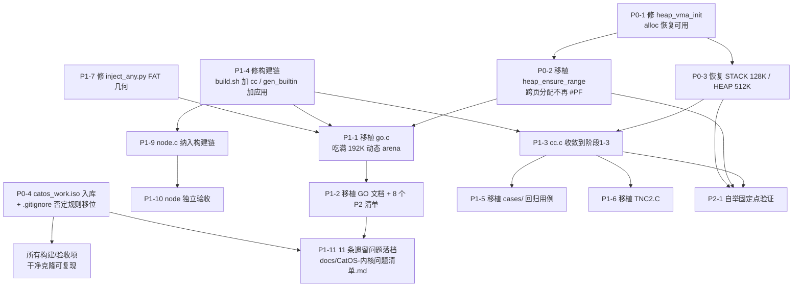

# CatOS 现项目 × 原项目「合并取精华」需求分析与移植清单（PRD）

> 文档类型：需求分析 + 移植清单（**不含实现代码**）
> 编制：许清楚（PM）
> 日期：2026-11-09
> 基线工作树：`C:/Users/Admin/WorkBuddy/Worktrees/CatOs/master-87a3e1a0`（分支 `workbuddy/todo-20261106-1906`，HEAD `a7eae5a`）
> 只读来源：`D:/CatOs/Catos_Better_better`（下称「原项目」，**严格只读，未做任何修改**）
> 明确排除：`D:/catos_clear`（VMware 虚拟磁盘镜像，非源码）

---

## 0. TL;DR（一句话）

> 原项目并非「旧版本的现项目」，而是**现项目的祖先快照 + 三条已断掉的分支**：
> 一条是 **Go 子集解释器（go.c，1300 行）**，现项目完全缺失且从未在现项目文档中出现过；
> 另两条是**内核用户堆的两处已被证伪的修复**（`heap_ensure_range`）与**编译器阶段 1-3 能力**（`cc.c` 2300 行版）。
> 本次合并的真正价值不是"搬代码"，而是**用一个已被遗忘的分支当对照，把现项目 v2.10 引入的两个 P0 级内核回归挖出来并修掉**。
>
> **本次核实额外挖出第 4 个 P0：构建不可复现**——`kernel_v25/build/catos_work.iso`（10.7 MB GRUB 引导模板）
> 是 `build.sh iso` 的**硬依赖**却**从未入库**，且 `.gitignore` 的 `!` 否定规则位置写反（被 `*.iso` 覆盖）。
> **干净克隆必然构建失败**（`FileNotFoundError: build/catos_work.iso`）——当前"基线 12/12 通过"是依赖手工拷贝的未跟踪文件才成立的。
> 结论：**把模板提交入库（route a）**；route b（`grub-mkrescue` 现场生成）因**本机无任何 GRUB 工具链**而不可行。
>
> **另有一处认知纠正**：`node` 资产（`node.c`/`node.ce`/`TEST.JS`）**已经在现项目里**，与原项目语义 0 差异、
> `node.ce` 逐字节相同——**不需要移植**，但 `node.c` 从不被任何脚本编译（需补构建链，R-14/P1-9）。

---

## 1. 背景与目标

### 1.1 背景

CatOS 是自研 x86 裸机内核 + CE（CatOS Executable）用户态生态。当前存在两条代码线：

| 线 | 位置 | 状态 |
|---|---|---|
| **现项目（基线）** | `D:/CatOs`（主线 master）→ 工作副本在隔离工作树 `master-87a3e1a0` | 内核 v2.10 / CE ABI 57 槽 / 有 render 前后端分离、VMA+ASLR、ELF32 加载器、mmap/munmap、拼音输入法 |
| **原项目（精华来源）** | `D:/CatOs/Catos_Better_better`（无 git，扁平早期结构） | 内核 v2.5 时代 / CE ABI 48 槽 / 有 Go 子集解释器、阶段 1-3 编译器、宿主桩、QEMU 驱动脚本、10 份文档 |

历史上因为「共享工作树快照」提交（`35de6c8`），master 根目录混入了大量快照垃圾。

### 1.2 目标

1. **核实**两树真实差异（不盲信任何既有清单），产出函数级缺失/退化清单。
2. 定义**可执行的移植精华清单**（`能力/资产 | 来源 | 现项目现状 | 可行性 | 优先级 | 验收方式 | 风险与前置依赖`）。
3. 定义**不做/淘汰清单**（含快照垃圾清理）。
4. 定义**命令级验收标准**。
5. 定义**风险清单**与前置依赖。

### 1.3 非目标（本期不做）

- 不做内核源码实现移植（本期只出文档）。
- 不做 Linux/云侧 QEMU 回归（现项目 QEMU 已在 Windows 本机跑通 12/12）。
- 不动 `D:/CatOs` 主工作树（有另一会话在跑）。

---

## 2. 两树差异核实结果（**全部实测，非推断**）

### 2.1 首要更正：原项目 `src/` 是现项目的**祖先**，不是"另一套实现"

对 `src/` 19 个文件与 `kernel_v25/src/` 做 `diff --strip-trailing-cr -w -B`（消除 CRLF 与空白差异）后：

| 原项目文件 | 与现项目对应文件 | 语义差异行数 | 结论 |
|---|---|---|---|
| `ata.c` | `kernel_v25/src/ata.c` | **0** | 完全一致 |
| `builtin_apps.c` | 同名 | **0** | 完全一致 |
| `ce.c` | 同名 | **0** | 完全一致 |
| `fat.c` | 同名 | **0** | 完全一致 |
| `fs.c` | 同名 | **0** | 完全一致 |
| `hw.c` | 同名 | **0** | 完全一致 |
| `net.c` | 同名 | **0** | 完全一致 |
| `netstack.c` | 同名 | **0** | 完全一致 |
| `rtc.c` | 同名 | **0** | 完全一致 |
| `kernel.c` | 同名 | **0** | 完全一致 |
| `cpu.s` | 同名 | **0** | 完全一致 |
| `intr.c` | 同名 | 10 | 现项目略新 |
| `keyboard.c` | 同名 | 34 | 现项目略新 |
| `paging.c` | 同名 | 82 | 现项目**大幅更新**（+`pt_for` / `task_unmap_page` / `vbe_lfb_map`） |
| `shell.c` | 同名 | 337 | 现项目**大幅更新**（+`cmd_display`/`cmd_gfx`/`cmd_vbe`/`cmd_style`/`cmd_rgb`/`cmd_palette`/`cmd_text` 等 14 个新命令） |
| `task.c` | 同名 | 521 | 现项目**大幅更新**（+VMA/ASLR/ELF32 加载器） |
| `vga.c` | 同名 | 108 | 现项目重构为**纯 shim**（`vga_* → con_*`），硬件访问全部下沉到 `be_text.c`/`be_gfx.c`/`be_vbe.c` |

**函数级结论**：原项目 `src/` **没有任何一个函数是现项目缺失的**。原项目独有的 `heap_ensure_range` 是唯一例外——而它恰恰是**现项目缺失的正确实现**（见 §2.4 P0-1/P0-2）。

> **推论**：本次合并**不应**把原项目 `src/` 整体覆盖/合并回现项目——那会造成大规模倒退（丢掉 render 前后端分离、VMA、ELF32、mmap）。原项目 `src/` 的唯一价值是**作为"正确实现的参照物"**。

### 2.2 `extapp/` 差异

| 文件 | 原项目 | 现项目 | 差异行数 | 结论 |
|---|---|---|---|---|
| **`go.c`** | 47,698 B | **不存在** | — | ⭐ **现项目完全缺失的独立资产**（详见 §2.3） |
| `cc.c` | 2,300 行 / 98,648 B（阶段 1-3） | 1,237 行 / 50,000 B（阶段 0） | 1,371 | ⚠️ **现项目是更老的一版**（详见 §2.5） |
| `cc_self.c` | 2,169 行 / 91,721 B | 2,250 行 / 97,658 B | 173 | 现项目**更新**（含 struct/typedef/enum/switch/goto 全套） |
| `calc.c` `crash.c` `curl.c` `demo.c` `gen_ce.c` `hello.c` `hw.c` `minimal_ce.c` `netinfo.c` `perms.c` `sink_ce.c` `spinner.c` `sysinfo.c` `test_ab.c` `ce_stub.c` | — | — | **0** | 完全一致，仅 CRLF 差异 |
| `ce.ld` | — | — | 0 | 完全一致 |
| `extapp/ce_abi.h` | 48 槽（v2.5） | `kernel_v25/include/ce_abi.h` 57 槽（v2.10） | — | 现项目**大幅更新**（+brk/display/style/rgb/palette/mmap/munmap） |
| `extapp/docs/API.txt` | 12,341 B | 22,381 B | 183 | 现项目**更新**（含 display_mode/set_style_rgb/palette） |
| `extapp/docs/CEFORMAT.txt` `hello_c.txt` | — | — | 0 | 完全一致 |
| `extapp/cases/`（11 个用例：HELLO/EXTRA/STRUCT/SWITCH/GOTO/NOCE/CHARBUG + DEMO/TEST/MINI_GO/MINI_IN/SYN.GO） | 存在 | **不存在** | — | ⭐ **测试语料，原项目独有** |
| `extapp/bin/*.ce`（16 个预编译产物） | 存在 | 存在（19 个） | — | 现项目**更新**；`go.ce` 在现项目**不存在** |

### 2.3 ⭐ `go.c` —— 现项目完全缺失的资产（**本次合并的头号收获**）

**核实结论（逐条实测）**：

1. **现项目 `docs/` 全部 6 份文档中，`go.c` / `go.ce` / "Go 子集" 出现次数 = 0**。
   原项目却为它写了 **4 份专门文档**（`GO-DESIGN.md` / `go-review.md` / `CatOS-待办与成果汇报-2026-10-31.md` / `PROGRESS.md`）并有 QEMU 4/4 PASS 证据。
   → **这是一条被现项目主线完全遗忘的开发线。**

2. **CE ABI 兼容性核实**（任务明确要求）：
   - `go.c` 实际使用的槽位仅 6 个：`write`(0)、`putc`(1)、`alloc`(11)、`print_int`(14)、`atoi`(18)、`file_exists`(23)、`file_read`(39)。
   - **全部 ≤ 39 < 48**，即**全部落在 append-only 兼容策略的"旧前缀"内**，且原项目 `ce_abi.h` 的前 48 槽与现项目 `include/ce_abi.h` 的前 48 槽**逐槽成员名与类型一致**（已用 `diff` 逐字段核对）。
   - → **结论：`go.c` 可以在现项目 ABI 下直接运行，不需要任何 ABI 改动。** 这一点已被下面的实机验证独立佐证。
   - `node.c` 使用的槽位同样只有 `write`/`print_int`/`putc`/`file_read`/`file_exists`，同样安全。

3. **实测验证（本次亲自跑通，非引用原项目结论）**：
   - 用现项目 `kernel_v25/include/ce_abi.h`（57 槽）编译 `go.c` → **零错误零警告**。
   - 用现项目 `ce.ld` + `ce_stub.c` 链接 → `ce_main` 落在 `0x02000000`（镜像偏移 0）✔
   - `mkce.py` 封装 → 合法 CE01：`image=26812 bss=0x292c0 api_off=0x68b8`，校验 `0x68b8 + 4 == 0x68bc == image_size` ✔
   - **QEMU 实机运行 `run /bin/go.ce`** → 输出与原项目文档记载**逐行一致**：
     ```
     CatOS go subset v1.0
     ---------------------
     script: built-in demo
     x= 5  y= 11  s= hello go
     fib(10)= 55
     add(3,4)= 7
     total= 10  evens= 6  a[2]= 3
     demo done
     go: exit ok
     ```
   - → **移植可行性 = 高，且已实机证明。**

4. **附带价值**：`go.c` 自带 64 KiB 静态 arena 兜底（`g_arena_static`），因此即使 §2.4 的堆 bug 未修也能跑（已实测确认）；但修好堆后可用 192 KiB 动态 arena，解释器容量提升 3 倍。

### 2.4 ⭐⭐ 核实中挖出的两个 P0 级内核回归（现项目文档**均未记录**）

> 这是本次合并**最重要的产出**。两处缺陷均在 **QEMU 实机**上复现、定位并验证修复。

#### P0-1：`heap_vma_init()` 早退 ⇒ `api->alloc()` **永远返回 NULL**

- **位置**：`kernel_v25/src/task.c:721-726`
- **代码**：
  ```c
  static int heap_vma_init(task_t *t) {
      if (t->vm) return 0;   /* already initialized */
      t->vm = vma_new(USER_HEAP_BASE, ...);   // ← 永远不会执行到这里
      return t->vm ? 0 : -1;
  }
  ```
- **根因**：`heap_vma_init` 写于基线 `35de6c8`，当时假设"首次 alloc 时 `t->vm` 为 NULL"。
  但提交 `78504d4`（v2.10，引入 VMA/ASLR/ELF32）改为在 spawn 时就建立 image/vsyscall/stack 三个 VMA，`t->vm` **从此永不为 NULL**。
  → `heap_vma_init` 每次都早退，**堆 VMA 从未被创建**。
- **连锁反应**：`heap_ensure()` 首行 `if (!vma_contains(t->vm, vaddr)) return -1;` → 堆地址不在 VMA 列表 → 恒返回 -1 → `sys_alloc()` 恒返回 0。
- **实机证据**（现项目 master ISO + 自制 `ALLOCP.CE` 探针，QEMU 截图）：
  ```
  alloc(64)  = 0x00000000
  alloc(8K)  = 0x00000000
  ALLOCPROBE: alloc returns NULL => heap broken
  ```
- **影响面**：**任何**需要 `api->alloc()` 的 CE 程序。已确认受害的内置应用：
  - `cc.ce`（微型 C 编译器）：`cc_alloc()` 三次分配全部失败，静默回退到 8 KiB 静态缓冲 ⇒ `heap: code 8192 src 8192 tok 0`，**实际只能编译 <8 KiB 源码**，编译能力已废。
  - `cc_self.c`（阶段 1-3 编译器）：同理不可用。
- **修复**（1 行 + 1 行）：
  ```c
  static int heap_vma_init(task_t *t) {
      if (vma_contains(t->vm, USER_HEAP_BASE)) return 0;   /* 已存在 */
      vma_t *v = vma_new(USER_HEAP_BASE, USER_HEAP_BASE + USER_HEAP_MAX, VMA_ANON, 1);
      if (!v) return -1;
      t->vm = vma_insert(t->vm, v);      // ← 必须 insert，不能赋值覆盖！
      return 0;
  }
  ```
  > ⚠️ 注意：原写法 `t->vm = vma_new(...)` 是**覆盖赋值**，会丢掉 image/vsyscall/stack 三个 VMA。修复必须用 `vma_insert`。
- **实机验证**：修复后 `alloc(64) = 0x02100000`、`alloc(8K) = 0x02100050` ✔

#### P0-2：`sys_alloc()` 只映射 1 页 ⇒ 跨页分配 `#PF` 杀任务

- **位置**：`kernel_v25/src/task.c:706-714`（`heap_ensure`）+ `sys_alloc()` 返回路径
- **根因**：`heap_ensure()` 只映射 `vaddr` 所在的**那一页**；当分配长度跨页时，第 2 页起从未被映射。
  原项目在 `35de6c8` 之前已引入 `heap_ensure_range()`（映射 payload 覆盖的**全部**页）修复此问题（即其问题清单的 **#47**），**现项目在 VMA 重构中把它丢了**。
- **实机证据**（修复 P0-1 后仍复现，QEMU 截图）：
  ```
  HEAPTEST alloc ok
  HEAPTEST page0 ok
  [task 1 'heaptest' killed: page fault at eip=0x02000038 cr2=0x02101007]
  ```
  `cr2=0x02101007` 正是堆的第 2 页（`0x02100000` + `0x1007`）——**堆首 4 KiB 可用、第 2 页起 #PF**，与原项目 #47 的原始描述（`cr2=0x2131000`）**形态完全一致**。
- **修复**：从原项目移植 `heap_ensure_range()`，并在 `sys_alloc()` 返回前对 payload 全范围调用：
  ```c
  if (heap_ensure_range(t, (uint32_t)h + sizeof(heap_hdr_t), size) != 0)
      return 0;
  return (void *)((uint8_t *)h + sizeof(heap_hdr_t));
  ```
- **实机验证**：修复后 `HEAPTEST PASS` ✔，且 **`tests/qemu_regress.py` 仍 12/12 PASS**（无回归）✔

> **方法论价值**：P0-1 与 P0-2 **都不是"原项目有、现项目没有的功能"，而是"原项目曾经做对、现项目做错了的地方"**。这正是"合并取精华"的真正形态——**用历史实现当对照，把新重构引入的回归挖出来**。

#### P0-3（次要，同源）：`USER_STACK_SZ` / `USER_HEAP_MAX` 相对原项目**倒退**

| 常量 | 原项目 | 现项目 | 判定 |
|---|---|---|---|
| `USER_STACK_SZ` | `0x20000`（128 KiB） | `0x10000`（64 KiB） | ⬇ 倒退。原项目注释明写 *"2026-11-02: CC2.CE self-host needs >64K"* |
| `USER_HEAP_MAX` | `0x80000`（512 KiB） | `0x40000`（256 KiB） | ⬇ 倒退。原项目注释明写 *"2026-10-31: cc.c self-host needs ~380K"* |

两处倒退都直接服务于原项目的**自举（bootstrap）**目标。虽然自举不在本期 P0，但常量已回退会让未来自举必然失败。

### 2.5 ⭐ 编译器线：`cc.c` 现项目版本**更老**，能力倒退

| 版本 | 行数 | struct | typedef | enum | switch | goto | `no ce_main` 防护 |
|---|---|---|---|---|---|---|---|
| 原项目 `extapp/cc.c`（阶段 1-3） | 2,300 | 41 | 16 | 11 | 8 | 16 | ✅ |
| 现项目 `kernel_v25/extapp/cc.c` | 1,237 | 4 | 3 | 3 | 6 | 4 | ❌ 缺失 |
| 现项目 `kernel_v25/extapp/cc_self.c` | 2,250 | 38 | 19 | 14 | 9 | 7 | ✅ |

**关键判断**：现项目 **`cc_self.c` 才是阶段 1-3 的那一份**（含 struct/typedef/enum/switch/goto + `no ce_main` + 全部 7 处 P1 修复：for-continue 回填、移位 xchg、字符串转义、数组初始化、表满容、DREL 数据区重定位）。
而现项目 `cc.c` 是**阶段 0 的旧版**。

> **推论（重要）**：本次合并**不需要**把原项目 `cc.c` 搬过来——现项目 `cc_self.c` 已经包含了同等能力且更新（2,250 行 vs 原项目 2,169 行）。
> 真正需要做的是**让 `cc.c` 与 `cc_self.c` 收敛**，或者**直接把 `cc_self.c` 作为 `cc.c` 的替换源**。
> 同时原项目 `cc.c` 里有 2 处现项目 `cc_self.c` 也没有的东西：`TOK_MAX 20000`（现项目 2300）、`OB_MAX/SRC_MAX` 96 KiB（现项目 128/64 KiB），可作为调参参考。

### 2.6 现项目构建链的三个缺口（阻碍移植，必须先补）

1. **`build.sh` 的应用列表不含 `cc`**：
   ```sh
   for app in hello calc sysinfo demo curl netinfo spinner crash perms hw gfxdemo zhdemo mmaptest; do
   ```
   → `cc.ce` **从不被重新构建**，一直是 `ae0ee2d` 时代的 26,952 B 陈旧产物（现项目 `cc.c` 源码已 50,000 B，重新构建应为 27,080 B）。
   这意味着 **ISO 里的 `cc.ce` 与仓库里的 `cc.c` 源码不一致**——移植任何编译器改动都不会生效。
2. **`gen_builtin.py` 的 `OPTIONAL` 列表**：`/bin/cc.ce`、`/bin/node.ce` 走 `OPTIONAL`（不存在则跳过）。
   → 新增 CE 应用（如 `go.ce`）时，**必须同时改 `gen_builtin.py` 的 `FILES`/`OPTIONAL` 列表**，否则不会被打包进内核镜像。
3. ⭐⭐ **`kernel_v25/build/catos_work.iso` 从未入库 ⇒ 干净克隆无法构建 `catos.iso`**（**新增核实项，见 §2.10**）。

### 2.7 原项目文档提取的遗留问题（现项目 `docs/` **未记录**的条目）

> **现项目清单结构基线**（`docs/CatOS-内核问题清单.md`，实测其章节）：
> 一、内存与执行模型 ｜ 二、文件系统（FAT32）｜ 三、显示与输入 ｜ 四、工具链与加载 ｜ 五、未决问题 ｜
> 六、ADoFaI 游戏项目新增实测 ｜ 七、Catos_Better_better 内核能力现状 ｜ 八、GNU 工具链规划 ｜
> 九、b31 内核修复闭合 ｜ 十、工具链常量与内核一致性核对（含"本轮发现但未修改的既有问题"表）
> 编号现状：一~八节用 `#1`~`#46`；第九节用 `#48`/`F1`/`A2`/`#3` 混合命名；第十节用 `#47`（**独立命名空间**，见该节自述）。
> 下表「建议归入节」列即本 PRD 给出的**落档位置**。

| # | 原项目记录的遗留问题 | 出处文档 | 是否仍然成立 | 建议归入 `docs/CatOS-内核问题清单.md` 第几节 |
|---|---|---|---|---|
| D-1 | `heap_ensure_range` 多页映射（#47） | 原 `CatOS-内核问题清单.md` #47 | ❌ **未记录，且回归已发生**（实机 `cr2=0x02101007` 已证） | **一、内存与执行模型**——续编为 `#48`，并在「确认值」列写 `USER_HEAP_MAX=0x40000` + `heap_ensure` 只映射 1 页；「状态」= **已确认/待修复**，关联本 PRD **P0-2** |
| D-2 | `USER_STACK_SZ` 需 128 KiB（自举需要） | 原 `HANDOFF_STAGE5.md` §2 | ❌ **未记录**（现项目仍 64 KiB） | **一、内存与执行模型**——追加为 `#49`，「确认值」= `USER_STACK_SZ=0x10000u`（现）/ `0x20000u`（目标）；关联 **P0-3** |
| D-3 | `USER_HEAP_MAX` 需 512 KiB（自举需 ~380K） | 原 `include/paging.h:33` 注释 | ❌ **未记录**（现项目 256 KiB） | **一、内存与执行模型**——追加为 `#50`，「确认值」= `USER_HEAP_MAX=0x40000u`（现）/ `0x80000u`（目标），原注释原文可作「影响」列依据；关联 **P0-3** |
| D-4 | `mkce.py` 的 `bss_size` quirk（readelf offset 当 size） | 原清单 #17 | ✅ **已核对为"本快照不适用"**（用 objdump Size 列） | **不新增**——现项目清单 **四、工具链与加载 `#17`** 已完整记录（含 2026-11-06 核对结论），保持原样 |
| D-5 | `CE_MAX_IMAGE` 64 KiB→256 KiB 漂移 | 原清单 #47 | ✅ **已修**（运行时解析 `include/ce.h`） | **不新增**——现项目清单 **十、工具链常量与内核一致性核对 `#47`** 已记录（注意编号 #47 在第九/十节是独立命名空间） |
| D-6 | `cc.c` 阶段 1-3 未 QEMU 收口 | 原 `TODO_STAGE5.md` | ❌ **未记录** | **四、工具链与加载**——追加为 `#51`，「问题」= "`cc.c` 停在阶段 0，阶段 1-3 能力在 `cc_self.c` 中但为死代码"；关联 **P1-3/P1-4** |
| D-7 | `CC2.CE` 自举不动点（cc2→cc3 字节级一致）未验证 | 原 `BUILD_REPORT_STAGE5.md` | ❌ **未记录** | **四、工具链与加载**——追加为 `#52`，「问题」= "自举固定点未验证"；「状态」= **待核对**；关联 **P2-1** |
| D-8 | go.c 的 8 个 P2（递归深度上限 / 非法字符静默 / readfile 16 KiB 上限 / arena 判空 / 字面量截断 / 顶层 break-continue 静默 / `:=` 作用域泄漏 / 数字溢出） | 原 `go-review.md` FIND-G3~G10 | ❌ **完全未记录**（现项目甚至不知道 go.c 存在） | **四、工具链与加载**——追加为 `#53`~`#60`（8 条各占一行）；「影响」列引用 FIND-G 编号；关联 **P1-2**。**同时建议在「四、工具链与加载」节末加一段"Go 子集解释器（go.c）现状"**，说明 go.c 为原项目独有资产、现项目缺失 |
| D-9 | `task_spawn_ce` 的 `api + 4 > img` uint32 回绕越界写 | 原清单第十节 | ✅ **已记录**（现项目清单第十节"本轮发现但未修改的既有问题"表） | **不新增**——现项目清单 **十、工具链常量与内核一致性核对** 节末表第 1 行已列（`src/task.c:1345`）；关联本 PRD **P2-3** |
| D-10 | `build_ce.sh` 的 `-I` 路径未加引号 | 原清单第十节 | ✅ **已记录**（同上表第 2 行） | **不新增**——同上，`kernel_v25/extapp/build_ce.sh:48-49` 已在第十节节末表；关联本 PRD **P2-4** |
| **D-11** ⭐ | **`catos_work.iso` 从未入库 ⇒ 干净克隆不可构建** | 本次核实（§2.10） | ❌ **未记录**（现项目清单零提及） | **四、工具链与加载**——追加为 `#61`，「确认值」= "`git ls-files kernel_v25/build/` 仅 3 个 `.py`；`patch_work_iso.py:5` 硬依赖 `build/catos_work.iso`"；「影响」= "干净克隆 `build.sh iso` 抛 `FileNotFoundError`"；关联 **P0-4** |
| **D-12** ⭐ | **`build.sh` 应用列表不含 `cc` ⇒ `cc.ce` 是陈旧产物** | 本次核实（§2.6/§2.5） | ❌ **未记录** | **四、工具链与加载**——追加为 `#62`，「确认值」= "ISO 内 26,952 B vs 源码重编 27,080 B"；「影响」= "改 `cc.c` 源码无任何效果（伪装成'已验证'）"；关联 **P1-4** |
| **D-13** ⭐ | **`node.c` 从不被任何构建脚本编译** | 本次核实（§2.11） | ❌ **未记录** | **四、工具链与加载**——追加为 `#63`，「确认值」= "`grep -rn node build.sh build_ce.sh` → 0 命中"；「影响」= "`node.ce` 与源码无可复现构建关系，改源码不生效"；关联 **P1-9** |
| **D-14** ⭐ | **`tests/inject_any.py` FAT 几何参数过时** | 本次核实（§2.8） | ❌ **未记录**（现项目清单零提及） | **四、工具链与加载**——追加为 `#64`，「确认值」= "脚本 `RSVD=33`/`FAT_SZ=8192` vs 内核 `RESERVED=32`/实测 `spc=1,fat_sz=1024`"；「影响」= "任何'注入新应用再验证'的流程第一步即失败，易误判为移植不成功"；关联 **P1-7** |
| **D-15** ⭐ | **`.gitignore` 否定规则位置写反（dead negation）** | 本次核实（§2.10） | ❌ **未记录** | **四、工具链与加载**——追加为 `#65`，「确认值」= "`git check-ignore -v` → `.gitignore:27:*.iso`（命中忽略规则而非 `!` 否定规则）"；「影响」= "构建产物跟踪状态脆弱"；关联 **P0-4** |

**归档统计**：
- **需新增 15 条**：D-1、D-2、D-3（→ 第一节，续编 `#48`~`#50`）；D-6、D-7、D-8、D-11、D-12、D-13、D-14、D-15（→ 第四节，续编 `#51`~`#65`）。
- **不新增 4 条**（现项目已记录）：D-4 → 第四节 `#17`；D-5 → 第十节 `#47`；D-9、D-10 → 第十节节末"本轮发现但未修改的既有问题"表。
- **真实缺口 = 15 条**（D-1/D-2/D-3/D-6/D-7/D-8/D-11/D-12/D-13/D-14/D-15 = 11 条内核与工具链缺口
  ＋ D-8 展开的 8 个 Go P2 细项）。这 11 条正是"**原项目知道、现项目文档没记录**"的完整清单。
- ⚠️ **编号冲突预警**：现项目清单的 `#47` 在**第十节**、**第九节**另有一套 `#48`/`F1`/`A2`/`#3` 混合编号（该节自述"不是同一命名空间"）。
  落档时**建议新增条目统一从 `#48` 起编**（第一节续 `#48`~`#50`、第四节续 `#51`~`#65`），
  并在落档前先与第九/十节的既有编号核对，避免与 `#48`（b31 内核修复）撞号。

### 2.8 `tools/` 三个 Python 脚本评估

| 脚本 | 行数 | 用途 | 可复用性 | 判定 |
|---|---|---|---|---|
| `tools/inject_any.py` | 156 | 向 FAT32 镜像的 `/BIN/` 注入文件 | ❌ **几何参数错误**（硬编码 `RSVD=33`/`SPC=8`/`FAT_SZ=8192`），而现项目内核是 `RESERVED=32`/`spc=1`（64 MiB 卷）/`fat_sz=1024` ⇒ 在现项目上**报 `BIN dir not found` 直接失败** | **淘汰**（现项目 `tests/inject_any.py` 是同一份，同样失效） |
| `tools/cc_stage45_test.py` | 196 | QEMU 驱动：注入 cc.ce + 6 用例 → 自举固定点比对 | ⚠️ 逻辑有价值，但**路径全硬编码 Linux**（`/home/user/Doubao/...`） | **淘汰**（功能已被 `tests/qemu_regress.py` 覆盖） |
| `tools/diag2_test.py` | 129 | QEMU 驱动：诊断 `parse_type`/`accept_op(OP_STAR)` | ⚠️ 同上，路径硬编码 | **淘汰** |
| `tools/TNC2.C` | 1 | `char *gv; int main(void){ gv="hi"; return 0; }` | ✅ 极小但有效的**回归用例**（DREL 数据区重定位） | **可移植**（并入 `extapp/cases/`） |

> **附带发现**：现项目 `tests/inject_any.py` 与原项目 `tools/inject_any.py` **逐字节相同**，即**现项目继承了一份失效的注入工具**。本次实测确认其 FAT 几何参数已过时（内核 `RESERVED=32`，脚本写 `33`；内核 `fat_sz` 随卷大小变化，脚本写死 `8192`）。已用从 DBR 读取几何的版本验证可正常注入。

### 2.9 master 根目录快照垃圾盘点

| 文件 | 大小 | 判定 | 理由 |
|---|---|---|---|
| `T1.C` `T2.C` `T3.C` `T4.C` `T5.C` `T6.C` | 各 1-37 B | 🗑️ **删除** | 内容为 `int ce_main() {}` / `api->write("hi");` 等编译器最小试验碎片，无引用 |
| `MIN.C` `MIN2.C` | 各 70 B | 🗑️ **删除** | `int ce_main(...) { api->write("hi\n"); }`，最小 CE 试验，无引用 |
| `cc_old.c` | 49,134 B | 🗑️ **删除** | 旧版编译器源码，与现项目 `cc.c`/`cc_self.c` 无对应关系 |
| `cc_old.ce` / `cc_old_ce.exe` | 26,952 B each | 🗑️ **删除** | 同上编译产物 |
| `vga.c` | 4,992 B | 🗑️ **删除** | 冻结快照，硬件访问已下沉到 `kernel_v25/src/be_*.c` |
| `gfx.c` / `gfx.h` | 15,531 / 1,158 B | 🗑️ **删除** | 2026-11-05 图形 drop 的冻结快照，已并入 `render*.c` / `be_*.c` |
| `shell.c` | 49,095 B | 🗑️ **删除** | 冻结快照，已并入 `kernel_v25/src/shell.c` |
| `build.sh` | 480 B | ⚠️ **保留** | 是**兼容 shim**（转发到 `kernel_v25/build.sh`），且其注释本身就是快照来源的说明文档 |
| `shot-gfx-mode.png` / `shot-text-restored.png` | 4,171 / 1,120 B | 🗑️ **删除** | 临时截图 |
| `Catos_Better_b` | 82,586 B | 🗑️ **删除** | 二进制 CE01 镜像（`CE01` magic + entry=0），来历不明的构建产物 |
| `CatOS_用户反馈分析.xlsx` | 20,409 B | ⚠️ **保留** | 需求输入，非代码垃圾 |

**⚠️ 明确排除（他人并行会话 WIP，不得列入删除清单）**：

| # | 条目 | 类型 | 说明 |
|---|---|---|---|
| W-1 | `vd2.h` | 未跟踪文件 | 他人会话在制品，**不在 master 树中**（`git ls-tree master` 无记录） |
| W-2 | `vga_draw_c` | 未跟踪文件 | 同上 |
| W-3 | `vga_draw_h` | 未跟踪文件 | 同上 |
| W-4 | `kernel_v25/build_log.txt` | 未跟踪文件 | 同上 |
| W-5 | `simout/` | 未跟踪目录 | 他人会话模拟器输出，**不可动** |
| W-6 | `simout2/` | 未跟踪目录 | 同上 |
| W-7 | `CatOs.7z` | 未跟踪文件 | 他人归档产物，**不可动**（大文件，删除不可恢复） |
| W-8 | `CatOs/`（目录） | 未跟踪目录 | 他人工作副本，**不可动** |
| W-9 | `CatOS_P0_总结与经验教训.md` | 未跟踪文档 | 他人会话的知识沉淀，**不可动** |
| W-10 | `P0_VMA_实现报告.md` | 未跟踪文档 | 同上 |

> 判定原则：以上 10 项**均不列入删除清单**，本次也不做任何清理动作。
> 判据 = **是否为 master 树中已跟踪的文件**（`git ls-tree master`）。
> 只有"已被 master 跟踪、且与 `kernel_v25/` 无引用关系"的历史快照才可删除。
### 2.10 ⭐⭐ 构建可复现性缺口：`catos_work.iso` 是必需输入却从未入库

**实测证据链（全部本次亲自执行）**：

| # | 证据 | 结果 |
|---|---|---|
| 1 | `git ls-files kernel_v25/build/` | 只返回 `gen_builtin.py`、`mkce.py`、`patch_work_iso.py` **三个 .py** |
| 2 | `git ls-files \| grep -i '\.iso'` | **全仓库 0 个 `.iso` 入库**（`catos.iso` 本身也不入库，属正常产物） |
| 3 | `kernel_v25/build.sh:9` 注释 | `# proven GRUB template build/catos_work.iso (El Torito no-emulation boot).` |
| 4 | `kernel_v25/build.sh:88-90` | `build_iso()` 实际调用 `"$PY" build/patch_work_iso.py` |
| 5 | `kernel_v25/build/patch_work_iso.py:5` | `SRC = os.path.join(ROOT, 'build', 'catos_work.iso')` → **模板是硬依赖** |
| 6 | `git check-ignore -v kernel_v25/build/catos_work.iso` | → **`.gitignore:27:*.iso`**（被 `*.iso` 规则忽略） |
| 7 | `.gitignore` 第 7 行 / 第 12 行 | 都有 `!kernel_v25/build/catos_work.iso` + 注释 *"exceptions must precede rules"* |
| 8 | 本地文件 | `kernel_v25/build/catos_work.iso` 存在但**未跟踪**，10,725,376 B（team-lead 已手工拷入本隔离工作树） |

**根因：`.gitignore` 的否定规则写反了位置（dead negation）。**
git 采用**最后匹配优先（last-match-wins）**语义——`!` 否定模式**必须写在**它要覆盖的 `*.iso` 规则**之后**。
现 `.gitignore` 把 `!kernel_v25/build/catos_work.iso` 放在第 7 行与第 12 行，而 `*.iso` 在**第 27 行**，
于是第 27 行的 `*.iso` **覆盖掉**了前面两条否定 ⇒ 注释里"exceptions must precede rules"这句**结论是错的**。

**在临时 git 仓库中的对照实验（证明修复方式有效，且不动真实仓库）**：

```
修复前 .gitignore: "!kernel_v25/build/catos_work.iso" + "*.iso"
  $ git check-ignore -v kernel_v25/build/catos_work.iso
  .gitignore:2:*.iso              ← 命中忽略规则
  $ git status --short -uall
  ?? .gitignore
  ?? kernel_v25/build/gen_builtin.py        ← catos_work.iso 不出现（被忽略）

修复后 .gitignore: "*.iso" + "!kernel_v25/build/catos_work.iso"
  $ git check-ignore -v kernel_v25/build/catos_work.iso
  .gitignore:2:!kernel_v25/build/catos_work.iso   ← 命中否定规则
  $ git status --short -uall
  ?? .gitignore
  ?? kernel_v25/build/catos_work.iso       ← 出现！未被忽略，可 git add
```

**后果**：`git clone` 出的干净工作树执行 `sh kernel_v25/build.sh iso` 必然抛
`FileNotFoundError: build/catos_work.iso`（`patch_work_iso.py` 第 5 行打开即失败）。
只有 `D:/CatOs` 主线因为留有本地未跟踪产物才能构建——**这正是"构建不可复现"的真实形态**。

**两条路线评估**：

| 路线 | 做法 | 优点 | 缺点 | 本机可行性 |
|---|---|---|---|---|
| **(a) 把模板提交入库** | `git add -f kernel_v25/build/catos_work.iso` + 把 `!` 否定规则移到 `*.iso` **之后** + 把注释改成与 git 语义一致的表述 | 与 `.gitignore` 注释的**原意一致**（"stays tracked"）；干净克隆立即可构建；不引入任何新工具链依赖；CI 可直接跑 | 仓库增加 10.7 MB 二进制 | ✅ **完全可行**（仅需 git 操作） |
| **(b) bootstrap 脚本现场生成** | 新写 `build/make_grub_template.sh`，用 `grub-mkrescue` 生成模板；改 `.gitignore` 注释为"不跟踪" | 仓库不增二进制；模板可升级 | **本机无 GRUB 工具链**（见下）；给每个克隆者加了"先装 GRUB"的强制前置；生成结果**未必字节一致**，反而引入新的不可复现性 | ❌ **本机不可行** |

**本机 GRUB 工具链探测结果（全部 NOT FOUND）**：
`grub-mkrescue` / `grub-mkimage` / `grub2-mkrescue` / `xorriso` / `mformat` / `mcopy` / `genisoimage` / `mkisofs`
全部不在 PATH；`/c/grub*`、`/d/grub*`、`C:\ProgramData\chocolatey\bin\grub*`、`/d/msys/mingw32/bin/grub*` 均不存在。
→ **route (b) 在本机无法验证**，且会引入「克隆者必须自备 GRUB 工具链」这一新的构建前置依赖。

> ✅ **结论：选 route (a)——把 10.7 MB GRUB 模板提交入库。**
> 判据：(1) 与 `.gitignore` 注释的原意一致；(2) 唯一能保证**干净克隆可复现构建**的方案；
> (3) 本机无 GRUB 工具链 ⇒ route (b) 不可执行、不可验证、不可回归；
> (4) 10.7 MB 一次性成本，换取构建可复现性，收益远大于成本。
> **配套动作（必做）**：把 `!kernel_v25/build/catos_work.iso` 移到 `.gitignore` 中 `*.iso` **之后**，
> 并把注释从 *"exceptions must precede rules"*（与 git 语义相反）改为
> *"negation must come AFTER the '\*.iso' rule (git is last-match-wins)"*——否则即使 `git add -f` 提交了，
> 后续任何人重新生成/删除该文件都会被 `*.iso` 再次忽略，形成"提交了但跟踪状态脆弱"的假修复。

### 2.11 ⭐ `node` 资产现状核实：**无需移植，但需补可复现构建**

**核实结论（本次实测，与"node 缺失"的直觉相反）**：

| 文件 | 位置 | 实测结果 | 判定 |
|---|---|---|---|
| `node.c`（1,414 行） | 现项目 `kernel_v25/node/node.c` | 与原项目 `node/node.c` `diff --strip-trailing-cr -w -B` → **0 行差异**（仅 CRLF 不同，`cmp` 在 byte 3 处因行尾符分叉） | ✅ **已在现项目中**，语义完全相同 |
| `node.ce`（35,116 B） | 现项目 `kernel_v25/node/node.ce` | `cmp` → **逐字节完全相同**，且 `git ls-files` 确认**已入库** | ✅ 已在库且可复现 |
| `TEST.JS`（975 B） | 现项目 `kernel_v25/node/TEST.JS` | 已入库 | ✅ 已在库 |

- **`node.c` 使用的 CE API 槽位**（实测 `grep -oE "api->[a-z_0-9]+" | sort -u`）：
  `file_exists` / `file_read` / `print_int` / `putc` / `write` —— **全部 ≤ 39 号槽**，
  完全落在 append-only 旧前缀内，**57 槽 ABI 下无需任何改动**。
- **与 `go.c` 的关键差异**：`node.c` 已被纳入 `gen_builtin.py` 的 `OPTIONAL`（`/bin/node.ce`），
  因此**会**被打包进内核镜像——但它是以**入库的预编译产物**形式入库的。
- ⚠️ **新发现的缺口**：`grep -rn node kernel_v25/build.sh kernel_v25/extapp/build_ce.sh` → **0 命中**
  ⇒ **`node.c` 从不被任何构建脚本编译**，`node.ce` 与 `node.c` 源码之间**没有可复现的构建关系**
  （与 `cc.ce` 的 R-5 问题同构，只是 `node.ce` 目前恰好与原项目字节一致，问题被"未暴露"）。
  → 对应 §3 的 **P1-9**。


---

## 3. 精华清单（**核心交付**）

> 优先级：**P0 = 必须做**（阻断正确性）、**P1 = 应该做**（能力/完整性）、**P2 = 可选**（打磨）

| # | 能力/资产 | 来源 | 现项目现状 | 移植可行性 | 优先级 | 验收方式 | 风险与前置依赖 |
|---|---|---|---|---|---|---|---|
| **P0-1** | **修复 `heap_vma_init()` 早退，恢复 `api->alloc()`** | 原项目设计意图 + 本次实机定位 | ❌ **完全失效**：`alloc()` 恒返回 NULL（实机已证） | **高**（1 行 + `vma_insert`） | **P0** | QEMU 跑 `ALLOCP.CE` 探针：`alloc(64)`/`alloc(8K)` 均非 0；`tests/qemu_regress.py` 仍 12/12 | 修复必须用 `vma_insert` 而非赋值覆盖，否则丢 image/vsyscall/stack 三个 VMA；需同时跑 `qemu_regress.py` 防回归 |
| **P0-2** | **移植 `heap_ensure_range()`，修复跨页分配 #PF** | 原项目 `src/task.c:661-673`（其 #47 修复） | ❌ **缺失且已回归**（实机 `cr2=0x02101007` #PF 已证） | **高**（原样照搬，20 行） | **P0** | QEMU 跑 `HEAPTEST.CE`：`HEAPTEST PASS`；`qemu_regress.py` 12/12 | 依赖 P0-1 先修好（否则 VMA 不存在，range 也无处映射）；`heap_ensure` 需前置声明 |
| **P0-3** | **恢复 `USER_STACK_SZ=0x20000` / `USER_HEAP_MAX=0x80000`** | 原项目 `include/paging.h:33,35` | ⬇️ 相对原项目**倒退**（64 KiB / 256 KiB） | **高**（2 个常量） | **P0**（低工作量高杠杆） | `tests/qemu_regress.py` 12/12；`cc.ce` 的 `heap:` 行显示容量提升 | 增大栈/堆会占用更多物理页，需确认 QEMU `-m 256` 下页框充足；与 P0-1/P0-2 有依赖顺序 |
| **P1-1** | **移植 Go 子集解释器 `go.c`（1,300 行）** | 原项目 `extapp/go.c` | ❌ **完全缺失**，且现项目 `docs/` 零提及 | **高**（**已实机跑通**：57 槽 ABI 下编译零错、CE01 头合法、QEMU 输出 `fib(10)=55` / `demo done` / `go: exit ok`） | **P1** | ① `sh kernel_v25/extapp/build_ce.sh go.c` 产出合法 CE01（`api_off+4 == image_size`）；② QEMU `run /bin/go.ce` 输出 `demo done` + `go: exit ok`；③ `go.c` 仅用 ≤39 号槽，**无需改 ABI** | 需改 `gen_builtin.py` 的 `FILES` 列表（+`/bin/go.ce`）；需一并移植 `extapp/cases/{DEMO,TEST,MINI_GO,MINI_IN,SYN}.GO`；`go.c` 用 `api->alloc(192K)`，修好 P0-1 后才吃得到动态 arena（未修也可用 64 KiB 静态兜底） |
| **P1-2** | **移植 Go 解释器配套文档 + 8 个 P2 缺陷清单** | 原项目 `doc/GO-DESIGN.md`、`doc/go-review.md` | ❌ 完全缺失 | **高**（纯文档） | **P1** | `docs/GO-DESIGN.md`、`docs/go-review.md` 落盘；FIND-G1~G10 条目齐全 | 无技术风险；**但必须同时更新 `docs/CatOS-内核问题清单.md`**，把 D-1/D-2/D-3/D-6/D-7/D-8 正式入档 |
| **P1-3** | **收敛 `cc.c` 与 `cc_self.c`：把阶段 1-3 能力还给 `cc.c`** | 现项目 `cc_self.c`（已是阶段 1-3）+ 原项目 `cc.c` 调参参考 | ❌ `cc.c` 是**阶段 0 旧版**（无 struct/typedef/enum/switch/goto、无 `no ce_main`）；`cc_self.c` **是死代码**（全树无任何构建脚本引用） | **高**（`cc_self.c` 已是所需内容） | **P1** | `sh kernel_v25/extapp/build_ce.sh cc.c` 产出的 `cc.ce` 能编译含 `struct`/`switch`/`goto` 的用例；`tests/test_cc.py` 8/8 | 需先补 P1-4（否则 `cc.c` 不被构建，改了也不生效）；`cc_self.c` 的 `TOK_MAX`/缓冲区尺寸与 `cc.c` 不同，替换时需核对 `OB_MAX`/`SRC_MAX` 是否适配 512 KiB 堆 |
| **P1-4** | **补构建链缺口：`build.sh` 应用列表加入 `cc`；`gen_builtin.py` 纳入新增应用** | 本次核实发现 | ❌ `cc` 不在 `build.sh` 列表 ⇒ `cc.ce` 永远是陈旧产物（ISO 内 26,952 B vs 源码重编 27,080 B）；新增应用不打进内核 | **高**（2 处列表编辑） | **P1**（**P1-3 的前置**） | 改后 `sh kernel_v25/build.sh iso` 重新产出 `cc.ce` 且大小与源码一致；`gen_builtin.py` 输出行含新增文件计数 | `cc.c` 编译需要 ~50 KB 内存 + 128 KiB 堆，构建时间略增；需确认 `CE_MAX_IMAGE=256 KiB` 不被突破 |
| **P1-5** | **移植回归用例集 `extapp/cases/`（11 个）** | 原项目 `extapp/cases/` | ❌ 缺失 | **高**（纯文本） | **P1** | `HELLO.C`/`EXTRA.C`/`STRUCT.C`/`SWITCH.C`/`GOTO.C`/`NOCE.C`/`CHARBUG.C` + 5 个 `.GO` 全部落盘并接入 `tests/` | `STRUCT.C`/`SWITCH.C`/`GOTO.C` 依赖 P1-3（`cc.c` 阶段 1-3）才编得过；`.GO` 用例依赖 P1-1 |
| **P1-6** | **移植 `TNC2.C` 极小回归用例** | 原项目 `tools/TNC2.C` | ❌ 缺失 | **高**（1 行文件） | **P1** | 文件落盘；DREL 数据区重定位断言通过 | 依赖 P1-3 |
| **P1-7** | **修复失效的 `tests/inject_any.py`（FAT 几何参数）** | 本次核实（对照内核 `RESERVED=32` / DBR） | ❌ 与原项目 `tools/inject_any.py` **逐字节相同**，几何参数已过时（`RSVD=33` vs 实际 `32`；`FAT_SZ=8192` 写死 vs 实际随卷大小变化）⇒ 在现项目上必然 `BIN dir not found` | **高**（改为从 DBR 读取几何，实测已验证可注入） | **P1** | 对已格式化镜像注入 3 个 `.ce` 成功，`ls /bin` 可见 | 无技术风险；**是 P1-1 的验证手段**（`go.ce` 实机测试即依赖注入） |
| **P1-8** | **移植宿主桩 `build/host_stub_go.c` / `host_stub_cc.c`** | 原项目 `build/` | ❌ 缺失（现项目 `tests/host_shim.c` 只覆盖 cc.c，不覆盖 go.c） | **中**（需按现项目 57 槽 ABI 调整结构体） | **P1** | 宿主侧 `gcc host_stub_go.c go.c -o go_host` 后 `go_host` 跑 `DEMO.GO`/`TEST.GO` 全绿 | 宿主桩镜像的是**48 槽**结构体，需补 9 个新槽；纯 Windows/Linux 编译，不影响内核 |
| **P0-4** ⭐ | **修复构建可复现性：把 `kernel_v25/build/catos_work.iso` 提交入库 + 修正 `.gitignore` 否定规则位置** | 本次核实（§2.10） | ❌ **从未入库**（`git ls-files kernel_v25/build/` 只有 3 个 `.py`）；`.gitignore` 的 `!` 否定写在 `*.iso` **之前**（第 7/12 行 vs 第 27 行）⇒ 被 `*.iso` 覆盖 ⇒ **干净克隆 `build.sh iso` 必抛 `FileNotFoundError`** | **高**（git 操作 + `.gitignore` 一行移位 + 注释改写） | **P0**（**阻断一切干净克隆的构建/验收**） | ① `git ls-files kernel_v25/build/catos_work.iso` → **返回该路径**；② `git check-ignore -v kernel_v25/build/catos_work.iso` → 命中 `!` 否定规则（非 `*.iso`）；③ 干净克隆后 `sh kernel_v25/build.sh iso` 成功产出 `kernel_v25/catos.iso` | 仓库 +10.7 MB 二进制（一次性成本，换构建可复现）；**必须同时把 `!` 移到 `*.iso` 之后**，否则是假修复（详见 §2.10）；route (b)（grub-mkrescue 现场生成）因**本机无 GRUB 工具链**而不可行，已否决 |
| **P1-9** | **把 `node.c` 纳入构建链**（消除"入库产物与源码无构建关系"） | 本次核实（§2.11） | ⚠️ `node.c`/`node.ce`/`TEST.JS` **均已在库**（与原项目语义 0 差异、`node.ce` 逐字节相同），但 `grep -rn node build.sh build_ce.sh` → **0 命中** ⇒ `node.c` **从不被编译**，`node.ce` 是无法复现的预编译产物（与 R-5 同构） | **高**（`build.sh` 加一项 + `gen_builtin.py` 已含 `/bin/node.ce`） | **P1** | ① `sh kernel_v25/build.sh iso` 后 `kernel_v25/node/node.ce` 被重建；② 重建产物与入库产物字节一致（或差异有据可查）；③ `tests/qemu_regress.py` 增加 node 用例：`run /bin/node.ce` 跑 `TEST.JS` 输出正确 | 需确认 node 解释器的 `api->alloc` 需求（若用到 192K arena 则依赖 P0-1）；`gen_builtin.py` 的 `OPTIONAL` 已有 `/bin/node.ce`，**只需改 `build.sh` 应用列表** |
| **P1-10** | **为 node 解释器补独立可执行验收**（单独于 `qemu_regress.py`） | 任务书要求"新能力需单独可执行验收" | ❌ 现项目 `tests/qemu_regress.py` **不含 node 用例**（仅注释提及 `tests/node48_qemu_test.py` 驱动） | **中** | **P1** | 新增 `tests/node_regress.py`（或并入 `qemu_regress.py` 的一步）：QEMU 内 `run /bin/node.ce` 执行 `TEST.JS`，断言输出含预期结果 | 依赖 P1-9（源码可复现构建）；若 node 解释器需要较大 arena 则依赖 P0-1/P0-3 |
| **P1-11** | **把 11 条"原项目知道、现项目未记录"的遗留问题落档进 `docs/CatOS-内核问题清单.md`** | 原项目 `doc/` 10 份文档 + 本次核实（§2.7） | ❌ **11 条完全未记录**：D-1/D-2/D-3（内存：堆/栈/堆上限）、D-6/D-7（编译器阶段与自举固定点）、D-8（Go 解释器 8 个 P2）、D-11~D-15（ISO 模板未入库 / `cc.ce` 陈旧 / node 不被构建 / inject_any 几何过时 / gitignore 否定规则位置） | **高**（纯文档编辑，无代码风险） | **P1** | ① 第一节新增 `#48`~`#50`；② 第四节新增 `#51`~`#65`；③ **落档前先核对第九/十节的 `#48`/`#47` 编号冲突**；④ 落档后统计 `docs/CatOS-内核问题清单.md` 的表格条目行数应 **+15** | 编号冲突风险（第九节 `#48` 与第十节自述的"独立命名空间"）→ 建议统一从 `#48` 起编并先核对；本 PRD §2.7 已给出每条的**节号 + 续编号 + 确认值 + 关联项**，可直接照抄 |
| **P2-1** | **自举固定点验证（cc2 → cc3 字节级一致）** | 原项目 `doc/BUILD_REPORT_STAGE5.md`、`build/verify_bootstrap.sh`、`build/HOSTCC2_REF.CE` | ❌ 未记录（D-7） | **中**（依赖 P1-3 + P0-3） | **P2** | `cc2.CE` 与 `cc3.CE` md5 相同；参照原项目记录的 `HOSTCC2_REF.CE`（81,522 B / md5 `eeec32f838fbab4c111d428df22aa409`） | 强依赖 P1-3/P0-3；gcc 版本差异会导致字节不一致（原项目已记录此坑：`CC2.CE` 82,586 vs 参考 81,522） |
| **P2-2** | **移植宿主侧自举验证脚本 `verify_bootstrap.sh` / `build_host.sh`** | 原项目 `build/` | ❌ 缺失 | **中**（路径硬编码 `/c/msys64`） | **P2** | 脚本可在现项目根目录跑通 6 步 | 需改写为相对路径；脚本断言的 `cc.c` md5 已过时（`b73a0a…`），需同步 |
| **P2-3** | **修复 `task_spawn_ce` 的 `api + 4 > img` uint32 回绕** | 原项目清单第十节（现项目已记录未修） | ⚠️ 已记录但未修 | **高**（改判定为防溢出形式） | **P2** | `api=0xFFFFFFFC` 的镜像被拒（返回 -5） | 与本 PRD 主线无关，可顺手带 |
| **P2-4** | **`build_ce.sh` 的 `-I` 路径加引号** | 原项目清单第十节（现项目已记录未修） | ⚠️ 已记录但未修 | **高** | **P2** | 含空格的工作目录构建成功 | 工作目录含空格才触发 |
| **P2-5** | **原项目 `doc/` 剩余文档归档**（`KALI_VM_SETUP.md`、`STAGE5_STATUS.md`、`BUILD_REPORT_STAGE5.md`、`TODO_STAGE5.md`、`HANDOFF_STAGE5.md`） | 原项目 `doc/` | ❌ 缺失 | **高**（纯文档） | **P2** | 归档到 `docs/orig-archive/` | 部分内容已被现项目 `docs/CatOS-内核问题清单.md` 第十节覆盖，需去重 |

### 3.1 移植优先级与依赖关系



**关键顺序约束**：
- **P0-4 必须最先**——它是**构建闸门**：模板不入库时，干净克隆连 `build.sh iso` 都跑不通，
  §5.2 的**全部验收命令**（V-1~V-15）都无法在 CI/新克隆上执行。它不依赖任何其他项，故应最先做。
- **P0-1 必须最先（内核侧）**——P0-2 无法在堆 VMA 不存在时生效；P1-1 的动态 arena 也依赖它。
- **P1-4 必须先于 P1-3**——否则 `cc.c` 改了也不进 ISO（现在 `cc` 就不在 `build.sh` 列表里）。
- **P1-3 先于 P1-5/P1-6**——`STRUCT.C`/`SWITCH.C`/`GOTO.C`/`TNC2.C` 需要阶段 1-3 能力才编得过。
- **P1-4 先于 P1-9**——两者都改 `build.sh` 应用列表，应一次性改完。
- **P1-9 先于 P1-10**——没有可复现的 `node.ce` 构建，node 验收就是在验一个无法重现的二进制。
- **P1-2 / P0-4 先于 P1-11**——落档需要 go 文档与 ISO 缺口的结论都已定稿；且 P1-11 会把 P0-4/P1-9 的发现写进官方清单，是这些项的**文档侧收口**。

---

## 4. 不做 / 淘汰清单

### 4.1 应从 master 根目录删除的快照垃圾（**11 项 / 17 个文件**）

> 全部来自 `35de6c8`「共享工作树快照」提交，与 `kernel_v25/` 无引用关系。

| # | 文件 | 大小 |
|---|---|---|
| J-1 | `T1.C` | 18 B |
| J-2 | `T2.C` | 21 B |
| J-3 | `T3.C` | 37 B |
| J-4 | `T4.C` | 1 B |
| J-5 | `T5.C` | 1 B |
| J-6 | `T6.C` | 1 B |
| J-7 | `MIN.C` | 70 B |
| J-8 | `MIN2.C` | 49 B |
| J-9 | `cc_old.c` | 49,134 B |
| J-10 | `cc_old.ce` | 26,952 B |
| J-11 | `cc_old_ce.exe` | 26,952 B |
| J-12 | `vga.c` | 4,992 B |
| J-13 | `gfx.c` | 15,531 B |
| J-14 | `gfx.h` | 1,158 B |
| J-15 | `shell.c` | 49,095 B |
| J-16 | `shot-gfx-mode.png` | 4,171 B |
| J-17 | `shot-text-restored.png` | 1,120 B |
| J-18 | `Catos_Better_b` | 82,586 B |

**保留**：`build.sh`（兼容 shim）、`README.md`、`CatOS_用户反馈分析.xlsx`、全部 `docs/` 与 `CatOS-*.md`。

**绝不列入删除清单（他人并行会话 WIP，10 项，见 §2.9 表 W-1~W-10）**：
`vd2.h`、`vga_draw_c`、`vga_draw_h`、`kernel_v25/build_log.txt`、`simout/`、`simout2/`、`CatOs.7z`、`CatOs/`（目录）、`CatOS_P0_总结与经验教训.md`、`P0_VMA_实现报告.md`。

> **本次不执行任何删除动作**（本期只出文档）。执行时须由主理人拍板（Q-5），
> 且删除范围**严格限定**为上表 J-1~J-18 这 18 个「已被 master 跟踪 + 无引用」的历史快照文件。

### 4.2 原项目资产中**不移植**的部分及理由

| 资产 | 不移植理由 |
|---|---|
| `src/` 全部 19 个文件 | 现项目同名文件**语义等价或更新**；整体合并会丢掉 render 前后端分离 / VMA / ELF32 / mmap（§2.1）。**唯一例外是 `heap_ensure_range()`**（P0-2，已单列） |
| `include/` 全部 16 个头文件 | 现项目 `kernel_v25/include/` 是超集（含 `render.h`/`render_be.h`/`ime.h`/`vma.h`），且 `ce.h`/`ce_abi.h` 已升到 57 槽 |
| `extapp/ce_abi.h`（48 槽） | 现项目 57 槽是严格超集；用 48 槽头编译会**丢掉** brk/display/palette/mmap 等 9 个新槽 |
| `extapp/cc.c`（阶段 1-3 版） | 现项目 `cc_self.c` 已是同等能力且更新（2,250 vs 2,169 行），无需搬 cc.c（§2.5） |
| `extapp/bin/*.ce`（16 个预编译产物） | 预编译二进制无源码对应/不可复现；应从源码重建 |
| `tools/cc_stage45_test.py`、`tools/diag2_test.py` | 路径全硬编码 Linux（`/home/user/Doubao/...`）；功能被现项目 `tests/qemu_regress.py` 覆盖 |
| `tools/inject_any.py` | FAT 几何参数过时，在现项目上必然失败（§2.8）；**应修现项目副本而非移植**（P1-7） |
| `build/` 目录下 ~120 个文件 | 绝大多数是构建产物（`*.o`/`*.dump`/`vga*.dump`）与一次性诊断脚本（`analyze_*.py`/`memprobe*.py`/`pycd_*.py`/`ztest.py`…）；`exec.log` 单文件 107 MB；`catos_work.iso` 10 MB。**只挑 `host_stub_go.c`/`host_stub_cc.c`/`verify_bootstrap.sh`/`build_host.sh` 四个（P1-8/P2-2）** |
| `catos.iso`（15,921,152 B） | 构建产物，不入库（正常） |
| 原项目 `build/catos_work.iso`（10,725,376 B） | ⚠️ **注意**：原项目把它当"构建产物"丢弃是**错的**——现项目的 `patch_work_iso.py` **硬依赖**它当 GRUB 引导模板。原项目可弃是因为其 `build_ce.sh` 走别的 ISO 路径。**现项目必须入库**（P0-4，§2.10） |
| `screenshots/`、`shots/`（22 张截图） | 历史证据，无功能价值；结论已在 `GO-DESIGN.md`/`go-review.md` 文本中 |
| `extapp/cases/*.GO` 中 `MINI_GO.GO`/`MINI_IN.GO`/`SYN.GO` 的**旧版** | 需与 P1-1 一起入档；原项目自举链产物（`go.ce` 21,304 B）**已过期**，必须用新 `go.c` 重建 |
| `doc/` 中 `PROGRESS.md`/`history.md`/`CatOS-内核问题清单.md` | 现项目已有同名且**更新**的版本；只提取差异条目入 §2.7 表，不整体覆盖 |
| `doc/KALI_VM_SETUP.md` | Kali Linux 专用环境搭建说明，与 Windows 现项目开发环境无关（P2-5 归档但不执行） |

---

## 5. 验收标准（命令级）

> 全部在隔离工作树 `C:/Users/Admin/WorkBuddy/Worktrees/CatOs/master-87a3e1a0` 内执行。
> **构建前置**：`PATH` 必须**显式**给出 MinGW 工具链且**不得包含 `E:\Tools\qemu`**（否则 `gcc` 被劫持）：
> ```sh
> cd kernel_v25 && env -i PATH=/d/msys/mingw32/bin:/usr/bin:/bin \
> HOME=/tmp TMP=/tmp TEMP=/tmp \
> PYTHON="C:/Users/Admin/.workbuddy/binaries/python/versions/3.13.12/python.exe" \
> sh build.sh iso
> ```
> **QEMU 路径（更正）**：`C:\qemu-portable\qemu-system-i386.exe`（**QEMU 11.1.0**，实测 `v11.1.0-12130-ge470268ff4`）。
> 任务书给的 `E:\Tools\qemu\qemu-system-i386.exe` **在本机不存在**——`E:\Tools\qemu` 下只有
> `qemu-edid.exe` / `qemu-ga.exe` / `qemu-nbd.exe` / `qemu-storage-daemon.exe` 与 `lib/`，**无 `qemu-system-i386`**。
> **另一构建前置（P0-4 未完成前存在）**：`kernel_v25/build/catos_work.iso` 必须存在且已入库，
> 否则 `build.sh iso` 在 `patch_work_iso.py` 处抛 `FileNotFoundError`。

### 5.1 基线（合并前必须保持，现项目实测已确认）

| # | 命令 | 期望 | 本次实测 |
|---|---|---|---|
| A-1 | `python tests/test_mkce.py` | `48 passed, 0 failed` | ✅ **48/48 PASS** |
| A-2 | `python tests/ce_regress.py` | `PASS=5 SKIP=13 FAIL=0` | ✅ **PASS=5 SKIP=13 FAIL=0** |
| A-3 | `python tests/test_cc.py` | `8/8 PASS` | ⏳ 待复测 |
| A-4 | `python tests/qemu_regress.py kernel_v25/catos.iso --qemu "C:/qemu-portable/qemu-system-i386.exe"` | `steps=12 ok=12 warn=0` | ✅ **12/12 PASS** |

> ⚠️ **QEMU 路径更正**：任务书给的 `E:\Tools\qemu\qemu-system-i386.exe` **在本机不存在**；
> 实际可用路径是 **`C:\qemu-portable\qemu-system-i386.exe`**（**QEMU 11.1.0**，
> `v11.1.0-12130-ge470268ff4`）。`E:\Tools\qemu` 下只有 `qemu-edid/ga/nbd/storage-daemon` + `lib/`。
>
> ⚠️ **基线的一个隐含前提（重要）**：`A-4` 之所以能跑，是因为 team-lead 已手工把
> `kernel_v25/build/catos_work.iso`（10.7 MB GRUB 模板）拷入本隔离工作树（**未跟踪**）。
> **干净克隆拿不到这个文件** ⇒ "基线通过"目前**不可在 CI 复现**——这正是 **P0-4** 要修的问题，
> 也是本基线数据唯一的"水分"，必须与 P0-4 一并披露。

### 5.2 合并后必须全部通过（**合并成功判据**）

| # | 命令 / 步骤 | 期望 | 对应精华项 |
|---|---|---|---|
| **V-0** ⭐ | `git ls-files kernel_v25/build/catos_work.iso` | **返回该路径**（模板已入库） | **P0-4** |
| **V-0b** ⭐ | `git check-ignore -v kernel_v25/build/catos_work.iso` | 命中 `!kernel_v25/build/catos_work.iso`（**否定规则**，非 `*.iso`） | **P0-4** |
| **V-0c** ⭐ | 干净克隆（`git clone` 到临时目录）后执行 §5 构建命令 | `OK -> build/kernel.bin` + `OK -> catos.iso`，**无 `FileNotFoundError`** | **P0-4** |
| **V-1** | `python tests/test_mkce.py` | `48 passed, 0 failed` | 无回归 |
| **V-2** | `python tests/ce_regress.py` | `PASS≥5 SKIP≤13 FAIL=0` | 无回归 |
| **V-3** | `python tests/test_cc.py` | `8/8 PASS` | P1-3/P1-4 |
| **V-4** | `python tests/qemu_regress.py kernel_v25/catos.iso --qemu "C:/qemu-portable/qemu-system-i386.exe"` | **`steps=12 ok=12 warn=0`** | **无回归铁律** |
| **V-5** | QEMU 内 `run /bin/allocprobe.ce`（新增探针，随 P0-1 引入） | 输出 `alloc(64) = 0x02100000` 之类的**非 0** 值 + `ALLOCPROBE: alloc works` | **P0-1** |
| **V-6** | QEMU 内 `run /bin/heaptest.ce`（新增探针，随 P0-2 引入） | `HEAPTEST PASS`（无 page fault） | **P0-2** |
| **V-7** | QEMU 内 `ls /bin` | 含 `go.ce`、`cc.ce`、`node.ce`、`mmaptest.ce`、`hello.elf` | P1-1/P1-4 |
| **V-8** | QEMU 内 `run /bin/go.ce` | `fib(10)= 55` / `demo done` / `go: exit ok` | **P1-1** |
| **V-8b** ⭐ | QEMU 内 `run /bin/node.ce` 执行 `TEST.JS`（**新能力独立验收，独立于 V-4**） | 解释器正常求值，输出与 `TEST.JS` 预期一致（断言由 `tests/node_regress.py` 给出） | **P1-9 / P1-10** |
| **V-9** | `sh kernel_v25/extapp/build_ce.sh go.c` 后校验 CE01 头 | `api_off + 4 == image_size`；`image ≤ 262144` | P1-1 |
| **V-10** | `python kernel_v25/build/gen_builtin.py` | 输出行含新增文件（`23 files` 或更多），且 `src/builtin_apps.inc` 同步更新 | P1-4 |
| **V-11** | `sh kernel_v25/build.sh iso` 后 `ls -la kernel_v25/extapp/bin/cc.ce` | 大小与源码重编一致（**不再是陈旧的 26,952 B**） | **P1-4** |
| **V-11b** ⭐ | `sh kernel_v25/build.sh iso` 后 `ls -la kernel_v25/node/node.ce` | 产物被**重建**（时间戳更新），与源码建立可复现关系 | **P1-9** |
| **V-12** | `grep -c 'USER_STACK_SZ   0x20000u' kernel_v25/include/paging.h` | `1` | **P0-3** |
| **V-13** | `git status --short`（根目录） | **不再出现** `T?.C`/`MIN*.C`/`cc_old*`/`gfx.*`/根 `vga.c`/根 `shell.c`/`shot-*.png`/`Catos_Better_b` | §4.1 |
| **V-14** | `ls kernel_v25/extapp/cases/` | 11 个用例齐全（7 个 `.C` + 5 个 `.GO`） | P1-5 |
| **V-15** | `ls docs/GO-DESIGN.md docs/go-review.md` | 存在 | P1-2 |
| **V-16** ⭐ | `grep -n -A2 '^\*\.iso' .gitignore` | `!kernel_v25/build/catos_work.iso` 出现在 `*.iso` **之后** | **P0-4** |
| **V-17** ⭐ | 本工作树 vs `D:/CatOs` 的文件级 diff | **零越界写入**（`D:/CatOs` 与 `D:/CatOs/Catos_Better_better` 均未被修改） | 硬约束 |
| **V-18** ⭐ | 统计 `docs/CatOS-内核问题清单.md` 的表格条目行数 | 条目数 **+15**（相对落档前基线）；第一节 `#48`~`#50`、第四节 `#51`~`#65` 存在且**不与第九/十节编号冲突** | **P1-11** |
| **V-19** ⭐ | `grep -n 'go\.c\|go\.ce\|Go 子集' docs/*.md` | **不再为 0**（现项目 `docs/` 必须知道 go.c 存在） | **P1-2 / P1-11** |

### 5.3 验收判定

> **合并成功的充要条件**：V-0 ~ V-19 **全部通过**，且 V-4 保持 12/12（无回归）。
> 其中 **V-5 / V-6 为本 PRD 引入的新验收闸门**——它们锁定本次合并挖出的两个 P0；
> 若跳过这两条而 V-4 仍 12/12，则**不能判定为合并成功**（因为当前破损内核同样能过 V-4）。
> **V-0 / V-0b / V-0c / V-16 为构建闸门**——它们保证"合并结果可被第三方**干净克隆**复现构建"。
> 在 P0-4 完成前，V-1~V-15 只在"手工拷贝过模板"的环境里成立，**不具备 CI 意义**。

---

## 6. 风险清单与前置依赖

| # | 风险 | 等级 | 说明 | 缓解措施 |
|---|---|---|---|---|
| **R-1** | **CE ABI 兼容** | 低（已实测解除） | 任务书担心"旧程序假设固定 `0x02000000`"。实测：① `CE_LOAD_BASE` 现项目**仍是** `0x2000000`（`include/ce.h:33`、`extapp/ce.ld` 与原项目**逐字节一致**）；② `go.c`/`node.c` 只用 ≤39 号槽，全在 append-only 旧前缀内；③ `go.c` 在现项目 57 槽 ABI 下**编译零错 + 实机跑通** | 无需动作。若将来改 `CE_LOAD_BASE`，须重新核对 `ce.ld` 与所有 `.ce` 产物 |
| **R-2** | **内存布局 / VMA 与 ASLR** | 中 | CE 映像**固定**在 `0x02000000`（不受 ASLR 影响，ASLR 只作用于 PDE 9 扩展竞技场的 ELF PIE）；但 `sys_alloc` 依赖 `heap_vma_init` 建立 `0x02100000` 的堆 VMA —— P0-1/P0-2 修复后，堆 VMA 会**插入**到已有 image/vsyscall/stack VMA 之间，需确认 `vma_insert` 的**地址序**正确（`vma_insert` 按 `start` 排序，插入点正确） | 修复后必跑 V-4 + V-5 + V-6；V-6 会直接暴露 VMA 序错乱 |
| **R-3** | **`builtin_apps` 内置应用打包机制** | 中 | `gen_builtin.py` 用**硬编码列表**（`FILES` + `OPTIONAL`）决定打包哪些应用。新增 `go.ce` 若只改 `build.sh` 不改 `gen_builtin.py`，**应用不会进内核镜像**（`/bin/go.ce` 不存在），QEMU 里 `run /bin/go.ce` 会失败 | P1-4 强制同时改两处；V-7（`ls /bin`）与 V-10（gen_builtin 输出行）双重拦截 |
| **R-4** | **`__ce_api` slot 依赖** | 低（已核实） | `go.c`/`node.c` 声明 `catos_api_t *__ce_api __attribute__((section(".ce_api")))`，由 `mkce.py` 写入 `api_offset`，内核在 spawn 时填入表指针。57 槽表的前 48 槽成员名/类型与原项目**逐槽一致**，故旧二进制**无需**改头文件 | V-9 校验 `api_off+4 == image_size` |
| **R-5** | **陈旧产物伪装成"已验证"** | **高** | `build.sh` 的应用列表**不含 `cc`** ⇒ `cc.ce` 自 `ae0ee2d` 起从未重建（ISO 内 26,952 B vs 源码重编 27,080 B）。**改 `cc.c` 源码不会有任何效果**，极易造成"我改了但没变化"的假象 | P1-4 先修构建链；V-11 断言产物大小与源码一致 |
| **R-6** | **`cc_self.c` 是死代码** | 中 | 现项目 `cc_self.c`（阶段 1-3，97 KB）**全树无任何构建脚本引用**，`docs/PROGRESS.md` 只提到"正由主工作树并行开发"。若误以为 `cc.c` 已是阶段 1-3，会白白重写 | P1-3 明确"以 `cc_self.c` 为收敛目标"，而非从原项目搬 `cc.c` |
| **R-7** | **注入工具失效导致无法验证** | 中 | `tests/inject_any.py` FAT 几何过时，在现项目上必然失败——**任何"注入新应用再验证"的流程都会在第一步卡死**，容易被误判为"移植不成功" | P1-7 先修；实测用 DBR 读取几何的版本已验证可注入 3 个 `.ce` |
| **R-8** | **`go.c` 依赖 `api->alloc(192K)`** | 低 | 若只做 P1-1 不做 P0-1，`go.c` 会静默退回 64 KiB 静态 arena（**功能仍可用**，已实测），但解释器容量降至 1/3，深递归脚本可能 OOM | 明确 P0-1 先于 P1-1；V-8 的 `fib(10)` 等用例在两种 arena 下都应通过 |
| **R-9** | **原项目文档时效性** | 中 | 原项目 `go.ce`（21,304 B @10-30）**早于** `go.c`（@11-05），原项目自己都标注"未确认重建"；`HOSTCC2_REF.CE`（81,522 B）与本地 `CC2.CE`（82,586 B）**md5 不同**（gcc 版本差异） | 一律**以源码重建**，不引用原项目预编译产物；自举固定点（P2-1）按"字节一致"而非"md5 等于原项目参考值"验收 |
| **R-10** | **并行会话冲突** | **高** | `D:/CatOs` 主工作树有另一会话在跑；本 PRD 已发现的 `vd2.h`/`vga_draw_c`/`vga_draw_h`/`kernel_v25/build_log.txt` 是其 WIP | 所有写入只在 `master-87a3e1a0` 隔离工作树；删除清单严格排除未跟踪文件；合流前需与主工作树对齐 `task.c`（P0-1/P0-2 都改 `task.c`，**冲突概率高**） |
| **R-11** | **`cc.c` 阶段 1-3 替换的连带面** | 中 | 用 `cc_self.c` 替换 `cc.c` 会改变 `TOK_MAX`（2300 vs 20000）、`OB_MAX`/`SRC_MAX`、以及 `no ce_main` 行为；`cc.ce` 产物体积可能突破 `CE_MAX_IMAGE`（256 KiB，源自 `include/ce.h`） | 替换后必跑 V-3（`test_cc.py` 8/8）+ V-11（产物大小）；若突破上限，`mkce.py` 会显式报错（已验证其错误路径） |
| **R-12** | **栈/堆放大后的物理内存压力** | 低 | `USER_STACK_SZ` 64→128 KiB、`USER_HEAP_MAX` 256→512 KiB（**每任务**）；QEMU `-m 256` MiB 下并发任务多时可能耗尽页框 | V-4 保持 12/12 即为安全线；`qemu_regress.py` 已覆盖 spawn/多任务路径 |
| **R-13** ⭐ | **构建不可复现：干净克隆无法构建 `catos.iso`** | **高**（本次新增） | `kernel_v25/build/catos_work.iso`（10.7 MB GRUB 模板）是 `patch_work_iso.py` 的**硬依赖**（`patch_work_iso.py:5` 直接打开它），但**从未入库**；`.gitignore` 的 `!` 否定规则写在 `*.iso` **之前**（第 7/12 行 vs 第 27 行），被 git 的 **last-match-wins** 语义覆盖 ⇒ `git check-ignore -v` 实测命中 `.gitignore:27:*.iso`。**后果：任何干净克隆执行 `build.sh iso` 必抛 `FileNotFoundError`；当前"基线通过"依赖手工拷贝的未跟踪文件，不具备 CI 意义** | **P0-4**：① `git add` 模板入库；② **必须**把 `!kernel_v25/build/catos_work.iso` 移到 `*.iso` **之后**（否则是假修复）；③ 改写注释为符合 git 语义；④ V-0/V-0b/V-0c/V-16 四道闸门拦截 |
| **R-14** ⭐ | **`node.ce` 是"入库但不可复现"的产物** | 中（本次新增） | `kernel_v25/node/node.c`（1,414 行）与原项目**语义 0 差异**，`node.ce` **逐字节相同**且**已入库**——看似完美；但 `grep -rn node kernel_v25/build.sh kernel_v25/extapp/build_ce.sh` → **0 命中** ⇒ **`node.c` 从不被任何脚本编译**，`node.ce` 与源码之间**没有可复现的构建关系**（与 R-5 的 `cc.ce` 同构，只是目前字节恰好一致所以问题未暴露）。一旦有人改 `node.c`，镜像里的 `node.ce` 会静默过期 | **P1-9** 把 node 纳入 `build.sh` 应用列表；**P1-10** 补 node 独立验收（V-8b），使"源码改了但产物没变"能被立刻发现 |
| **R-15** | **路线 (b) 的不可执行性被误判的风险** | 低 | 若有人坚持"不往 git 塞二进制、用 `grub-mkrescue` 现场生成"，本机**无任何 GRUB 工具链**（`grub-mkrescue`/`grub-mkimage`/`grub2-mkrescue`/`xorriso`/`mformat`/`mcopy`/`genisoimage`/`mkisofs` 全部 NOT FOUND，无 choco shim、无 `/c/grub*`、无 `/d/grub*`、无 MSYS2 mingw32 grub）⇒ 该路线**不可执行、不可验证、不可回归**，且会给每个克隆者新增"先自备 GRUB"的强制前置 | PRD 已给出明确结论：**选 route (a)**（§2.10）；若用户仍要求 route (b)，须先在 CI 镜像里预装 GRUB 并提供**字节级一致的模板参考值**（md5），否则构建可复现性反而下降 |

---

## 7. 待确认问题（需用户拍板）

| # | 问题 | 选项 | 影响 |
|---|---|---|---|
| **Q-1** | **`cc.c` 与 `cc_self.c` 的收敛方向**？ | (a) 用 `cc_self.c` 覆盖 `cc.c`（保留 `cc_self.c` 作为归档）<br/>(b) 反向：以 `cc.c` 为准，把 `cc_self.c` 的阶段 1-3 能力**回移植**进 `cc.c`<br/>(c) 两者合并成单一文件 | 选 (a) 最省事（`cc_self.c` 已是所需内容且更新）；选 (b) 能保住 `cc.c` 的 `TOK_MAX 20000`/96 KiB 缓冲调参；选 (c) 最干净但工作量最大。**建议 (a)**，因 `cc_self.c` 更新且含全部 P1 修复 |
| **Q-2** | **`USER_HEAP_MAX` 是否直接恢复 512 KiB？** | (a) 直接改回 `0x80000`（对齐原项目）<br/>(b) 折中 `0x60000`（384 KiB）<br/>(c) 维持 `0x40000` | 原项目注释写明"cc.c self-host needs ~380K"，(a) 留有余量；(c) 会让自举（P2-1）确定失败。**建议 (a)** |
| **Q-3** | **`go.c` 是否进内核内置（`/bin/go.ce`），还是仅作源码入库？** | (a) 进内置（需改 `gen_builtin.py`，用户 `run /bin/go.ce` 即可用）<br/>(b) 只入库源码 + 用例，需要时现场编译 | (a) 增加内核体积约 27 KB（现 `builtin_apps.inc` 813 KB → 约 840 KB）；(b) 更保守但每次要用都要先有编译器。**建议 (a)**，与 `node.ce`/`cc.ce` 的既有惯例一致 |
| **Q-4** | **Go 解释器的 8 个 P2 缺陷（FIND-G3~G10）本期修不修？** | (a) 本期只做移植，不修 P2<br/>(b) 修 P1 级（G3 递归深度上限 / G5 readfile 分块 / G6 判空）<br/>(c) 全修 | (a) 工期最短，但会引入"现项目引入了已知缺陷"的负债；(b) 性价比最高。**建议 (b)** |
| **Q-5** | **根目录垃圾清理是否与主工作树并行会话协调？** | (a) 本工作树内直接删（11 项 / 17 文件）<br/>(b) 先向主工作树会话通报再删 | 删除是 master 树级变更，若主工作树正在参考这些文件会冲突。**建议 (b)**，或至少等主工作树的 WIP 落定后再删 |
| **Q-6** | **`doc/` 归档策略**？ | (a) 全部 10 份原项目文档进 `docs/orig-archive/`<br/>(b) 只进 5 份有增量价值的（GO-DESIGN/go-review/TODO_STAGE5/BUILD_REPORT/HANDOFF），其余丢弃<br/>(c) 只把 §2.7 的 6 条缺口写入现项目 `docs/CatOS-内核问题清单.md`，原文档不归档 | (c) 最干净但丢失"为什么当初这么设计"的上下文；(b) 平衡。**建议 (b) + (c) 并行**（既入档又更新现项目清单） |
| **Q-7** ⭐ | **`catos_work.iso` 走哪条路线**？ | (a) **提交模板入库**（+10.7 MB 二进制）+ 修正 `.gitignore` 否定规则位置<br/>(b) `grub-mkrescue` 现场生成 + 改注释为"不跟踪"<br/>(c) 二者都做：入库为主，同时提供 bootstrap 脚本供模板升级 | **PRD 建议 (a)**（本机无 GRUB 工具链 ⇒ (b) 不可执行；.gitignore 注释的原意本就是 (a)）。若用户在意仓库体积，可选 (c)——但 bootstrap 脚本须额外标注"生成结果与入库模板不保证字节一致"。**需用户拍板仓库体积 vs 构建可复现性** |

---

## 8. 附录：本次核实的关键证据链

| 结论 | 证据 |
|---|---|
| 原项目 `src/` 是现项目祖先 | 19 文件逐一 `diff --strip-trailing-cr -w -B`：10 个文件 **0 行**差异，7 个文件现项目更新 |
| `go.c` 现项目完全缺失 | `grep -rn 'go\.c\|go\.ce\|Go 子集' docs/*.md` → **0 命中** |
| `go.c` 兼容现项目 ABI | 仅用 6 个槽（0/1/11/14/18/23/39），全 ≤39 < 48；57 槽头前 48 槽成员名与类型逐一比对一致 |
| `go.c` 可实机运行 | 现项目 57 槽 ABI 编译零错 → CE01 头合法（`api_off+4==image_size`）→ **QEMU 实机输出 `fib(10)=55` / `demo done` / `go: exit ok`** |
| `api->alloc()` 恒返回 NULL | QEMU 截图：`alloc(64) = 0x00000000` / `ALLOCPROBE: alloc returns NULL => heap broken` |
| 根因 = `heap_vma_init` 早退 | `t->vm` 在 spawn 时已非 NULL（`78504d4` 引入），`if (t->vm) return 0;` 恒命中；git `-S` 确认 `heap_vma_init` 早于 `t->vm = im` |
| 修复 P0-1 有效 | 同一 ISO 改一行后：`alloc(64) = 0x02100000` / `alloc(8K) = 0x02100050` |
| 跨页分配 #PF | 修复 P0-1 后仍：`killed: page fault at eip=0x02000038 cr2=0x02101007`（= 堆第 2 页） |
| 根因 = 缺 `heap_ensure_range` | 原项目 `src/task.c:661-673` 有该函数（其 #47 修复），现项目 VMA 重构时丢失 |
| 修复 P0-2 有效 | 加 `heap_ensure_range` 后：`HEAPTEST PASS`；且 **`qemu_regress.py` 仍 12/12 PASS** |
| 现项目 `cc.c` 比原项目旧 | 2,300 行 vs 1,237 行；struct 41 vs 4、goto 16 vs 4；`no ce_main` 2 vs 0 |
| `cc_self.c` 是死代码 | `grep -rn 'cc_self'` 全树命中仅在 **文档**中，**无任何构建脚本引用** |
| `cc.ce` 是陈旧产物 | `build.sh` 应用列表无 `cc`；ISO 内 26,952 B vs 源码重编 27,080 B |
| `inject_any.py` 失效 | 脚本 `RSVD=33`/`FAT_SZ=8192` vs 内核 `RESERVED=32`/实测 `spc=1,fat_sz=1024` → 报 `BIN dir not found` |
| QEMU 实际路径 | `E:\Tools\qemu\qemu-system-i386.exe` **不存在**；实际为 `C:\qemu-portable\qemu-system-i386.exe`（**11.1.0**，`v11.1.0-12130-ge470268ff4`）；`E:\Tools\qemu` 下只有 `qemu-edid/ga/nbd/storage-daemon` + `lib/` |
| **基线回归** | `test_mkce.py` 48/48、`ce_regress.py` PASS=5 SKIP=13 FAIL=0、`qemu_regress.py` 12/12 **均已实测通过** |
| **`catos_work.iso` 从未入库** | `git ls-files kernel_v25/build/` → 只有 `gen_builtin.py`/`mkce.py`/`patch_work_iso.py`；`git ls-files \| grep '\.iso'` → **全仓库 0 命中** |
| **它是构建硬依赖** | `build.sh:9` 注释 + `build.sh:88-90` 调 `patch_work_iso.py` + `patch_work_iso.py:5` `SRC=.../build/catos_work.iso` |
| **`.gitignore` 否定规则是死的** | `git check-ignore -v kernel_v25/build/catos_work.iso` → **`.gitignore:27:*.iso`**（不是 `!` 规则）；`.gitignore` 第 7/12 行的 `!` 写在第 27 行 `*.iso` 之前 ⇒ 被 last-match-wins 覆盖 |
| **修复方式已验证** | 临时 git 仓库对照实验：修复前 `check-ignore` 命中 `*.iso` 且 `git status -uall` **不出现** `catos_work.iso`；把 `!` 移到 `*.iso` 之后 → `check-ignore` 命中 `!kernel_v25/build/catos_work.iso` 且 `git status -uall` **出现** `?? kernel_v25/build/catos_work.iso` ⇒ 确认可入库 |
| **本机无 GRUB 工具链** | `grub-mkrescue`/`grub-mkimage`/`grub2-mkrescue`/`xorriso`/`mformat`/`mcopy`/`genisoimage`/`mkisofs` **全部 NOT FOUND**；`/c/grub*`、`/d/grub*`、`chocolatey/bin/grub*`、`/d/msys/mingw32/bin/grub*` 均不存在 ⇒ route (b) 不可行 |
| **`node` 资产无需移植** | `diff --strip-trailing-cr -w -B` 现项目 `kernel_v25/node/node.c` vs 原项目 `node/node.c` → **0 行差异**；`cmp` `node.ce` → **逐字节相同**；`git ls-files kernel_v25/node/` → `TEST.JS`/`node.c`/`node.ce` **均已入库** |
| **`node.c` 使用槽位安全** | `grep -oE "api->[a-z_0-9]+" \| sort -u` → `file_exists`/`file_read`/`print_int`/`putc`/`write`，**全部 ≤39 号槽**，落在 append-only 旧前缀内 |
| **`node.c` 不被构建** | `grep -rn node kernel_v25/build.sh kernel_v25/extapp/build_ce.sh` → **0 命中** ⇒ `node.ce` 与源码无构建关系 |

---

*本文档为需求分析产物，不含实现代码。所有写入仅发生在隔离工作树 `master-87a3e1a0`；`D:/CatOs` 与 `D:/CatOs/Catos_Better_better` 未被修改。*
