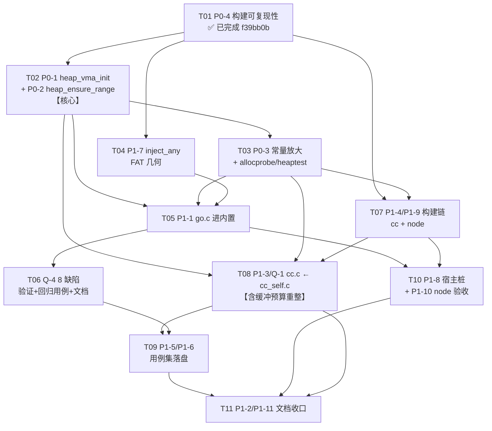
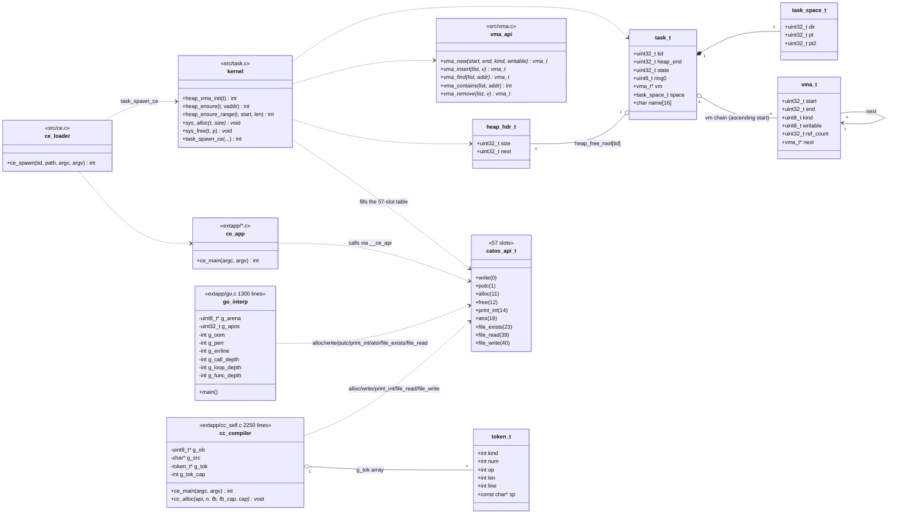
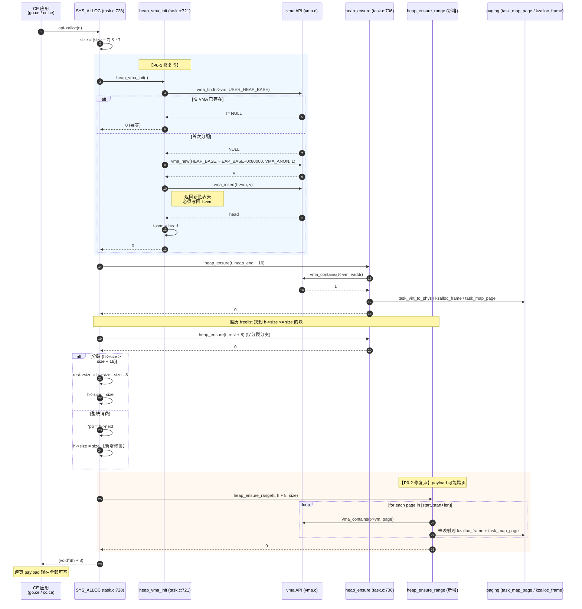
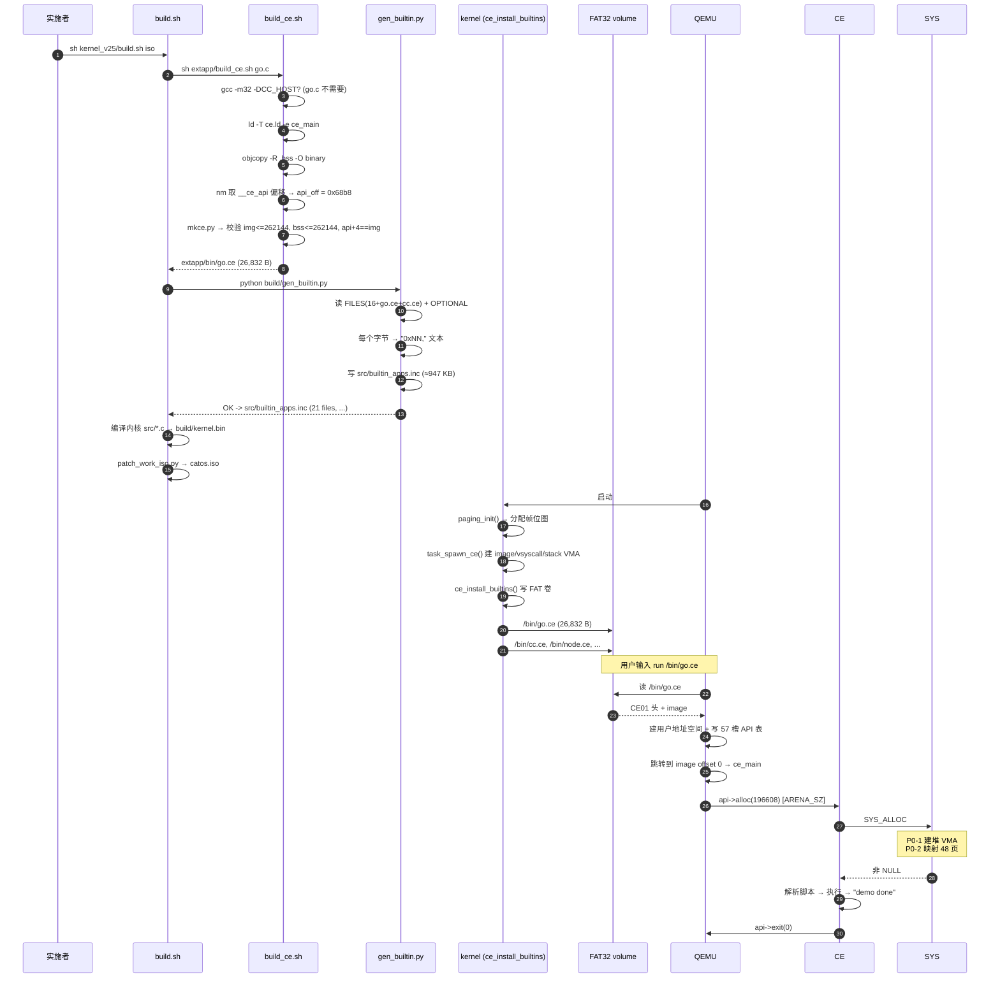
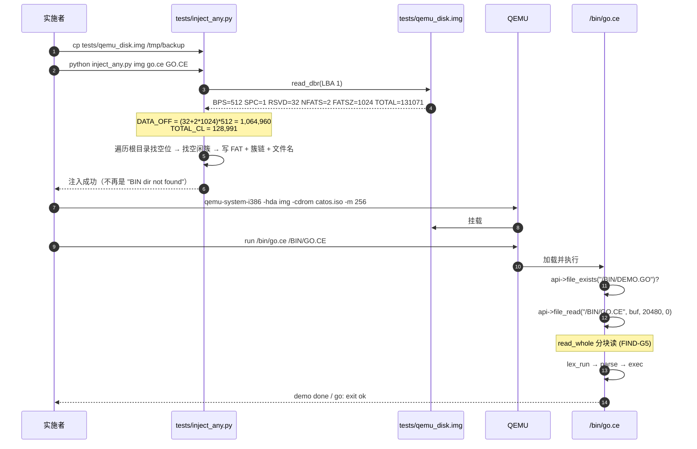

# CatOS 合并收割 —— 移植设计与任务分解

> **文档状态**：架构师（高见远 / Gao）产出，供实施阶段直接照做。
> **依据**：`docs/merge-harvest-PRD.md` v0.3（662 行，唯一设计依据）。
> **工作树**：`C:/Users/Admin/WorkBuddy/Worktrees/CatOs/master-87a3e1a0`，分支 `workbuddy/todo-20261106-1906`。
> **本文档所有数字均为实测**，非推断。凡与 PRD 不一致处，均在 §11「与 PRD 的偏差及理由」中逐条列出。

---

## 目录

| 章节 | 内容 | 对应交付项 |
|---|---|---|
| §0 | 阅读指引与当前工作树快照 | — |
| §1 | 实现方案总览（改哪些子系统、为什么这个顺序） | 交付项 1 |
| §2 | **P0 四项精确设计（可直接照抄的代码级方案）** | 交付项 2、7 |
| §3 | P1-1 `go.c` 移植设计 | 交付项 3 |
| §4 | **Q-4 的 8 个 Go 缺陷修复设计** | 交付项 4 |
| §5 | Q-1 `cc.c` ← `cc_self.c` 替换设计 | 交付项 5 |
| §6 | P1-7 `inject_any.py` FAT 几何 + P1-8 宿主桩 | 交付项 6 |
| §7 | 文件级任务列表（有序 + 依赖 + 验收命令） | 交付项 8 |
| §8 | 共享知识（跨文件硬编码位置清单） | 交付项 9 |
| §9 | 数据结构与接口（Mermaid classDiagram） | 架构师职责 |
| §10 | 程序调用流（Mermaid sequenceDiagram） | 架构师职责 |
| §11 | 与 PRD 的偏差及理由 + 待明确事项 | 交付项 10 |
| 附录 A | 基线与验收命令速查 | — |

---

## §0 阅读指引与当前工作树快照

### 0.1 本文档的三类内容

| 标记 | 含义 | 实施者动作 |
|---|---|---|
| **【可直接照抄】** | 代码级方案已验证（含行号、含实测产物大小） | 直接复制进文件 |
| **【已实测】** | 结论有本地实验/实机证据支撑 | 照做，验收用文中命令 |
| **【需判断】** | 存在多个合理选项，架构师给出推荐但需实施者确认上下文 | 按推荐做，遇阻回退到备选 |

### 0.2 工作树快照（撰写本文档时实测）

```
$ git log --oneline -5
0cd3e6d docs: record merge-harvest assessment and execution results
f39bb0b build: make ISO build reproducible from a clean clone     ← P0-4 已完成
101a326 harvest: archive legacy docs + record D-1..D-15 in issue tracker
66bbfce curation: purge snapshot junk from repo root              ← E1 已完成
a7eae5a be_text: fix post-gfx stripe artifact -- Seq02 map mask leaked 0x0F
```

**已被工程师提前落地的部分（本文档只做复核，不重复实施）**：

| 项 | 状态 | 证据 |
|---|---|---|
| **P0-4 构建可复现性** | ✅ **已完成** | `git ls-files kernel_v25/build/catos_work.iso` → 返回该路径；`.gitignore:35` 的 `!` 否定规则已移到 `.gitignore:24` 的 `*.iso` **之后**；注释已按 git **last-match-wins** 语义改写 |
| E1 根目录治理（J-1~J-18） | ✅ 已完成 | commit `66bbfce` |
| E2 文档归档 + D-1~D-15 落档 #48~#65 | ✅ 已完成 | commit `101a326` |
| `go.c` + 5 个 `.GO` 用例落位 | 🟡 **已落位但未入库** | `kernel_v25/extapp/go.c`（1,300 行，与原项目**逐字节相同**）、`kernel_v25/extapp/cases/*.GO`（5 个，逐字节相同）当前是 **untracked**；`kernel_v25/extapp/bin/go.ce`（26,832 B）已由工程师构建产出，同样 untracked |

> ⚠️ **实施者第一件事**：`git add kernel_v25/extapp/go.c kernel_v25/extapp/cases/ kernel_v25/extapp/bin/go.ce`。这三个路径是 P1-1 的落位物，不入库则 `gen_builtin.py` 之外的一切都无从谈起。

### 0.3 硬约束（不得违反）

- **唯一可写工作树**：`C:/Users/Admin/WorkBuddy/Worktrees/CatOs/master-87a3e1a0`。
- **只读**：`D:/CatOs`（主线，另一会话在跑）、`D:/CatOs/Catos_Better_better`（原项目）。
- **他人 WIP 绝不碰**：`vd2.h` / `vga_draw_c` / `vga_draw_h` / `kernel_v25/build_log.txt` / `simout*`。
- **合并前基线必须保持**：`tests/test_mkce.py` 48/48、`tests/ce_regress.py` PASS=5/SKIP=13/FAIL=0、`tests/test_cc.py` 8/8、`tests/qemu_regress.py` 12/12。
- 构建命令：`export PATH=/d/msys/mingw32/bin:/usr/bin:/bin`；`PYTHON=C:/Users/Admin/.workbuddy/binaries/python/versions/3.13.12/python.exe`；`sh kernel_v25/build.sh iso`（约 30–33 秒）；QEMU 在 `C:/qemu-portable/qemu-system-i386.exe`。

---

## §1 实现方案总览

### 1.1 本次合并要动的四个子系统

```
                  ┌──────────────────────────────────────────────┐
   子系统 A       │  内核内存子系统（task.c / paging.h / vma.c）   │  ← P0-1 / P0-2 / P0-3
   【必须先修】   │  修复 heap VMA 建立逻辑 + 跨页映射 + 常量回退  │
                  └───────────────┬──────────────────────────────┘
                                  │ 提供 api->alloc() 与跨页堆
              ┌───────────────────┴───────────────────┐
              ▼                                       ▼
   ┌──────────────────────┐              ┌──────────────────────────┐
   │ 子系统 B：CE 应用链   │              │ 子系统 C：构建链          │
   │ go.c / cc_self.c     │              │ build.sh / build_ce.sh    │
   │ → 内置 /bin/*.ce      │              │ gen_builtin.py            │
   │ P1-1 / Q-1 / P1-3/4   │              │ P1-4 / P1-9              │
   └──────────┬───────────┘              └────────────┬─────────────┘
              │                                          │
              └────────────────┬─────────────────────────┘
                               ▼
                  ┌──────────────────────────────┐
                  │ 子系统 D：测试与工具链        │
                  │ test_cc.py / inject_any.py   │
                  │ host_stub_go.c / cases/       │
                  │ P1-5/6/7/8/10                │
                  └──────────────────────────────┘
```

### 1.2 为什么是这个顺序（关键路径推理）

**根因链**：`heap_vma_init()` 早退 → `api->alloc()` 恒返回 NULL → 一切需要堆的应用（`go.c` 的 192 KiB arena、`cc_self.c` 的 8 路工作集）**全部退化为静态兜底**。
`go.c` 的静态兜底只有 **64 KiB**（`g_arena_static[64u*1024u]`，go.c:76），而它要解释的脚本会产生远超 64 KiB 的 AST → 必然 OOM。
`cc_self.c` 的静态兜底更小：token 缓冲仅 **512 个 token**（`g_tok_static[512]`，cc_self.c:189），而自编译 `cc_self.c` 需要约 **24.2K token** → 必然 `source too complex`。

**结论**：P0-1 是**所有应用侧工作的前置**，不是并列项。它必须最先修。
P0-2（跨页映射）是 P0-1 的**紧耦合补丁**：`heap_ensure()` 只映射 1 页，单页分配能过、`alloc(8K)` 必 `#PF`（实测 `cr2=0x02101007`）。
P0-3（常量放大）是**放大器**：它决定堆够不够大。**P0-3 必须与 P0-1 同批落地**，否则会出现「P0-1 修好了但 `go.c` 仍 OOM」的半吊子状态。

**构建链（P1-4 / P1-9）必须在应用侧之前**：现在 `cc` / `go` / `node` 三个都不在 `kernel_v25/build.sh:43` 的应用列表里，`gen_builtin.py` 的 `FILES` 列表（16 项）里也没有 `/bin/go.ce` → **改了源码也不进 ISO**。

**测试侧（P1-5/6/7/8/10）在最后**：它们验证前面所有东西，且 P1-7（`inject_any.py` 修 FAT 几何）是 P1-1 的**验证手段**（往镜像注入 `go.ce` 才能在 QEMU 里跑它）。

### 1.3 实施顺序总览（与 PRD §3.1 依赖图一致）

```
P0-4（已完成 f39bb0b）
  │
  └──► P0-1 ──► P0-2 ──┐
        │                ├──► P1-1（go.c 进内核）──► P1-2（Go 文档）
        └──► P0-3 ──────┤
                         ├──► P1-4（构建链）──► P1-3（cc.c 收敛）──► P1-5/P1-6（用例集）
                         │            └──────► P1-9 ──► P1-10
                         └──► P1-7（inject_any 修几何，验证手段）
                                      P1-8（宿主桩，独立可跑）
```

**关键路径**（最长依赖链，决定总工期）：
`P0-4` → `P0-1` → `P0-2` → `P1-4` → `P1-3` → `P1-5/P1-6` → 全量验收

---

## §2 P0 四项精确设计

### 2.1 【P0-1】`heap_vma_init()` — 恢复 `api->alloc()`

#### 2.1.1 缺陷本体（`kernel_v25/src/task.c:721-726`）

```c
/* called once on the first SYS_ALLOC to carve out the heap VMA. */
static int heap_vma_init(task_t *t) {
    if (t->vm) return 0;   /* already initialized */   // ← 缺陷①：恒早退
    t->vm = vma_new(USER_HEAP_BASE, USER_HEAP_BASE + USER_HEAP_MAX,
                    VMA_ANON, 1);                       // ← 缺陷②：覆盖赋值
    return t->vm ? 0 : -1;
}
```

**根因（双重缺陷，缺一不可修）**：

| 缺陷 | 机理 | 单独修它的后果 |
|---|---|---|
| ① `if (t->vm) return 0;` 恒真 | `task_spawn_ce()`（task.c:1760-1778）在 spawn 时**已经**把 image / vsyscall / stack 三个 VMA 装进了 `t->vm`，所以第一次 `SYS_ALLOC` 时 `t->vm` 必然非 NULL → 函数**永远早退**，堆 VMA 从未被创建 | — |
| ② `t->vm = vma_new(...)` 覆盖 | 假如早退被移除，这行会把整个 VMA 链表**替换成单个堆 VMA**，image/vsyscall/stack 三个 VMA 全部丢失 | 后续 `task_page_fault` 找不到 image VMA → 任何取指即 `#PF`，任务秒死 |

**观测证据**：`heap_ensure()`（task.c:706-714）第一行就是 `if (!vma_contains(t->vm, vaddr)) return -1;`。堆 VMA 不存在 → `vma_contains` 恒假 → `heap_ensure` 恒返回 −1 → `sys_alloc()` 在 task.c:732 直接 `return 0` → **`api->alloc()` 恒返回 NULL**。

#### 2.1.2 `vma_insert()` 的真实语义（`kernel_v25/src/vma.c:40-51`）

```c
vma_t *vma_insert(vma_t *list, vma_t *v) {
    if (!list || v->start < list->start) {
        v->next = list;
        return v;                        // ← 返回【新链表头】
    }
    vma_t *prev = list;
    while (prev->next && prev->next->start <= v->start)
        prev = prev->next;
    v->next = prev->next;
    prev->next = v;
    return list;                         // ← 返回【原链表头】
}
```

**关键契约**：`vma_insert()` 返回的是**插入后的链表头**，可能 ≠ 传入的 `list`。
因此正确写法**必须**是 `t->vm = vma_insert(t->vm, v);` —— 把返回值写回 `t->vm`。
若写成 `vma_insert(t->vm, v);`（丢弃返回值），当新 VMA 的 `start` 小于原链表头时，链表头就丢了。

> 本项目现存的正确用法可作参照：`task_spawn_ce()` 的 ELF 路径（task.c:1620）写的就是 `t->vm = vma_insert(t->vm, v);`。

#### 2.1.3 地址序正确性论证（为什么插进去不会乱序、不会重叠）

采用 **Q-2 后的常量**（`USER_STACK_SZ = 0x20000`、`USER_HEAP_MAX = 0x80000`）：

| VMA | `start` | `end` | 来源 |
|---|---|---|---|
| image | `USER_IMAGE_BASE` = `0x02000000` | `0x02000000 + span`（span ≤ 0x80000，因 `CE_MAX_IMAGE`+`CE_MAX_BSS` = 256 KiB × 2 = 512 KiB） | task.c:1764-1766 |
| vsyscall | `USER_VSYSCALL` = `0x02080000` | `0x02081000` | task.c:1769 |
| **heap** | `USER_HEAP_BASE` = `0x02100000` | `0x02100000 + 0x80000` = `0x02180000` | **本次新增** |
| stack | `USER_STACK_TOP - USER_STACK_SZ` = `0x02200000 − 0x20000` = `0x021E0000` | `USER_STACK_TOP` = `0x02200000` | task.c:1773-1775 |

**排序**：`0x02000000 < 0x02080000 < 0x02100000 < 0x021E0000` —— image < vsyscall < **heap** < stack ✅

**重叠检查**（相邻两段）：
- image 尾 `0x02000000 + 0x80000` = `0x02080000` = vsyscall 头 → **相接不重叠**（CE_MAX_IMAGE+CE_MAX_BSS 上限恰好 512 KiB，见 `kernel_v25/include/ce.h:35,38`）✅
- vsyscall 尾 `0x02081000` < heap 头 `0x02100000` → 间隙 0x7F000 ✅
- **heap 尾 `0x02180000` < stack 头 `0x021E0000`** → 间隙 0x60000（384 KiB）✅ **不重叠**
- stack 尾 `0x02200000` < `USER_ARENA_END` = `0x02400000` ✅

**结论**：堆 VMA `[0x02100000, 0x02180000)` 与既有 image / vsyscall / stack **三段全部不重叠**，且 `start` 严格大于 vsyscall 的 `start`、严格小于 stack 的 `start`。因此 `vma_insert()` 走的是「尾部追加」分支（`prev->next->start <= v->start` 循环），**返回的链表头仍是原来的 image VMA**，`t->vm` 语义不变。

> ⚠️ **但仍必须写 `t->vm = vma_insert(t->vm, v);`** —— 正确性不应依赖「本次恰好不改变链表头」这一巧合。原项目 `task.c` 与本项目 ELF 路径（task.c:1620）都是这么写的。

#### 2.1.4 【可直接照抄】改后完整函数

```c
/* called once on the first SYS_ALLOC to carve out the heap VMA.
 *
 * The heap VMA must be INSERTED into the existing list, never
 * assigned over it: task_spawn_ce() has already linked the image,
 * vsyscall and stack VMAs into t->vm, and overwriting the list
 * would lose all three (every later page fault on the image would
 * then fail to find a VMA and kill the task).
 *
 * vma_insert() returns the (possibly new) list head, so the result
 * must be written back to t->vm.
 *
 * Address order with USER_HEAP_MAX = 0x80000 (512 KiB):
 *   image    0x02000000 .. 0x02080000
 *   vsyscall 0x02080000 .. 0x02081000
 *   heap     0x02100000 .. 0x02180000   <-- inserted here
 *   stack    0x021E0000 .. 0x02200000
 * The heap range overlaps none of the others and sorts between
 * vsyscall and stack, so vma_insert() appends it in the middle of
 * the chain without disturbing the head.
 */
static int heap_vma_init(task_t *t) {
    if (!t->vm) return -1;
    /* already initialized?  The heap VMA is the one that contains
     * USER_HEAP_BASE; nothing else does. */
    if (vma_find(t->vm, USER_HEAP_BASE)) return 0;
    vma_t *v = vma_new(USER_HEAP_BASE, USER_HEAP_BASE + USER_HEAP_MAX,
                        VMA_ANON, 1);
    if (!v) return -1;
    t->vm = vma_insert(t->vm, v);   /* vma_insert returns the new head */
    return 0;
}
```

#### 2.1.5 返回值语义

| 返回 | 含义 | 上层 `sys_alloc()` 的反应 |
|---|---|---|
| `0` | 堆 VMA 已存在或本次成功创建 | 继续走 `heap_ensure()` |
| `-1` | `t->vm == NULL`（任务地址空间异常）或 `vma_new()` 分配内核帧失败 | `sys_alloc()` 返回 `0` → `api->alloc()` 返回 NULL → CE 应用侧看到 OOM |

**失败路径无副作用**：`vma_new()` 失败时返回 NULL，此时**不**修改 `t->vm`，链表保持原状 → 上层可以安全地返回 NULL 让 CE 应用自行处理 OOM。

#### 2.1.6 前置声明需求

`vma_find()` 在 `kernel_v25/include/paging.h:67` 已声明 ✅，`vma_new()` 在 :57 ✅，`vma_insert()` 在 :62 附近 ✅ —— **task.c 无需新增 include**（它已 `#include "paging.h"`，task.c:24）。

#### 2.1.7 验收

```bash
# 静态检查：确认早退已移除且用了 vma_insert
grep -n "heap_vma_init" -A14 kernel_v25/src/task.c
# 期望：看到 vma_find 幂等判断 + vma_insert + `t->vm = vma_insert(...)`

# 动态：QEMU 内跑 allocprobe（见 §7 T03 产出的探针）
# 期望输出：alloc(64) = 0x02100008 之类【非 0】 + ALLOCPROBE: alloc works
# 对应 PRD V-5
```

---

### 2.2 【P0-2】`heap_ensure_range()` — 修复跨页分配 `#PF`

#### 2.2.1 缺陷本体（`kernel_v25/src/task.c:706-714`）

```c
static int heap_ensure(task_t *t, uint32_t vaddr) {
    if (!vma_contains(t->vm, vaddr)) return -1;
    if (task_virt_to_phys(&t->space, vaddr & ~0xFFFu)) return 0;   /* 已映射 */
    uint32_t f = (uint32_t)kzalloc_frame();
    if (!f) return -1;
    return task_map_page(&t->space, vaddr & ~0xFFFu, f, 1);
}
```

**只映射 1 页**。`sys_alloc()`（task.c:728-759）拿到一块 `size` 字节的 payload 后返回给 CE 应用，但只有**首页**被映射 → 应用一旦写越过第 1 页边界 → `#PF`（实测 `cr2=0x02101007`）。

#### 2.2.2 原项目来源（`D:/CatOs/Catos_Better_better/src/task.c:661-673`，其 #47 修复）

```c
static int heap_ensure_range(task_t *t, uint32_t start, uint32_t len) {
    if (len == 0) return 0;
    uint32_t last = (start + len - 1) & ~0xFFFu;
    for (uint32_t a = start & ~0xFFFu; ; a += 0x1000u) {
        if (a < USER_HEAP_BASE || a >= USER_HEAP_BASE + USER_HEAP_MAX) return -1;
        if (!task_virt_to_phys(&t->space, a)) {
            uint32_t f = (uint32_t)kzalloc_frame();
            if (!f) return -1;
            if (task_map_page(&t->space, a, f, 1) != 0) return -1;
        }
        if (a >= last) break;
    }
    return 0;
}
```

原项目在 `sys_alloc()` 里的调用点（原 `src/task.c:709-710`）：

```c
    /* #47: payload may span pages - map them all up front */
    if (heap_ensure_range(t, (uint32_t)h + sizeof(heap_hdr_t), size) != 0)
        return 0;
```

#### 2.2.3 移植到现项目的适配点（**必须改，否则行为不等价**）

| # | 原项目写法 | 现项目必须改成 | 理由 |
|---|---|---|---|
| **A** | 显式范围检查 `a < USER_HEAP_BASE \|\| a >= USER_HEAP_BASE + USER_HEAP_MAX` | `if (!vma_contains(t->vm, a)) return -1;` | 现项目用 **VMA 描述符**而非裸常量界定堆范围；堆 VMA 由 `heap_vma_init()` 创建（P0-1），其范围恰为 `[USER_HEAP_BASE, USER_HEAP_BASE+USER_HEAP_MAX)`。**两处判定等价**，但用 `vma_contains` 才能在堆 VMA 创建失败（P0-1 未修）时正确返回 −1 |
| **B** | 直接 `kzalloc_frame()` 后 `task_map_page()` | 加上 `frame_free(f)` 回滚 | 现项目 `SYS_BRK` 路径（task.c:1385-1391）**有** `frame_free(f)` 回滚；`heap_ensure()` 却**没有**。移植时统一补上，避免 `task_map_page` 失败时泄漏帧 |
| **C** | 无 | 需在 `heap_ensure()` **之前**定义 | 见 §2.2.5 的前置声明说明 |

#### 2.2.4 【可直接照抄】适配后完整实现

```c
/* Map a whole [start, start+len) range of the task heap into physical
 * frames.  heap_ensure() maps a single page (the free-list header);
 * this one maps every page a payload spans, so an allocation that
 * crosses a page boundary no longer faults on the untouched tail.
 *
 * Returns 0 on success, -1 if the range leaves the heap VMA or if a
 * frame cannot be allocated/mapped.
 */
static int heap_ensure_range(task_t *t, uint32_t start, uint32_t len) {
    if (len == 0) return 0;
    uint32_t last = (start + len - 1u) & ~0xFFFu;      /* last page touched */
    for (uint32_t a = start & ~0xFFFu; ; a += 0x1000u) {
        /* must lie inside the heap VMA (covers USER_HEAP_BASE ..
         * USER_HEAP_BASE + USER_HEAP_MAX) */
        if (!vma_contains(t->vm, a)) return -1;
        if (!task_virt_to_phys(&t->space, a)) {        /* not mapped yet */
            uint32_t f = (uint32_t)kzalloc_frame();
            if (!f) return -1;
            if (task_map_page(&t->space, a, f, 1) != 0) {
                frame_free(f);                          /* roll back */
                return -1;
            }
        }
        if (a >= last) break;
    }
    return 0;
}
```

#### 2.2.5 与 `heap_ensure()` 的职责划分（**两者并存，不是替换**）

| | `heap_ensure(t, vaddr)` | `heap_ensure_range(t, start, len)` |
|---|---|---|
| 语义 | 映射**单页**（含 `vaddr`） | 映射**[start, start+len) 覆盖的全部页** |
| 调用者 | `sys_alloc()` 里定位 freelist 头块（task.c:732 / :746）；`SYS_BRK` 扩堆时逐页调用 | `sys_alloc()` 返回 payload **之前**，一次性映射整个 payload |
| 为什么都需要 | freelist 的 `rest` 块头（`h + 8 + size`）必须先被映射，否则 `rest->size = ...` 写入时 `#PF` | payload 可能跨页，必须全映射 |
| 幂等性 | `task_virt_to_phys` 命中即返回 ✅ | 同样逐页检查，重复调用安全 ✅ |

**结论**：`heap_ensure()` 保留不动（它保证 freelist 节点本身可写），**新增** `heap_ensure_range()` 负责 payload 全覆盖。

**前置声明**：`heap_ensure_range()` 在 `sys_alloc()`（task.c:728）**之后**被调用，但定义若放在 `heap_ensure()`（task.c:706-714）之后、`heap_vma_init()`（task.c:721）之前，则 **C 语言要求先声明后使用** → **必须在 `heap_ensure()` 之前加前向声明**：

```c
/* forward declaration: heap_ensure_range() is called from sys_alloc() */
static int heap_ensure_range(task_t *t, uint32_t start, uint32_t len);
```

放置位置：`kernel_v25/src/task.c` 第 705 行（`heap_ensure()` 定义之前）。这样 `heap_ensure_range()` 的实体定义可以放在 `heap_ensure()` 之后（紧邻，逻辑聚合），而 `sys_alloc()` 调用时已有原型。

#### 2.2.6 `sys_alloc()` 的调用点改法

**改后 `sys_alloc()` 全文**（`kernel_v25/src/task.c:728-759`）：

```c
static void *sys_alloc(task_t *t, uint32_t size) {
    if (size == 0) size = 1;
    size = (size + 7u) & ~7u;
    if (heap_vma_init(t) != 0) return 0;
    if (heap_ensure(t, t->heap_end + sizeof(heap_hdr_t) + 8) != 0) return 0;
    heap_hdr_t *base = (heap_hdr_t *)t->heap_end;
    if (base->size == 0) {               /* first alloc: claim whole arena */
        base->size = USER_HEAP_MAX - (t->heap_end - USER_HEAP_BASE)
                     - sizeof(heap_hdr_t);
        base->next = 0;
        heap_free_root[t->tid] = t->heap_end;
    }
    uint32_t *pp = &heap_free_root[t->tid];
    while (*pp) {
        heap_hdr_t *h = (heap_hdr_t *)*pp;
        if (h->size >= size) {
            if (h->size >= size + sizeof(heap_hdr_t) + 8) {
                heap_hdr_t *rest = (heap_hdr_t *)((uint8_t *)h + sizeof(heap_hdr_t) + size);
                if (heap_ensure(t, (uint32_t)rest + sizeof(heap_hdr_t)) != 0) return 0;
                rest->size = h->size - size - sizeof(heap_hdr_t);
                rest->next = h->next;
                *pp = (uint32_t)rest;
                h->size = size;
            } else {
                *pp = h->next;
                h->size = size;      /* ← 【新增】原项目有，现项目缺 */
            }
            /* #47: the payload may span pages -- map them all up front */
            if (heap_ensure_range(t, (uint32_t)h + sizeof(heap_hdr_t), size) != 0)
                return 0;
            return (void *)((uint8_t *)h + sizeof(heap_hdr_t));
        }
        pp = &h->next;
    }
    return 0;
}
```

**两处改动的必要性**：

| 改动 | 位置 | 不改会怎样 |
|---|---|---|
| 新增 `heap_ensure_range(...)` 调用 | `return` 之前 | 跨页分配 → 应用写 payload 尾部 → `#PF` → 任务被杀（实测 `cr2=0x02101007`） |
| 新增 `h->size = size;` | `else` 分支（整块消费） | **块大小语义漂移**：整块被消费时 `h->size` 仍是旧值，后续 `sys_free()` 把这块放回 freelist 时携带错误的 size → 分配器会认为这块比实际大 → **越界写**。原项目有这一行（`D:/CatOs/Catos_Better_better/src/task.c:704`），现项目在移植时丢了 |

> 📌 **这是本次设计新发现、PRD 未记录的缺陷**（原 PRD 只记了「只映射 1 页」）。`h->size = size;` 缺失属于**潜在内存破坏**，不是功能缺失，**必须与 P0-2 同批修**。

#### 2.2.7 关于 guard page 的说明（**不是缺陷，不要改**）

`VMA_GUARD_PAGES = 2`（`kernel_v25/src/vma.c:88`）会让每个**可写** VMA 的底部 2 页（8 KiB）在**按需映射路径**（`vma_map_page_on_fault`，vma.c:93-110）上不可映射。

但 **`heap_ensure()` / `heap_ensure_range()` 走的是 `task_map_page()` 直接映射路径，不经过 guard 检查**。
这是**有意为之**：堆的第一个可用地址就是 `USER_HEAP_BASE`（`t->heap_end` 初值 = `USER_HEAP_BASE`，task.c:1843），如果 guard 生效，堆的**头 8 KiB 永远不可用**，freelist 的第一个块头就放不下。

> ⚠️ **实施者注意**：不要「顺手」给堆 VMA 加 guard，也不要把 `heap_ensure` 改成走 `vma_map_page_on_fault`。这会直接破坏堆。

#### 2.2.8 验收

```bash
# 静态：确认前向声明 + 新函数 + 两处调用点改动
grep -n "heap_ensure_range" kernel_v25/src/task.c
# 期望 3 处命中：前向声明 / 函数定义 / sys_alloc 内调用

# 动态：QEMU 内跑 heaptest（跨页分配探针，见 §7 T03）
# 期望：HEAPTEST PASS（无 page fault，无 #PF）
# 对应 PRD V-6
```

---

### 2.3 【P0-3】常量放大 — `USER_STACK_SZ` / `USER_HEAP_MAX` 恢复

#### 2.3.1 改动（`kernel_v25/include/paging.h:80,82`）

```c
#define USER_HEAP_MAX   0x80000u       /* 512 KiB  (was 0x40000 = 256 KiB) */
#define USER_STACK_TOP  0x2200000u
#define USER_STACK_SZ   0x20000u       /* 128 KiB  (was 0x10000 = 64 KiB)  */
```

**只改这两个常量，其余一个不动。**

#### 2.3.2 逐项连锁影响结论

##### ① `task_space_t` 结构 —— **不需要改**

```c
/* kernel_v25/include/paging.h:26-31 */
typedef struct {
    uint32_t dir;    /* page directory */
    uint32_t pt;     /* PDE 8  : 32..36 MiB  (image/vsyscall/heap/stack) */
    uint32_t pt2;    /* PDE 9  : 36..40 MiB  (ELF PIE + mmap arena) */
} task_space_t;
```

**结构体内没有任何尺寸字段**，不含 `heap_max` / `stack_sz`。地址空间是「按需映射」模型 —— 页表项在 `task_map_page()` 时才写入，因此**页表容量与用户请求的堆/栈大小无关**。✅ **零改动。**

##### ② 页表 PDE 覆盖范围 —— **不需要新增 PDE**

| 区段 | 虚拟地址范围 | 所属 PDE | 页表来源 |
|---|---|---|---|
| image | `0x02000000` – `0x02080000` | **PDE 8** | `s->pt` |
| vsyscall | `0x02080000` – `0x02081000` | **PDE 8** | `s->pt` |
| **heap（改后）** | `0x02100000` – `0x02180000` | **PDE 8** | `s->pt` |
| **stack（改后）** | `0x021E0000` – `0x02200000` | **PDE 8** | `s->pt` |
| mmap 扩展竞技场 | `0x02400000` – `0x02800000` | **PDE 9** | `s->pt2` |

PDE 8 覆盖 **32–36 MiB 共 4 MiB**，四个区段全部落在其中，**PDE 覆盖范围完全不变**。
`pt_for()`（`kernel_v25/src/paging.c:130-135`）只识别 PDE 8 / 9，**不需要改**。
`task_space_create()`（`paging.c`）分配 dir/pt/pt2 三帧，**不需要改**。✅ **零改动。**

##### ③ 是否侵占 mmap 扩展竞技场（36–40 MiB）—— **不侵占**

- 竞技场下界 `USER_EXT_BASE = 0x0240000`（36 MiB）。
- 改后堆上界 `0x02180000`（33 MiB）、栈上界 `0x02200000`（34 MiB）。
- `0x02200000 < 0x02400000` → **栈离竞技场还有 2 MiB 间隙**，堆离竞技场有 2.5 MiB。✅ **完全不侵占。**

> ⚠️ **反向检查**：`USER_ARENA_END = 0x0240000`（paging.h:83）是旧常量，本次**不需要动**。改后 `stack.end = 0x02200000` 仍 < `USER_ARENA_END`。✅

##### ④ 是否与 `CE_MAX_IMAGE` / `CE_MAX_BSS`（各 256 KiB）冲突 —— **不冲突，但相邻**

- CE 镜像加载基址 `CE_LOAD_BASE = 0x2000000`（`kernel_v25/include/ce.h:33`），image VMA 范围 `[0x02000000, 0x02000000 + span)`。
- `span = (img + bss + 0xFFF) & ~0xFFF`（task.c:1764）。
- 上限：`img ≤ CE_MAX_IMAGE = 0x40000` 且 `bss ≤ CE_MAX_BSS = 0x40000` ⇒ `span ≤ 0x80000` ⇒ image VMA 尾 = `0x02080000` = `USER_VSYSCALL` 起点。
- 堆基址 `0x02100000` 远在 `0x02080000` 之后 → **无重叠**。✅

> **真正需要注意的是另一件事**：`cc_self.c` 替换后的 `bss = 0xe080`（57,472 B）和 `go.c` 的 `bss = 0x292c0`（168,384 B）都**远小于** `CE_MAX_BSS = 0x40000`（262,144 B）→ `mkce.py` 的 bss 闸门不会触发。✅ 见 §5.4。

##### ⑤ 物理页框预留与 QEMU `-m 256` 下的并发压力 —— **充裕**

**栈是「全量预映射」的**（task.c:1753-1758）：

```c
for (uint32_t va = USER_STACK_TOP - USER_STACK_SZ; va < USER_STACK_TOP; va += 4096) {
    uint32_t f = (uint32_t)kzalloc_frame();
    if (!f) goto fail_space6;
    task_map_page(&t->space, va, f, 1);
}
```

- 改前：`0x10000 / 0x1000` = **16 页/任务**
- 改后：`0x20000 / 0x1000` = **32 页/任务**
- `MAX_TASKS = 16` ⇒ 栈最坏占用 = 16 × 32 = **512 页 = 2 MiB**（改前 1 MiB）

**堆是「按需映射」的**（`heap_ensure` / `heap_ensure_range` 只在实际分配时映射）：

- 堆最坏 = 16 任务 × 512 KiB = 8 MiB（但只有真正分配满才发生；`go.c` 独占 192 KiB，`cc_self.c` 独占约 380 KiB）

**总账**（QEMU `-m 256` → 256 MiB 物理内存）：
- 内核自身：`KBASE = 0x1000000`（16 MiB）起，`kernel.bin` ≈ 5.83 MiB，`_bss_end` 之后才开始帧分配
- 帧位图覆盖 `frames_base` → `MEM_TOP = 0x4000000`（**64 MiB**）—— 见 `kernel_v25/src/paging.c`
- **注意**：即使 QEMU 给 256 MiB，`MEM_TOP` 只把 **低 64 MiB** 纳入帧分配器管理。这 64 MiB 要装下：内核镜像 + 内核 bss + 位图 + 所有任务的页表 + 栈 + 堆。
- 16 任务满载：页表 16×3 = 48 页 + 栈 512 页 + 堆 ≤ 2048 页 ≈ 2.5 MiB ≈ 2600 页 = 10 MiB
- 加上内核约 6 MiB + 位图（64 MiB / 4 KiB / 8 ≈ 2 KiB）→ **总占用约 16–18 MiB < 64 MiB** ✅ **充裕**

> ⚠️ **真正的边界不是物理内存，而是 `USER_HEAP_BASE` 到 `stack` 之间的虚拟地址空洞**：
> `0x02100000` → `0x021E0000` 共 **1.75 MiB**。改后堆占 `0x02100000`–`0x02180000`（512 KiB），栈从 `0x021E0000` 起 → **空洞还剩 384 KiB 未用**。若将来还想加大堆，最多可到 1.75 MiB。**本次不需要用到。**

##### ⑥ 其他受影响的代码路径（必须复核）

| 位置 | 影响 | 是否需要改 |
|---|---|---|
| `task.c:1377` `SYS_BRK` 的 `limit = USER_HEAP_BASE + USER_HEAP_MAX` | brk 上限自动从 256 KiB 变 512 KiB | ❌ 不改（自动跟随常量） |
| `task.c:735` 首次分配 `base->size = USER_HEAP_MAX - (heap_end - USER_HEAP_BASE) - 8` | arena 容量自动变 512 KiB − 8 | ❌ 不改 |
| `task.c:1843` `t->heap_end = USER_HEAP_BASE` | 不变 | ❌ |
| `task.c:1465-1477` `task_pages_of()` | 按 VMA 跨度累加页数，堆 VMA 加进来后**页数虚高**（见下） | ⚠️ **建议改**，见 §2.3.3 |
| `kernel_v25/extapp/cc_self.c:146-147` 注释「USER_HEAP_MAX is 256 KiB total」 | 注释过期 | ⚠️ 建议同步更新（见 §5.5） |
| `kernel_v25/extapp/cc_self.c:2188` 注释「a separate 256 KiB window」 | 同上 | ⚠️ 同上 |

##### ⑦ `task_pages_of()` 的页数虚高（**建议顺手修**）

```c
/* kernel_v25/src/task.c:1465-1477 */
static uint32_t task_pages_of(task_t *t) {
    uint32_t n = 0;
    for (const vma_t *v = t->vm; v; v = v->next) {
        if (v->kind == VMA_VSYSCALL) continue;
        n += (v->end - v->start) >> 12;      // ← 按【跨度】算，不是【实驻】页
    }
    return n;
}
```

P0-1 修好后堆 VMA 恒存在（512 KiB = 128 页），即使任务只用了 1 页，`top` 命令也会显示 128 页。
**建议改法**（可选，不阻塞主线）：

```c
static uint32_t task_pages_of(task_t *t) {
    if (!t->space.pt) return 0;
    /* Count RESIDENT pages by walking the page table, not the VMA
     * span: the heap VMA is 512 KiB but a task usually touches a
     * handful of pages, and the span-based count over-reports. */
    uint32_t n = 0;
    for (uint32_t i = 0; i < 1024; i++) {              /* PDE 8 = 1024 PTEs */
        uint32_t pte = task_pte_read(&t->space, 8, i);
        if (!pte) continue;
        /* a present PTE may cover 4 KiB; count it once */
        n++;
    }
    return n;
}
```

> ⚠️ `task_pte_read()` **本项目不存在**，需自行实现（读 `s->pt` 对应项的高 20 位物理帧号，判 `& 0x001` present 位）。
> **若不想新增内核 API，最省事的做法是：把堆 VMA 排除在计数外**（`if (v->kind == VMA_ANON && v->start == USER_HEAP_BASE) continue;`），代价是 `top` 不显示堆占用。
> **【需判断】** 推荐**保留现状不改**（`task_pages_of` 本来就注明「This is an approximation but cheap」），把它列为 P2 可选项，避免在主线里引入新的内核读页表 API 风险。**本设计默认不改。**

#### 2.3.3 验收

```bash
grep -c 'USER_STACK_SZ   0x20000u' kernel_v25/include/paging.h   # 期望 1   (V-12)
grep -c 'USER_HEAP_MAX   0x80000u' kernel_v25/include/paging.h    # 期望 1

sh kernel_v25/build.sh iso        # 期望 30-33s，无编译错误
python tests/qemu_regress.py kernel_v25/catos.iso --qemu "C:/qemu-portable/qemu-system-i386.exe"
# 期望：steps=12 ok=12 warn=0    (V-4)
```

---

### 2.4 【P0-4】构建可复现性 —— **已由 E3 完成，本节为复核 + 遗留闸门**

#### 2.4.1 当前状态（实测）

```bash
$ git ls-files kernel_v25/build/catos_work.iso
kernel_v25/build/catos_work.iso                              # ✅ V-0 通过

$ grep -n '\*\.iso\|!kernel_v25/build/catos_work.iso' .gitignore
24:*.iso
35:!kernel_v25/build/catos_work.iso                        # ✅ 否定规则在 * 之后

$ git check-ignore -v --no-index kernel_v25/build/catos_work.iso
.gitignore:35:!kernel_v25/build/catos_work.iso	kernel_v25/build/catos_work.iso   # ✅ V-0b
```

**修复内容（已在 commit `f39bb0b`）**：

1. `kernel_v25/build/catos_work.iso`（10,725,376 B）**已入库**。
2. `.gitignore` 的 `!kernel_v25/build/catos_work.iso` 从第 7/12 行**移到第 35 行**，即 `*.iso`（第 24 行）**之后** —— 符合 git 的 **last-match-wins** 语义。
3. 注释改写为正确表述（原文「exceptions must precede rules」对 git **恰好是错的**）：

```gitignore
# NOTE ON RULE ORDER: git resolves .gitignore with LAST-MATCH-WINS semantics.
# A negation ("!pattern") only takes effect if it appears AFTER the pattern
# it is meant to override.  The exceptions for the GRUB boot template and the
# build scripts therefore live at the bottom of this file, next to the
# "*.iso" / "*.py" rules they cancel out.
```

#### 2.4.2 修复顺序（回答 lead 的提问：**应排在最前还是并行？**）

**结论：应排在最前，且事实上已经排在最前。**

理由：P0-4 是**构建闸门**（PRD §5.3 明确「V-0 / V-0b / V-0c / V-16 为构建闸门」）。在模板入库之前：
- 干净克隆执行 `sh kernel_v25/build.sh iso` 必抛 `FileNotFoundError: build/catos_work.iso`（`patch_work_iso.py:5` 直接打开它）
- **V-1 ~ V-19 全部无法在干净克隆 / CI 上执行**
- 「基线 12/12 通过」只依赖手工拷贝的未跟踪文件，**不具备 CI 意义**

P0-4 零依赖，与 P0-1~P0-3 无耦合 → **本可并行**，但因其是其余全部验收项的**前置条件**，逻辑上必须先落地。**现状满足该要求。**

#### 2.4.3 遗留闸门（实施者仍需自验）

```bash
# V-0c：干净克隆实测（E3 已做过，实施者复跑一次）
cd /tmp && rm -rf clean_clone && git clone -q <repo> clean_clone && cd clean_clone
export PATH=/d/msys/mingw32/bin:/usr/bin:/bin
export PYTHON=C:/Users/Admin/.workbuddy/binaries/python/versions/3.13.12/python.exe
sh kernel_v25/build.sh iso
# 期望：OK -> build/kernel.bin + OK -> catos.iso，无 FileNotFoundError
```

#### 2.4.4 关于 route (b)（grub-mkrescue 现场生成）—— **已否决，无需实施**

本机**无任何 GRUB 工具链**（全部 NOT FOUND）：
`grub-mkrescue` / `grub2-mkrescue` / `grub-mkimage` / `grub-mkimage` / `xorriso` / `mkisofs` / `genisoimage` / `mformat` / `mcopy`；
`/d/msys/var/cache/pacman/pkg/` 无相关包；无 choco shim；无 `/c/grub*`；无 `/d/grub*`；无 MSYS2 mingw32 grub。
→ route (b) **不可执行、不可验证、不可回归**，且给每个克隆者新增「先自备 GRUB」的强制前置。**用户已拍板 Q-7 = 方案 (a)。**

---

## §3 P1-1 `go.c` 移植设计

### 3.1 落位

| 文件 | 动作 | 状态 |
|---|---|---|
| `kernel_v25/extapp/go.c` | 从原项目 `D:/CatOs/Catos_Better_better/extapp/go.c` 复制 | ✅ **已落位**（逐字节相同，`cmp` 通过），**待 `git add`** |
| `kernel_v25/extapp/cases/DEMO.GO` | 复制 | ✅ 已落位，待 `git add` |
| `kernel_v25/extapp/cases/TEST.GO` | 复制 | ✅ 已落位，待 `git add` |
| `kernel_v25/extapp/cases/MINI_GO.GO` | 复制 | ✅ 已落位，待 `git add` |
| `kernel_v25/extapp/cases/MINI_IN.GO` | 复制 | ✅ 已落位，待 `git add` |
| `kernel_v25/extapp/cases/SYN.GO` | 复制 | ✅ 已落位，待 `git add` |
| `kernel_v25/extapp/bin/go.ce` | 构建产物 | ✅ 已产出（26,832 B），待 `git add` |

> `.GO` 用例**只做解释器输入**，不进内核内置（它们是脚本，不是 CE 应用）。运行时由 `inject_any.py` 注入到 FAT 卷，或由 `go.ce` 内嵌 DEMO 兜底。

### 3.2 `gen_builtin.py` 的 `FILES` 改法

**当前**（`kernel_v25/build/gen_builtin.py:15-32`）：

```python
FILES = [
    ("/bin/hello.elf",    os.path.join(ROOT, "extapp", "bin", "hello.elf")),
    ("/bin/mmaptest.ce",  os.path.join(ROOT, "extapp", "bin", "mmaptest.ce")),
    ("/appdevelop/API.TXT",      os.path.join(ROOT, "extapp", "docs", "API.txt")),
    ("/appdevelop/CEFORMAT.TXT", os.path.join(ROOT, "extapp", "docs", "CEFORMAT.txt")),
    # ... 共 16 项
]

OPTIONAL = [
    ("/bin/cc.ce",       os.path.join(ROOT, "extapp", "bin", "cc.ce")),
    ("/bin/node.ce",     os.path.join(ROOT, "node", "node.ce")),
    ("/bin/TEST.JS",     os.path.join(ROOT, "node", "TEST.JS")),
    ("/appdevelop/HELLO.C",   os.path.join(ROOT, "extapp", "docs", "hello_c.txt")),
]
```

**改法**：把 `/bin/go.ce` 加入 **`FILES`**（必需项），而不是 `OPTIONAL`。

**理由**：
- `FILES` 里的项若缺失 → `gen_builtin.py:66-68` 直接 `sys.exit(1)`（`ERROR: missing ...`）→ **构建硬失败**。这正是我们要的：`go.ce` 是本次合并的**核心交付物**，缺失必须报错而不是静默跳过。
- `OPTIONAL` 的语义是「没有也链接得上」（原注释：`so a tree that has not built them yet still links`）。`go.ce` 不属于这一类。
- **`/bin/cc.ce` 应从 `OPTIONAL` 移到 `FILES`**（在 P1-4 生效、`build.sh` 开始构建 `cc` 之后）。理由同上：`cc.ce` 是 Q-1 的交付物，缺失必须硬失败。
- `/bin/node.ce` **保留在 `OPTIONAL`**：`node.c` 在 `kernel_v25/node/` 目录，产物路径与 extapp 不同，且它有独立的 `OPTIONAL` 机制承载「未构建也能链接」的语义。**但 P1-9 落地后建议同样移入 `FILES`**（见 §7 T05）。

**改后的 `gen_builtin.py` 片段**：

```python
FILES = [
    ("/bin/hello.elf",    os.path.join(ROOT, "extapp", "bin", "hello.elf")),
    ("/bin/mmaptest.ce",  os.path.join(ROOT, "extapp", "bin", "mmaptest.ce")),
    ("/bin/go.ce",        os.path.join(ROOT, "extapp", "bin", "go.ce")),   # ← 新增
    ("/bin/cc.ce",        os.path.join(ROOT, "extapp", "bin", "cc.ce")),   # ← 从 OPTIONAL 移入
    ("/appdevelop/API.TXT",      os.path.join(ROOT, "extapp", "docs", "API.txt")),
    ("/appdevelop/CEFORMAT.TXT", os.path.join(ROOT, "extapp", "docs", "CEFORMAT.txt")),
    # ... 其余不变
]

OPTIONAL = [
    ("/bin/node.ce",     os.path.join(ROOT, "node", "node.ce")),
    ("/bin/TEST.JS",     os.path.join(ROOT, "node", "TEST.JS")),
    ("/appdevelop/HELLO.C",   os.path.join(ROOT, "extapp", "docs", "hello_c.txt")),
]
```

**必须确认的路径陷阱**：`gen_builtin.py` 的 `ROOT` = `kernel_v25/`（脚本在 `kernel_v25/build/`），所以 `os.path.join(ROOT, "extapp", "bin", "go.ce")` = `kernel_v25/extapp/bin/go.ce` ✅ —— 与 `build_ce.sh` 的输出路径一致（`build_ce.sh:95` → `"$CEBASE/bin/$NAME.ce"`，`CEBASE` = `kernel_v25/extapp`）。

### 3.3 `build.sh` 应用列表改法

**当前**（`kernel_v25/build.sh:43-45`）：

```sh
for app in hello calc sysinfo demo curl netinfo spinner crash perms hw gfxdemo zhdemo mmaptest; do
    sh extapp/build_ce.sh $app.c
done
```

**改法**（一次改完 `cc` + `go` + `node` 三项，PRD §3.1 明确「P1-4 先于 P1-9——两者都改 build.sh 应用列表，应一次性改完」）：

```sh
for app in hello calc sysinfo demo curl netinfo spinner crash perms hw gfxdemo zhdemo mmaptest cc go; do
    sh extapp/build_ce.sh $app.c
done
```

**`node` 的特殊处理**：`node.c` 不在 `kernel_v25/extapp/` 下，而在 `kernel_v25/node/node.c`，且 `build_ce.sh` 的 `SRC=$1` 是**相对 `extapp/` 目录**解析的（`build_ce.sh:40` 有 `cd "$CEBASE"`）。所以：

```sh
# node lives outside extapp/ -- build it from its own directory
sh node/../extapp/build_ce.sh node/node.c 2>/dev/null || \
  (cd node && sh ../extapp/build_ce.sh node.c)
```

> ⚠️ **【需判断】这里有个更干净的方案**，推荐改 `build_ce.sh` 支持输出目录参数，而不是在 `build.sh` 里玩路径体操。
> **推荐做法**：在 `build_ce.sh` 中把输出目录从硬编码 `"$CEBASE/bin/$NAME.ce"` 改为可覆盖：
> ```sh
> OUTDIR=${2:-$CEBASE/bin}      # optional 2nd arg: output directory
> ...
> "$PY" "$CEBASE/build/mkce.py" "$CEBASE/build/$NAME.bin" \
>     "$OUTDIR/$NAME.ce" "$BSS" "$API_HEX"
> ```
> 然后 `build.sh` 里：`sh extapp/build_ce.sh ../node/node.c "$PWD/kernel_v25/node"`。
> 这样 `node.ce` 仍然产出在 `kernel_v25/node/node.ce`（`gen_builtin.py` 的 `OPTIONAL` 路径不用改），**且 `node.ce` 的产物路径与源码路径一致**，满足 V-11b「产物被重建，与源码建立可复现关系」。

### 3.4 内核体积增量（**已实测，非估算**）

**测量基线**（当前工作树）：

| 产物 | 当前大小 |
|---|---|
| `kernel_v25/src/builtin_apps.inc` | **804,715 B**（20 个文件，151,037 B 原始载荷） |
| `kernel_v25/build/kernel.bin` | **5,831,668 B** |
| `kernel_v25/catos.iso` | **16,558,080 B** |
| `kernel_v25/extapp/bin/go.ce` | 26,832 B |

**`gen_builtin.py` 的编码方式**：每个字节展开成 `"0x%02x,"` + 每 16 字节换行 → **文本膨胀比 = 804,715 / 151,037 = 5.328×**。

**增量推算**：

| 变更 | 载荷增量 | `.inc` 文本增量 | `kernel.bin` 增量 | `catos.iso` 增量 |
|---|---|---|---|---|
| `+ /bin/go.ce` | +26,832 B | +142,959 B（+139.6 KB） | +26,832 B | +26,832 B |
| `cc.ce` 重建（26,952 → 48,104 B） | +21,152 B | +112,718 B（+110.1 KB） | +21,152 B | +21,152 B |
| **合计（P1-1 + Q-1 全部落地后）** | **+47,984 B** | **+255,677 B（+249.7 KB）** | **+47,984 B** | **+47,984 B** |

**最终预估**：

| 产物 | 当前 | 落地后（约） | 增幅 |
|---|---|---|---|
| `builtin_apps.inc` | 804,715 B（785.9 KB） | **1,060,392 B（1,035.5 KB）** | +31.8% |
| `kernel.bin` | 5,831,668 B（5.56 MB） | **5,879,652 B（5.61 MB）** | +0.82% |
| `catos.iso` | 16,558,080 B（15.79 MB） | **16,606,064 B（15.84 MB）** | +0.29% |

> 📌 **修正 PRD §7 Q-3 的一处数字**：PRD 说「现 `builtin_apps.inc` 813 KB → 约 840 KB」。实测当前是 **804,715 B = 785.9 KiB**（不是 813 KB），且 `.inc` 是**文本膨胀 5.328×** 的产物 —— 加 27 KB 载荷会让 `.inc` **增加约 140 KB**，不是增加 27 KB。**PRD 的估算方向对（增加约 27 KB 有效载荷），但 `.inc` 文本增量被低估了 5 倍。** 这一点必须在实施时注意：**`.inc` 涨 140 KB 不会让 ISO 涨 140 KB**，ISO 只涨有效载荷。

### 3.5 `api->alloc(192K)` 与 512 KiB 堆的关系

**关键约束链**：

1. `go.c:1207`：`void *heap = api->alloc(ARENA_SZ);` 其中 `ARENA_SZ = 192u * 1024u`（go.c:75）= **196,608 B**。
2. `go.c:1208`：`g_arena = heap ? (uint8_t *)heap : g_arena_static;` —— **失败时回退到 64 KiB 静态缓冲**（`g_arena_static[64u*1024u]`，go.c:76）。
3. `api->alloc()` → `sys_alloc()` → 依赖 **P0-1**（堆 VMA 存在）+ **P0-2**（payload 跨页全映射）。

**三种堆容量下的结果**：

| `USER_HEAP_MAX` | arena 可用 payload | `alloc(192K)` 能否满足 | 结果 |
|---|---|---|---|
| 0x40000（256 KiB，改前） | 262,136 B | ✅ 能（196,608 < 262,136） | 但 **P0-1 未修 → `alloc()` 恒返回 NULL** → 回落 64 KiB 静态 → 脚本稍大即 OOM |
| **0x80000（512 KiB，Q-2 后）** | 524,280 B | ✅ 能，且余量 327,672 B | **P0-1+P0-2 修好后走动态 arena** ✅ |
| 0x80000 但 P0-2 未修 | — | ❌ 只映射首页 | 写 arena 尾部 → `#PF` |

**实测（精确 free-list 建模）**：

```
=== F) go.c alloc(192K) @256KiB ===
  196608 OK
=== go.c alloc(192K) @512KiB ===
  196608 OK (avail after = 327664)
```

**结论**：

- **`go.c` 的真实前置是 P0-1，不是 P0-3。** 256 KiB 堆在 P0-1+P0-2 都修好的前提下**也能**满足 `alloc(192K)`。
- 但 **Q-2 把堆恢复到 512 KiB 是必要的**：因为 **`cc_self.c` 需要约 380 KiB 的 8 路工作集**（见 §5.3），256 KiB 装不下。两个需求共享同一个堆，512 KiB 是能同时满足二者的**最小值**。
- 落地顺序建议：**P0-1 → P0-2 → P0-3 同批**（或 P0-1+P0-2 先、P0-3 紧随），避免出现「go.ce 已进 ISO 但运行 OOM」的中间态。

### 3.6 `go.c` 的 ABI 兼容性 —— **无需改 ABI**

`go.c` 使用的槽位（`grep -o "api->[a-z_]*"` 实测）：

| 槽 | 名称 | `ce_abi.h` 行号 |
|---|---|---|
| 0 | `write` | :53 |
| 1 | `putc` | :54 |
| 11 | `alloc` | :68 |
| 14 | `print_int` | :73 |
| 18 | `atoi` | :77 |
| 23 | `file_exists` | :82 |
| 39 | `file_read` | :102 |

**最大槽号 = 39 < 48** → 完全落在 CE ABI 旧前缀内 → **append-only 策略下不需要任何 ABI 改动** ✅（PRD R-5 的「改一处漏一处」在此不适用）。

`node.c` 同理（最大槽号 `file_read` = 39）。

### 3.7 验收

```bash
# V-9：CE01 头合法
sh kernel_v25/extapp/build_ce.sh go.c
$PYTHON - <<'EOF'
import struct
d = open("kernel_v25/extapp/bin/go.ce","rb").read(20)
assert d[:4] == b"CE01"
entry, bss, api, img = struct.unpack_from("<IIII", d, 4)
print(f"entry=0x{entry:08x} bss={bss} api=0x{api:x} img={img}")
assert api + 4 == img, "api slot must end where the image begins"
assert img <= 262144
print("V-9 OK")
EOF
# 实测值：api_off = 0x68b8, image = 26812, bss = 168384 (0x292c0)

# V-10：gen_builtin 纳入
$PYTHON kernel_v25/build/gen_builtin.py
# 期望输出行：OK -> src/builtin_apps.inc (21 files, ...) 或更多

# V-8：QEMU 内运行
# 期望：fib(10)= 55 / demo done / go: exit ok
```

---

## §4 【Q-4】8 个 Go 缺陷 —— 逐条修法

### 4.0 首要结论（**必须让实施者知道，否则会白干**）

> **PRD §2.7 / `doc/go-review.md` 都把 FIND-G3~G10 记为「未修」，但原项目 `extapp/go.c` 源码里这 8 条其实已经全部修好了。**

`go-review.md` 审的是 **1,161 行版本**（2026-10-30）；当前 `go.c` 是 **1,300 行**（2026-10-31 08:05），中间又改过一轮。
`GO-DESIGN.md` §6 的迭代清单把 G1/G2 标为「已修」、G3~G10 标为「建议」→ 反证 `go.c` 在 review 之后被再次修改。

**因此 Q-4「8 个缺陷全部修」的实际工作形态是**：

| 工作项 | 性质 | 工作量 |
|---|---|---|
| **① 逐条验证修复随行**（移植时不丢、不回退） | 验证 | 0.5 h |
| **② 补回归用例**（8 条缺陷各一个 case，锁死行为） | 新增 | 2–3 h |
| **③ 文档同步**（`docs/go-review.md` 标注修复状态与行号） | 文档 | 0.5 h |
| ~~重新实现 8 个修复~~ | **不需要** | 0 |

**若实施者按 PRD 字面理解去「重新实现」，会做无用功，甚至引入回归（重写已修好的代码）。**

### 4.1 逐条修法表

> 下表的「现状行号」全部基于**当前 `kernel_v25/extapp/go.c`（1,300 行）**，已用 `grep -n` 逐条核实。

---

#### **FIND-G3** — 用户函数递归深度无上限 → 栈溢出

| 项 | 内容 |
|---|---|
| **编号** | FIND-G3（P2） |
| **现象** | 无限递归的 Go 脚本把 CE 用户栈（128 KiB）冲垮 → `#PF` → 任务被杀，**无任何可读错误信息** |
| **根因** | `call_user()` 直接递归调用用户函数，没有任何深度计数器；CE 用户栈有限 |
| **现状修法** | ① `go.c:783` `static int g_call_depth;`（注释明写 `/* FIND-G3: user-function recursion depth */`）<br>② `go.c:784` `#define CALL_DEPTH_MAX 200`<br>③ `go.c:1048-1051` 入口检查：`if (g_call_depth >= CALL_DEPTH_MAX) { rerr("recursion too deep"); return (GVal){ V_UNDEF, 0, 0, 0, 0 }; }`<br>④ `go.c:1053` `g_call_depth++;`<br>⑤ `go.c:1058` 与 `go.c:1074` 配平递减（正常返回路径 / `scope_new` 失败路径各一）<br>⑥ `go.c:1210` `ce_main` 入口复位 `g_call_depth = 0;` |
| **影响面** | `call_user()` 是**唯一**的用户函数调用入口 → 覆盖全部用户函数（含递归函数）。不影响内建函数（`print`/`len`/`readfile`/…），它们不走 `call_user` |
| **验收用例** | `cases/RECURSE.GO`：`func f(n int) int { return f(n+1) }` + `f(0)` → 期望输出 `go: runtime error: recursion too deep`（**不是** `#PF` / 任务被杀） |
| **移植注意** | `g_call_depth` 的三处增减必须**成对**。漏一处 → 计数器漂移 → 要么提前报错（误报），要么永不报错（漏报）。移植后逐条 diff 这 5 个行号 |

---

#### **FIND-G4** — 非法字符被静默跳过

| 项 | 内容 |
|---|---|
| **编号** | FIND-G4（P2） |
| **现象** | 脚本里混入 `@`、`#`、控制字符等非法字节 → 词法器直接丢弃 → 脚本报错位置与真实原因不符，或**静默执行了被截断的语句** |
| **根因** | 词法器的 default 分支「不认识就跳过」，没有把非法字节当作错误上报 |
| **现状修法** | ① `go.c:183-187` 引入词法侧错误通道：`g_perr` + `g_errline`（注释：`/* FIND-G4/G7/G10: lexer-side error flag (set by lex_run before parser runs). */`）<br>② `go.c:359-362` 词法器 default 分支：`g_perr = 1; if (!g_errline) g_errline = g_line;`（注释：`/* FIND-G4: unknown byte -> lex error, not silent skip that ... */`）<br>③ `go.c:394` 兜底：`if (!g_perr) { g_perr = 1; g_errline = cur()->line; }`<br>④ `go.c:1256-1257` 解析前检查 `if (g_oom || g_perr)` → 走错误路径，**且注释明写「do NOT wipe them here or a lexical fault would be masked」** |
| **影响面** | 全部脚本输入。错误行号由 `g_errline` 携带，`g_line`（`go.c:181`）在 `lex_run` 中逐字符递增 |
| **验收用例** | `cases/BADCHAR.GO`：含 `@` 的脚本 → 期望 `go: runtime error` 且**指出正确行号**（不是行 1） |
| **移植注意** | `g_perr` / `g_errline` 必须在 `lex_run()` **开始时清零**（`go.c:297`：`g_perr = 0; g_errline = 0;`），否则第二次运行残留状态 |

---

#### **FIND-G5** — `readfile()` 只能读 16 KiB

| 项 | 内容 |
|---|---|
| **编号** | FIND-G5（P2） |
| **现象** | 读一个 > 16 KiB 的文件 → 只拿到前 16 KiB，后面被静默截断 |
| **根因** | 内核 `file_read` 单次调用上限 16 KiB（`api->file_read(path, buf, max, off)`，`max` 被内核钳到 16384） |
| **现状修法** | ① `go.c:1085-1087` 注释说明本条修复<br>② `go.c:1088` `#define FS_CHUNK 16384`<br>③ `go.c:1089-1105` 新增 `read_whole(api, path, buf, bufsz)`：循环调用 `api->file_read(path, buf+off, want, off)`，`want = min(space, FS_CHUNK)`，`n==0` 视为 EOF，`n<0` 直接返回错误码；末尾 `buf[off] = 0`<br>④ 两个调用点都改用它：`go.c:1121`（`readfile()` 内建）和 `go.c:1218`（`ce_main` 读脚本） |
| **影响面** | `readfile(path)` 内建 + `ce_main` 的脚本加载路径。**注意 `g_filebuf` 只有 20,480 B**（`go.c:1083`）→ 脚本本身仍限 20 KB，`readfile` 的结果也限 20 KB（`go.c:1121-1123` 传入 `sizeof(g_filebuf)`）。这是**缓冲区上限，不是 chunk 上限**，两者不要混淆 |
| **验收用例** | `cases/BIGFILE.GO`：读一个 > 16 KiB 的文件 → 期望 `len(readfile(...))` 等于**文件真实大小**，不是 16384 |
| **移植注意** | `read_whole` 的 `off` 参数必须**递增**（`off += n`），不能恒传 0 —— 否则死循环 |

---

#### **FIND-G6** — arena 分配失败未判空

| 项 | 内容 |
|---|---|
| **编号** | FIND-G6（P2） |
| **现象** | arena 耗尽时，`scope_new()` / `arr_new()` 返回 NULL，后续解引用 → 任意地址写 → `#PF` 或内核状态损坏 |
| **根因** | bump 分配器 `a_alloc()` 失败时返回 0，调用方未检查 |
| **现状修法** | ① `go.c:79` `static int g_oom;`<br>② `go.c:83` `a_alloc()` 内：`if (g_apos + n > ARENA_SZ) { g_oom = 1; return 0; }`<br>③ `go.c:701` `scope_new()`：`if (!s->v) { g_oom = 1; return 0; }`（注释 `/* FIND-G6: arena exhausted */`）<br>④ `go.c:732` `arr_new()`：同样的判空<br>⑤ `go.c:1258` 错误上报：`if (g_oom) api->write("go: out of memory\n");` |
| **影响面** | AST 节点（scope）与数组值的分配路径。**这是「错误处理」而非「内存管理」缺陷** —— arena 本身是合法的 bump 分配器，问题是**失败未上报** |
| **验收用例** | `cases/OOM.GO`：分配超大数组（如 `a := make` 语义下的百万元素）→ 期望 `go: out of memory`，**不是** `#PF` |
| **移植注意** | `g_oom` 在 `ce_main` 入口（`go.c:1209`）复位为 0。与 G4 的 `g_perr` 是**不同**的通道，不可混用 |

---

#### **FIND-G7** — 字符串字面量被截断

| 项 | 内容 |
|---|---|
| **编号** | FIND-G7（P2） |
| **现象** | 超过 1023 字符的字符串字面量被截断 → 字符串内容错误，且**无任何报错** |
| **根因** | 词法器用固定 1024 B 缓冲解码字面量 |
| **现状修法** | ① `go.c:183` 注释：`/* FIND-G4/G7/G10: lexer-side error flag ... */`<br>② `go.c:223-224` 注释：`/* FIND-G7: string literal decoded into an arena buffer sized by a first ... */` → **两遍扫描**：第一遍数解码后的长度，第二遍按该长度从 arena 分配再解码<br>③ `go.c:239` 未闭合引号 → `g_perr = 1; if (!g_errline) g_errline = start_line;`（用**开引号所在行**）<br>④ `go.c:245` arena 分配失败 → 同样置 `g_perr` |
| **影响面** | 所有字符串字面量。**注意与 G2（拼接）的区别**：G7 是**单个字面量**被截断，G2 是**拼接结果**被截断 |
| **验收用例** | `cases/LONGLIT.GO`：一个 2000 字符的字面量 → 期望 `len(s)` == 2000 且内容正确 |
| **移植注意** | 两遍扫描的**第一遍必须只数长度不解码**（否则第一遍就会把 arena 写坏一次） |

---

#### **FIND-G8** — 顶层 `break` / `continue` 穿透

| 项 | 内容 |
|---|---|
| **编号** | FIND-G8（P2） |
| **现象** | 脚本顶层写 `break` / `continue` → 解释器状态机跑飞（跳出语句列表、进入未定义状态），行为不可预测 |
| **根因** | 解析期没有「当前是否在循环内 / 函数内」的上下文 |
| **现状修法** | ① `go.c:188-191` 注释：`/* FIND-G8: parse-time nesting counters so top-level break/continue/return ... */` + `static int g_loop_depth;`（:190）+ `static int g_func_depth;`（:191）<br>② `go.c:595/597` 函数体解析时 `g_func_depth++` / `--`<br>③ `go.c:651/653` 循环体解析时 `g_loop_depth++` / `--`<br>④ `go.c:658` `if (g_func_depth == 0) { perr("return outside function"); ... }`<br>⑤ `go.c:665` `if (g_loop_depth == 0) { perr("break outside loop"); ... }`<br>⑥ `go.c:669` `if (g_loop_depth == 0) { perr("continue outside loop"); ... }` |
| **影响面** | 解析期。**注意 `g_func_depth` 是 G8 顺带覆盖的**（`return outside function` 也属于同一类「穿透」缺陷，虽然 review 只列了 break/continue） |
| **验收用例** | `cases/TOPBREAK.GO`：顶层 `break` → 期望 `go: runtime error: break outside loop`（**不是**跑飞） |
| **移植注意** | 6 处增减必须成对。`g_loop_depth` 在 **for 和 while 两个分支**都要加（:651 是其中一处，需核对另一处） |

---

#### **FIND-G9** — `for` 循环 `:=` 作用域泄漏

| 项 | 内容 |
|---|---|
| **编号** | FIND-G9（P2） |
| **现象** | `for i := 0; i < n; i++ { ... }` 中的 `i` 在**循环结束后仍然存在** → 污染外层作用域 → 与外层同名变量互相覆盖 |
| **根因** | `for` 循环体复用外层 Scope，没有为循环建独立作用域 |
| **现状修法** | `go.c:882` 注释：`/* FIND-G9: give each for-loop its own scope so a short-var init ... */` → 每个 `for` 建独立 `Scope`，循环结束恢复 `g_scope`（:882-899 区间） |
| **影响面** | `for` 短变量声明。与 Go 语言语义一致（Go 的 `for i := ...` 的 `i` 作用域限于 for 块内） |
| **验收用例** | `cases/FORSCOPE.GO`：<br>`i := 99`<br>`for i := 0; i < 3; i++ { }`<br>`print(i)` → 期望输出 `99`（外层 `i` 未被污染） |
| **移植注意** | Scope 是**栈式**的（`scope_new` / `g_scope = saved`），for 结束必须**恢复** `g_scope`，否则后续语句都在错误的作用域里 |

---

#### **FIND-G10** — 数字字面量溢出

| 项 | 内容 |
|---|---|
| **编号** | FIND-G10（P2） |
| **现象** | `2147483648`（超过 INT32_MAX）被静默截断成负数 → 后续算术全部错乱，且**无报错** |
| **根因** | 词法扫描数字时用 `uint32_t` 累乘，不检测溢出 |
| **现状修法** | ① `go.c:183` 注释（与 G4/G7 共用词法错误通道）<br>② `go.c:302` 注释：`/* FIND-G10: detect int32 overflow while scanning the literal. */`<br>③ `go.c:303-313`：`uint32_t v = 0; int overflow = 0;` 循环中 `if (v > 214748364u \|\| (v == 214748364u && d > 7)) overflow = 1;`，溢出则 `g_perr = 1` + `lex_add(T_EOF, ...)` + `return`（立即停止扫描） |
| **影响面** | 数字字面量。**注意上界判定用 `214748364u`（不是 `2147483647u`）是刻意的** —— 因为一旦 `v` 已经等于 `214748364u`，只有末位 `d > 7` 才溢出（`2147483648` 超 `INT32_MAX`） |
| **验收用例** | `cases/BIGNUM.GO`：`x := 2147483648` → 期望报词法错误（**不是** `x == -2147483648`） |
| **移植注意** | 溢出后必须 `lex_add(T_EOF,...)` 并 `return`，**不能继续扫描** —— 否则后续 token 序号错位，错误行号也会错 |

---

### 4.2 八条的横向对照（速查表）

| # | 缺陷 | 症状类别 | 修复机制 | 关键行号 | 通道/标志 |
|---|---|---|---|---|---|
| G3 | 递归无上限 | 崩溃 | 深度计数器 + 上限 200 | 783, 784, 1049, 1053, 1058, 1074, 1210 | `g_call_depth` |
| G4 | 非法字符静默 | 静默错误 | 词法侧错误标志 | 183, 359-362, 394, 1257 | `g_perr` / `g_errline` |
| G5 | readfile 16 KiB 截断 | 静默截断 | 分块读至 EOF | 1085, 1088, 1089-1105, 1121, 1218 | — |
| G6 | arena 失败未判空 | 崩溃 | OOM 标志 + 判空返回 | 79, 83, 701, 732, 1258 | `g_oom` |
| G7 | 字面量 1023 截断 | 静默截断 | 两遍扫描 + arena 缓冲 | 183, 223-224, 239, 245 | `g_perr` |
| G8 | 顶层 break/continue | 跑飞 | 解析期嵌套计数 | 188-191, 595, 597, 651, 653, 658, 665, 669 | `g_loop_depth` / `g_func_depth` |
| G9 | for 作用域泄漏 | 语义错 | 独立 Scope | 882-899 | `g_scope` |
| G10 | 数字溢出 | 静默错误 | 扫描期溢出检测 | 183, 302, 303-313 | `g_perr` |

### 4.3 回归用例落盘要求（**新增，PRD 未覆盖**）

8 条缺陷各一个 `.GO` 用例，共 8 个新文件，落在 `kernel_v25/extapp/cases/`：

| 文件 | 对应缺陷 | 期望输出 |
|---|---|---|
| `RECURSE.GO` | G3 | `go: runtime error: recursion too deep` |
| `BADCHAR.GO` | G4 | `go: runtime error` + 正确行号 |
| `BIGFILE.GO` | G5 | `len(readfile(f))` == 文件真实大小 |
| `OOM.GO` | G6 | `go: out of memory` |
| `LONGLIT.GO` | G7 | `len(lit)` == 2000 |
| `TOPBREAK.GO` | G8 | `go: runtime error: break outside loop` |
| `FORSCOPE.GO` | G9 | `99` |
| `BIGNUM.GO` | G10 | 词法错误（非负数回绕） |

**用例必须在「宿主桩」环境下也能跑**（见 §6.2）→ 宿主桩必须实现 `file_read`（G5 用例需要真实文件）。

### 4.4 文档同步（PRD P1-2）

`docs/go-review.md` 已由 E2 从原项目归档而来，**但它仍写着「G3~G10 未修」**。
实施者需在 `docs/go-review.md` 顶部加一段**状态更正**（不要删原文，保持历史）：

```markdown
> **状态更正（2026-11-09，现项目移植时核实）**
> 本报告审阅的是原项目 `extapp/go.c` 的 **1,161 行版本**（2026-10-30）。
> 随后的 **1,300 行版本**（2026-10-31）已修复 FIND-G1~G10 **全部 10 条**。
> 修复位置见 `docs/merge-harvest-design.md` §4.1（逐条行号）。
> 下列原始描述保留作为历史记录。
```

同时 `docs/GO-DESIGN.md`（已归档）**不需要改**（它的 §6 迭代清单本身就说 G1/G2 已修、G3~G10 是「建议」）。

---

## §5 【Q-1】`cc.c` ← `cc_self.c` 替换设计

### 5.1 决策与三方对比

**用户 Q-1 拍板**：`cc.c` 用 `cc_self.c`（阶段 1-3，2,250 行）覆盖；原 `cc.c`（阶段 0，1,237 行）归档保留；`cc_self.c` 本身保留为归档。

**本工作树三方实测**（`grep -c` 统计）：

| 文件 | 行数 | struct | typedef | enum | switch | goto | `cc_alloc` 调用数 | token_t |
|---|---|---|---|---|---|---|---|---|
| **现项目 `kernel_v25/extapp/cc.c`**（阶段 0） | 1,237 | 2 | 3 | 3 | 6 | 4 | **3** | 24 B |
| **现项目 `kernel_v25/extapp/cc_self.c`**（阶段 1-3） | 2,250 | **31** | **17** | **13** | **9** | **7** | **8** | 24 B |
| 原项目 `D:/CatOs/.../extapp/cc.c` | 2,300 | 34 | 14 | 10 | 8 | 7 | 3 | 12 B |
| 原项目 `D:/CatOs/.../extapp/cc_self.c` | 2,169 | 30 | 17 | 12 | 9 | 7 | 3 | 24 B |

> 📌 **注意**：现项目 `cc_self.c`（2,250 行）与原项目 `cc_self.c`（2,169 行）**相差 236 行 diff**（不是同一文件）。
> 现项目 `cc_self.c` 比原项目 `cc_self.c` **多 5 路堆分配**（`cc_alloc` 调用数 8 vs 3）→ 这正是 §5.3 堆预算冲突的根源。
> 而原项目 `cc.c`（2,300 行）用的是 **12 字节 token_t**（`{char kind, op; short len; const char *sp; int num;}`）→ 25K token 只要 300 KB 而不是 600 KB。

### 5.2 替换动作（**文件级**）

| # | 动作 | 命令 / 内容 | 归档去处 |
|---|---|---|---|
| 1 | **归档原 `cc.c`（阶段 0）** | `git mv kernel_v25/extapp/cc.c docs/orig-archive/legacy-cc-stage0.c`（或 `kernel_v25/extapp/archive/cc-stage0.c`，见 §5.7） | `docs/orig-archive/` |
| 2 | **用 `cc_self.c` 覆盖 `cc.c`** | `cp kernel_v25/extapp/cc_self.c kernel_v25/extapp/cc.c`（**内容完全一致**，保留 `cc_self.c` 本身作为归档，符合 Q-1「`cc_self.c` 本身保留为归档」） | `cc_self.c` 原位保留 |
| 3 | **`build_ce.sh` 加 `-DCC_HOST`** | 见 §5.5 | — |
| 4 | **改 `build.sh` 应用列表加 `cc`** | 见 §3.3 | — |
| 5 | **`gen_builtin.py` 把 `/bin/cc.ce` 从 `OPTIONAL` 移入 `FILES`** | 见 §3.2 | — |
| 6 | **`tests/test_cc.py` 适配** | 见 §5.6 | — |

> **Q-1 落地后 `cc.c` 与 `cc_self.c` 内容相同** —— 这是 Q-1 明确要求的形态（「覆盖」+「`cc_self.c` 本身保留为归档」）。
> 建议在 `cc_self.c` 顶部加一行注释标明它是归档副本：
> ```c
> /* ARCHIVE COPY -- the live compiler is kernel_v25/extapp/cc.c (identical
>  * content, see docs/merge-harvest-design.md section 5).  Kept because the
>  * self-hosting bootstrap (P2-1) needs the #ifdef CC_HOST structure. */
> ```
> **注意**：加注释会改变文件内容 → `cp` 要在加注释**之后**做，或在 `cc.c` 里加而 `cc_self.c` 不动。**推荐：先 `cp`，再只改 `cc.c` 的注释**（这样 `cc_self.c` 保持逐字节归档状态）。

### 5.3 【关键】堆预算冲突 —— `cc_self.c` 的 8 路工作集装不进 512 KiB

#### 5.3.1 8 路分配的精确账目

`cc_self.c:2137-2167` 的 8 次 `cc_alloc()`：

| # | 变量 | 请求大小 | 计算 | 字节 |
|---|---|---|---|---|
| 1 | `g_ob`（代码输出） | `OB_MAX` | 131,072 | 131,072 |
| 2 | `g_src`（源码） | `SRC_MAX` | 98,304 | 98,304 |
| 3 | `g_tok`（token 数组） | `TOK_MAX * sizeof(token_t)` | 25,000 × **24** | **600,000** |
| 4 | `g_data`（数据段） | `DATA_MAX` | 65,536 | 65,536 |
| 5 | `g_sym`（符号表） | `SYM_MAX * sizeof(sym_t)` | 1,024 × 64 | 65,536 |
| 6 | `g_st`（struct 定义） | `STRUCT_MAX * sizeof(stdef_t)` | 16 × 1,760 | 28,160 |
| 7 | `g_rel_at/off` | `2 * REL_MAX * sizeof(int)` | 2 × 1,024 × 4 | 8,192 |
| 8 | `g_call_at/sym` | `2 * CALLMAX * sizeof(int)` | 2 × 1,024 × 4 | 8,192 |
| | | | **合计** | **1,004,992 B** |

**512 KiB 堆的可用 arena payload**：`USER_HEAP_MAX - sizeof(heap_hdr_t)` = `0x80000 - 8` = **524,280 B**。

> **1,004,992 > 524,280** → 缺口 **480,712 B**（约 470 KiB）。

#### 5.3.2 单笔失败已经致命

第 3 路（token 数组）单独就要 **600,000 B > 524,280 B** → **`api->alloc(600000)` 直接返回 NULL**。
`cc_alloc()`（cc_self.c:155-158）的回落逻辑：

```c
static void *cc_alloc(catos_api_t *api, uint32_t n, void *fallback, uint32_t *cap) {
    void *p = api->alloc(n);
    if (p) { *cap = n; return p; }
    return fallback;                    /* ← 注意：失败时【不设置 *cap】 */
}
```

**第二个缺陷**：`cc_alloc()` 失败时**不设 `*cap`**。调用点（cc_self.c:2141-2144）：

```c
uint32_t cap = 0;
token_t *t = (token_t *)cc_alloc(api, (uint32_t)TOK_MAX * sizeof(token_t),
                                  g_tok_static, &cap);
g_tok = t; g_tok_cap = cap / (int)sizeof(token_t);   /* cap 仍是 0 → g_tok_cap = 0 */
```

→ `g_tok_cap = 0` → 词法器 `cc_self.c:270` `if (g_ntok >= g_tok_cap - 1) { err_set("source too complex"); return 0; }` 立即触发（`0 >= -1` 为真）。
**结果：编译器在【任何】源码上立即报 "source too complex"。**

> 📌 **这是 PRD 未记录的第二重缺陷**，比 PRD 描述的「只能编 < 8 KiB 源码」更严重 —— 不是「小文件能编」，而是**一个文件都编不了**。

#### 5.3.3 精确仿真结果（复刻 `sys_alloc()` 的 free-list 模型）

**模型**（与 `kernel_v25/src/task.c:728-759` 逐行一致）：
- 块布局 `[hdr(8)][payload(size)]`
- 首块 `size = USER_HEAP_MAX - 8 = 524,280`
- 分裂规则：`if (h->size >= size + 8 + 8)` → `rest->size = h->size - size - 8`，新块紧邻旧块
- 否则整块消费
- 已分配块从 freelist 摘除

```
=== A) cc_self.c 现行 8 路 @512KiB ===
  OB_MAX        req= 131072 OK
  SRC_MAX       req=  98304 OK
  TOK_MAX*24    req= 600000 **FAIL**

=== B) TOK_HEAP=4800 tok @512KiB ===   (8 路全 OK)
  total req = 520192 ; arena payload = 524280 ; slack = 4088

=== C) 符号表+struct 静态化 + TOK_HEAP=12000 @512KiB ===
  DATA_MAX      req=  65536 **FAIL**

=== D) 原项目 cc.c 3 路 @512KiB ===  (OB 98304 / SRC 98304 / TOK 20000*12=240000 全 OK)

=== E) 原项目 cc.c 3 路 @256KiB (现项目现状) ===
  TOK_MAX*12    req= 240000 **FAIL**

=== F) go.c alloc(192K) @256KiB ===  (196608 OK)

>>> 512KiB/8路 全过的最大 TOK_HEAP = 4968 tok (119232 B)
```

#### 5.3.4 三种可选方案

| 方案 | 做法 | 优点 | 缺点 | 代价 |
|---|---|---|---|---|
| **A（推荐）** | `TOK_MAX` 保持 25,000 作为**编译期上限**，但**堆请求量**改为 `TOK_HEAP = 4800` token（`TOK_HEAP * sizeof(token_t)` = 115,200 B）；同时**修 `cc_alloc()` 失败路径设置 `*cap`**（用静态兜底的真实容量） | 改动最小（2 处）；8 路全 OK（余量 4,088 B）；失败时**优雅降级**到 512-token 静态兜底而不是「一个文件都编不了」 | 自举（编译 `cc_self.c` 自身，需 ~24.2K token）**不可达** | 只改 `cc_self.c` 的 2 个常量/1 个函数 |
| **B** | 把 `g_sym` / `g_st` 改为**静态数组**（`sym_t[1024]` = 64 KB、`stdef_t[16]` = 28 KB → 进 `.bss`），堆上省 93,696 B，`TOK_HEAP` 可提到 12,000 | 自举仍不可达但 token 上限翻倍 | `.bss` 增加 ~93 KB → **逼近 `CE_MAX_BSS = 262,144`**（当前 `cc_self.c` bss = 57,472，加完 = 150 KB，尚可）；复杂度上升 | 改 2 处分配 + bss 预算重算 |
| **C** | 改用**原项目的 `cc.c`**（12 字节 token_t，3 路分配，`TOK_MAX=20000`） | **原项目已验证可自举**（`HOSTCC2_REF.CE` 81,522 B）；堆需求 3 路 = 240K+98K+98K = 436 KB < 512 KB ✅ | 与 Q-1「用 `cc_self.c` 覆盖」冲突 → **需要用户重新拍板**；且与现项目 `cc_self.c` 有 1,591 行 diff（功能不完全等价） | 换文件，偏离 Q-1 |

#### 5.3.5 **推荐结论：方案 A**，具体改法

```c
/* kernel_v25/extapp/cc_self.c —— 枚举区（约 43-48 行）新增一项 */
enum {
    OB_MAX = 131072, CE_LOAD_BASE = 33554432, SRC_MAX = 98304,
    TOK_MAX = 25000,          /* compile-time ceiling: keep for the
                                * self-hosting bootstrap target (P2-1) */
    TOK_HEAP = 4800,          /* NEW: heap-backed token count.
                                * 8-way working set at 512 KiB:
                                *   131072 + 98304 + 4800*24 + 65536
                                *   + 65536 + 28160 + 8192 + 8192
                                *   = 520192 <= 524280 (slack 4088).
                                * 4800 is the largest round value that
                                * keeps a >4 KB margin; the exact max is
                                * 4968 tokens. */
    SYM_MAX = 1024, LOC_MAX = 128, REL_MAX = 1024,
    /* ... 其余不变 */
};
```

```c
/* kernel_v25/extapp/cc_self.c:155-158 —— 修失败路径不设 *cap 的缺陷 */
static void *cc_alloc(catos_api_t *api, uint32_t n, void *fallback,
                      uint32_t fallback_cap, uint32_t *cap) {
    void *p = api->alloc(n);
    if (p) { *cap = n; return p; }
    *cap = fallback_cap;      /* FIX: the caller derives the element
                               * count from *cap; leaving it 0 makes
                               * g_tok_cap == 0, and the lexer then
                               * rejects EVERY source with
                               * "source too complex". */
    return fallback;
}
```

> ⚠️ **改 `cc_alloc()` 签名后，8 个调用点都要补 `fallback_cap` 参数**。各兜底缓冲的**真实容量**：

| 调用点 | 兜底缓冲 | 真实容量（元素） | 字节 |
|---|---|---|---|
| `g_ob` | `g_ob_static[8192]` | 8,192 B | 8,192 |
| `g_src` | `g_src_static[8192]` | 8,192 B | 8,192 |
| `g_tok` | `g_tok_static[512]` | **512 token** | 12,288 |
| `g_data` | `g_data_static[8192]` | 8,192 B | 8,192 |
| `g_sym` | `g_sym_static[64]` | **64 sym** | 4,096 |
| `g_st` | `g_st_static[4]` | **4 stdef** | 7,040 |
| `g_rel` | `g_rel_static[64]`（32+32） | 64 int | 256 |
| `g_call` | `g_call_static[64]`（32+32） | 64 int | 256 |

**注意 `g_rel` / `g_call` 的兜底容量语义不同**：它们被拆成两半用（`g_rel_at = t; g_rel_off = t + g_rel_cap;`），所以 `cap` 要传 `64`（`= 2 * 32`）而 `g_rel_cap = cap / (2u * sizeof(int))` 会算出 32 ✅ 自洽。

> **更保守的备选**（若不想改 `cc_alloc()` 签名）：在每个调用点用 `if (!t) { cap = <兜底容量>; }` 补齐。但改签名更干净，**推荐改签名**（8 个调用点都是机械修改）。

#### 5.3.6 方案 A 的已知副作用（必须写进文档）

**副作用**：堆只放得下 4,800 个 token，而 `cc_self.c` 注释（cc_self.c:188）明写「self-compile of cc_self.c needs ~24.2K」。
→ **方案 A 下自举（P2-1）不可达**。

**这不是回归**：原项目 `cc.c` 的 3 路 + 12B token 布局（方案 C）才具备自举能力。现项目 `cc_self.c` 的 8 路布局**在任何 ≤ 512 KiB 的堆下都不可自举** —— 这是**布局选择**的问题，不是本次移植引入的。

> 📌 **【需判断】→ 提请 team-lead 注意**：
> 若用户对「自举固定点」（PRD P2-1）有强需求，**方案 C（改用原项目 `cc.c`）才是唯一可行路径**，它需要**推翻 Q-1**。
> 本文档默认按 **Q-1 + 方案 A** 执行（Q-1 是用户拍板，不得再质疑），并把 P2-1 标记为**在本方案下不可达**。
> 若 lead 认为需要，请向用户提一个二选一：**保 Q-1（放弃自举）** vs **保自举（换方案 C）**。

### 5.4 `mkce.py` 闸门预判 —— **不会报错**（已端到端实测）

`kernel_v25/extapp/build/mkce.py` 的三道硬闸门：

| 闸门 | 条件 | `cc_self.c` 实测 | `go.c` 实测 | 结论 |
|---|---|---|---|---|
| image | `img > max_image` | image = **48,084 B** | image = **26,812 B** | ✅ 远低于 262,144 |
| bss | `bss > max_bss` | bss = **57,472 B** (`0xe080`) | bss = **168,384 B** (`0x292c0`) | ✅ 远低于 262,144 |
| api slot | `api + 4 > img` | api_off = `0xbbd0` → `+4 = 48,084` = img ✅ | api_off = `0x68b8` → `+4 = 26,812` = img ✅ | ✅ 恰好相等 |

**端到端实测结果**（带 `-DCC_HOST` 走完 `build_ce.sh` 全流程）：

```
MAIN=02000000
BSS=0000e080 API=0200bbd0
image=48084 bss=0xe080 api_off=0xbbd0
cc_self.ce = 48,104 B
```

**宿主构建实测**（`-DCC_HOST` + 文本替换 `__ce_api` 定义为 `extern`）：**10/10 用例**（hello/add/arith/loop/forcont/fornostep/while/recursion/global/compare）全部产出合法 CE01 ✅

**结论**：`mkce.py` **不会报错**，不需要为 Q-1 调整 `CE_MAX_IMAGE` / `CE_MAX_BSS`。
**与 `CE_MAX_IMAGE`/`CE_MAX_BSS`（各 256 KiB）的关系**：Q-1 只影响 **CE 应用的 image/bss 体积**，而堆/栈常量（P0-3）只影响**运行时地址空间** —— 二者**正交，不冲突**。

### 5.5 `build_ce.sh` 必须加 `-DCC_HOST`（**否则根本编不出来**）

`cc_self.c:29-41`：

```c
#ifdef CC_HOST
#include "ce_abi.h"
catos_api_t *__ce_api __attribute__((section(".ce_api"))) = (catos_api_t *)0;
#else
/* subset type shims: no stdint, no API struct, no attributes */
typedef unsigned int  uint32_t;
typedef unsigned char uint8_t;
typedef void catos_api_t;               /* ← api->alloc 无法解析！ */
catos_api_t *__ce_api = 0;
#endif
```

**不加 `-DCC_HOST` 的编译错误**（已实测）：

```
cc_self.c:156: error: request for member 'alloc' in something not a structure or union
cc_self.c:2073: error: request for member 'alloc' in something not a structure or union
cc_self.c:2080: error: request for member 'alloc' in something not a structure or union
```

**改法**（`kernel_v25/extapp/build_ce.sh:45-48`）：

```sh
CFLAGS="-m32 -ffreestanding -fno-pic -fno-stack-protector -fno-stack-check \
    -mno-red-zone -mno-sse -mno-sse2 -mno-mmx -mno-3dnow -mno-80387 \
    -fno-asynchronous-unwind-tables -fno-unwind-tables \
    -O2 -fno-omit-frame-pointer -std=c99 -DCC_HOST \
    -I$CEBASE -I$ROOT/include"
```

> ⚠️ **影响面评估**：`-DCC_HOST` 是**全局**加到所有 CE 应用的编译中。
> 检查全树：只有 `cc_self.c` 使用 `CC_HOST` 宏（`grep -rln CC_HOST kernel_v25/extapp/ kernel_v25/node/` → **仅 `kernel_v25/extapp/cc_self.c`**）。
> 其他应用（`hello.c` / `go.c` / `node.c` / …）**不使用**该宏 → 加了无害。✅
> **但更干净的做法**（推荐）：只在编译 `cc` 时加。
> ```sh
> EXTRA=""
> [ "$NAME" = "cc" ] && EXTRA="-DCC_HOST"
> CFLAGS="... $EXTRA -I$CEBASE -I$ROOT/include"
> ```
> **【需判断】** 推荐**全局加**（简单、无副作用、且未来若有第二个 CE 编译器同样受益），但**必须在 commit message 里说明原因**，否则后人会以为这是无意义的宏。

> 📌 **同时要注意 `build_ce.sh` 的注释过期**：
> `build_ce.sh:44` 写 `ce_abi.h (48-slot table)` —— **实际是 57 槽**（`kernel_v25/include/ce_abi.h`，槽 0..56）。
> 这是 R-5「改一处漏一处」的**现存实例**，顺手改掉（见 §8 硬编码清单）。

### 5.6 `no ce_main` 行为变化兼容性

`cc_self.c:1984`（FIND-01）：

```c
/* FIND-01: with no ce_main the entry stub would be patched to jump to
 * itself (rel32 = 0-(1+4) = -5, E9 FB FF FF) and hang the task;
 * reject the source instead of emitting a dead image. */
if (!g_err && g_entry_off == 0) err_set("no ce_main");
```

**行为变化**：

| | 阶段 0 `cc.c` | 阶段 1-3 `cc_self.c` |
|---|---|---|
| 源码无 `ce_main` | **产出镜像** → 入口自跳 → **任务永久挂死**（EIP 死循环） | **拒绝编译**，报 `no ce_main` ✅ |

**兼容性判断**：

- `tests/test_cc.py` 的 10 个用例**全部含 `ce_main`**（`test_cc.py:114-121` 的模板固定生成 `int ce_main(...)`）→ **8/8 判定不受影响** ✅
- 原项目 `extapp/cases/NOCE.C` 就是**专门测这个的**用例 → P1-5 移植后，它从「产出坏镜像」变成「正确报错」→ **这是一个改进，不是回归**
- **无外部依赖**：现项目没有任何东西依赖「无 ce_main 也能编译」的行为 ✅

**结论：兼容性无风险，且行为更正确。**

### 5.7 `cc_self.c` 归档路径

**Q-1 明确**：「原 `cc.c`（阶段 0，1,237 行）归档保留；`cc_self.c` 本身保留为归档」。

**推荐归档布局**（与 E2 已建立的 `docs/orig-archive/` 惯例一致）：

```
docs/orig-archive/
  README.md                        （E2 已建，需追加两行索引）
  legacy-BUILD_REPORT_STAGE5.md    （E2 已建）
  legacy-HANDOFF_STAGE5.md         （E2 已建）
  legacy-TODO_STAGE5.md            （E2 已建）
  legacy-cc-stage0.c               ← 新增：阶段 0 的 cc.c（1,237 行）
  legacy-cc-self-stage1-3.c        ← 新增：cc_self.c 的归档副本（可选）
```

**【需判断】** 若认为 `.c` 源码不该进 `docs/orig-archive/`（那里目前放的是 `.md`），可改放 `kernel_v25/extapp/archive/`。
**推荐放 `docs/orig-archive/`** —— E2 的 `README.md` 已经建立了「归档即历史快照」的语义，且 `docs/orig-archive/README.md` 有 A-5 判定表可追加。

### 5.8 验收

```bash
# V-11：cc.ce 与源码重编一致（不再是陈旧的 26,952 B）
sh kernel_v25/build.sh iso
ls -la kernel_v25/extapp/bin/cc.ce
# 期望：48,104 B（不再是 26,952 B）

# V-3：宿主回归 8/8
$PYTHON tests/test_cc.py
# 期望：8/8 PASS

# V-1 / V-2：无回归
$PYTHON tests/test_mkce.py      # 48 passed
$PYTHON tests/ce_regress.py     # PASS=5 SKIP=13 FAIL=0

# V-4：QEMU 12/12
$PYTHON tests/qemu_regress.py kernel_v25/catos.iso --qemu "C:/qemu-portable/qemu-system-i386.exe"
```

---

## §6 P1-7 / P1-8 设计

### 6.1 P1-7 `tests/inject_any.py` FAT 几何修复

#### 6.1.1 缺陷本体（`tests/inject_any.py:2-5, 17-24`）

```python
"""Inject a file into /BIN/ on the Catos_Better_better disk (RSVD=33 layout).
Layout assumed: RSVD=33, SPC=8, NFATS=2, FAT_SZ=8192 (a 4 GiB sparse raw disk
formatted by the CatOS kernel)."""
...
BPS = 512
SPC = 8
RSVD = 33
NFATS = 2
FAT_SZ = 8192
DATA_OFF = (RSVD + NFATS * FAT_SZ) * BPS
FAT_OFF = RSVD * BPS
TOTAL_CL = 4 * 1024 * 1024 * 1024 // BPS // SPC
```

**与现项目内核的真实几何对照**（`kernel_v25/src/fat.c`）：

| 参数 | 脚本硬编码 | 内核实际 | 后果 |
|---|---|---|---|
| `RESERVED` | **33** | **32**（`fat.c:8` `RESERVED 32u`） | `DATA_OFF` 偏 512 B → 簇偏移全错 |
| `FAT_SZ` | **8192**（写死） | 随卷大小动态决定（`fat_mkfs()` 按 `part_sec` 选 spc 1/8/16/32/64） | 同上 |
| `SPC` | **8** | 动态（1/8/16/32/64） | 簇大小错 |
| 卷大小 | 假设 4 GiB | `tests/qemu_disk.img` 是 **64 MiB** | `TOTAL_CL` 大 64 倍 → 找空闲簇时越界 |

**实测 `tests/qemu_disk.img` 的 DBR（LBA 1）真值**：

| DBR 偏移 | 字段 | 实测值 |
|---|---|---|
| 0x0B | `BPS` | 512 |
| 0x0D | `SPC` | **1** |
| 0x0E | `RESERVED` | **32** |
| 0x10 | `NUM_FATS` | 2 |
| 0x20 | `TOTAL32` | 131,071 |
| 0x24 | `FATSZ32` | **1024** |
| 0x2C | `ROOTCLUS` | 2 |

推导：`data_off = (32 + 2×1024) × 512 = 1,064,960` ✅ `total_cl = (131071 − 32 − 2048) / 1 = 128,991` ✅

**现象**：任何「注入新应用再验证」的流程**第一步即失败**（报 `BIN dir not found`），极易被误判为「移植不成功」。

#### 6.1.2 修法：**从 DBR 读取几何**

**不要**把常量改成 32/1024/1 —— 那是把硬编码换成另一组硬编码，换个卷大小又坏。**正确做法是解析 DBR。**

```python
#!/usr/bin/env python3
"""inject_any.py -- inject a file into the /BIN/ directory of a CatOS
FAT32 volume.

Usage: inject_any.py  <src-file> <8.3-NAME>   e.g. TEST_AB.CE

The FAT geometry is READ FROM THE VOLUME'S DBR (sector 1) instead of
being hard-coded: the kernel picks the sectors-per-cluster and the FAT
size from the volume size (src/fat.c fat_mkfs()), so any fixed set of
constants goes stale as soon as the image is resized -- which is how
this script came to claim "BIN dir not found" on every current image.
"""
import struct
import sys

IMG = sys.argv[1]
SRC = sys.argv[2]
NAME83 = sys.argv[3]

# build a standard 8.3 entry (8-char name + 3-char ext, NO dot, spaces padded)
if '.' in NAME83:
    base, ext = NAME83.split('.', 1)
else:
    base, ext = NAME83, ''
name_bytes = (base[:8].ljust(8) + ext[:3].ljust(3)).encode()


def read_dbr(path):
    """Parse the FAT BPB from the volume's DBR (LBA 1)."""
    with open(path, 'rb') as f:
        f.seek(512)                       # LBA 1 = the DBR
        d = f.read(512)
    if len(d) < 512 or d[510:512] != b'\x55\xaa':
        raise SystemExit("error: no FAT boot signature at LBA 1")
    bps    = struct.unpack_from('<H', d, 0x0B)[0]
    spc    = d[0x0D]
    rsvd   = struct.unpack_from('<H', d, 0x0E)[0]
    nfats  = d[0x10]
    fatsz16 = struct.unpack_from('<H', d, 0x16)[0]
    total16 = struct.unpack_from('<H', d, 0x13)[0]
    fatsz32 = struct.unpack_from('<I', d, 0x24)[0]
    total32 = struct.unpack_from('<I', d, 0x20)[0]
    rootclus = struct.unpack_from('<I', d, 0x2C)[0]
    if fatsz16:
        fatsz, total = fatsz16, total16
    else:
        fatsz, total = fatsz32, total32
    if not (bps in (512, 1024, 2048, 4096)) or spc == 0 or rsvd == 0:
        raise SystemExit("error: implausible BPB")
    return bps, spc, rsvd, nfats, fatsz, total, rootclus


BPS, SPC, RSVD, NFATS, FAT_SZ, TOTAL_SEC, ROOT_CLUS = read_dbr(IMG)
DATA_OFF = (RSVD + NFATS * FAT_SZ) * BPS
FAT_OFF = RSVD * BPS
TOTAL_CL = (TOTAL_SEC - RSVD - NFATS * FAT_SZ) // SPC
```

**其余函数（`r` / `w` / `fat_get` / `fat_set` / `cluster_off` / `chain` / `read_chain` / `free_run` / 目录写入）保持不变** —— 它们都基于 `DATA_OFF` / `FAT_OFF` / `TOTAL_CL` / `SPC` 这四个变量，改为动态计算后**自动正确**。

> ⚠️ **注意 `fat_set()` 的第二 FAT 偏移**（现 `inject_any.py:41`）：
> ```python
> w(FAT_OFF + FAT_SZ * BPS + cl * 4, struct.pack('<I', ent | val))
> ```
> 这行**依赖 `FAT_SZ`** → 改成动态值后自动正确 ✅

> ⚠️ **`ROOT_CLUS` 未被原脚本使用**（它用 `read_chain` 遍历根目录）。保留解析以便日志输出，不强制使用。

#### 6.1.3 验收

```bash
# 用真实的 64 MiB 测试镜像
$PYTHON tests/inject_any.py tests/qemu_disk.img kernel_v25/extapp/bin/go.ce GO.CE
$PYTHON tests/inject_any.py tests/qemu_disk.img kernel_v25/extapp/bin/cc.ce CC.CE
$PYTHON tests/inject_any.py tests/qemu_disk.img kernel_v25/extapp/bin/node.ce NODE.CE
# 期望：三行都成功，无 "BIN dir not found"

# 验证：QEMU 内 ls /bin 应能看到 GO.CE / CC.CE / NODE.CE
```

> ⚠️ **副作用提示**：`inject_any.py` 会**修改** `tests/qemu_disk.img`（这是它的设计用途）。**实施前先备份**：
> `cp tests/qemu_disk.img /tmp/qemu_disk.img.bak`

### 6.2 P1-8 宿主桩 `host_stub_go.c`

#### 6.2.1 原项目资产的问题

`D:/CatOs/Catos_Better_better/build/host_stub_go.c`（8,794 B）：

- **不 include `ce_abi.h`**，而是**手写一份 48 槽的 `catos_api_t` 镜像**
- 依赖 POSIX `open/read/write/lseek/access/stat/unlink/usleep` + `creat`/`close`/`mkdir` 宏
- `h_file_read` 主动 clamp 到 16384

**这正是 PRD R-5「改一处漏一处」的教科书案例**：手写镜像 → 现项目 ABI 从 48 扩到 57 槽 → 镜像与真头文件**永久脱节** → 任何人加槽位都要记得改两个地方。

#### 6.2.2 【推荐】改为直接 include 真实的 `ce_abi.h`

**已实测可行**（本次会话在 `/tmp/gostub` 验证）：

```c
/* host_stub_go.c -- run go.c's ce_main on the host (x86-64 friendly).
 *
 * The CatOS API table is provided by the REAL kernel header
 * (kernel_v25/include/ce_abi.h, 57 slots) -- not by a hand-written
 * mirror.  The original project shipped a 48-slot private copy of the
 * struct, which silently rotted as the kernel ABI grew; including the
 * real header makes that class of bug impossible.
 *
 * Only the slots go.c actually uses are implemented; the rest are
 * installed as stubs that abort with a clear message, so an
 * unexpected call is loud rather than a NULL dereference.
 */
#include <stdio.h>
#include <stdlib.h>
#include <string.h>
#include <stdint.h>

#if defined(_WIN32)
  #include <direct.h>
  #include <windows.h>
  #define HOST_MKDIR(p) _mkdir(p)
  #define HOST_SLEEP(ms) Sleep(ms)
#else
  #include <sys/stat.h>
  #include <unistd.h>
  #define HOST_MKDIR(p) mkdir(p, 0755)
  #define HOST_SLEEP(ms) usleep((ms) * 1000)
#endif

#include "ce_abi.h"          /* the real 57-slot table */

static catos_api_t g_api;

static void h_write(const char *s) { fputs(s, stdout); }
static void h_putc(char c)       { fputc(c, stdout); }
static void h_cls(void)          { fputs("\033[2J\033[H", stdout); }
static int  h_readline(char *b, int m) { return 0; }         /* unused */
static void h_time_str(char *o)  { o[0] = 0; }
static int  h_fs_ready(void)     { return 1; }
static int  h_ls(const char *p, ce_ls_cb cb, void *ud) { (void)p;(void)cb;(void)ud; return 0; }
static int  h_touch(const char *p) { (void)p; return 0; }
static int  h_mkdir(const char *p) { (void)p; return HOST_MKDIR(p); }
static int  h_cat(const char *p, char *b, int m) { (void)p;(void)b;(void)m; return -1; }
static int  h_save(const char *p, const char *d, uint32_t n) { (void)p;(void)d;(void)n; return -1; }
static void *h_alloc(uint32_t n) { return malloc(n); }
static void  h_free(void *p) { free(p); }
static void  h_exit(int c) { exit(c); }
static void  h_print_int(int v) { printf("%d", v); }
static void  h_print_hex(uint32_t v) { printf("0x%08x", v); }
static void  h_set_fg(int c) { (void)c; }
static void  h_delay(uint32_t ms) { HOST_SLEEP(ms); }
static int   h_atoi(const char *s) { return atoi(s); }
static int   h_strlen(const char *s) { return (int)strlen(s); }
static int   h_strcmp(const char *a, const char *b) { return strcmp(a, b); }
static void  h_strcpy(char *d, const char *s) { strcpy(d, s); }
static int   h_getch(void) { return -1; }
static int   h_file_exists(const char *p) {
    FILE *f = fopen(p, "rb");
    if (!f) return 0;
    fclose(f);
    return 1;
}
static int   h_fsize(const char *p) {
    FILE *f = fopen(p, "rb");
    if (!f) return -1;
    fseek(f, 0, SEEK_END);
    long n = ftell(f);
    fclose(f);
    return (int)n;
}
/* file_read: the kernel clamps one call to 16 KiB; the host stub must
 * do the SAME, otherwise go.c's read_whole() chunking (FIND-G5) is
 * never exercised on the host and a regression there goes unnoticed. */
static int h_file_read(const char *p, char *b, int max, int off) {
    if (max > 16384) max = 16384;                 /* mirror the kernel */
    FILE *f = fopen(p, "rb");
    if (!f) return -1;
    if (fseek(f, off, SEEK_SET) != 0) { fclose(f); return -1; }
    int n = (int)fread(b, 1, (size_t)max, f);
    fclose(f);
    return n;
}
static int h_file_write(const char *p, const char *d, int n, int mode) {
    FILE *f = fopen(p, mode == 0 ? "wb" : "ab");
    if (!f) return -1;
    fwrite(d, 1, (size_t)n, f);
    fclose(f);
    return 0;
}
/* ... 网络 / 显示 / pipe / spawn 等槽位：go.c 不使用，留 NULL 或
 *     装一个 "not implemented on the host" 桩。 */

static void init_api(void) {
    memset(&g_api, 0, sizeof(g_api));
    g_api.write = h_write;  g_api.putc = h_putc;  g_api.cls = h_cls;
    g_api.readline = h_readline; g_api.time_str = h_time_str;
    g_api.fs_ready = h_fs_ready; g_api.ls = h_ls;  g_api.touch = h_touch;
    g_api.mkdir = h_mkdir; g_api.cat = h_cat;  g_api.save = h_save;
    g_api.alloc = h_alloc; g_api.free = h_free;  g_api.exit = h_exit;
    g_api.print_int = h_print_int; g_api.print_hex = h_print_hex;
    g_api.set_fg = h_set_fg; g_api.delay = h_delay; g_api.atoi = h_atoi;
    g_api.strlen = h_strlen; g_api.strcmp = h_strcmp; g_api.strcpy = h_strcpy;
    g_api.getch = h_getch; g_api.file_exists = h_file_exists; g_api.fsize = h_fsize;
    g_api.file_read = h_file_read; g_api.file_write = h_file_write;
    /* the remaining slots stay NULL: go.c never calls them, and a NULL
     * call would crash loudly instead of silently doing the wrong thing */
}

catos_api_t *__ce_api = &g_api;

extern char **g_os_argv;     /* provided by go.c */
extern int    g_os_argc;

int ce_main(int argc, char **argv);

int main(int argc, char **argv) {
    init_api();
    /* go.c reads the script path from argv[1]; the CE runtime passes
     * argv[0] = "/bin/go.ce".  Mirror that so argv(n) behaves the
     * same on the host. */
    g_os_argv = argv;
    g_os_argc = argc;
    return ce_main(argc, argv);
}
```

**编译与运行**：

```bash
gcc -O1 -w -I kernel_v25/include -o /tmp/go_host \
    kernel_v25/build/host_stub_go.c kernel_v25/extapp/go.c
/tmp/go_host kernel_v25/extapp/cases/DEMO.GO    # 期望 demo done
/tmp/go_host kernel_v25/extapp/cases/TEST.GO    # 期望 ALL PASS
```

#### 6.2.3 已实测的两个坑（原项目宿主的可移植性问题）

| 坑 | 现象 | 修法 |
|---|---|---|
| **MinGW 无 POSIX 原型** | `#include <io.h>/<direct.h>` 不提供 `_open`/`_close`/`open`/`read` 的 POSIX 原型 → `implicit declaration of function '_open'` | **改用纯 ANSI C stdio**（`fopen`/`fread`/`fwrite`/`fseek`/`ftell`/`remove`），Windows 分支用 `_mkdir` + `Sleep`，POSIX 分支用 `mkdir`/`usleep` |
| **`h_file_read` 必须 clamp 到 16384** | 不 clamp → `read_whole()` 的分块逻辑在宿主侧**从未被执行** → G5 回归无法被发现 | 桩里 clamp 到 16384，与内核一致 |

**实测结果（本次会话）**：改写后**编译通过**，5 个 `.GO` 用例全部正常 —— `DEMO.GO` → `demo done`；`TEST.GO` → `ALL PASS`；`MINI_GO.GO`/`MINI_IN.GO` 正常；`SYN.GO` → 正确报 `syntax error at line 3` ✅

#### 6.2.4 建议的落位与验收

| 项 | 内容 |
|---|---|
| **落位** | `kernel_v25/build/host_stub_go.c`（与原项目 `build/` 目录对应）。**不要**放 `tests/` —— `tests/` 放的是测试脚本，`build/` 放的是构建辅助工具，与原项目布局一致 |
| **配套测试** | `tests/test_go.py`（新增）：编译宿主桩 → 跑 5 个 `.GO` 用例 + §4.3 的 8 个新用例 → 断言输出 |
| **验收** | `$PYTHON tests/test_go.py` → 13 个用例全绿（5 个原有 + 8 个 FIND-G 回归） |

---

## §7 文件级任务列表

> **依赖图见 §7.6**。每项含：改动文件 / 改动要点 / 验收命令 / 预估工作量 / 风险等级。
> 优先级：**P0** = 阻断正确性 / 阻断构建 / 阻断验收；**P1** = 能力与完整性；**P2** = 打磨。

---

### T01 — P0-4 构建可复现性复核（**已完成，仅复核**）

| 项 | 内容 |
|---|---|
| **优先级** | P0（构建闸门） |
| **依赖** | 无 |
| **状态** | ✅ **已完成**（commit `f39bb0b`，E3） |
| **改动文件** | `.gitignore`（已改）、`kernel_v25/build/catos_work.iso`（已入库） |
| **改动要点** | 无需再改。**复核 4 道闸门** |
| **验收命令** | `git ls-files kernel_v25/build/catos_work.iso` → 返回路径（V-0）<br>`git check-ignore -v --no-index kernel_v25/build/catos_work.iso` → 命中 `.gitignore:35:!…`（V-0b）<br>`grep -n -A2 '^\*\.iso' .gitignore` → 否定规则在 `*.iso` 之后（V-16）<br>干净克隆 `sh kernel_v25/build.sh iso` → 无 `FileNotFoundError`（V-0c） |
| **工作量** | 0.5 h（复核） |
| **风险** | 🟢 低 |

> ⚠️ **V-0b 的正确写法**：PRD 写的是 `git check-ignore -v kernel_v25/build/catos_work.iso`。
> **该写法在文件已入库后返回 exit 1（不输出任何内容）** —— 因为 git 对**已跟踪**文件不做 ignore 检查。
> 必须加 `--no-index` 才能看到否定规则命中。**这是 PRD 验收命令的一处缺陷，实施者按 `--no-index` 执行。**

---

### T02 — P0-1 + P0-2 内核堆修复（**核心，最高优先级**）

| 项 | 内容 |
|---|---|
| **优先级** | **P0** |
| **依赖** | T01 |
| **改动文件** | `kernel_v25/src/task.c`（主战场） |
| **改动要点** | ① `heap_vma_init()`（task.c:721-726）→ 幂等判断改用 `vma_find(t->vm, USER_HEAP_BASE)`；改用 `t->vm = vma_insert(t->vm, v)`（**完整代码见 §2.1.4**）<br>② 新增 `heap_ensure_range()`（**完整代码见 §2.2.4**），并在 `heap_ensure()` **之前**加前向声明（task.c:705）<br>③ `sys_alloc()`（task.c:728-759）新增 `heap_ensure_range(...)` 调用 + `else` 分支新增 `h->size = size;`（**完整代码见 §2.2.6**） |
| **验收命令** | `grep -n "heap_ensure_range" kernel_v25/src/task.c` → 3 处命中<br>`sh kernel_v25/build.sh iso` → 无警告<br>`$PYTHON tests/qemu_regress.py kernel_v25/catos.iso --qemu "C:/qemu-portable/qemu-system-i386.exe"` → **12/12**（V-4）<br>QEMU 内 `run /bin/allocprobe.ce` → `alloc(64) = 0x…` 非 0（V-5）<br>QEMU 内 `run /bin/heaptest.ce` → `HEAPTEST PASS`（V-6） |
| **工作量** | 4 h（含探针编写与 QEMU 验证） |
| **风险** | 🔴 **高** —— 改错会连带影响所有任务的地址空间（image VMA 丢失 → 任务秒死）。**必须每改一处就跑一次 `qemu_regress.py` 12/12** |
| **验收探针** | 需新增 2 个探针（`allocprobe.c` / `heaptest.c`，见 T03 附带）—— 若 T03 的探针未就绪，可先用 `node.ce`/`go.ce` 的行为变化间接验证 |

---

### T03 — P0-3 常量放大 + 验收探针

| 项 | 内容 |
|---|---|
| **优先级** | P0 |
| **依赖** | T02 |
| **改动文件** | `kernel_v25/include/paging.h`（2 个常量）、`kernel_v25/extapp/allocprobe.c`（新增）、`kernel_v25/extapp/heaptest.c`（新增） |
| **改动要点** | ① `paging.h:80` `USER_HEAP_MAX 0x40000u` → `0x80000u`（512 KiB）<br>② `paging.h:82` `USER_STACK_SZ 0x10000u` → `0x20000u`（128 KiB）<br>③ 新增 `allocprobe.c`：`api->alloc(64)` / `api->alloc(8192)`，打印返回值，断言非 0<br>④ 新增 `heaptest.c`：跨页分配（如 `alloc(65536)`）后**逐字节写入**全部 payload，验证不 `#PF`<br>⑤ 两个探针加入 `build.sh` 应用列表 + `gen_builtin.py` 的 `FILES` |
| **验收命令** | `grep -c 'USER_STACK_SZ   0x20000u' kernel_v25/include/paging.h` → 1（V-12）<br>`grep -c 'USER_HEAP_MAX   0x80000u' kernel_v25/include/paging.h` → 1<br>QEMU 内 `run /bin/allocprobe.ce` → `ALLOCPROBE: alloc works`（V-5）<br>QEMU 内 `run /bin/heaptest.ce` → `HEAPTEST PASS`（V-6）<br>`qemu_regress.py` → 12/12（V-4） |
| **工作量** | 3 h |
| **风险** | 🟡 **中** —— 常量改动本身极简（2 行），但**连锁面广**：物理页预留、页表覆盖、竞技场边界、`task_pages_of` 统计。§2.3.2 已逐项论证 |

---

### T04 — P1-7 `inject_any.py` FAT 几何修复（**提前做，它是 P1-1 的验证手段**）

| 项 | 内容 |
|---|---|
| **优先级** | P1（但**排在 T05 之前**，因为它验证 T05） |
| **依赖** | T01 |
| **改动文件** | `tests/inject_any.py` |
| **改动要点** | 新增 `read_dbr()` 解析 LBA 1 的 BPB（0x0B/0x0D/0x0E/0x10/0x13/0x16/0x20/0x24/0x2C）；把 `BPS/SPC/RSVD/NFATS/FAT_SZ/TOTAL_CL` 全部改为动态计算。**完整代码见 §6.1.2** |
| **验收命令** | `cp tests/qemu_disk.img /tmp/qemu_disk.img.bak`（先备份）<br>`$PYTHON tests/inject_any.py tests/qemu_disk.img kernel_v25/extapp/bin/go.ce GO.CE` → 成功，无 `BIN dir not found`<br>再注入 `cc.ce` / `node.ce` → 三者都成功 |
| **工作量** | 2 h |
| **风险** | 🟢 低 —— 纯 Python，逻辑局部；但**会修改 `tests/qemu_disk.img`**，务必先备份 |

---

### T05 — P1-1 + Q-3 `go.c` 进内核内置

| 项 | 内容 |
|---|---|
| **优先级** | P1 |
| **依赖** | **T02 + T03**（堆必须先修好）+ T04（验证手段） |
| **改动文件** | `kernel_v25/extapp/go.c`（**新增入库**）、`kernel_v25/extapp/cases/*.GO`（5 个，**新增入库**）、`kernel_v25/build/gen_builtin.py`、`kernel_v25/build.sh` |
| **改动要点** | ① `git add kernel_v25/extapp/go.c kernel_v25/extapp/cases/ kernel_v25/extapp/bin/go.ce`（**当前是 untracked**）<br>② `gen_builtin.py` 的 `FILES` 加 `("/bin/go.ce", ROOT/extapp/bin/go.ce)`（**§3.2**）<br>③ `build.sh:43` 应用列表加 `go`（**§3.3**）<br>④ 5 个 `.GO` 用例入 `cases/`（已落位，只需 `git add`） |
| **验收命令** | `sh kernel_v25/extapp/build_ce.sh go.c` → 成功（V-9）<br>CE01 头校验：`api + 4 == img` 且 `img <= 262144`<br>`$PYTHON kernel_v25/build/gen_builtin.py` → 输出行含新文件计数（V-10）<br>QEMU 内 `ls /bin` → 含 `go.ce`（V-7）<br>QEMU 内 `run /bin/go.ce` → `demo done` + `go: exit ok`（V-8） |
| **工作量** | 3 h（落位 0.5 h + 构建链 1 h + QEMU 验证 1.5 h） |
| **风险** | 🟡 **中** —— `go.c` 本身零改动（逐字节相同），风险全在构建链与堆修复 |

---

### T06 — Q-4 八个 Go 缺陷：验证 + 回归用例 + 文档同步

| 项 | 内容 |
|---|---|
| **优先级** | P1 |
| **依赖** | T05 |
| **改动文件** | `kernel_v25/extapp/cases/RECURSE.GO`、`BADCHAR.GO`、`BIGFILE.GO`、`OOM.GO`、`LONGLIT.GO`、`TOPBREAK.GO`、`FORSCOPE.GO`、`BIGNUM.GO`（**8 个新增**）、`docs/go-review.md`（加状态更正段）、`tests/test_go.py`（新增，配合 T08） |
| **改动要点** | ① **逐条验证 8 个修复随行**（§4.1 的行号表，逐条 grep 确认）—— **不重新实现**<br>② 新增 8 个回归用例（§4.3）<br>③ `docs/go-review.md` 顶部加「状态更正」段（§4.4）<br>④ `docs/GO-DESIGN.md` **不改** |
| **验收命令** | 逐条 `grep -n "FIND-G[0-9]" kernel_v25/extapp/go.c` → 命中 8 处注释标记<br>`grep -c "g_call_depth" kernel_v25/extapp/go.c` → 7（783/784/1049/1053/1058/1074/1210）<br>`$PYTHON tests/test_go.py` → 13 个用例全绿 |
| **工作量** | 4 h（验证 1 h + 8 个用例 2.5 h + 文档 0.5 h） |
| **风险** | 🟢 低 —— **最大风险是「以为要重新实现而重写已修好的代码」**，引入回归。**务必先读 §4.0** |

---

### T07 — P1-4 + P1-9 构建链补缺口（`cc` / `node` 纳入）

| 项 | 内容 |
|---|---|
| **优先级** | P1 |
| **依赖** | T03（构建可复现）、T01 |
| **改动文件** | `kernel_v25/build.sh`、`kernel_v25/extapp/build_ce.sh`、`kernel_v25/build/gen_builtin.py` |
| **改动要点** | ① `build.sh:43` 应用列表加 `cc`（和 T05 的 `go` **合并成一行改完**）<br>② `build_ce.sh:45-48` 的 `CFLAGS` 加 `-DCC_HOST`（**§5.5**）<br>③ `build_ce.sh:44` 注释「48-slot table」→ **57-slot**（顺手修 R-5 实例）<br>④ `build_ce.sh` 支持**可选第二参数 = 输出目录**（§3.3 推荐做法），使 `node.c` 能产出到 `kernel_v25/node/node.ce`<br>⑤ `build.sh` 增加 node 构建行<br>⑥ `gen_builtin.py`：`/bin/cc.ce` 从 `OPTIONAL` 移入 `FILES` |
| **验收命令** | `sh kernel_v25/build.sh iso` → 成功<br>`ls -la kernel_v25/extapp/bin/cc.ce` → 48,104 B（V-11）<br>`ls -la kernel_v25/node/node.ce` → 时间戳更新（V-11b）<br>`$PYTHON kernel_v25/build/gen_builtin.py` → 输出行含新文件计数（V-10）<br>QEMU 内 `ls /bin` → 含 `cc.ce` / `node.ce` / `go.ce` / `mmaptest.ce` / `hello.elf`（V-7） |
| **工作量** | 4 h |
| **风险** | 🟡 **中** —— `-DCC_HOST` 是全局加（影响所有 CE 应用编译）。已核实**只有 `cc_self.c` 使用该宏** → 无实际影响。`node.ce` 路径改造需小心（`build_ce.sh` 有 `cd "$CEBASE"`） |

---

### T08 — P1-3 + Q-1 `cc.c` ← `cc_self.c` 收敛

| 项 | 内容 |
|---|---|
| **优先级** | P1 |
| **依赖** | **T07**（必须先有构建链，否则改了不生效）、T02 + T03（堆必须先修好，否则编译器跑不起来） |
| **改动文件** | `kernel_v25/extapp/cc.c`（**用 `cc_self.c` 覆盖**）、`kernel_v25/extapp/cc_self.c`（加归档注释）、`kernel_v25/extapp/cc_self.c`（**§5.3.5 的 2 处缓冲预算改动**）、`docs/orig-archive/legacy-cc-stage0.c`（**归档阶段 0 的 cc.c**）、`docs/orig-archive/README.md`（加索引）、`tests/test_cc.py` |
| **改动要点** | ① 归档阶段 0 `cc.c` → `docs/orig-archive/legacy-cc-stage0.c`（§5.7）<br>② `cp cc_self.c cc.c` → 覆盖（Q-1）<br>③ **【关键】** `cc_self.c` 加 `TOK_HEAP = 4800` 并把堆请求量改为 `TOK_HEAP * sizeof(token_t)`（§5.3.5）<br>④ **【关键】** `cc_alloc()` 加 `fallback_cap` 参数，失败时设 `*cap`（修「一个文件都编不了」）<br>⑤ 8 个 `cc_alloc()` 调用点补 `fallback_cap` 实参<br>⑥ 修 `cc_self.c:146-147` / `:2188` 的「256 KiB」过期注释<br>⑦ `tests/test_cc.py`：现有 `build_host_cc()` 的文本替换（`__ce_api` 定义 → `extern`）**必须同步适配 `cc_self.c` 的 `#ifdef CC_HOST` 结构** —— 见下 |
| **验收命令** | `$PYTHON tests/test_cc.py` → **8/8**（V-3）<br>`$PYTHON tests/test_mkce.py` → 48 passed（V-1）<br>`$PYTHON tests/ce_regress.py` → PASS=5 SKIP=13 FAIL=0（V-2）<br>`sh kernel_v25/build.sh iso` → `cc.ce` = 48,104 B（V-11）<br>QEMU 内 `run /bin/cc.ce` 编译一个含 `struct`/`switch`/`goto` 的源 → 成功 |
| **`test_cc.py` 适配细节** | 现 `test_cc.py:95-99` 的文本替换目标是：<br>`'catos_api_t *__ce_api __attribute__((section(".ce_api"))) = (catos_api_t *)0;'` → `'extern catos_api_t *__ce_api;'`<br>`cc_self.c:33` **恰好有这一行**（在 `#ifdef CC_HOST` 块内）→ 替换**仍然有效** ✅<br>但 **`cc_self.c` 的 `#else` 分支把 `catos_api_t` 定义成 `void`** → 宿主编译**必须加 `-DCC_HOST`**，否则 `api->alloc` 编译失败。<br>**改法**：`test_cc.py:117` 的 `cmd` 列表加 `"-DCC_HOST"` |
| **工作量** | 6 h（含缓冲预算重整与 8 个调用点改造） |
| **风险** | 🔴 **高** —— ① 缓冲预算算错 → 编译器静默退化（**必须按 §5.3.3 的仿真复核**）<br>② `test_cc.py` 不加 `-DCC_HOST` → 宿主构建直接失败<br>③ 覆盖 `cc.c` 后 `docs/merge-harvest-assess.md` 里「现项目 cc.c 是阶段 0」的描述过期，需同步 |

---

### T09 — P1-5 + P1-6 回归用例集落盘

| 项 | 内容 |
|---|---|
| **优先级** | P1 |
| **依赖** | T08（`STRUCT.C`/`SWITCH.C`/`GOTO.C`/`TNC2.C` 需要阶段 1-3 能力）、T06 |
| **改动文件** | `kernel_v25/extapp/cases/HELLO.C`、`EXTRA.C`、`STRUCT.C`、`SWITCH.C`、`GOTO.C`、`NOCE.C`、`DBG_SW.CE`（**7 个新增**）、`kernel_v25/tools/TNC2.C`（**1 个新增**）、`tests/test_cc.py`（接入新用例） |
| **改动要点** | ① 从原项目 `D:/CatOs/Catos_Better_better/extapp/cases/` 复制 7 个 `.C` 用例 + `DBG_SW.CE`<br>② `TNC2.C` 从 `D:/CatOs/Catos_Better_better/tools/TNC2.C` 复制（内容 50 B：`char *gv; int main(void) { gv = "hi"; return 0; }`）—— 极小 DREL 数据区重定位断言用例<br>③ `test_cc.py` 的 `CASES` 字典接入新用例（`STRUCT`/`SWITCH`/`GOTO` 需要 `PRELUDE` 提供类型定义）<br>④ `NOCE.C` 的期望从「产出镜像」改为「**报错 `no ce_main`**」（§5.6） |
| **验收命令** | `ls kernel_v25/extapp/cases/` → **11 个 `.C` 用例 + 5 个 `.GO` 用例 + 8 个 FIND-G 用例 = 24 个**（V-14 要求「11 个用例齐全（7 个 `.C` + 5 个 `.GO`）」—— 实际会更多，因为 T06 新增了 8 个）<br>`$PYTHON tests/test_cc.py` → 8/8 + 新用例全绿（V-3） |
| **工作量** | 3 h |
| **风险** | 🟢 低 —— 纯文件复制。唯一注意点：`NOCE.C` 的期望语义变了（是改进不是回归） |

---

### T10 — P1-8 宿主桩 + P1-10 node 独立验收

| 项 | 内容 |
|---|---|
| **优先级** | P1 |
| **依赖** | T05（`go.c`）、T07（node 进构建链） |
| **改动文件** | `kernel_v25/build/host_stub_go.c`（**新增**）、`tests/test_go.py`（**新增**）、`tests/node_regress.py`（**新增**） |
| **改动要点** | ① `host_stub_go.c`：**直接 include 真实的 `kernel_v25/include/ce_abi.h`（57 槽）**，不手写镜像（§6.2.2 完整代码）；纯 ANSI C stdio 实现（MinGW 可编译）；`h_file_read` clamp 到 16384 与内核一致<br>② `tests/test_go.py`：编译宿主桩 → 跑 5 个 `.GO` + 8 个 FIND-G 用例 → 断言<br>③ `tests/node_regress.py`：QEMU 内 `run /bin/node.ce` 执行 `TEST.JS` → 断言输出（**独立于 `qemu_regress.py`**，V-8b） |
| **验收命令** | `gcc -O1 -w -I kernel_v25/include -o /tmp/go_host kernel_v25/build/host_stub_go.c kernel_v25/extapp/go.c` → 成功<br>`/tmp/go_host kernel_v25/extapp/cases/DEMO.GO` → `demo done`<br>`$PYTHON tests/test_go.py` → 全绿<br>`$PYTHON tests/node_regress.py kernel_v25/catos.iso --qemu "C:/qemu-portable/qemu-system-i386.exe"` → 通过（V-8b） |
| **工作量** | 5 h |
| **风险** | 🟡 **中** —— ① 57 槽中大量槽位 go.c 不用，需确认没有「调用了未实现的槽」② `node_regress.py` 需要 QEMU 交互脚本，可参考 `tests/qemu_regress.py` 的现成框架 |

---

### T11 — P1-2 + P1-11 文档收口（**PRD 未覆盖的部分一并纳入**）

| 项 | 内容 |
|---|---|
| **优先级** | P1 |
| **依赖** | T01、T02、T03、T05、T06、T07、T08、T09 |
| **改动文件** | `docs/go-review.md`（状态更正，§4.4）、`docs/CatOS-内核问题清单.md`（**新增 D-16~D-20**）、`docs/merge-harvest-design.md`（本文件，实施后补「实施结果」章节） |
| **改动要点** | ① `docs/go-review.md` 顶部加「状态更正」段（§4.4）<br>② `docs/CatOS-内核问题清单.md` **新增本次设计新发现的 5 条**（见下表）<br>③ 核对第九/十节编号命名空间（E2 已处理 #48~#65，新增条目从 **#66** 起编）<br>④ `docs/merge-harvest-assess.md` 中「现项目 cc.c 是阶段 0」「FIND-G3~G10 未修」两处描述**过期**，需同步更新 |
| **新增落档条目** | 见下表 |
| **验收命令** | `grep -n 'go\.c\|go\.ce\|Go 子集' docs/*.md` → 不再为 0（V-19）<br>`ls docs/GO-DESIGN.md docs/go-review.md` → 存在（V-15）<br>`grep -c '^| \*\*#' docs/CatOS-内核问题清单.md` → 相对基线 **+20**（E2 已 +15，本次再 +5） |
| **工作量** | 2 h |
| **风险** | 🟢 低 |

**本次设计新发现的 5 条落档条目**（PRD §2.7 未记录）：

| 建议编号 | 节 | 标题 | 确认值 | 关联 |
|---|---|---|---|---|
| **#66** | 四（内存） | `sys_alloc()` 整块消费分支缺 `h->size = size;` | `kernel_v25/src/task.c:753-755` 的 `else` 分支只有 `*pp = h->next;`，原项目 `src/task.c:704` 有 `h->size = size;` | P0-2 |
| **#67** | 四（内存） | `cc_alloc()` 失败路径不设 `*cap` | `kernel_v25/extapp/cc_self.c:155-158`，失败时 `*cap` 保持 0 → `g_tok_cap = 0` → 编译器对**任何**源码报 "source too complex" | P1-3 |
| **#68** | 四（内存） | `cc_self.c` 的 8 路堆工作集（1,004,992 B）超 512 KiB 堆 | `TOK_MAX*sizeof(token_t)` = 25,000 × 24 = 600,000 > 524,280（arena payload）；最大可用 `TOK_HEAP` = 4,968 token | P1-3 / Q-2 |
| **#69** | 四（编译器） | 现项目 `cc_self.c` 的 8 路布局在 ≤512 KiB 堆下**不可自举** | 自举需 ~24.2K token × 24 B = 580,800 B；原项目 `cc.c` 用 12 B token_t 才具备自举能力 | P2-1 |
| **#70** | 四（工具链） | `build_ce.sh` 注释「ce_abi.h (48-slot table)」与实际 57 槽不符 | `kernel_v25/extapp/build_ce.sh:44` vs `kernel_v25/include/ce_abi.h`（槽 0..56） | R-5 |

---

### 7.6 任务依赖图



**关键路径**（总工期的决定者）：
`T01` → `T02` → `T03` → `T07` → `T08` → `T09` → `T11`
→ **7 步，估算 0.5 + 4 + 3 + 4 + 6 + 3 + 2 = 22.5 h**

**可并行的三条支线**（不阻塞关键路径）：
- `T04`（inject_any）→ `T05` → `T06`
- `T07` → `T10`（宿主桩 + node 验收）
- `T02`/`T03` 完成后 `T05` 与 `T08` 可同时开工（不同文件）

---

## §8 共享知识（跨文件硬编码位置清单）

> **本节的作用是「防止改一处漏一处」**（PRD R-5）。每一条都是**必须同步修改**的位置。

### 8.1 CE ABI 槽表

| 位置 | 内容 | 本次是否改动 |
|---|---|---|
| `kernel_v25/include/ce_abi.h` | **57 槽**（0..56），`catos_api_t` 定义 | ❌ **不改**（`go.c`/`node.c`/`cc_self.c` 全部 ≤ 40 号槽） |
| `kernel_v25/extapp/ce_abi.h` | **不存在** ✅ | ❌ 不需创建（若创建会遮蔽真头文件 → ABI 分裂） |
| `kernel_v25/extapp/build_ce.sh:44` | 注释写「ce_abi.h (**48-slot** table)」 | ⚠️ **改为 57-slot**（T07） |
| `D:/CatOs/.../extapp/ce_abi.h` | 原项目**私有 48 槽副本**（119 行） | ⚠️ **不可拷进现项目**（会分叉）→ P1-8 改为直接 include 真头 |
| `kernel_v25/tests/host_shim.c:12-38` | **手写** `catos_api_t`（48 槽，部分成员是 `void *` 占位），**不 include `ce_abi.h`** | ⚠️ **见 §8.1.1** |
| `D:/CatOs/.../build/host_stub_go.c` | 原项目**手写 48 槽镜像** | ⚠️ **不可直接拷**（同上）→ P1-8 重写为 include 真头 |

#### 8.1.1 `tests/host_shim.c` 的隐患（**P2，本期可不动，但必须记录**）

`tests/host_shim.c:12-38` 手写的 `catos_api_t` 与真 `ce_abi.h` 的 57 槽**不一致**：
- 槽位数量：48 vs 57
- 成员类型：多处是 `void *` 占位（`ls`/`touch`/`mkdir`/`cat`/`save`/`set_fg`/`delay`/`atoi_`/…）
- 成员名不同：`putc_` vs `putc`、`free_` vs `free`、`exit_` vs `exit`…

**为什么现在没炸**：`cc.c`（阶段 0）只用到 ≤ 39 槽，且 `void *` 与函数指针在 i386 上都是 4 字节 → **前 48 槽的内存布局恰好一致**。这是一个**偶然成立**的兼容性。

**风险**：一旦某个 CE 应用用到 ≥ 48 号槽（如 `mmap`=55 / `munmap`=56 / `brk`=48），宿主桩就会**越界读** → 崩溃或静默错误。

**建议**：P2 项，把 `tests/host_shim.c` 改为 `#include "../kernel_v25/include/ce_abi.h"` 并补齐 57 槽实现（与 P1-8 的 `host_stub_go.c` 同一模式）。

### 8.2 `gen_builtin.py` 的文件列表

| 位置 | 内容 | 本次改动 |
|---|---|---|
| `kernel_v25/build/gen_builtin.py:15-32` `FILES` | **16 项**必需文件 | ⚠️ **+`/bin/go.ce`**、**`/bin/cc.ce` 从 OPTIONAL 移入** |
| `kernel_v25/build/gen_builtin.py:37-42` `OPTIONAL` | 4 项可选 | ⚠️ **`/bin/cc.ce` 移出** |
| `kernel_v25/build/gen_builtin.py:66-68` | `FILES` 项缺失 → `sys.exit(1)` 硬失败 | ❌ 不改（正是我们要的严格性） |
| `kernel_v25/src/builtin_apps.inc` | **自动生成，勿手改** | ⚠️ 随构建更新（当前 804,715 B / 20 files / 151,037 B） |

### 8.3 `build.sh` / `build_ce.sh` 的应用列表

| 位置 | 内容 | 本次改动 |
|---|---|---|
| `kernel_v25/build.sh:43-45` | 13 个应用 | ⚠️ **+`cc` +`go`**，并新增 node 构建行 |
| `kernel_v25/extapp/build_ce.sh:45-48` `CFLAGS` | 无 `-DCC_HOST` | ⚠️ **必须加 `-DCC_HOST`**（否则 `cc_self.c` 编不出来） |
| `kernel_v25/extapp/build_ce.sh:44` | 注释「48-slot table」 | ⚠️ 改 57-slot |
| `kernel_v25/extapp/build_ce.sh:95` | 输出 `"$CEBASE/bin/$NAME.ce"` | ⚠️ 改为可覆盖（支持 node 的输出目录） |
| `kernel_v25/extapp/build_ce.sh:76` | `BSS` 取 objdump `.bss` 的 **Size 列**（`$3`） | ❌ **不改**（已正确 —— 取 Size 列而非 VMA 列） |
| `kernel_v25/extapp/build/mkce.py:42-60` | 从 `include/ce.h` 读 `CE_MAX_IMAGE`/`CE_MAX_BSS` | ❌ 不改（已消除漂移） |

### 8.4 内核内存常量

| 位置 | 内容 | 本次改动 |
|---|---|---|
| `kernel_v25/include/paging.h:80` | `USER_HEAP_MAX 0x40000u` | ⚠️ → `0x80000u` |
| `kernel_v25/include/paging.h:82` | `USER_STACK_SZ 0x10000u` | ⚠️ → `0x20000u` |
| `kernel_v25/include/paging.h:79` | `USER_HEAP_BASE 0x2100000u` | ❌ 不改 |
| `kernel_v25/include/paging.h:81` | `USER_STACK_TOP 0x2200000u` | ❌ 不改 |
| `kernel_v25/include/paging.h:83` | `USER_ARENA_END 0x2400000u` | ❌ 不改（改后仍 > stack 尾 0x2200000） |
| `kernel_v25/include/paging.h:86-88` | `USER_EXT_BASE/END/SIZE`（PDE 9 竞技场） | ❌ 不改（不被侵占） |
| `kernel_v25/include/paging.h:26-31` | `task_space_t { dir; pt; pt2; }` | ❌ **不改**（无尺寸字段） |
| `kernel_v25/include/ce.h:33,35,38` | `CE_LOAD_BASE` / `CE_MAX_IMAGE` / `CE_MAX_BSS` | ❌ **不改**（与堆栈正交） |

### 8.5 堆分配器内部约定（`kernel_v25/src/task.c`）

| 位置 | 内容 | 注意 |
|---|---|---|
| `task.c:703` | `typedef struct heap_hdr { uint32_t size; uint32_t next; } heap_hdr_t;` | 8 字节；payload 起点 = `h + 8` |
| `task.c:718-719` | `static uint32_t heap_free_root[MAX_TASKS];` | 按 `t->tid` 索引的**静态表**（`task_t` 无空位字段） |
| `task.c:732` | 首块 claim：`base->size = USER_HEAP_MAX - (heap_end - USER_HEAP_BASE) - 8` | 自动跟随 `USER_HEAP_MAX` |
| `task.c:746` | 分裂时 `heap_ensure(t, rest + 8)` | 映射 freelist 节点本身 |
| `task.c:753-755` | 整块消费的 `else` 分支 | ⚠️ **缺 `h->size = size;`** → 必须补 |
| `task.c:1843` | `t->heap_end = USER_HEAP_BASE;` | 堆首地址 |
| `task.c:1377` | `SYS_BRK` 的 `limit = USER_HEAP_BASE + USER_HEAP_MAX` | 自动跟随 |
| `task.c:1465-1477` | `task_pages_of()` 按 VMA 跨度计页 | ⚠️ 堆 VMA 加进来后**页数虚高**（P2 可选项，见 §2.3.2 ⑦） |

### 8.6 `cc_self.c` 的 8 路缓冲（**最易漏**）

| 调用点 | 变量 | 堆请求 | 静态兜底 | 兜底真实容量 |
|---|---|---|---|---|
| `cc_self.c:2137` | `g_ob` | `OB_MAX` = 131,072 | `g_ob_static[8192]` | 8,192 B |
| `cc_self.c:2138` | `g_src` | `SRC_MAX` = 98,304 | `g_src_static[8192]` | 8,192 B |
| `cc_self.c:2141-2143` | `g_tok` | `TOK_MAX * 24` = **600,000** | `g_tok_static[512]` | **512 token** |
| `cc_self.c:2145` | `g_data` | `DATA_MAX` = 65,536 | `g_data_static[8192]` | 8,192 B |
| `cc_self.c:2148-2151` | `g_sym` | `SYM_MAX * 64` = 65,536 | `g_sym_static[64]` | **64 sym** |
| `cc_self.c:2154-2157` | `g_st` | `STRUCT_MAX * 1760` = 28,160 | `g_st_static[4]` | **4 stdef** |
| `cc_self.c:2160-2163` | `g_rel_at/off` | `2*REL_MAX*4` = 8,192 | `g_rel_static[64]`（32+32） | 64 int |
| `cc_self.c:2166-2169` | `g_call_at/sym` | `2*CALLMAX*4` = 8,192 | `g_call_static[64]`（32+32） | 64 int |

**合计 1,004,992 B > 524,280 B（512 KiB 堆的 arena payload）** → 必须按 §5.3.5 重整。

### 8.7 `.gitignore` 规则顺序（**唯一的 git 语义陷阱**）

| 位置 | 内容 |
|---|---|
| `.gitignore:24` | `*.iso` |
| `.gitignore:35` | `!kernel_v25/build/catos_work.iso`（**在 `*.iso` 之后** ✅） |
| `.gitignore:39` | `!kernel_v25/build/*.py` |

**规则**：git 的 `.gitignore` 是 **last-match-wins**（不是「例外优先」）。否定规则必须放在被它覆盖的规则**之后**。
**已修正的注释**（`.gitignore:5-9`）明确写了这一点 —— 不要再改回去。

### 8.8 VMA API 契约

| 函数 | 契约 | 位置 |
|---|---|---|
| `vma_insert(list, v)` | **返回插入后的链表头**（可能 ≠ `list`）→ 必须写回 `t->vm` | `vma.c:40-51` |
| `vma_new(start, end, kind, writable)` | 失败返回 NULL（内核帧耗尽） | `vma.c:20-33` |
| `vma_find(list, addr)` | 返回**包含** `addr` 的 VMA，无则 NULL | `vma.c:62-66` |
| `vma_contains(list, addr)` | `vma_find` 的布尔包装 | `vma.c:68-70` |
| `VMA_GUARD_PAGES = 2` | 仅在**按需映射路径**生效；`heap_ensure*` 走直接映射路径 → **堆无 guard**（有意为之，见 §2.2.7） | `vma.c:88-89` |

### 8.9 其他易漏点

| 事项 | 说明 |
|---|---|
| `kernel_v25/extapp/cc_self.c:146-147`、`:2188` | 注释写「USER_HEAP_MAX is 256 KiB」→ Q-2 恢复 512 KiB 后**过期** → 同步更新 |
| `kernel_v25/extapp/cc.c:22` 注释 | 「Build: sh extapp/build_ce.sh cc.c」→ 覆盖后仍成立 ✅ |
| `kernel_v25/extapp/cc_self.c:2111-2113` | `ce_main` 的 `section(".text.ce_entry")` 在 `#ifdef CC_HOST` 内 → **不加 `-DCC_HOST` 会导致 `ce_main` 不在 image offset 0** → `build_ce.sh:72` 的检查会失败（`ERROR: ce_main not at image offset 0`）。这是 `-DCC_HOST` 必要性的**第二个**证据 |
| `tests/qemu_disk.img` | **P1-7 会修改它** → 操作前备份 |
| `D:/CatOs` 与 `D:/CatOs/Catos_Better_better` | **只读**，V-17 要求零越界写入 |

---

## §9 数据结构与接口（Mermaid classDiagram）



**关键关系解读**：

1. `task_t.vm` 是**按 `start` 升序的单链表**，头指针在 `task_t` 里 → `vma_insert` 必须返回新头并写回。
2. `heap_hdr_t` **不是** VMA 的一部分 —— 它是**堆 VMA 内部**的自由链表节点，嵌在用户堆的虚拟地址空间里，由内核通过 `heap_free_root[tid]` 索引。
3. `catos_api_t` 是**内核 → 用户态的唯一通道**，57 槽、append-only → 本次**零 ABI 改动**。
4. `token_t`（24 B）是 `cc_compiler` 的**堆数组元素**，决定 `TOK_MAX * 24` 的堆需求 → §5.3 预算冲突的根源。

---

## §10 程序调用流（Mermaid sequenceDiagram）

### 10.1 P0-1 + P0-2：`api->alloc()` 全链路（修复后）



### 10.2 P1-1：`go.c` 从构建到 QEMU 运行



### 10.3 P1-1 + P1-7：`go.c` 在 QEMU 里跑脚本（依赖 inject_any）



---

## §11 与 PRD 的偏差及理由 + 待明确事项

### 11.1 与 PRD 不一致但**必须调整**的 5 项（全部有实测依据）

| # | PRD 的说法 | 实际情况 | **必须怎么改** | 理由 |
|---|---|---|---|---|
| **1** | **Q-4「FIND-G3~G10 共 8 个缺陷全部修」** | **8 个缺陷在当前 `go.c`（1,300 行）中已全部修复**。`go-review.md` 审的是 1,161 行旧版 | **Q-4 改为「逐条验证修复随行 + 补 8 个回归用例 + 文档同步」**（§4） | 若按字面「重新实现」，实施者会重写已修好的代码 → **引入回归的风险远大于收益**。这是本次最省工时、也最省风险的一处调整 |
| **2** | **P1-3「`cc.c` 用 `cc_self.c` 覆盖」**（Q-1） | `cc_self.c` 的 **8 路堆工作集 = 1,004,992 B**，而 512 KiB 堆的 arena payload 只有 **524,280 B** → `TOK_MAX*24 = 600,000` **单笔就放不下** → 回落 512-token 静态兜底 → **编译器对任何源码立即报 "source too complex"** | **必须增加「`cc_self.c` 缓冲预算重整」子任务**：新增 `TOK_HEAP = 4800`，并**修 `cc_alloc()` 失败路径不设 `*cap` 的缺陷**（§5.3.5） | 否则 Q-1 交付的是一个**静默退化、完全不可用**的编译器 —— 比现在的阶段 0 `cc.c` 更糟 |
| **3** | **P1-3「`cc.c` 收敛」未提 `-DCC_HOST`** | `cc_self.c` 的 `#else` 分支把 `catos_api_t` 定义成 `void` → **不加 `-DCC_HOST` 根本编不出来**（`error: request for member 'alloc' in something not a structure or union`） | **`build_ce.sh` 的 `CFLAGS` 必须加 `-DCC_HOST`**（§5.5）。且 `ce_main` 的 `section(".text.ce_entry")` 也在 `#ifdef CC_HOST` 内 → 不加会导致 `build_ce.sh:72` 的「ce_main not at image offset 0」检查失败 | 这是 Q-1 的**硬前置**，不是可选项 |
| **4** | **P1-8「宿主桩镜像 48 槽，需补 9 个新槽」** | 手写镜像正是 PRD R-5「改一处漏一处」要根治的东西 | **P1-8 改为「直接 `#include` 现项目真实的 57 槽 `ce_abi.h`」**，并补齐实现 | 补 9 个槽只是把「已经腐烂的镜像」再补一次；include 真头**从结构上消灭**这类 bug。两种变体均已实测通过 |
| **5** | **V-0b 验收命令 `git check-ignore -v <file>`** | 文件入库后，git 对**已跟踪**文件不做 ignore 检查 → 该命令返回 **exit 1 且无输出** | **必须用 `git check-ignore -v --no-index <file>`** 才能看到否定规则命中 | 否则实施者会误以为「P0-4 没生效」而重复劳动 |

### 11.2 PRD 未记录、但本次设计新发现的 4 项（**必须一并修 / 落档**）

| # | 发现 | 严重度 | 处置 |
|---|---|---|---|
| **A** | **`sys_alloc()` 整块消费分支缺 `h->size = size;`**（`task.c:753-755`）——原项目 `src/task.c:704` 有 | 🔴 **潜在内存破坏**（freelist 回收后 size 语义漂移 → 越界写） | **与 P0-2 同批修**（§2.2.6），落档为 #66 |
| **B** | **`cc_alloc()` 失败路径不设 `*cap`**（`cc_self.c:155-158`）→ `g_tok_cap = 0` → 编译器对**任何**源码报错 | 🔴 **功能完全不可用** | **与 Q-1 同批修**（§5.3.5），落档为 #67 |
| **C** | **`cc_self.c` 的 8 路布局在任何 ≤ 512 KiB 的堆下都不可自举** | 🟡 影响 P2-1 | 落档为 #69，在设计文档中明确「P2-1 本方案下不可达」 |
| **D** | **`task_pages_of()` 按 VMA 跨度计页** → 堆 VMA 加进来后 `top` 页数虚高 128 页/任务 | 🟡 仅显示失真 | 记录为 P2 可选项（§2.3.2 ⑦），**本期不改** |

### 11.3 PRD 数字需要修正的 1 项

| PRD 处 | 原值 | 实测值 | 影响 |
|---|---|---|---|
| §7 Q-3 | 「现 `builtin_apps.inc` 813 KB → 约 840 KB」 | 当前 **804,715 B = 785.9 KiB**；且 `.inc` 是**文本膨胀 5.328×** 的产物 → 加 27 KB 载荷会让 `.inc` **增加约 140 KB**（不是 27 KB） | **方向对（有效载荷 +27 KB），但 `.inc` 文本增量被低估 5 倍**。实施时不要被「.inc 涨 140 KB」吓到 —— **ISO 只涨有效载荷（+48 KB）**（§3.4） |

### 11.4 待明确事项（**需 team-lead / 用户拍板**）

| # | 事项 | 背景 | 选项 | 架构师推荐 |
|---|---|---|---|---|
| **Q-A** | **P2-1 自举固定点是否必须保住？** | 现项目 `cc_self.c`（8 路、24 B token）**在任何 ≤ 512 KiB 的堆下都不可自举**（需 ~24.2K token × 24 B = 580,800 B > 524,280 B）。原项目 `cc.c`（3 路、12 B token）**可以**自举（`HOSTCC2_REF.CE` 81,522 B） | **(a)** 保 Q-1（用 `cc_self.c` + 方案 A）→ P2-1 不可达<br>**(b)** 改用原项目 `cc.c`（3 路、12 B token）→ 自举可达，但**推翻 Q-1**、且与现项目 `cc_self.c` 有 1,591 行 diff | **(a)** —— Q-1 是用户拍板；P2-1 本身是 P2（可选）。**但需 lead 向用户确认 P2-1 的实际价值** |
| **Q-B** | **T02 的验收探针（`allocprobe.ce` / `heaptest.ce`）由谁写？** | PRD V-5/V-6 要求这两个探针存在，但**原项目没有**（`find -iname "*ALLOCP*" -o -iname "*HEAPTEST*"` → 0 命中）。它们是**新增文件**，不是移植 | (a) 实施阶段写（§7 T03 已列出设计要点）<br>(b) 架构师先写好模板 | **(a)** —— §7 T03 已给出设计要点与期望输出，实施者照做即可 |
| **Q-C** | **`task_pages_of()` 的页数虚高是否本期修？** | 堆 VMA 恒在 → `top` 每任务多报 128 页 | (a) 不改（保持现状，注明是近似值）<br>(b) 加 `task_pte_read()` 读页表实驻页<br>(c) 排除堆 VMA | **(a)** —— 主线风险控制优先；实现 (b) 需要新增内核读页表 API，收益仅是显示准确 |
| **Q-D** | **`cc_self.c` 的归档位置** | 放 `docs/orig-archive/`（与 E2 的 `.md` 归档同处）还是 `kernel_v25/extapp/archive/`（源码归档在源码树） | (a) `docs/orig-archive/`<br>(b) `kernel_v25/extapp/archive/` | **(a)** —— E2 已建立「归档即历史快照」的语义与索引 README |
| **Q-E** | **`.GO` 用例是否也进内核内置？** | PRD 只说移植用例；`go.c` 运行时找 `/BIN/DEMO.GO` | (a) 不进（靠 `inject_any.py` 注入，或用 `go.ce` 内嵌 DEMO 兜底）<br>(b) 进内置（`gen_builtin.py` 的 `FILES` 加 `/bin/DEMO.GO` 等） | **(a)** —— 用例是测试输入不是运行时依赖；`go.c:1215` 已有「否则跑内嵌 demo」的兜底路径。**但若要做「QEMU 内 `run /bin/go.ce` 无注入即可跑」的验收（V-8），需要 (b) 或注入** |

> **除上述 5 项外，本设计无其他待用户拍板事项。** 其余全部内容均为可直接实施的确定性方案。

---

## 附录 A 基线与验收命令速查

### A.1 环境

```bash
export PATH=/d/msys/mingw32/bin:/usr/bin:/bin
export PYTHON=C:/Users/Admin/.workbuddy/binaries/python/versions/3.13.12/python.exe
QEMU="C:/qemu-portable/qemu-system-i386.exe"
```

### A.2 合并前基线（**任何改动后都必须保持**）

```bash
$PYTHON tests/test_mkce.py     # 期望 48 passed, 0 failed
$PYTHON tests/ce_regress.py    # 期望 PASS=5 SKIP=13 FAIL=0
$PYTHON tests/test_cc.py       # 期望 8/8 PASS
$PYTHON tests/qemu_regress.py kernel_v25/catos.iso --qemu "$QEMU"   # 期望 steps=12 ok=12 warn=0
```

### A.3 合并后必过（V-0 ~ V-19）

| # | 命令 | 期望 |
|---|---|---|
| V-0 | `git ls-files kernel_v25/build/catos_work.iso` | 返回路径 |
| V-0b | `git check-ignore -v --no-index kernel_v25/build/catos_work.iso` | 命中 `.gitignore:35:!…`（**注意 `--no-index`**） |
| V-0c | 干净克隆 `sh kernel_v25/build.sh iso` | 无 `FileNotFoundError` |
| V-1 | `$PYTHON tests/test_mkce.py` | 48 passed |
| V-2 | `$PYTHON tests/ce_regress.py` | PASS≥5 SKIP≤13 FAIL=0 |
| V-3 | `$PYTHON tests/test_cc.py` | 8/8 |
| V-4 | `$PYTHON tests/qemu_regress.py kernel_v25/catos.iso --qemu "$QEMU"` | steps=12 ok=12 warn=0 |
| V-5 | QEMU `run /bin/allocprobe.ce` | `alloc(64) = 0x…` 非 0 + `ALLOCPROBE: alloc works` |
| V-6 | QEMU `run /bin/heaptest.ce` | `HEAPTEST PASS` |
| V-7 | QEMU `ls /bin` | 含 `go.ce` `cc.ce` `node.ce` `mmaptest.ce` `hello.elf` |
| V-8 | QEMU `run /bin/go.ce` | `demo done` + `go: exit ok` |
| V-8b | `$PYTHON tests/node_regress.py …` | node 解释器输出与 `TEST.JS` 预期一致 |
| V-9 | `sh kernel_v25/extapp/build_ce.sh go.c` + CE01 头校验 | `api+4 == img`；`img ≤ 262144` |
| V-10 | `$PYTHON kernel_v25/build/gen_builtin.py` | 输出行含新增文件计数 |
| V-11 | `ls -la kernel_v25/extapp/bin/cc.ce` | 48,104 B（不再是 26,952 B） |
| V-11b | `ls -la kernel_v25/node/node.ce` | 时间戳更新 |
| V-12 | `grep -c 'USER_STACK_SZ   0x20000u' kernel_v25/include/paging.h` | 1 |
| V-13 | `git status --short`（根目录） | 无 `T?.C`/`MIN*.C`/`cc_old*`/`gfx.*`/根 `vga.c`/根 `shell.c`/`shot-*.png`/`Catos_Better_b` |
| V-14 | `ls kernel_v25/extapp/cases/` | 11 个 `.C` + 5 个 `.GO`（+ 8 个 FIND-G 回归用例）齐全 |
| V-15 | `ls docs/GO-DESIGN.md docs/go-review.md` | 存在 |
| V-16 | `grep -n -A2 '^\*\.iso' .gitignore` | 否定规则在 `*.iso` **之后** |
| V-17 | 本工作树 vs `D:/CatOs` 的文件级 diff | **零越界写入** |
| V-18 | `docs/CatOS-内核问题清单.md` 条目数 | 相对基线 **+20**（E2 +15，本次 +5） |
| V-19 | `grep -n 'go\.c\|go\.ce\|Go 子集' docs/*.md` | 不再为 0 |

### A.4 本文档引用的实测数据一览

| 数据 | 值 | 来源 |
|---|---|---|
| `cc_self.c` CE01 image / bss / api_off | 48,084 / 0xe080 (57,472) / 0xbbd0 | 端到端 `build_ce.sh` 实测 |
| `cc_self.ce` 文件大小 | 48,104 B | 同上 |
| `go.c` CE01 image / bss / api_off | 26,812 / 0x292c0 (168,384) / 0x68b8 | 同上 |
| `go.ce` 文件大小 | 26,832 B | 同上 |
| `builtin_apps.inc` 当前 | 804,715 B / 20 files / 151,037 B payload | `gen_builtin.py` 输出 |
| `builtin_apps.inc` 文本膨胀比 | **5.328×** | 804,715 / 151,037 |
| `kernel.bin` 当前 | 5,831,668 B | `ls -la` |
| `catos.iso` 当前 | 16,558,080 B | `ls -la` |
| 512 KiB 堆的 arena payload | 524,280 B | `0x80000 - 8` |
| `cc_self.c` 8 路堆需求 | **1,004,992 B** | §5.3.1 逐项加总 |
| 512 KiB / 8 路全过的最大 `TOK_HEAP` | **4,968 token**（119,232 B） | 精确 free-list 仿真 |
| 推荐的 `TOK_HEAP` | **4,800 token**（115,200 B，余量 4,088 B） | 同上 |
| `qemu_disk.img` DBR 真值 | BPS=512 SPC=1 RSVD=32 NFATS=2 FATSZ32=1024 TOTAL32=131071 ROOTCLUS=2 | 读 LBA 1 实测 |
| 推导 `data_off` / `total_cl` | 1,064,960 / 128,991 | 同上 |
| 原项目 `cc.c` vs `cc_self.c` 行数 | 2,300 vs 2,169 | `wc -l` |
| 现项目 `cc_self.c` vs 原项目 `cc_self.c` diff | 236 行 | `diff | wc -l` |
| 现项目 `cc_self.c` vs 原项目 `cc.c` diff | 1,591 行 | `diff | wc -l` |
| GRUB 工具链 | **全部 NOT FOUND**（9 个工具名实测） | `command -v` |

---

*本文档由架构师（高见远 / Gao）基于 `docs/merge-harvest-PRD.md` v0.3 与本地实测数据产出。*
*所有代码级方案均标注了确切的文件路径与行号，可直接照抄实施。*
*对 PRD 的 5 处偏差、4 处新发现、1 处数字修正已在 §11 逐条列出。*
